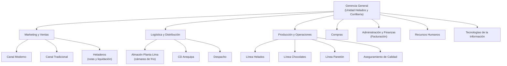

# 3. Aspectos generales

> **Estado:** versión final del Cierre (25/11/2026) · **Autora:** Evelyn (PO) · **Fuentes:** [01_alcance_escenario.md](../plan/01_alcance_escenario.md), [03_modulos_odoo.md](../plan/03_modulos_odoo.md) · **Revisa:** Orlando
>
> Leyenda de evidencia, igual que en el plan: **[V]** verificado con fuente · **[P]** reportado por una sola fuente o sin fecha clara · **[S]** supuesto académico. Las fuentes se citan en formato APA 7 y se listan en la [sección 9](09_referencias.md).
>
> Aviso: proyecto académico, no afiliado a Nestlé ni a D'Onofrio. Los datos de personas, clientes, precios y cifras operativas son ficticios (supuesto S2).

---

## 3.1 Definición del problema

**D'Onofrio** (helados, chocolates y panetón) opera con un negocio **estacional**, una red de distribución **muy atomizada** (miles de heladeros ambulantes) y productos **perecibles** que dependen de la cadena de frío. En el escenario del proyecto (corte 2026, supuesto S1) la información de cada área vive en herramientas separadas: hojas de cálculo, formatos en papel y correos (supuesto S7). Esto produce cuatro dificultades:

1. **Se pierde dinero y trazabilidad en la última milla.** La liquidación diaria de los heladeros se hace en papel o Excel, con descuadres y mermas que nadie puede rastrear hasta un lote.
2. **El producto vence sin que nadie lo vea a tiempo.** No hay control de vencimiento por lote ni despacho por FEFO (el que vence primero sale primero).
3. **La calidad y el frío no dejan rastro.** Temperaturas e inspecciones se anotan a mano y no se ligan al lote producido.
4. **La gerencia decide tarde y sin datos consolidados.** Ventas, almacén y producción digitan dos veces y no hay un reporte oportuno para planificar las campañas de verano (helados) y de Navidad (panetón).

**Problema central (enunciado):**

> ¿Cómo puede D'Onofrio, como unidad de helados y confitería, integrar sus procesos de ventas, logística, producción y gestión en un solo sistema, de modo que cada lote sea trazable desde la compra del insumo hasta el cliente y la gerencia vea datos confiables a tiempo, usando una plataforma abierta (Odoo 19 Community) y sin depender de licencias Enterprise?

**Solución propuesta:** un ERP sobre **Odoo 19.0 Community + PostgreSQL 16 en Docker**, en dos fases. La Fase 1 (garantizada) usa Odoo estándar configurado por código en el módulo `donofrio_base`; la Fase 2 agregó **cuatro módulos propios**, que se construyeron uno a uno y están publicados en las releases `v1.1.0` a `v1.4.0`: calidad (M1), liquidación de heladeros (M2), cadena de frío (M3) y tablero gerencial (M4) ([04 §4.3](../plan/04_scrum_pmbok.md) y los mini gates de [`docs/scrum/gates/`](../scrum/gates/)).

---

## 3.2 Descripción del problema

### 3.2.1 Situación actual y datos de la empresa

| Dato | Estado | Fuente |
|---|---|---|
| Fundada en 1897 por Pedro (Pietro) D'Onofrio, inmigrante italiano; empezó vendiendo helados en carretilla | [V] | Wikipedia (s. f.); Infomercado (2023); Mercado Negro (s. f.) |
| En 1919 los carritos se pintan de amarillo, color que se mantiene | [V] | Wikipedia (s. f.) |
| Fábrica de chocolates desde 1924 (Jr. Cotabambas) | [V] | Gestión (s. f.-a); Peru Retail (s. f.) |
| La fórmula del panetón llega de Italia en 1950 | [V] | Gestión (s. f.-a); Peru Retail (s. f.) |
| En los años 50 la planta pasa a la Av. Venezuela (unos 36 000 m²) | [V] | Gestión (s. f.-a); Peru Retail (s. f.) |
| Nestlé la compra en 1997 y mantiene la operación en la Av. Venezuela | [V] | Wikipedia (s. f.); Peru Retail (s. f.) |
| Según El Popular (2022), más de 6 000 heladeros y unos 400 helados por triciclo al día | [P] | El Popular (2022) |
| Según el CMA citado en LinkedIn (2024), el panetón D'Onofrio tiene cerca del 30 % de un mercado de unos US$ 125 millones al año | [P] | El Comercio (s. f.); el post de LinkedIn que cita al CMA no tiene enlace verificado |
| Feb-2026: Nestlé anuncia negociaciones avanzadas para vender su negocio global de helados a Froneri; transición de 12 a 18 meses | [V] | Infobae (2026); El Comercio (2026) |
| Jun-2026: Froneri inicia el registro de su denominación y logotipo ante Indecopi; no confirma cambio de dueño | [V] | Peru Retail (2026); Mercado Negro (2026) |

**Giro.** Fabricación y comercialización de helados, chocolates y panetón, con venta por canal moderno (autoservicios), canal tradicional (bodegas y distribuidores), punto de venta propio y heladeros concesionarios.

**Escenario modelado** (supuestos S1 y S6): *D'Onofrio – Unidad de Helados y Confitería (proyecto académico)*, unidad de negocio de Nestlé Perú con corte en 2026, dos sedes: **Planta Lima** (Av. Venezuela) y **CD Arequipa** (centro de distribución regional abastecido desde Lima). La venta del negocio de helados a Froneri se menciona como riesgo y oportunidad del entorno, pero **no se modela** porque para Perú no hay nada confirmado.

**Estacionalidad** (eje del caso de negocio):

| Línea | Temporada alta | Consecuencia para el ERP |
|---|---|---|
| Helados | Verano, diciembre a marzo [S] | Producción anticipada, stock en cámara de congelación, más heladeros y rutas |
| Panetón | Campaña de Navidad, octubre a diciembre [V] | Producción por lotes de vencimiento corto y listas de precios de campaña |
| Chocolates | Todo el año, con picos en fechas comerciales [S] | Producción continua y FEFO por vencimiento |

Helados en verano y panetón en Navidad permiten aprovechar la misma planta, almacenes y fuerza de distribución todo el año.

### 3.2.2 Áreas y organigrama

Las áreas del ERP son las cinco que piden los lineamientos: **Marketing y Ventas**, **Logística y Distribución**, **Producción y Operaciones**, **Gerencia** y **Extras** (Compras, Administración y Finanzas, Recursos Humanos y TI).

El organigrama está cargado en Odoo (módulo RR. HH., HU-05) y se exporta desde la vista de organigrama. Evidencia:

- Empleados: [HU-05_organigrama_empleados.png](../capturas/sprint-1/HU-05_organigrama_empleados.png)
- Departamentos: [HU-05_organigrama_departamentos.png](../capturas/sprint-1/HU-05_organigrama_departamentos.png)

### 3.2.3 Trabajadores y responsabilidades

Son 21 empleados **ficticios** (supuesto S2), los mismos que carga `donofrio_base`. Diez de ellos tienen usuario en el ERP según su rol (HU-04). Los heladeros **no** son empleados: son concesionarios que compran a precio de heladero y liquidan cada día (supuesto S4), por eso se modelan como contactos y no aparecen aquí.

| Área | Puesto | Persona (ficticia) | Responsabilidad principal | Usuario ERP |
|---|---|---|---|---|
| Gerencia General | Gerente General | Marco Antonio Salazar Quispe | Dirige la unidad, aprueba presupuestos y decide con los indicadores | Sí |
| Marketing y Ventas | Jefe de Marketing y Ventas | Lucía Fernández Rojas | Define precios y campañas, supervisa los tres canales | Sí |
| Canal Moderno | Vendedor de Canal Moderno | Carlos Mamani Huanca | Cotiza y cierra pedidos con autoservicios | Sí |
| Canal Moderno | Cajero de Punto de Venta | Julio Cárdenas Ibáñez | Vende en la tienda de planta y cierra caja | Sí |
| Canal Tradicional | Ejecutivo de Canal Tradicional | Rosa Condori Apaza | Atiende bodegas y distribuidores regionales | No |
| Heladeros | Supervisor de Heladeros | Jorge Paredes Cáceres | Organiza rutas y reclutamiento de heladeros | No |
| Heladeros | Liquidador de Heladeros | Elena Ccori Mendoza | Liquida a cada heladero al final del día | Sí |
| Logística y Distribución | Jefe de Almacén | Miguel Torres Vega | Responde por existencias, lotes y despachos | Sí |
| Almacén Planta Lima | Encargado de Almacén | Diana Huamán Flores | Recibe insumos y prepara despachos en Lima | No |
| CD Arequipa | Encargado de Almacén | Pedro Choque Vilca | Recibe transferencias y despacha en Arequipa | No |
| Despacho | Coordinador de Despacho | Walter Quispe Ramos | Programa salidas de triciclos y reparto | No |
| Producción y Operaciones | Jefe de Producción | Ana Gutiérrez Luna | Planifica y ejecuta las órdenes de producción | Sí |
| Línea Helados | Técnico de Línea de Producción | Luis Rivera Medina | Opera la línea de helados | No |
| Línea Chocolates | Técnico de Línea de Producción | Sofía Delgado Pinto | Opera la línea de chocolates | No |
| Línea Panetón | Técnico de Línea de Producción | Raúl Ñahui Mayta | Opera la línea de panetón | No |
| Aseguramiento de Calidad | Inspector de Calidad | Patricia Vargas Ledesma | Inspecciona puntos de control y lotes | Sí |
| Compras | Comprador | Héctor Palomino Ruiz | Cotiza y emite órdenes de compra de insumos | Sí |
| Administración y Finanzas | Contador | Marisol Chávez Torres | Controla facturación, IGV y cobranzas | Sí |
| Administración y Finanzas | Asistente de Facturación | Camila Núñez Arce | Emite facturas y boletas | No |
| Recursos Humanos | Jefa de Recursos Humanos | Verónica Ramos Soto | Mantiene organigrama, puestos y empleados | No |
| Tecnologías de la Información | Analista de TI | Andrés Zegarra Bellido | Soporte, accesos y mesa de servicios | No |

### 3.2.4 Problemas y oportunidades (tabla 1 de la plantilla)

Todos los problemas son **supuestos AS-IS** (S7). El estado final es el del 25/11/2026, con la Fase 2 completa ([02 §2.3](../plan/02_mapeo_plantilla.md)); la última columna conserva el estado que había solo con la Fase 1 para que se vea qué aportó cada módulo.

| ID | Problema empresarial | Oportunidad | Tecnología propuesta | Con solo la Fase 1 | Estado final (25/11/2026) |
|---|---|---|---|---|---|
| 1 | La liquidación diaria de los heladeros se hace en papel o Excel, con descuadres y mermas no trazadas | Automatización | `donofrio_heladeros` (F2-M2); en la F1, pedido de venta + devolución estándar | Propuesta | **Resuelto** (M2, `v1.2.0`) |
| 2 | El vencimiento de lotes no se controla y el despacho no sigue FEFO | Integración en tiempo real | Inventario Odoo con lotes y `product_expiry` | Resuelto | **Resuelto** |
| 3 | Las temperaturas de las cámaras se anotan a mano y las alertas llegan tarde | Digitalización y alertas | Cadena de frío en `donofrio_calidad` (F2-M3) | Propuesta | **Resuelto** (M3, `v1.3.0`; lecturas a mano, sin sensores) |
| 4 | Las inspecciones de calidad están en papel y no se ligan al lote | Trazabilidad | `donofrio_calidad` + MRP (F2-M1); en la F1, lotes y trazabilidad estándar | Propuesta | **Resuelto** (M1, `v1.1.0`) |
| 5 | La planificación de campañas se hace sin datos consolidados | Analítica | Dashboards estándar y vistas pivote (F1) + tablero OWL (F2-M4) | Resuelto | **Resuelto y reforzado** (M4, `v1.4.0`) |
| 6 | Ventas, almacén y producción usan sistemas separados y digitan dos veces | Integración de sistemas | ERP Odoo 19 único sobre PostgreSQL | Resuelto | **Resuelto** |
| 7 | La gerencia no tiene reportes oportunos | Analítica (BI) | Dashboards estándar de Odoo | Resuelto | **Resuelto** (más el tablero propio de M4) |

### 3.2.5 Supuestos académicos

| # | Supuesto | Por qué |
|---|---|---|
| S1 | Fecha de corte 2026, operación normal bajo Nestlé Perú | La transición a Froneri no está confirmada para Perú |
| S2 | Datos maestros ficticios pero verosímiles | No hay acceso a datos internos; se cumple la Ley 29733 |
| S3 | Nombres de productos inspirados en marcas públicas; recetas, precios y vida útil estimados | Solo dan realismo a la demo |
| S4 | Los heladeros son concesionarios que compran a precio de heladero y liquidan a diario | No hay un modelo de comisión público |
| S5 | Helado almacenado a −18 °C o menos; insumos lácteos entre 2 y 6 °C | Rangos usados por la cadena de frío |
| S6 | CD Arequipa se abastece desde la Planta Lima | Permite mostrar transferencias entre almacenes |
| S7 | Situación actual: Excel y registros manuales; sistemas separados por área | Base del AS-IS |
| S8 | Un solo servidor (contenedores) más una réplica de base de datos | Suficiente para el alcance académico |
| S9 | Moneda PEN, IGV 18 %, idioma es_PE y zona horaria America/Lima | Contexto peruano |

---

## 3.3 Visión

> **Propuesta académica (redacción propia).** Ser la unidad de helados y confitería que llega fresca y a tiempo a cada rincón del país, con cada lote trazable de la compra del insumo hasta el cliente y decisiones tomadas con datos del día.

Se inspira en el propósito público de Nestlé de aprovechar el poder de los alimentos para mejorar la calidad de vida (Nestlé India, s. f.). No es la visión oficial de D'Onofrio ni de Nestlé.

## 3.4 Misión

> **Propuesta académica (redacción propia).** Elaborar y distribuir helados, chocolates y panetón de calidad, cuidando la cadena de frío y el vencimiento de cada lote, apoyados en un sistema integrado que conecta ventas, almacenes, producción y gerencia, y que acompaña tanto al canal moderno como al heladero de cada triciclo.

---

## 3.5 Entorno

### 3.5.1 Análisis PESTEL

| Factor | Elementos relevantes para la unidad | Efecto en el ERP |
|---|---|---|
| **Político** | Estabilidad y política comercial del país [S]; la transición de Nestlé a Froneri en helados anunciada en feb-2026 depende de decisiones corporativas fuera de Perú [V] | Se declara como riesgo; el ERP no modela la transición |
| **Económico** | Estacionalidad marcada (verano e invierno, campaña navideña); mercado de panetón de unos US$ 125 millones al año [P]; precios de insumos lácteos y cacao [S] | Listas de precios por temporada y análisis por línea, canal y mes |
| **Social** | Marca de arraigo histórico [V] y heladeros como figura popular [S]; consumidores atentos a la alimentación saludable [S] | Trato diferenciado al canal heladero; datos para campañas |
| **Tecnológico** | Comprobantes electrónicos obligatorios (SUNAT) (Superintendencia Nacional de Aduanas y de Administración Tributaria [SUNAT], s. f.); el EDI `l10n_pe_edi` es Enterprise [V] | Facturación con `l10n_pe` y limitación declarada: sin envío a SUNAT |
| **Ecológico** | Consumo de energía de las cámaras de frío y manejo de residuos de empaque [S] | Registro de temperaturas y mermas como base de mejora |
| **Legal** | Ley 29733 de Protección de Datos Personales (Congreso de la República del Perú, 2011); Código de Protección y Defensa del Consumidor (Ley 29571) (Congreso de la República del Perú, 2010); Ley 30021 de promoción de la alimentación saludable (advertencias en alimentos) (Congreso de la República del Perú, 2013); vigilancia sanitaria de alimentos y HACCP (D. S. 007-98-SA) (Ministerio de Salud, 1998); IGV 18 % | Datos ficticios, trazabilidad de lotes, controles de calidad y tributación con IGV |

### 3.5.2 Cinco fuerzas de Porter

| Fuerza | Nivel | Análisis |
|---|---|---|
| Rivalidad entre competidores | **Alta** | Helados y panetón compiten con marcas de Alicorp/Lamborgini y Gloria y con panaderías y heladerías artesanales [S]; la mención de Alicorp y Lamborgini se apoya en Gestión (s. f.-a) y la de Gloria es un supuesto [S]; en chocolates Nestlé Perú tendría cerca de la mitad del mercado [P] |
| Amenaza de nuevos entrantes | Media | Marcas artesanales y *delivery* entran con poca inversión, pero la red de distribución y las cámaras de frío son una barrera [S] |
| Poder de negociación de los clientes | Media-alta | Los autoservicios negocian precio y condiciones; las bodegas y los heladeros tienen menos poder individual [S] |
| Poder de negociación de los proveedores | Media | Lácteos, cacao y harina dependen de pocos proveedores y de precios internacionales [S] |
| Amenaza de productos sustitutos | Media | Postres caseros, paletas artesanales y otros snacks [S] |

**Caso Froneri.** Si el negocio de helados pasa a Froneri (transición esperada de 12 a 18 meses desde feb-2026, traspaso en 2027 según la prensa [P]), la unidad podría perder la línea de helados que da el pico de verano. Por eso el diseño separa líneas de producto y canales, de modo que el ERP siga útil con chocolates y panetón.

---

## 3.6 Estrategia empresarial

### 3.6.1 Análisis FODA

| | **Positivo** | **Negativo** |
|---|---|---|
| **Interno** | **Fortalezas** · Marca histórica desde 1897 [V] · Red de heladeros muy extendida [P] · Planta propia en la Av. Venezuela [V] · Portafolio complementario (verano y Navidad) [V] | **Debilidades** · Procesos en Excel y papel [S7] · Sin control de vencimiento por lote [S7] · Liquidación de heladeros manual [S7] · Sistemas separados por área [S7] |
| **Externo** | **Oportunidades** · ERP abierto sin licencias Enterprise [V] · Datos para planificar campañas · Exportaciones de chocolates [V] · Trazabilidad como diferencial de calidad | **Amenazas** · Venta de helados a Froneri [V] · Precios de insumos [S] · Competidores con mayor distribución [S] · Normativa sanitaria y de etiquetado (Congreso de la República del Perú, 2013; Ministerio de Salud, 1998) |

### 3.6.2 Estrategias cruzadas

| Tipo | Estrategia | Se apoya en |
|---|---|---|
| **FO** (fortaleza + oportunidad) | Usar los datos de ventas por canal y temporada para anticipar la producción de verano y de Navidad con la red de heladeros existente | Dashboards y vistas pivote (HU-23) |
| **FO** | Aprovechar la marca histórica con trazabilidad completa del lote como argumento de calidad | Lotes y FEFO (HU-11) |
| **DO** (debilidad + oportunidad) | Reemplazar Excel y papel por un solo ERP que registre ventas, stock y producción una sola vez | Odoo 19 + `donofrio_base` |
| **DO** | Digitalizar la liquidación de heladeros para detectar descuadres y mermas | Pedido + devolución estándar (F1); `donofrio_heladeros` (M2, implementado) |
| **FA** (fortaleza + amenaza) | Diversificar entre helados, chocolates y panetón para amortiguar el riesgo de perder la línea de helados | Costeo y análisis por línea |
| **DA** (debilidad + amenaza) | Controlar vencimientos y temperaturas para evitar pérdidas ante precios altos de insumos | Alertas de vencimiento (F1); cadena de frío (M3, implementada) |

### 3.6.3 Estacionalidad complementaria

La demanda de helados sube en verano y la de panetón en Navidad. La estrategia es **producir helado en invierno con anticipación** (cámara de congelación) y **liberar capacidad de la línea de helados para el panetón** al acercarse la campaña de Navidad, usando las mismas instalaciones y la misma fuerza de distribución todo el año. El ERP lo apoya con listas de precios por campaña y reportes por mes.

### 3.6.4 Cascada de metas de COBIT 2019

COBIT 2019 se usa como **marco de referencia** para pasar de lo que necesita la gerencia a lo que el proyecto construye: *necesidad del interesado → meta empresarial (EG) → meta de alineamiento de TI (AG) → objetivo de gestión → componente del ERP*. No se hace evaluación de capacidad ni de madurez: queda fuera del alcance. Las necesidades salen de [1.6 del plan](../plan/01_alcance_escenario.md) y del análisis de interesados (`docs/pm/interesados.md`); la columna final dice **dónde está la evidencia** en este repositorio.

| Necesidad de la gerencia de D'Onofrio | Meta empresarial (EG) | Meta de alineamiento (AG) | Objetivos de gestión | Cómo lo atiende el proyecto (evidencia) |
|---|---|---|---|---|
| Integrar ventas, almacén y producción, y liquidar a los heladeros sin errores | **EG08** Optimización de la funcionalidad de los procesos internos | **AG08** Habilitar y soportar los procesos integrando aplicaciones y tecnología | **BAI03** Gestionar la identificación y construcción de soluciones | Odoo estándar configurado por código en `donofrio_base`, construido con Scrum; ciclo vender-comprar-producir-facturar probado de punta a punta (HU-33). La liquidación del heladero es la Fase 2 |
| Que el sistema esté disponible en temporada alta | **EG06** Continuidad y disponibilidad del servicio | **AG05** Entrega de servicios de I&T alineada con el negocio | **APO09** Acuerdos de servicio · **DSS01** Operaciones · **DSS04** Continuidad | Tablas de SLA (4.7.3); despliegue con Nginx y TLS; réplica en caliente (HU-25); respaldos y restauración con RTO medido de 31 s (HU-26) |
| Proteger la información de clientes y de la operación | **EG02** Riesgo de negocio gestionado · **EG03** Cumplimiento de leyes externas | **AG02** Riesgo de I&T gestionado · **AG07** Seguridad de la información y privacidad · **AG01** Cumplimiento | **APO12** Riesgo · **APO13** Seguridad · **DSS05** Servicios de seguridad | Registro de riesgos (`docs/pm/plan_riesgos.md`); seguridad del despliegue: 2FA, política de contraseñas, TLS y auditoría (HU-27); ZAP sin alertas altas (HU-28); datos ficticios por la Ley 29733 |
| Cambiar el sistema sin romper la operación | **EG08** | **AG06** Agilidad para convertir requerimientos en soluciones operativas | **BAI06** Cambios de TI · **DSS02** Solicitudes e incidentes · **DSS03** Problemas | Todo cambio entra por PR con CI y revisión del otro integrante (anexo 10.4); *release* automática (HU-29); mesa de servicios en Project (HU-32, anexos 10.3 y 10.5); plantilla `bug.yml` para registrar problemas |
| Decidir con datos | **EG07** Calidad de la información de gestión | **AG10** Calidad de la información de gestión de I&T | **MEA01** Supervisar el desempeño y la conformidad | Dashboards estándar y vistas guardadas (HU-23); KPI y SLA en 4.7; pruebas de carga y de rendimiento (HU-28) |

**Los 11 objetivos de gestión** que usa el proyecto son APO09, APO12, APO13, BAI03, BAI06, DSS01, DSS02, DSS03, DSS04, DSS05 y MEA01. El mapa inverso (qué componente del ERP o de la infraestructura soporta cada objetivo) está en 4.1.3.

**Lo que la cascada no cubre.** La Fase 2 (calidad, heladeros, cadena de frío y tablero propio) ya está implementada y atiende con más detalle la necesidad de integrar procesos (fila 1); lo que queda fuera son los envíos electrónicos a SUNAT y los sensores, que van como trabajo futuro ([8](08_recomendaciones.md)). COBIT es aquí una guía de alineamiento y no una auditoría.

---

## 3.7 Planificación empresarial

Los objetivos estratégicos se organizan en un **Cuadro de Mando Integral sencillo** y se ligan a indicadores que el ERP puede calcular. Cada indicador se enlaza con la cascada de COBIT de [3.6.4](#364-cascada-de-metas-de-cobit-2019): los de ventas y producción alimentan MEA01; los de continuidad, APO09 y DSS04. Las metas son **supuestos académicos** para la demo.

| Perspectiva | Objetivo estratégico | Indicador (KPI) | Meta [S] | De dónde sale en el ERP | RF |
|---|---|---|---|---|---|
| Financiera | Crecer la venta por canal y temporada | Ventas del mes por canal y línea | +10 % frente al mismo mes del año anterior | Pivote de ventas (`ir.filters`) y dashboard de ventas | RF013, RF014 |
| Financiera | Reducir pérdidas por vencimiento | Valor del stock vencido o por vencer a 30 días | < 2 % del inventario | Reporte de lotes por vencer (`product_expiry`) | RF006 |
| Cliente | Cumplir los pedidos a tiempo | Pedidos entregados a tiempo | ≥ 95 % | Entregas y fechas comprometidas | RF002, RF007 |
| Cliente | Atender bien al canal heladero | Descuadre de liquidación por heladero | < 2 % del despachado | Liquidación del heladero (M2; en la F1, pedido + devolución) | RF004 |
| Procesos internos | Trazar todos los lotes | Lotes de terminado con trazabilidad completa | 100 % | Trazabilidad de lotes | RF006, RF010 |
| Procesos internos | Producir según el plan | Cumplimiento de las órdenes de producción | ≥ 90 % | Órdenes de producción (MRP) | RF010 |
| Aprendizaje y crecimiento | Datos de personal y roles al día | Empleados con puesto, jefe y usuario por rol | 100 % de los usuarios del ERP con empleado | RR. HH. y usuarios (HU-04, HU-05) | RF017, RF018 |
| Aprendizaje y crecimiento | Que los usuarios usen el sistema sin ayuda | Puntaje de usabilidad (SUS) | ≥ 70 | Prueba con 5 usuarios (HU-30) **[PENDIENTE: resultados de HU-30]** | RNF003 |

---

## Fuentes

Las referencias completas de esta sección están en la [sección 9](09_referencias.md); lo que aún falta verificar (un dato con una sola fuente y los competidores de Porter) está en su apartado 9.4.

> Las metas de la sección 3.7, las clasificaciones de nivel de las cinco fuerzas y los efectos ecológicos y sociales son **juicios del equipo** (supuestos), no datos de la empresa.
