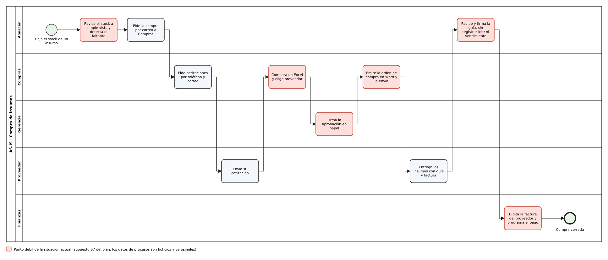

# 4.1 Planificación: análisis de sistemas y procesos AS-IS

> **Estado:** borrador del Sprint 1 · **Autora:** Evelyn (PO) · **Revisa:** Orlando · **Fuente:** [02 §2.2](../plan/02_mapeo_plantilla.md), [01 §1.3 y §1.6](../plan/01_alcance_escenario.md)
>
> **Todo lo de esta sección es un supuesto académico (S7):** no hay acceso a los sistemas internos de D'Onofrio. La situación actual se reconstruye de forma verosímil a partir de prácticas comunes de la industria y de las fuentes públicas del plan.

## 4.1.1 Análisis de sistemas

Sistemas y herramientas que se asumen en uso, por área, y las brechas que justifican el ERP.

| Área | Herramienta o sistema actual (supuesto) | Qué se hace con ella | Brechas detectadas | Cómo las cubre el ERP |
|---|---|---|---|---|
| **Marketing y Ventas** | Hojas de Excel por vendedor, correo y llamadas | Registrar clientes, pedidos y cotizaciones; seguimiento de prospectos | No hay embudo único ni historial por cliente; los precios por canal y temporada se manejan a mano; el pedido se digita de nuevo en facturación | CRM, Ventas y listas de precios por canal y temporada (RF001, RF002) |
| **Punto de venta** | Caja registradora o libro de ventas | Vender en la tienda de planta | La venta no descuenta stock ni llega a facturación | Punto de Venta con boleta (RF003) |
| **Heladeros** | Cuaderno y vales de papel, hoja de Excel | Entregar helados por la mañana y liquidar por la tarde | Descuadres, mermas sin trazar, liquidación lenta y sin vínculo con el lote ni con el pedido | Pedido de venta + devolución (F1); liquidación propia (F2) (RF004) |
| **Logística y almacén** | Kárdex en Excel, guías de remisión en papel, revisión visual de fechas | Controlar entradas, salidas y vencimientos | No hay lote ni fecha de vencimiento en el sistema; el despacho no sigue FEFO; la transferencia a Arequipa se coordina por teléfono | Inventario con lotes, `product_expiry`, FEFO y ruta Lima → Arequipa (RF005 a RF007) |
| **Cadena de frío** | Planilla en papel con la temperatura de cada cámara | Registrar la temperatura a mano | Las alertas llegan tarde; no hay historial por ubicación | F2-M3 (RF008); en la F1, rangos en el nombre de la ubicación |
| **Producción** | Fórmulas en Excel y órdenes impresas | Programar y registrar lo producido | Las recetas no consumen insumos del inventario; el lote producido no queda ligado a sus insumos | MRP con recetas, órdenes de producción y lote (RF009, RF010) |
| **Calidad** | Formatos de inspección en papel | Anotar mediciones y aprobar lotes | La inspección no se vincula al lote ni bloquea el despacho | F2-M1 (RF011, RF012); en la F1, lotes y trazabilidad estándar |
| **Compras** | Correo, llamadas y órdenes en Word o Excel | Cotizar, aprobar y ordenar insumos | No hay reabastecimiento automático por mínimo y máximo; la recepción no se compara con la orden | Compras con reglas mín./máx. y recepción desde la OC (RF015) |
| **Finanzas y facturación** | Sistema contable aislado y digitación manual | Emitir facturas y boletas, registrar compras | Doble digitación; IGV y tipos de documento dependen de la persona | Facturación con `l10n_pe` (RF016). Sin envío a SUNAT: el EDI es Enterprise |
| **Recursos Humanos** | Excel de planilla y organigrama en un documento | Mantener la lista de personal | El organigrama se desactualiza; no se liga con los usuarios del sistema | Empleados, puestos y organigrama en Odoo; usuarios por rol (RF017, RF018) |
| **Gerencia** | Reportes armados a mano al cierre del mes | Revisar ventas y producción | Los datos llegan tarde y son inconsistentes entre áreas | Dashboards estándar y vistas pivote (F1); tablero OWL (F2-M4) (RF013, RF014) |
| **TI** | Correo y mensajería para pedir soporte | Atender solicitudes | No hay registro ni plazo de atención | Mesa de servicios en Project con tipos ITIL (HU-32) |

### Resumen de brechas

1. **Información dispersa.** Cada área tiene su propia herramienta y los datos se digitan dos o más veces (problema 6 de la tabla 1).
2. **Sin trazabilidad de lote.** Ni el vencimiento ni la calidad quedan ligados al lote (problemas 2 y 4).
3. **Procesos manuales en la última milla.** La liquidación de heladeros y el registro de temperaturas dependen del papel (problemas 1 y 3).
4. **Decisiones tardías.** La gerencia no ve datos consolidados a tiempo (problemas 5 y 7).

---

## 4.1.2 Procesos AS-IS (BPMN)

Los diagramas se editan en **bpmn.io** (archivo `.bpmn`) y se exportan a PNG. Los tres primeros son de Evelyn (Sprint 1); los dos últimos son de Orlando. Se muestran los procesos **tal como se supone que funcionan hoy** (S7). Los TO-BE en Odoo se hacen en el Sprint 2.

| # | Proceso AS-IS | Responsable | Archivo | Estado |
|---|---|---|---|---|
| 1 | Venta a cliente B2B (autoservicio o distribuidor) | Evelyn | [as-is_venta_b2b.png](../diagramas/bpmn/as-is_venta_b2b.png) · [.bpmn](../diagramas/bpmn/as-is_venta_b2b.bpmn) | Borrador S1 |
| 2 | Liquidación diaria del heladero | Evelyn | [as-is_liquidacion_heladero.png](../diagramas/bpmn/as-is_liquidacion_heladero.png) · [.bpmn](../diagramas/bpmn/as-is_liquidacion_heladero.bpmn) | Borrador S1 |
| 3 | Compra de insumos | Evelyn | [as-is_compras_insumos.png](../diagramas/bpmn/as-is_compras_insumos.png) · [.bpmn](../diagramas/bpmn/as-is_compras_insumos.bpmn) | Borrador S1 |
| 4 | Producción y calidad | Orlando | Pendiente | S1 (Orlando) |
| 5 | Recepción y despacho con cadena de frío | Orlando | Pendiente | S1 (Orlando) |

### 1. Venta a cliente B2B

El vendedor recibe el pedido por correo o teléfono y lo anota en Excel. El jefe de ventas aprueba el precio y las condiciones por correo. Facturación vuelve a digitar el pedido para emitir la factura y el almacén prepara el despacho con una hoja impresa. No se verifica el vencimiento de los lotes y la factura no se concilia con lo entregado. Puntos débiles: doble digitación, aprobación sin registro y despacho sin FEFO.

### 2. Liquidación diaria del heladero

El heladero recoge su carga con un vale de papel y sale a la ruta. Al volver, el liquidador cuenta lo devuelto y calcula a mano lo vendido; si el efectivo no cuadra con el cálculo, el descuadre se anota en un cuaderno y se descuenta al día siguiente. Se pasa a Excel al cierre. Puntos débiles: descuadres sin causa, mermas no trazadas y ningún vínculo con el lote ni con el pedido.

### 3. Compra de insumos

El almacén detecta un faltante por revisión visual y lo pide por correo a Compras. Compras cotiza por teléfono y correo a varios proveedores y compara en Excel; la aprobación de la gerencia es una firma en papel. La orden se emite en Word, el proveedor entrega y el almacén recibe sin registrar lote ni vencimiento. Finanzas digita la factura del proveedor. Puntos débiles: sin reabastecimiento automático, recepción sin comparar con la orden y sin lote.

> En los diagramas, las tareas en **rojo claro** marcan los puntos débiles de la situación actual. Siguen la notación BPMN 2.0 (carriles por rol, eventos de inicio y fin, tareas y compuertas exclusivas). Se generan con [`docs/diagramas/generar_bpmn.py`](../diagramas/generar_bpmn.py) para que el diseño sea reproducible y se pueden abrir y retocar en bpmn.io.
