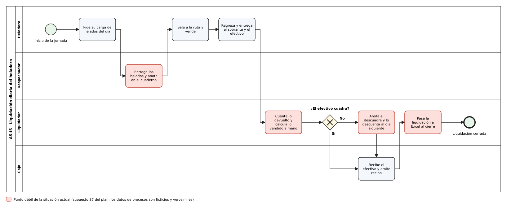
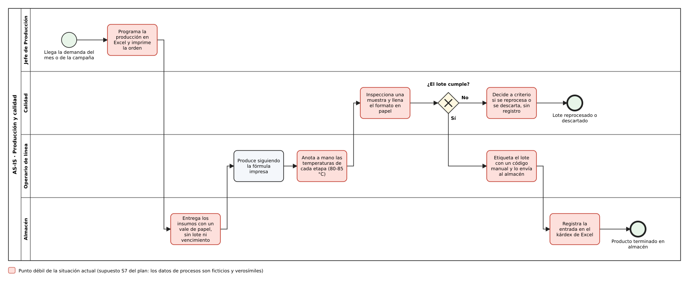
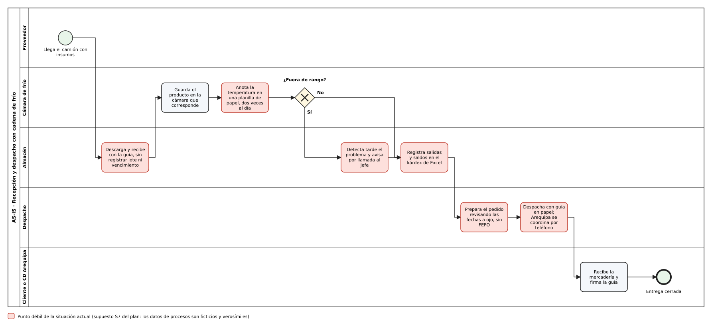
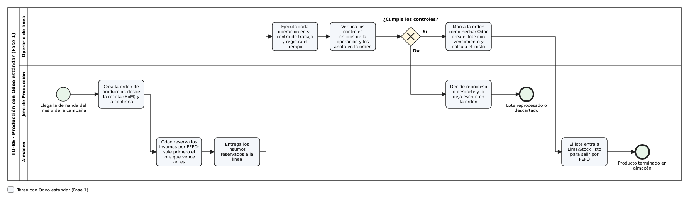
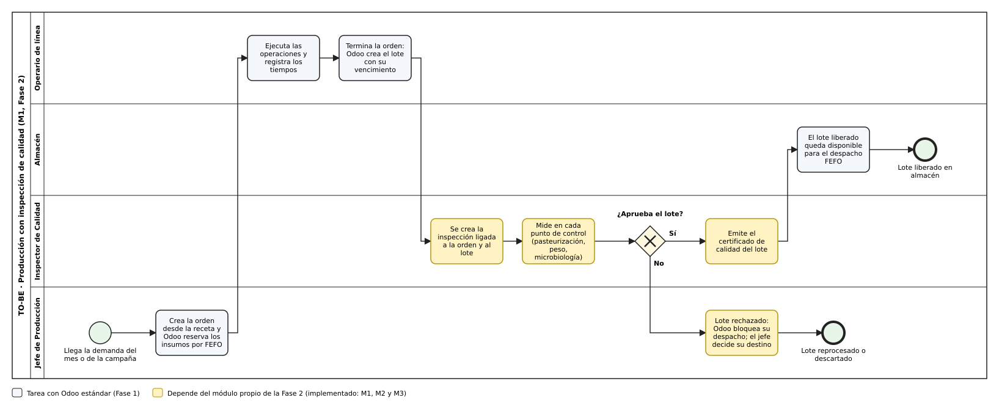
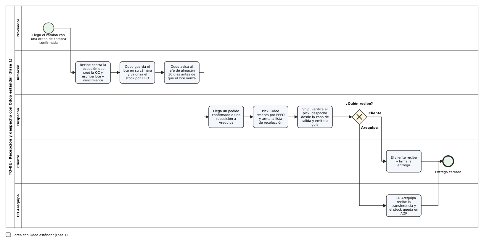
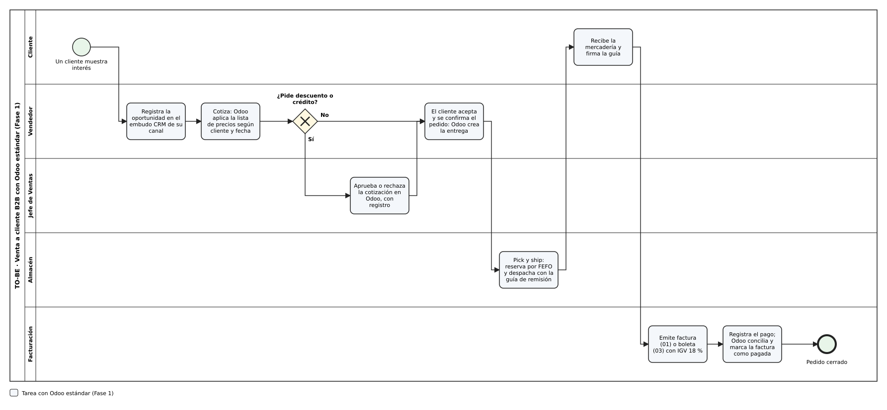
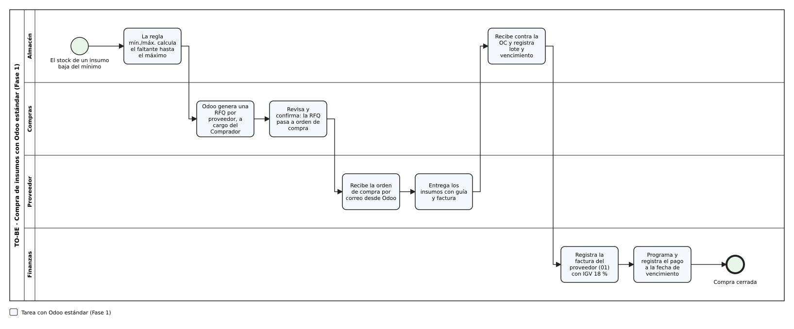
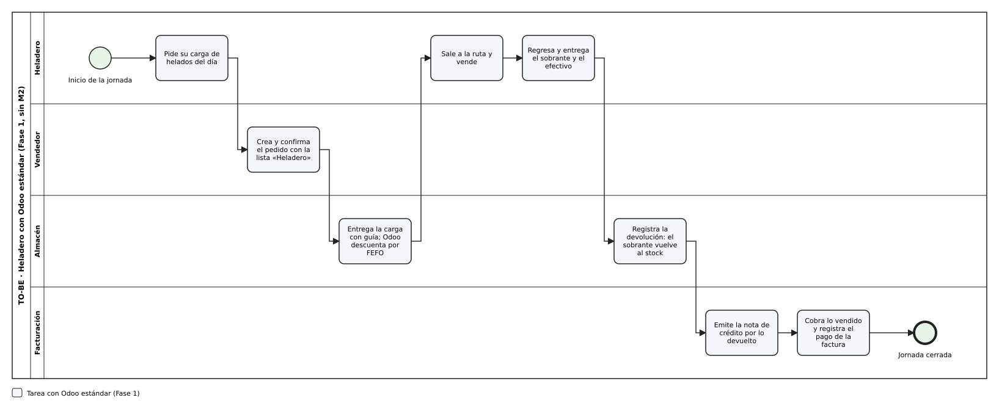
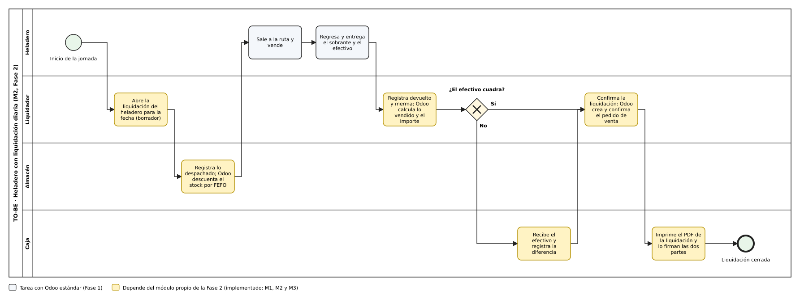

# 4.1 Planificación: análisis de sistemas y procesos AS-IS

> **Estado:** versión final del Cierre (25/11/2026) · **Autora:** Evelyn (PO) · **Revisa:** Orlando · **Fuente:** [02 §2.2](../plan/02_mapeo_plantilla.md), [01 §1.3 y §1.6](../plan/01_alcance_escenario.md)
>
> **Todo lo de esta sección es un supuesto académico (S7):** no hay acceso a los sistemas internos de D'Onofrio. La situación actual se reconstruye de forma verosímil a partir de prácticas comunes de la industria y de las fuentes públicas del plan.

## 4.1.1 Análisis de sistemas

Sistemas y herramientas que se asumen en uso, por área, y las brechas que justifican el ERP.

| Área | Herramienta o sistema actual (supuesto) | Qué se hace con ella | Brechas detectadas | Cómo las cubre el ERP |
|---|---|---|---|---|
| **Marketing y Ventas** | Hojas de Excel por vendedor, correo y llamadas | Registrar clientes, pedidos y cotizaciones; seguimiento de prospectos | No hay embudo único ni historial por cliente; los precios por canal y temporada se manejan a mano; el pedido se digita de nuevo en facturación | CRM, Ventas y listas de precios por canal y temporada (RF001, RF002) |
| **Punto de venta** | Caja registradora o libro de ventas | Vender en la tienda de planta | La venta no descuenta stock ni llega a facturación | Punto de Venta con boleta (RF003) |
| **Heladeros** | Cuaderno y vales de papel, hoja de Excel | Entregar helados por la mañana y liquidar por la tarde | Descuadres, mermas sin trazar, liquidación lenta y sin vínculo con el lote ni con el pedido | Pedido de venta + devolución (F1); liquidación propia (F2) (RF004) |
| **Logística y almacén** | Kárdex en Excel, guías de remisión en papel, revisión visual de fechas | Controlar entradas, salidas y vencimientos | No hay lote ni fecha de vencimiento en el sistema; el despacho no sigue FEFO; la transferencia a Arequipa se coordina por teléfono | Inventario con lotes, `product_expiry`, FEFO y ruta Lima → Arequipa (RF005 a RF007) |
| **Cadena de frío** | Planilla en papel con la temperatura de cada cámara | Registrar la temperatura a mano | Las alertas llegan tarde; no hay historial por ubicación | F2-M3 (RF008); en la F1, rangos en el nombre de la ubicación |
| **Producción** | Fórmulas en Excel y órdenes impresas | Programar y registrar lo producido | Las recetas no consumen insumos del inventario; el lote producido no queda ligado a sus insumos | MRP con recetas, órdenes de producción y lote (RF009, RF010) |
| **Calidad** | Formatos de inspección en papel | Anotar mediciones y aprobar lotes | La inspección no se vincula al lote ni bloquea el despacho | F2-M1 (RF011, RF012); en la F1, lotes y trazabilidad estándar |
| **Compras** | Correo, llamadas y órdenes en Word o Excel | Cotizar, aprobar y ordenar insumos | No hay reabastecimiento automático por mínimo y máximo; la recepción no se compara con la orden | Compras con reglas mín./máx. y recepción desde la OC (RF015) |
| **Finanzas y facturación** | Sistema contable aislado y digitación manual | Emitir facturas y boletas, registrar compras | Doble digitación; IGV y tipos de documento dependen de la persona | Facturación con `l10n_pe` (RF016). Sin envío a SUNAT: el EDI es Enterprise |
| **Recursos Humanos** | Excel de planilla y organigrama en un documento | Mantener la lista de personal | El organigrama se desactualiza; no se liga con los usuarios del sistema | Empleados, puestos y organigrama en Odoo; usuarios por rol (RF017, RF018) |
| **Gerencia** | Reportes armados a mano al cierre del mes | Revisar ventas y producción | Los datos llegan tarde y son inconsistentes entre áreas | Dashboards estándar y vistas pivote (F1); tablero OWL (F2-M4) (RF013, RF014) |
| **TI** | Correo y mensajería para pedir soporte | Atender solicitudes | No hay registro ni plazo de atención | Mesa de servicios en Project con tipos ITIL (HU-32) |

### Resumen de brechas

1. **Información dispersa.** Cada área tiene su propia herramienta y los datos se digitan dos o más veces (problema 6 de la tabla 1).
2. **Sin trazabilidad de lote.** Ni el vencimiento ni la calidad quedan ligados al lote (problemas 2 y 4).
3. **Procesos manuales en la última milla.** La liquidación de heladeros y el registro de temperaturas dependen del papel (problemas 1 y 3).
4. **Decisiones tardías.** La gerencia no ve datos consolidados a tiempo (problemas 5 y 7).

---

## 4.1.2 Procesos AS-IS (BPMN)

Los diagramas se editan en **bpmn.io** (archivo `.bpmn`) y se exportan a PNG. Los tres primeros son de Evelyn y los dos últimos de Orlando (Sprint 1). Se muestran los procesos **tal como se supone que funcionan hoy** (S7). Los TO-BE en Odoo de producción y de recepción y despacho (Orlando) están al final de esta sección (Sprint 2); los de ventas, heladeros y compras los agrega Evelyn.

| # | Proceso AS-IS | Responsable | Archivo | Estado |
|---|---|---|---|---|
| 1 | Venta a cliente B2B (autoservicio o distribuidor) | Evelyn | [as-is_venta_b2b.png](../diagramas/bpmn/as-is_venta_b2b.png) · [.bpmn](../diagramas/bpmn/as-is_venta_b2b.bpmn) | Borrador S1 |
| 2 | Liquidación diaria del heladero | Evelyn | [as-is_liquidacion_heladero.png](../diagramas/bpmn/as-is_liquidacion_heladero.png) · [.bpmn](../diagramas/bpmn/as-is_liquidacion_heladero.bpmn) | Borrador S1 |
| 3 | Compra de insumos | Evelyn | [as-is_compras_insumos.png](../diagramas/bpmn/as-is_compras_insumos.png) · [.bpmn](../diagramas/bpmn/as-is_compras_insumos.bpmn) | Borrador S1 |
| 4 | Producción y calidad | Orlando | [as-is_produccion_calidad.png](../diagramas/bpmn/as-is_produccion_calidad.png) · [.bpmn](../diagramas/bpmn/as-is_produccion_calidad.bpmn) | Borrador S1 |
| 5 | Recepción y despacho con cadena de frío | Orlando | [as-is_recepcion_despacho_frio.png](../diagramas/bpmn/as-is_recepcion_despacho_frio.png) · [.bpmn](../diagramas/bpmn/as-is_recepcion_despacho_frio.bpmn) | Borrador S1 |

### 1. Venta a cliente B2B

El vendedor recibe el pedido por correo o teléfono y lo anota en Excel. El jefe de ventas aprueba el precio y las condiciones por correo. Facturación vuelve a digitar el pedido para emitir la factura y el almacén prepara el despacho con una hoja impresa. No se verifica el vencimiento de los lotes y la factura no se concilia con lo entregado. Puntos débiles: doble digitación, aprobación sin registro y despacho sin FEFO.

### 2. Liquidación diaria del heladero

El heladero recoge su carga con un vale de papel y sale a la ruta. Al volver, el liquidador cuenta lo devuelto y calcula a mano lo vendido; si el efectivo no cuadra con el cálculo, el descuadre se anota en un cuaderno y se descuenta al día siguiente. Se pasa a Excel al cierre. Puntos débiles: descuadres sin causa, mermas no trazadas y ningún vínculo con el lote ni con el pedido.

### 3. Compra de insumos

El almacén detecta un faltante por revisión visual y lo pide por correo a Compras. Compras cotiza por teléfono y correo a varios proveedores y compara en Excel; la aprobación de la gerencia es una firma en papel. La orden se emite en Word, el proveedor entrega y el almacén recibe sin registrar lote ni vencimiento. Finanzas digita la factura del proveedor. Puntos débiles: sin reabastecimiento automático, recepción sin comparar con la orden y sin lote.

### 4. Producción y calidad

El jefe de producción programa la producción en Excel según la demanda del mes o de la campaña e imprime la orden con la fórmula. El almacén entrega los insumos con un vale de papel, sin registrar lote ni vencimiento. El operario produce siguiendo la fórmula impresa y anota a mano las temperaturas de cada etapa (por ejemplo, la pasteurización a 80-85 °C). Calidad inspecciona una muestra y llena un formato en papel; si el lote no cumple, se decide a criterio si se reprocesa o se descarta, sin dejar registro. Si cumple, el operario lo etiqueta con un código manual y el almacén lo registra en el kárdex de Excel. Puntos débiles: la receta no descuenta insumos del inventario, el lote no queda ligado a sus insumos ni a la inspección, y las decisiones sobre lotes no conformes no se registran (problemas 2 y 4 de la tabla 1).

### 5. Recepción y despacho con cadena de frío

El proveedor entrega los insumos y el almacén los recibe con la guía, sin registrar lote ni vencimiento. El producto se guarda en la cámara que corresponde y la temperatura se anota en una planilla de papel dos veces al día; si está fuera de rango, el problema se detecta tarde y se avisa por llamada al jefe. Las salidas y los saldos se llevan en un kárdex de Excel. Para despachar, el pedido se arma revisando las fechas a ojo, sin FEFO, y se entrega con guía en papel; la transferencia al CD Arequipa se coordina por teléfono. Puntos débiles: sin lote ni vencimiento en el sistema, sin historial de temperaturas por ubicación y sin alertas automáticas (problemas 2 y 3 de la tabla 1).

> En los diagramas, las tareas en **rojo claro** marcan los puntos débiles de la situación actual. Siguen la notación BPMN 2.0 (carriles por rol, eventos de inicio y fin, tareas y compuertas exclusivas). Se generan con [`docs/diagramas/generar_bpmn.py`](../diagramas/generar_bpmn.py) para que el diseño sea reproducible y se pueden abrir y retocar en bpmn.io.

---

## 4.1.2 (continuación) Procesos TO-BE en Odoo: producción y almacén (Sprint 2)

Son los mismos procesos de producción y de almacén, ahora **ejecutados con Odoo 19 Community**. Se dibujan con el mismo generador que los AS-IS ([`generar_bpmn.py`](../diagramas/generar_bpmn.py)). Las tareas en azul claro son de la **Fase 1** (Odoo estándar configurado por `donofrio_base`); las tareas en **amarillo** dependen de un módulo propio de la Fase 2, que **ya está implementado** (M1, M2 y M3).

| # | Proceso TO-BE | Responsable | Archivo | Estado |
|---|---|---|---|---|
| 6 | Producción con Odoo estándar (Fase 1) | Orlando | [to-be_produccion.png](../diagramas/bpmn/to-be_produccion.png) · [.bpmn](../diagramas/bpmn/to-be_produccion.bpmn) | Borrador S2 |
| 7 | Producción con inspección de calidad (M1, Fase 2) | Orlando | [to-be_produccion_m1.png](../diagramas/bpmn/to-be_produccion_m1.png) · [.bpmn](../diagramas/bpmn/to-be_produccion_m1.bpmn) | Implementado (M1, `v1.1.0`) |
| 8 | Recepción y despacho con Odoo estándar (Fase 1) | Orlando | [to-be_recepcion_despacho.png](../diagramas/bpmn/to-be_recepcion_despacho.png) · [.bpmn](../diagramas/bpmn/to-be_recepcion_despacho.bpmn) | Borrador S2 |

### 6. Producción con Odoo estándar (Fase 1)

El jefe de producción crea la orden de producción desde la receta (lista de materiales) y la confirma. Odoo reserva los insumos **por FEFO**: sale primero el lote que vence antes, y un lote vencido o ya en su fecha de retiro no se reserva. El almacén entrega lo reservado a la línea. El operario ejecuta cada operación en su centro de trabajo (el sistema registra el tiempo real) y verifica los controles críticos que están escritos en el nombre de la operación (pasteurizar a 80-85 °C, endurecer a -18 °C o menos); el resultado se anota en la orden. Si no cumple, el jefe decide reproceso o descarte y lo deja escrito en la orden. Si cumple, el operario marca la orden como hecha: Odoo **crea el lote con su fecha de vencimiento** (12 meses en helados y chocolates, 4 en panetón), **calcula el costo** (insumos más horas de línea, con valoración FIFO) y el lote entra a Lima/Stock listo para salir por FEFO.

Limitación declarada: en Community no hay inspecciones de calidad ligadas a la orden, así que en la Fase 1 el control es **documental** (instrucciones de la operación y nota en la orden). Eso lo cubre el módulo M1 de la Fase 2, ya implementado (proceso 7).

### 7. Producción con inspección de calidad (M1, Fase 2)

Con el módulo `donofrio_calidad` (M1, implementado en `v1.1.0`), al terminar la orden se crea una **inspección ligada a la orden y al lote**. El inspector mide en cada punto de control (pasteurización, peso neto, microbiología) y aprueba o rechaza. Si aprueba, se emite el certificado de calidad y el lote queda disponible para el despacho FEFO. Si rechaza, Odoo **bloquea el despacho del lote** (RNF005) y el jefe de producción decide su destino con el motivo registrado.

### 8. Recepción y despacho con Odoo estándar (Fase 1)

El comprador confirma la orden de compra y Odoo crea la recepción en Lima. Al llegar el camión, el almacén recibe contra esa recepción y **escribe el lote y la fecha de vencimiento** (sin lote no se puede validar). Odoo guarda el lote en su cámara, valoriza el stock por FIFO y **avisa al jefe de almacén 30 días antes** de que el lote venza. Cuando llega un pedido confirmado o una reposición a Arequipa, el despacho en Lima es en **dos pasos**: *pick* (Odoo reserva por FEFO y arma la lista de recolección) y *ship* (se verifica y se despacha desde la zona de salida con su guía). La entrega al cliente se cierra con su firma; la reposición pasa por la ubicación de tránsito y el CD Arequipa la recibe con su lote.

Limitación declarada: en la Fase 1 la temperatura de las cámaras se controla fuera del sistema; el registro con rangos y alertas es la cadena de frío (M3), implementada en `v1.3.0` dentro de `donofrio_calidad`: rango por ubicación, lecturas con alerta fuera de rango y *cron* de lotes por vencer (lecturas manuales, sin sensores).

### Cómo resuelve el TO-BE los puntos débiles del AS-IS

| Punto débil del AS-IS | Cómo lo resuelve el TO-BE | HU | Estado |
|---|---|---|---|
| Recepción sin lote ni vencimiento | La recepción exige lote y fecha | HU-11, HU-12 | Probado con tests |
| Despacho «a ojo», sin FEFO | Reserva por FEFO en el pick; un lote vencido no se reserva | HU-11 | Probado con tests |
| Vencimientos no controlados | Alerta 30 días antes al jefe de almacén | HU-11 | Probado con tests |
| Transferencia a Arequipa por teléfono | Reposición Lima → Arequipa con pick, ship y recepción | HU-12 | Probado con tests |
| Vale de papel que no descuenta insumos | La orden de producción reserva y consume insumos por FEFO | HU-14 | Probado con tests |
| Lote con código manual y kárdex en Excel | Lote con vencimiento creado por la orden, trazable a sus insumos | HU-14 | Probado con tests |
| Costo del lote desconocido | Costo FIFO: insumos más horas de centro de trabajo, con sus asientos | HU-14 | Probado con tests |
| Temperaturas en papel | Registro de temperaturas por ubicación con rango y alerta al jefe de almacén | HU-19 | Implementado (M3) y probado con tests |
| Inspección en papel y lotes no conformes sin registro | Inspección ligada a la orden y bloqueo del despacho | HU-17, HU-18 | Implementado (M1) y probado con tests |

---

## 4.1.2 (continuación) Procesos TO-BE en Odoo: ventas, compras y heladeros (Sprint 2)

Son los tres procesos de negocio que Evelyn describió como AS-IS en el Sprint 1 (venta B2B, compra de insumos y liquidación del heladero), ahora **ejecutados con Odoo 19 Community**. Se dibujan con el mismo generador ([`generar_bpmn.py`](../diagramas/generar_bpmn.py)) y la misma leyenda: azul claro = Fase 1 (Odoo estándar configurado por `donofrio_base`); **amarillo** = depende del módulo propio de la Fase 2.

| # | Proceso TO-BE | Responsable | Archivo | Estado |
|---|---|---|---|---|
| 9 | Venta a cliente B2B con Odoo estándar (Fase 1) | Evelyn | [to-be_venta_b2b.png](../diagramas/bpmn/to-be_venta_b2b.png) · [.bpmn](../diagramas/bpmn/to-be_venta_b2b.bpmn) | Borrador S2; HU-08, 09, 15 en `develop` |
| 10 | Compra de insumos con Odoo estándar (Fase 1) | Evelyn | [to-be_compra_insumos.png](../diagramas/bpmn/to-be_compra_insumos.png) · [.bpmn](../diagramas/bpmn/to-be_compra_insumos.bpmn) | Borrador S2; HU-13, 15 en `develop` |
| 11 | Heladero con Odoo estándar (Fase 1, variante sin M2) | Evelyn | [to-be_heladero.png](../diagramas/bpmn/to-be_heladero.png) · [.bpmn](../diagramas/bpmn/to-be_heladero.bpmn) | Borrador S2 (variante mínima) |
| 12 | Heladero con liquidación diaria (M2, Fase 2) | Evelyn | [to-be_heladero_m2.png](../diagramas/bpmn/to-be_heladero_m2.png) · [.bpmn](../diagramas/bpmn/to-be_heladero_m2.bpmn) | Implementado (M2, `v1.2.0`) |

### 9. Venta a cliente B2B con Odoo estándar (Fase 1)

El vendedor registra la oportunidad en el embudo CRM de su canal y crea la cotización: Odoo propone **la lista de precios del cliente** (mayorista, bodega, heladero, verano o Navidad) según la fecha. Si el cliente pide descuento o crédito, el jefe de ventas aprueba o rechaza **dentro de Odoo, con el historial de la cotización como registro** (paso manual: no hay una regla de aprobación automática). Al confirmar el pedido, Odoo crea la entrega; el almacén hace *pick* y *ship* **reservando por FEFO** y despacha con la guía. Desde el mismo pedido se emite la **factura (01)** si el cliente tiene RUC o la **boleta (03)** si tiene DNI, con IGV 18 %, y el pago concilia la factura sin digitar nada dos veces.

Limitación declarada: no hay envío electrónico a SUNAT (`l10n_pe_edi` es Enterprise); la numeración es la de Odoo (`F 00000001`, `B 00000001`).

### 10. Compra de insumos con Odoo estándar (Fase 1)

Cada insumo tiene una **regla de reabastecimiento mín./máx.**: cuando el stock baja del mínimo, el planificador de Odoo calcula lo que falta hasta el máximo y genera **una solicitud de cotización (RFQ) por proveedor**, a cargo del Comprador. El comprador revisa y confirma; la RFQ pasa a **orden de compra** y se envía al proveedor desde Odoo. Al confirmar, Odoo crea la recepción en Lima, donde el almacén registra lote y vencimiento (proceso 8). Finanzas registra la **factura del proveedor (01) con IGV 18 %** desde la orden y programa el pago a su vencimiento. Ya no hay cotizaciones por teléfono, comparación en Excel, firma en papel ni orden de compra en Word.

Limitación declarada: la comparación entre varios proveedores de un mismo insumo no se modela (cada insumo tiene un proveedor principal).

### 11. Heladero con Odoo estándar (Fase 1, sin M2)

Es la variante **mínima** que no necesita ningún módulo propio. El heladero es un **contacto concesionario** (supuesto S4), no un empleado: compra con la lista «Heladero» y liquida cada día. El vendedor crea y confirma el pedido del día con esa lista; el almacén entrega la carga y Odoo descuenta el stock por FEFO. Al volver, el heladero entrega el sobrante y el efectivo; el almacén registra la **devolución estándar** (el stock regresa) y facturación emite la **nota de crédito** por lo devuelto y cobra lo vendido.

Limitación declarada: no hay merma ni comisión como campos, ni cálculo automático de lo vendido, ni PDF de liquidación para firmar; eso lo resuelve la variante del proceso 12.

### 12. Heladero con liquidación diaria (M2, Fase 2)

Con el módulo `donofrio_heladeros` (M2, implementado en `v1.2.0`), el liquidador abre una **liquidación por heladero y fecha**. El almacén registra lo despachado por producto. Al volver el heladero, el liquidador registra lo **devuelto y la merma**; Odoo calcula **vendido = despachado − devuelto − merma**, el importe a precio de heladero y la comisión. Si el efectivo no cuadra, la diferencia queda registrada en la liquidación. Al confirmar, Odoo **crea y confirma el pedido de venta**, y se imprime el PDF que firman las dos partes. Cubre el problema 1 del plan (liquidación manual con cuaderno).

### Cómo resuelve el TO-BE los puntos débiles del AS-IS (ventas, compras y heladeros)

| Punto débil del AS-IS | Cómo lo resuelve el TO-BE | HU | Estado |
|---|---|---|---|
| Pedido anotado en Excel con el precio calculado a mano | Cotización con lista de precios por canal y fecha | HU-09 | Probado con tests |
| Aprobación de descuentos por correo, sin registro | El jefe de ventas aprueba en la cotización y queda en el historial (chatter) | HU-09 | Paso manual: no hay regla automática de aprobación |
| Pedido digitado dos veces para facturar | Factura 01 o boleta 03 desde el pedido, con IGV 18 % | HU-15 | Probado con tests |
| Despacho sin ver vencimientos | *Pick* y *ship* con reserva por FEFO | HU-11, HU-12 | Probado con tests |
| Cobranza conciliada a fin de mes en Excel | Pago registrado en la factura, con conciliación | HU-15 | Verificado en la UI con datos de demostración |
| Venta de mostrador sin control de caja | Sesión de PdV con boleta y cierre de caja | HU-10 | Probado con tests |
| Faltante de insumos detectado a simple vista | Regla mín./máx. que genera la RFQ | HU-13 | Probado con tests |
| Cotizaciones por teléfono y orden de compra en Word | RFQ y orden de compra generadas por Odoo | HU-13 | Probado con tests |
| Recepción sin lote ni vencimiento | La recepción de la OC exige lote y fecha | HU-11 | Probado con tests |
| Factura de proveedor digitada a mano | Factura de proveedor (01) con IGV desde la orden | HU-16 | Verificado con datos de demostración |
| Liquidación del heladero en cuaderno y cálculo a mano | Variante estándar (pedido + devolución) | — | Documentada; sin prueba propia |
| Descuadre de efectivo descontado al día siguiente | Diferencia registrada en la liquidación | HU-20, HU-21 | Implementado (M2) y probado con tests |
