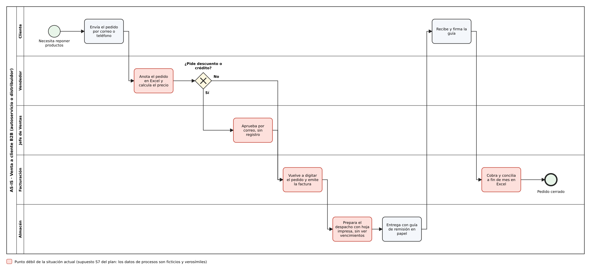

# 4.1 Análisis de sistemas y procesos AS-IS y TO-BE

## 4.1.1 Análisis de sistemas

No hubo acceso a los sistemas internos de D'Onofrio: la situación actual (AS-IS) es un supuesto académico (S7) reconstruido a partir de prácticas comunes de la industria. Se resume por área lo que se asume en uso, la brecha que justifica el ERP y cómo la cubre.

**Tabla 4.1. Sistemas actuales, brechas y cobertura del ERP**

| Área | Sistema actual y brecha | Cobertura del ERP |
|---|---|---|
| Ventas y punto de venta | Excel, correo y caja registradora; sin embudo ni historial por cliente, pedido digitado de nuevo en facturación | CRM, Ventas, listas de precios y PdV con boleta (RF001 a RF003) |
| Heladeros | Cuaderno y vales; descuadres, mermas sin trazar, sin vínculo con lote ni pedido | Liquidación propia, M2 (RF004) |
| Logística y frío | Kárdex en Excel, planilla de temperaturas; sin lote ni FEFO, alertas tardías | Inventario con lotes y FEFO; cadena de frío M3 (RF005 a RF008) |
| Producción y calidad | Fórmulas en Excel e inspección en papel; el lote no se liga a insumos ni a la inspección | Manufactura y calidad M1 (RF009 a RF012) |
| Compras y finanzas | Correo, Word y un sistema contable aislado; doble digitación | Compras mín./máx. y facturación `l10n_pe` (RF015, RF016) |
| Gerencia, RR. HH. y TI | Reportes a mano; organigrama desactualizado; soporte por correo | Dashboards, tablero M4, RR. HH. y mesa de servicios (RF013, RF014, RF017, RF018) |

Las brechas se resumen en cuatro: información dispersa, falta de trazabilidad por lote, procesos manuales en la última milla y decisiones tardías.

## 4.1.2 Procesos AS-IS y TO-BE (BPMN)

Los procesos se modelaron en BPMN 2.0, con carriles por rol, eventos, tareas y compuertas. En los AS-IS las tareas en rojo claro marcan los puntos débiles; en los TO-BE el azul es Odoo estándar configurado por `donofrio_base` y el amarillo lo que depende de un módulo propio.

### Procesos AS-IS

En la **venta a cliente B2B**, el pedido llega por correo o teléfono y se anota en Excel, el jefe de ventas aprueba por correo, facturación vuelve a digitar el pedido y el almacén despacha sin revisar vencimientos: hay doble digitación, aprobación sin registro y despacho sin FEFO.

*Figura 4.1. Proceso AS-IS de la venta a cliente B2B.*

En la **liquidación del heladero**, este retira su carga con un vale; al volver, el liquidador calcula a mano lo vendido y el descuadre se anota en un cuaderno y se descuenta al día siguiente, sin vínculo con el lote ni con el pedido.

*Figura 4.2. Proceso AS-IS de la liquidación del heladero.*

Los otros tres procesos siguen el mismo patrón manual. En **producción y calidad**, la fórmula se imprime, el almacén entrega insumos sin lote, el operario anota las temperaturas a mano y la inspección en papel no deja registro de los lotes no conformes. En la **compra de insumos**, los faltantes se detectan a simple vista, se cotiza por teléfono y la orden se emite en Word. En la **recepción y despacho con cadena de frío**, la temperatura se anota en planilla dos veces al día y la transferencia a Arequipa se coordina por teléfono.

### Procesos TO-BE en Odoo

En la **venta B2B**, el vendedor registra la oportunidad en el embudo CRM y cotiza con la lista de precios del cliente según la fecha; la aprobación de descuentos queda en el historial de la cotización (paso manual). Al confirmar, Odoo crea la entrega, el almacén reserva por FEFO en *pick* y *ship*, y del mismo pedido se emite la factura (01, con RUC) o la boleta (03, con DNI) con IGV 18 %, sin envío a SUNAT porque `l10n_pe_edi` es Enterprise.

*Figura 4.3. Proceso TO-BE de la venta a cliente B2B.*

Con el módulo M2, el liquidador abre una **liquidación por heladero y fecha**, registra lo despachado, devuelto y la merma, y Odoo calcula *vendido = despachado − devuelto − merma*, el importe y la comisión. La diferencia de efectivo queda registrada; al confirmar se crea el pedido de venta y se imprime el PDF que firman ambas partes.

*Figura 4.4. Proceso TO-BE de la liquidación del heladero.*

En **producción**, Odoo reserva los insumos por FEFO y, al terminar la orden, crea el lote con su vencimiento (12 meses en helados y chocolates, 4 en panetón) y calcula el costo. Con M1 se genera una inspección ligada a la orden y al lote: si se aprueba, se emite el certificado; si se rechaza, Odoo bloquea el despacho del lote.

*Figura 4.5. Proceso TO-BE de producción con inspección de calidad.*

La **compra de insumos** pasa a reglas de reabastecimiento mín./máx. que generan una solicitud de cotización por proveedor; la **recepción** exige lote y vencimiento, avisa 30 días antes de que venza y despacha en dos pasos con FEFO, con reposición Lima → Arequipa; y la temperatura se registra con la cadena de frío (M3). Así quedan resueltos los puntos débiles del AS-IS: recepción sin lote, despacho a ojo, faltantes sin control, temperaturas y liquidación en papel y lotes no conformes sin registro.
