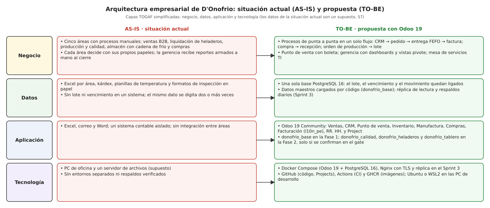

# 2.1.3 Análisis de arquitectura empresarial

Se ordena la arquitectura con las cuatro capas de TOGAF (The Open Group, 2022): negocio, datos, aplicación y tecnología, usadas de forma simplificada para comparar la situación actual (AS-IS) con la propuesta (TO-BE).

*Figura 4.6. Capas de la arquitectura empresarial: situación actual frente a propuesta.*

En la capa de negocio, las cinco áreas con procesos manuales pasan a flujos de punta a punta (CRM → pedido → entrega FEFO → factura; compra → recepción; orden de producción → lote), con punto de venta, dashboards y mesa de servicios. En la capa de datos, el Excel, el kárdex y los formatos en papel dan paso a una base PostgreSQL 16 donde lote, vencimiento y movimiento quedan ligados, con réplica y respaldos. En la capa de aplicación, Odoo 19 Community (Ventas, CRM, PdV, Inventario, Manufactura, Compras, Facturación con la localización peruana, RR. HH. y Project) reemplaza a Excel, correo y un sistema contable aislado, con el módulo de configuración base y los módulos de Calidad, Liquidación de heladeros y Tablero gerencial. En la capa de tecnología, Docker Compose, Nginx con TLS, GitHub (código, Projects y Actions) y GHCR reemplazan a la PC de oficina sin respaldos verificados.

Todo lo anterior está implementado y publicado en las versiones v1.0.0 a v1.4.0, con 42 tablas centrales en el modelo ER y 218 pruebas en la integración continua (CI), que las ejecuta automáticamente en cada cambio.

COBIT 2019. El ERP respalda once objetivos de gestión (ISACA, 2018), como marco de referencia y no como certificación: BAI03 y BAI06 (construcción y cambios, con PR de revisión cruzada e integración continua); DSS01 y DSS04 (operaciones y continuidad, con chequeos de salud, réplica y respaldos probados); DSS02 y DSS03 (solicitudes, incidentes y problemas, con la mesa de servicios); DSS05, APO12 y APO13 (seguridad y riesgos); APO09 (acuerdos de servicio) y MEA01 (burndown, CI y pruebas de rendimiento). El enlace entre cada objetivo y la arquitectura es un juicio del equipo.
