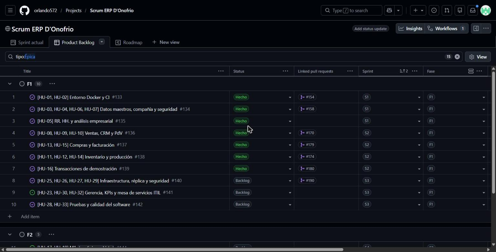
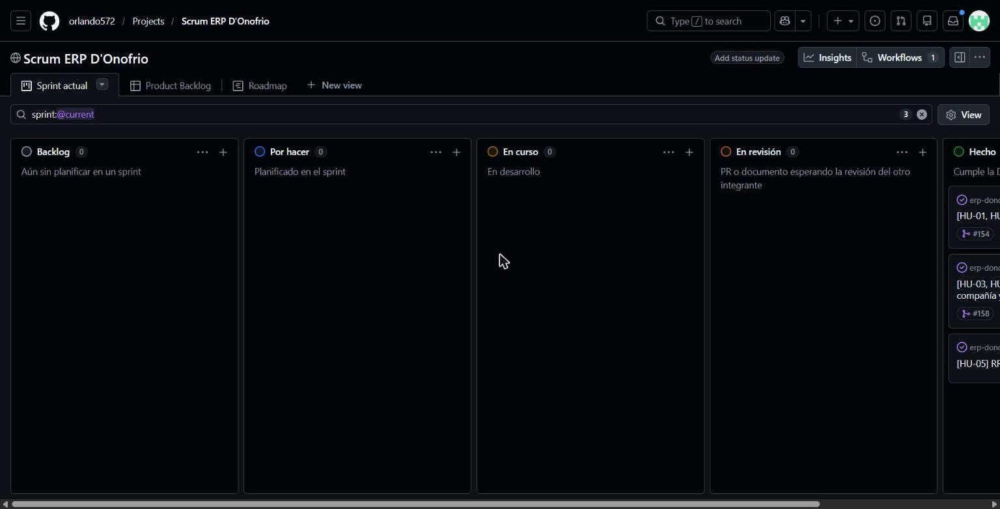
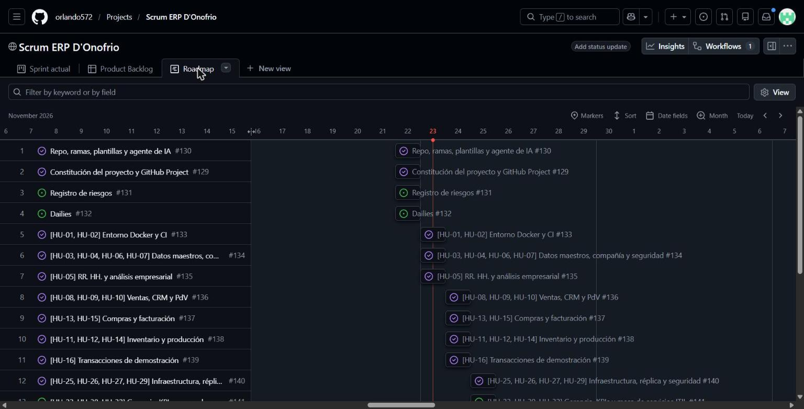
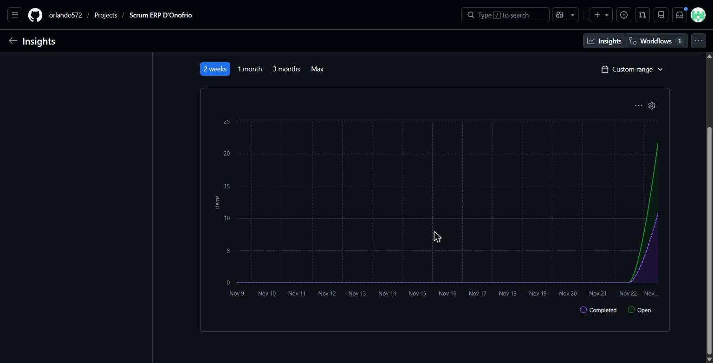

# 4.2.10 a 4.2.12 Desarrollo ágil con Scrum: roles, artefactos y eventos

> **Estado:** versión final del Cierre (25/11/2026) · **Autora:** Evelyn · **Revisa:** Orlando · **Fuente:** [la definición de roles](../pm/roles.md), [el plan de calidad](../pm/plan_calidad.md), [`docs/scrum/`](../scrum/), [04 §4.4 a §4.8](../plan/04_scrum_pmbok.md) y el Project «Scrum ERP D'Onofrio»
>
> Los datos son los del **25/11/2026** (S0 a S4). La Guía Scrum 2020 no fija la duración del sprint más que con un máximo de un mes; aquí cada sprint dura **~1 día** porque el plazo es único (entrega el viernes 27/11 a las 14:30).

## 4.2.10 Roles (tabla 7)

La Guía Scrum 2020 permite que el Product Owner y el Scrum Master también sean *Developers*; en un equipo de dos personas es la única opción realista. Los roles se reparten para que **las responsabilidades de cada rol no recaigan en quien debe controlarlas**: el PO acepta o rechaza el trabajo técnico que hace sobre todo el otro integrante, y el SM vigila el proceso y los tiempos del equipo, incluido el PO.

| Rol | Responsable | Responsabilidades | Por qué esa persona |
|---|---|---|---|
| **Product Owner** | **Evelyn** | Ordena el Product Backlog; redacta las HU y sus criterios de aceptación; representa a D'Onofrio (gerencia y áreas); acepta o rechaza los incrementos en la Review; mantiene el GitHub Project; redacta los informes de gate y lleva la decisión | Lidera el análisis empresarial y las áreas de cara al negocio (Ventas, Heladeros, Gerencia) |
| **Scrum Master** | **Orlando** | Facilita los eventos; cuida la DoD y el CI; elimina impedimentos técnicos (Docker, Odoo, agente de IA); mide la velocidad y el burndown; protege el *timebox*; verifica los criterios de salida del gate | Lidera la infraestructura, el repositorio y la automatización, donde surgen los impedimentos |
| **Developers** | **Evelyn y Orlando** | Construyen el incremento: módulos, configuración, pruebas y documentación; cada uno revisa **todos** los PR del otro | Revisión cruzada obligatoria |

**Asistente de IA.** Es una herramienta de los Developers, **no un rol**. Se declara en la metodología del informe (riesgo R5) y cada integrante revisa y entiende lo que firma.

### Reparto por áreas (de punta a punta)

| | Evelyn | Orlando |
|---|---|---|
| Áreas de negocio | Marketing y Ventas (CRM, Ventas, PdV, heladeros), Gerencia, extras administrativos (Compras, Facturación, RR. HH., mesa de servicios de TI) | Logística (almacenes, lotes, FEFO, cadena de frío), Producción (MRP, calidad), configuración base y seguridad |
| Módulos de la Fase 2 (dueño) | M2 `donofrio_heladeros`, M4 `donofrio_tablero` y marca | M1 `donofrio_calidad`, M3 cadena de frío |
| Entregables | Informe final (maquetación en Word), presentación, **sube la entrega** | Manuales, zip de la última *release*, **verifica la entrega** |

### Regla de conocimiento cruzado

- Cada uno revisa todos los PR del otro. Hasta el 25/11 se fusionaron **82 PR**; el análisis de aprobaciones de [6.6](06_04_a_06_06_repositorio.md) lo detalla. Hasta el 23/11 eran **49 PR** ([la lista de PR fusionados](../capturas/sprint-3/S3-informe6_prs_fusionados.tsv)): 46 con la aprobación vigente del otro integrante y 3 de Orlando sin aprobación vigente, porque se apilaron y la aprobación se descartó al cambiar la base (lo que la Retro del S1 dejó de hacer).
- Antes de la exposición, cada uno puede ejecutar `docker compose up` y explicar la arquitectura general.

### Cómo se cumplió el reparto

- El S0 lo preparó Orlando casi por completo porque Evelyn no pudo asistir (impedimento IMP-02 del [registro de riesgos](../pm/plan_riesgos.md)); desde el S1 cada uno trabajó su parte y revisó la del otro.
- Puntos terminados por persona: S1, Orlando 22 y Evelyn 2; S2, Evelyn 14, Orlando 11 y 5 compartidos; S3, Evelyn 5, Orlando 14 y 8 compartidos (ver [6.2](06_01_a_06_03_equipo_sprints_y_project.md)).
- La Retro del S2 dejó una decisión del PO: `enforce_admins` queda **desactivado** en `develop`; se conserva la salida de emergencia y se compensa cumpliendo siempre la revisión cruzada.

---

## 4.2.11 Artefactos

Los tres artefactos de Scrum están en el repositorio y en el Project: el **Product Backlog** y el **Sprint Backlog** en el GitHub Project, y el **Incremento** en la rama `develop`. El **compromiso** de cada artefacto es: el Product Backlog, el *objetivo del producto* (el ERP de D'Onofrio sobre Odoo 19 Community); el Sprint Backlog, el *objetivo del sprint*; y el Incremento, la *Definition of Done*.

### Product Backlog (tabla 8)

Las HU están en el Project «Scrum ERP D'Onofrio» como **checklist dentro de un issue de épica** (una épica por área y dueño en cada sprint), con la estimación en **puntos de historia** (Fibonacci, *planning poker*) y la prioridad MoSCoW. El backlog tiene **32 HU y 121 puntos**: 24 HU y **81 puntos** de la Fase 1 (núcleo garantizado) y 8 HU y **40 puntos** de la Fase 2 (37 de los módulos M1 a M4 y 3 de la opcional HU-31).

*Ilustración: vista «Product Backlog» (tabla agrupada por fase, filtro `tipo:Épica`). Captura del 23/11/2026.*

**Fase 1: núcleo (todas *Must*)**

| ID | Historia (resumen) | Req. | Pts | Sprint | Resp. | Estado | PR |
|---|---|---|---|---|---|---|---|
| HU-01 | Entorno Docker con Odoo 19 y PostgreSQL 16 | RNF012 | 3 | S1 | O | Hecho | [#153](https://github.com/orlando572/erp-donofrio/pull/153) |
| HU-02 | CI que instala los módulos y corre los tests en cada PR | RNF007 | 5 | S1 | O | Hecho | [#154](https://github.com/orlando572/erp-donofrio/pull/154), [#159](https://github.com/orlando572/erp-donofrio/pull/159) |
| HU-03 | Compañía con localización peruana | RF016 | 3 | S1 | O | Hecho | [#155](https://github.com/orlando572/erp-donofrio/pull/155) |
| HU-04 | Usuarios por rol con permisos mínimos | RF018 | 3 | S1 | O | Hecho | [#157](https://github.com/orlando572/erp-donofrio/pull/157) |
| HU-05 | Organigrama, puestos y empleados | RF017 | 2 | S1 | E | Hecho | [#160](https://github.com/orlando572/erp-donofrio/pull/160) |
| HU-06 | Almacenes de Lima y Arequipa con ubicaciones de frío | RF005 | 3 | S1 | O | Hecho | [#156](https://github.com/orlando572/erp-donofrio/pull/156) |
| HU-07 | Productos, insumos y recetas | RF009 | 5 | S1 | O | Hecho | [#158](https://github.com/orlando572/erp-donofrio/pull/158) |
| HU-08 | Embudo CRM por canal | RF001 | 2 | S2 | E | Hecho | [#168](https://github.com/orlando572/erp-donofrio/pull/168) |
| HU-09 | Cotizar con listas de precios por canal y temporada | RF002 | 3 | S2 | E | Hecho | [#167](https://github.com/orlando572/erp-donofrio/pull/167), [#171](https://github.com/orlando572/erp-donofrio/pull/171) |
| HU-10 | Punto de venta con boleta | RF003 | 3 | S2 | E | Hecho | [#170](https://github.com/orlando572/erp-donofrio/pull/170) |
| HU-11 | Lotes con vencimiento y salida FEFO | RF006, RNF005 | 5 | S2 | O | Hecho | [#169](https://github.com/orlando572/erp-donofrio/pull/169) |
| HU-12 | Recibir insumos y despachar en dos pasos | RF007 | 3 | S2 | O | Hecho | [#173](https://github.com/orlando572/erp-donofrio/pull/173) |
| HU-13 | Reabastecimiento mín./máx. de insumos | RF015 | 3 | S2 | E | Hecho | [#179](https://github.com/orlando572/erp-donofrio/pull/179) |
| HU-14 | Órdenes de producción con lote y costo | RF010 | 3 | S2 | O | Hecho | [#174](https://github.com/orlando572/erp-donofrio/pull/174) |
| HU-15 | Factura y boleta con IGV desde el pedido | RF016 | 3 | S2 | E | Hecho | [#178](https://github.com/orlando572/erp-donofrio/pull/178) |
| HU-16 | Meses de transacciones generadas por script | RNF013 | 5 | S2 | O+E | Hecho | [#175](https://github.com/orlando572/erp-donofrio/pull/175), [#180](https://github.com/orlando572/erp-donofrio/pull/180) |
| HU-23 | Tablero mínimo con lo estándar | RF013, RF014 | 3 | S3 | E | Hecho | [#188](https://github.com/orlando572/erp-donofrio/pull/188) |
| HU-25 | Réplica en caliente de PostgreSQL | RNF006 | 3 | S3 | O | Hecho | [#186](https://github.com/orlando572/erp-donofrio/pull/186) |
| HU-26 | Backups diarios y restauración probada | RNF006 | 3 | S3 | O | Hecho | [#187](https://github.com/orlando572/erp-donofrio/pull/187) |
| HU-27 | Despliegue protegido (TLS, 2FA, auditoría) | RNF009, RNF010 | 5 | S3 | O | Hecho | [#189](https://github.com/orlando572/erp-donofrio/pull/189) |
| HU-28 | Pruebas de carga, seguridad y rendimiento web | RNF002, RNF008, RNF009 | 5 | S3 | O+E | Hecho | [#194](https://github.com/orlando572/erp-donofrio/pull/194), [#196](https://github.com/orlando572/erp-donofrio/pull/196) |
| HU-29 | *Release* automática | RNF012 | 3 | S3 | O | Hecho (publicadas `v1.0.0` a `v1.4.0`) | [#190](https://github.com/orlando572/erp-donofrio/pull/190) |
| HU-32 | Mesa de servicios con tipos ITIL y SLA | RNF011 | 2 | S3 | E | Hecho | [#193](https://github.com/orlando572/erp-donofrio/pull/193) |
| HU-33 | Tests de integración de los flujos estándar | RNF004 | 3 | S3 | O+E | Hecho | [#191](https://github.com/orlando572/erp-donofrio/pull/191), [#192](https://github.com/orlando572/erp-donofrio/pull/192) |

**Fase 2: extensión (orden fijo, uno a uno; los cuatro módulos terminados)**

| Orden | Módulo | HU | Pts | Resp. | Req. | Estado | PR · release |
|---|---|---|---|---|---|---|---|
| M1 | `donofrio_calidad` | HU-17 (inspecciones), HU-18 (certificado) | 8 + 3 | O | RF011, RF012 | Hecho | [#219](https://github.com/orlando572/erp-donofrio/pull/219), [#220](https://github.com/orlando572/erp-donofrio/pull/220) · `v1.1.0` |
| M2 | `donofrio_heladeros` | HU-20 (liquidación), HU-21 (PDF) | 8 + 3 | E | RF004 | Hecho (la casilla de HU-21 sigue sin marcar en su épica) | [#223](https://github.com/orlando572/erp-donofrio/pull/223), [#225](https://github.com/orlando572/erp-donofrio/pull/225) · `v1.2.0` |
| M3 | Cadena de frío | HU-19 | 5 | O | RF008 | Hecho | [#226](https://github.com/orlando572/erp-donofrio/pull/226) · `v1.3.0` |
| M4 | `donofrio_tablero` y marca | HU-22, HU-24 | 8 + 2 | E | RF013 (parte propia) | Hecho | [#227](https://github.com/orlando572/erp-donofrio/pull/227), [#228](https://github.com/orlando572/erp-donofrio/pull/228) · `v1.4.0` |
| Opc. | Landing web | HU-31 | 3 | E | RF001 | Opcional | — |

Los cuatro módulos llegaron a `main` con el [PR #229](https://github.com/orlando572/erp-donofrio/pull/229), cada uno tras su mini gate. El S4 cuenta **34 de 40 puntos**: faltan los 3 de HU-21, cuyo PR está fusionado pero cuya casilla sigue sin marcar, y los 3 de la opcional HU-31.

**Cómo se mantiene.** El PO ordena y estima el backlog con el otro integrante; cada épica cierra con el último PR que lleva `Closes #n`. El detalle de campos, vistas y automatizaciones del Project está en [4.3.9](04_03_04_ides_y_gestion_proyectos.md). El historial de cambios está en los comentarios del issue «Dailies» (#132) y en el registro de [el registro de épicas](../pm/github-projects/epicas.csv).

### Sprint Backlog (tabla 9)

Cada HU del sprint se divide en tareas de 2 a 6 horas dentro de la checklist de su épica. Estas son las del **Sprint 3** (objetivo: «Núcleo v1.0.0 entregable: seguro, replicado, probado, desplegado y documentado»; 27 puntos planificados, 27 completados):

*Ilustración: vista «Sprint actual» (tablero por estado, filtro `sprint:@current`). La captura se repite cuando las iteraciones tengan sus fechas reales (ver [6.2](06_01_a_06_03_equipo_sprints_y_project.md)).*

| HU | Tarea | Resp. | h (est.) | Estado | Issue · PR | Fecha |
|---|---|---|---|---|---|---|
| HU-23 | Activar dashboards estándar y vistas guardadas (`ir.filters`) por código | E | 3 | Hecho | #141 · [#188](https://github.com/orlando572/erp-donofrio/pull/188) | 23/11 |
| HU-25 | Compose con perfil `replica`, script de inicio y evidencia | O | 3 | Hecho | #140 · [#186](https://github.com/orlando572/erp-donofrio/pull/186) | 23/11 |
| HU-26 | `backup.sh`, `restore.sh` y tiempo de restauración medido | O | 3 | Hecho | #140 · [#187](https://github.com/orlando572/erp-donofrio/pull/187) | 23/11 |
| HU-27 | Nginx con TLS, `odoo.conf` de producción y parámetros de seguridad por código | O | 4 | Hecho | #140 · [#189](https://github.com/orlando572/erp-donofrio/pull/189) | 23/11 |
| HU-28 | Lighthouse antes y después en tres vistas | E | 3 | Hecho | #142 · [#194](https://github.com/orlando572/erp-donofrio/pull/194) | 23/11 |
| HU-28 | Script k6, ZAP baseline y reporte | O | 3 | Hecho | #142 · [#196](https://github.com/orlando572/erp-donofrio/pull/196) | 23/11 |
| HU-29 | Workflow de *release* (GHCR y GitHub Releases) | O | 3 | Hecho | #140 · [#190](https://github.com/orlando572/erp-donofrio/pull/190) | 23/11 |
| HU-32 | Proyecto «Mesa de Servicios TI» con etapas y etiquetas por código | E | 2 | Hecho | #141 · [#193](https://github.com/orlando572/erp-donofrio/pull/193) | 23/11 |
| HU-33 | Test pedido → entrega FEFO → factura | E | 3 | Hecho | #142 · [#191](https://github.com/orlando572/erp-donofrio/pull/191) | 23/11 |
| HU-33 | Tests compra → recepción y OP → lote con vencimiento | O | 3 | Hecho | #142 · [#192](https://github.com/orlando572/erp-donofrio/pull/192) | 23/11 |

Las horas son la **estimación** del plan; no se midió el tiempo real por tarea.

### Incremento y Definition of Done

El **Incremento** es la suma de todo lo fusionado en `develop` que cumple la DoD. Al 25/11/2026 contiene el núcleo completo (Odoo estándar configurado por `donofrio_base`, el despliegue protegido, la réplica y los respaldos) y los cuatro módulos propios de la Fase 2, con **218 pruebas** que corren en el CI de cada PR. Está en `main` y publicado en las releases `v1.0.0` (núcleo, PR #222) y `v1.1.0` a `v1.4.0` (M1 a M4, PR #229).

| Sprint | Incremento al cerrar | Puntos | Decisión del PO |
|---|---|---|---|
| S0 | Repositorio con ramas protegidas, plantillas, defensa anti-legacy, artefactos de gestión y GitHub Project | 0 | [Review](../scrum/sprint-0/review.md): decisión sin registrar |
| S1 | Entorno Docker, CI y datos maestros (compañía, usuarios, almacenes, productos y recetas, organigrama); 38 pruebas | 24 de 24 | [Review](../scrum/sprint-1/review.md): decisión sin registrar |
| S2 | Ciclo vender, comprar, producir y facturar con datos de demostración; 100 pruebas | 30 de 30 | **Aceptado el 23/11/2026** ([Review](../scrum/sprint-2/review.md)) |
| S3 | Tableros, réplica, respaldos, despliegue protegido, pruebas de carga y seguridad, *release* y mesa de servicios; 136 pruebas | 27 de 27 | [Review](../scrum/sprint-3/review.md): decisión del PO sin registrar |
| S4 | Los cuatro módulos propios (M1 calidad, M2 heladeros, M3 cadena de frío y M4 tablero), datos de demostración de todas las vistas y capturas en PNG; 218 pruebas | 34 de 40 | Mini gates de M1 a M4 y [review y retro del S4](../scrum/sprint-4/review.md) |

**Definition of Done de cada HU** ([plan de calidad](../pm/plan_calidad.md)):

1. El código está en un PR hacia `develop` **aprobado por el otro integrante**.
2. El CI está en verde: *lint*, chequeo de patrones legacy e instalación desde cero con `--test-enable`, sin `ERROR`.
3. La lógica nueva tiene pruebas (`TransactionCase`) y los modelos nuevos tienen ACL.
4. El módulo se actualiza sin errores (`-u`) sobre una base con datos.
5. Los textos visibles están en español y los criterios de aceptación se verificaron en la interfaz.
6. Hay capturas de evidencia en `docs/capturas/sprint-N/` (`HU-xx_descripcion.png`).
7. La HU está marcada en la checklist de su épica con el enlace al PR (`Parte de #n`) y el ítem del Project pasa a «Hecho».
8. La sección del informe que corresponde tiene al menos un borrador.

Un **módulo de la Fase 2** cumple además: sus HU cumplen la DoD, hay tag de *release*, las secciones afectadas del informe están actualizadas, el ER y el diccionario se extrajeron de nuevo y el mini gate está escrito. Lo que no la cumple no se fusiona.

> **Excepción declarada.** La DoD 7 se cumplió con retraso en varias épicas: las tarjetas de #140 y #142 siguen en «Backlog» aunque sus issues están cerrados, porque el *workflow* «Item closed» del Project está desactivado (ver [6.3](06_01_a_06_03_equipo_sprints_y_project.md)).

---

## 4.2.12 Eventos

Los eventos son cortos porque el sprint dura ~1 día. Las **actas** viven en el repositorio, en `docs/scrum/sprint-N/` (Markdown breve), y se reflejan en el Project; así quedan *commits* de ambos y fechas verificables.

| Evento | Cuándo y cuánto dura | Cómo se hace | Evidencia |
|---|---|---|---|
| **Sprint** | ~1 día (*timebox*) | Un objetivo por sprint | Iteración `S<N>` del Project y *milestone* `Sprint N` |
| **Planning** | Al inicio, 15 a 20 min | El PO presenta las HU priorizadas, se estima, se fija el objetivo y se dividen en tareas | el planning y la vista «Sprint actual» |
| **Daily Scrum** | A mitad del sprint, 10 min (asíncrona) | Qué hice, qué haré y qué me bloquea | Comentario en el issue «Dailies» (#132) y las dailies |
| **Review** | Al final, 15 a 20 min | Demo del incremento contra los criterios; el PO acepta o rechaza | la review con la decisión del PO |
| **Retrospectiva** | Al final, 10 a 15 min | Empezar, dejar de hacer, continuar y dos acciones de mejora | la retro |
| **Gate 0 y mini gates** | Al terminar la Fase 1 y tras cada módulo de la Fase 2 | Informe del gate y decisión explícita del equipo | El informe de cada mini gate y un comentario en el issue del gate |

### Registro de eventos por sprint

| Sprint | Planning | Daily | Review | Retrospectiva |
|---|---|---|---|---|
| **S0 Inicio** (22/11) | [planning](../scrum/sprint-0/planning.md) | [dailies](../scrum/sprint-0/dailies.md) | [review](../scrum/sprint-0/review.md) | [retro](../scrum/sprint-0/retro.md) |
| **S1 Fundaciones** (22 y 23/11) | [planning](../scrum/sprint-1/planning.md) | [dailies](../scrum/sprint-1/dailies.md) | [review](../scrum/sprint-1/review.md) | [retro](../scrum/sprint-1/retro.md) |
| **S2 Procesos estándar** (23/11) | [planning](../scrum/sprint-2/planning.md) | [dailies](../scrum/sprint-2/dailies.md) | [review](../scrum/sprint-2/review.md) | [retro](../scrum/sprint-2/retro.md) |
| **S3 Calidad del núcleo** (23/11) | [planning](../scrum/sprint-3/planning.md) | [dailies](../scrum/sprint-3/dailies.md) | [review](../scrum/sprint-3/review.md) | [retro](../scrum/sprint-3/retro.md) (borrador de Orlando; Evelyn la confirma) |
| **S4 Módulos propios** (24 y 25/11) | Incluida en la review | Sin acta propia | [review](../scrum/sprint-4/review.md) y mini gates de M1 a M4 | [retro](../scrum/sprint-4/retro.md) |

### Qué se decidió en cada sprint

| Sprint | Objetivo | Resultado | Lo que dejaron la Review y la Retro |
|---|---|---|---|
| **S0** | Proyecto constituido y backlog inicial | Repositorio, ramas protegidas, plantillas, agente de IA con defensa anti-legacy, GitHub Project con 22 issues y artefactos de gestión | La protección de ramas falló en un repositorio privado: se hizo público (IMP-01). Evelyn debía revisar los artefactos que redactó Orlando (IMP-02) |
| **S1** | Odoo 19 corre igual en ambas PC, con CI y datos maestros | 7 HU, 24 de 24 puntos | No apilar PR: perdían la aprobación al cambiar de base. Marcar la checklist de la épica al fusionar cada HU. Dejar que exista el CI antes de exigirlo como check |
| **S2** | El ciclo vender-comprar-producir-facturar funciona de punta a punta | 9 HU, 30 de 30 puntos; las pruebas pasaron de 38 a 100 | La revisión cruzada halló un desfase de la vigencia de listas de precios (UTC frente a hora de Lima) y que el PdV no aplica FEFO. `enforce_admins` queda desactivado |
| **S3** | Núcleo v1.0.0 entregable: seguro, replicado, probado, desplegado y documentado | 8 HU, 27 de 27 puntos; 136 pruebas | Siguieron el Gate 0, la fusión de `develop` en `main` y la actualización del Project; el Gate 0 y el `v1.0.0` se hicieron el 24/11 (PR #222) |
| **S4** | Agregar M1, M2, M3 y M4, uno a uno, con mini gate | 6 de 8 HU contadas por el Project (34 de 40 puntos); 218 pruebas; releases `v1.1.0` a `v1.4.0` | Cada mini gate dejó ajustes propios (tags, ER y diccionario, Lighthouse del tablero); los cerraron el PR #229 y los PR #230 y #231 |

### Evidencias de la gestión

*Ilustración: vista «Roadmap». Las barras usan las fechas planificadas de cada iteración, no las reales (ver [6.2](06_01_a_06_03_equipo_sprints_y_project.md)).*

*Ilustración: Insights (*burn up* de ítems abiertos y cerrados). El burndown por puntos está en [6.2](06_01_a_06_03_equipo_sprints_y_project.md).*

**Velocidad:** 24, 30, 27 y 34 puntos en S1, S2, S3 y S4; promedio de **29**. Los tres sprints de la Fase 1 se completaron en unas 21 horas, entre el 22/11 a las 22:38 y el 23/11 a las 16:51 (hora de Lima); la Fase 2 se completó entre el 24 y el 25/11.

### Lo que falta de los eventos

- La confirmación de Evelyn de la retro del S3 y las decisiones del PO en las Reviews de S0, S1 y S3.
- Repetir las capturas del Project cuando las iteraciones tengan sus fechas reales.
