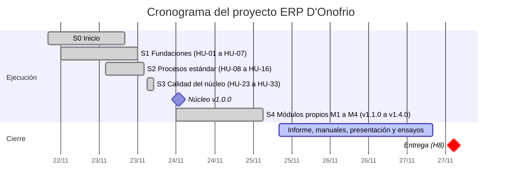

# 4.2.9 Gestión de calendarización

El plazo es de pocos días y la entrega es el viernes 27/11/2026 a las 14:30, así que cada sprint dura **un día** y los hitos se ordenan por criterio de salida y no por horas estimadas. El cronograma se mantiene en el GitHub Project «Scrum ERP D'Onofrio» y las fechas de los sprints cerrados son **las reales de ejecución** (commits, PR y actas), no las planificadas.

**Tabla 4.7. Cronograma de hitos**

| Hito | Entregable | Fecha |
|---|---|---|
| H0 a H2 | Constitución, entorno Docker con CI y datos maestros por código (S0 y S1) | 22 y 23/11/2026 |
| H3 | Ciclo estándar de punta a punta con 16 semanas de datos de demostración (S2) | 23/11/2026 |
| **H4** | **Núcleo `v1.0.0` y punto de control entre fases (S3)** | 23 y 24/11/2026 |
| H5 | Módulos M1 a M4 con sus versiones `v1.1.0` a `v1.4.0` (S4) | 23 al 25/11/2026 |
| H6 y H7 | Informe, manuales, presentación y dos ensayos cronometrados (Cierre) | 25 y 26/11/2026 |
| **H8** | **Entrega de todo** (un integrante, un solo intento) | **27/11/2026, 14:30** |

*Figura 4.15. Diagrama de Gantt con las fechas reales de ejecución y el Cierre hasta la entrega (hora de Lima).*

La Fase 2 se completó antes de la hora de corte fijada para decidir su alcance (jueves 26/11, 08:00); el Cierre y la entrega no se movieron.
