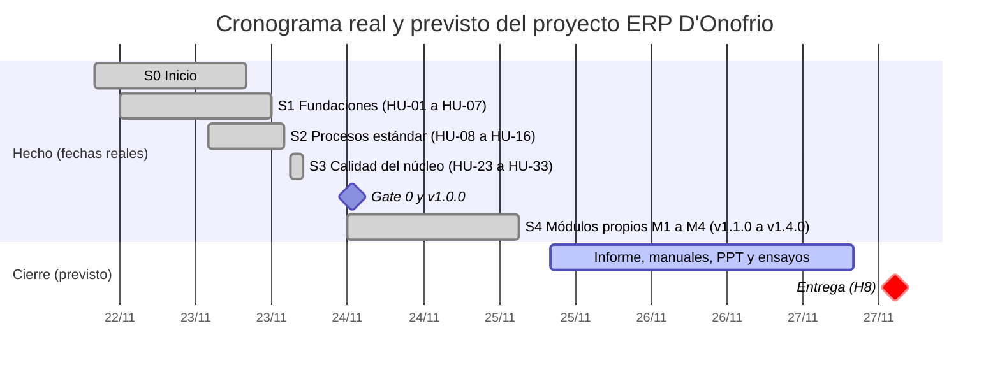

# 4.2.9 Gestión de calendarización (tabla 6 e ilustración 6)

> **Estado:** versión final del Cierre (25/11/2026) · **Autora:** Evelyn (PO) · **Revisa:** Orlando · **Fuente:** [04 §4.3 y §4.10](../plan/04_scrum_pmbok.md), [05 §5.2](../plan/05_reparto_equipo.md), `docs/scrum/`
>
> Las fechas de los sprints cerrados son **las reales de ejecución** (commits, PR y actas del repositorio), no las planificadas. Las fechas de lo que aún falta (el Cierre) son **previstas**, hasta el único plazo fijo: la entrega del **viernes 27/11/2026 a las 14:30**.

## Cómo se calendariza el proyecto

El plazo es de pocos días, así que cada sprint dura **un día** (*timebox* de ~1 día en cada `planning.md`) y los hitos se ordenan por **criterio de salida**, no por horas estimadas ([04 §4.10](../plan/04_scrum_pmbok.md)). El cronograma se mantiene en el GitHub Project «Scrum ERP D'Onofrio» (campo *Iteración* y vista *Roadmap*) y aquí se resume con las fechas reales.

## Tabla 6: cronograma de hitos

| Hito | Entregable verificable | Sprint | Resp. | Fecha | Estado |
|---|---|---|---|---|---|
| H0 | Acta de constitución; empresa confirmada con el docente | S0 | E | 22/11/2026 | Hecho: acta redactada y empresa asignada por el docente (ver `docs/pm/acta_constitucion.md`) |
| H1 | Entorno Docker + repo + CI en verde | S1 | O | 22/11/2026 | Hecho |
| H2 | Datos maestros de D'Onofrio por código (`donofrio_base`) | S1 | O | 23/11/2026 | Hecho |
| H3 | Ciclo estándar de punta a punta + transacciones | S2 | E+O | 23/11/2026 | Hecho: HU-08 a HU-16 fusionadas en `develop`, 16 semanas de datos de demostración (3/8 al 22/11/2026); el 25/11 la HU-16 se completó ([PR #230](https://github.com/orlando572/erp-donofrio/pull/230)) con datos de los módulos de la Fase 2 para que todas las vistas tengan datos |
| **H4** | **Núcleo v1.0.0 entregable → Gate 0** | **S3** | **E+O** | 23 y 24/11/2026 (real) | Hecho: las 8 HU del S3 el 23/11; informe del Gate 0 ([PR #218](https://github.com/orlando572/erp-donofrio/pull/218)), `develop` → `main` ([PR #222](https://github.com/orlando572/erp-donofrio/pull/222)) y tag `v1.0.0` el 24/11 |
| H5 | Módulos de la F2, cada uno con su mini gate y su tag (v1.1.0 a v1.4.0) | S4 | E+O | 23/11 23:58 a 25/11 03:07 (real) | **Hecho:** M1 ([#219](https://github.com/orlando572/erp-donofrio/pull/219), [#220](https://github.com/orlando572/erp-donofrio/pull/220)), M2 ([#223](https://github.com/orlando572/erp-donofrio/pull/223), [#225](https://github.com/orlando572/erp-donofrio/pull/225)), M3 ([#226](https://github.com/orlando572/erp-donofrio/pull/226)) y M4 ([#227](https://github.com/orlando572/erp-donofrio/pull/227), [#228](https://github.com/orlando572/erp-donofrio/pull/228)); a `main` con el [PR #229](https://github.com/orlando572/erp-donofrio/pull/229); releases `v1.1.0` a `v1.4.0` el 25/11 |
| H6 | Informe PDF, manuales, PPT y zip finales | Cierre | E+O | 25/11 a 26/11/2026 (previsto) | En curso: contenido del informe en su estado final y armado del PDF sobre la plantilla del docente; siguen los manuales y la presentación |
| H7 | 2 ensayos cronometrados (≤ 10 min) | Cierre | E+O | 26/11/2026 (previsto) | Previsto |
| **H8** | **Entrega de todo** (UTP+Class, un integrante, un solo intento) | Cierre | E (sube), O (verifica) | **27/11/2026, 14:30** | Previsto |

## Ilustración 6: diagrama de Gantt

La Fase 2 (S4) se completó antes de la hora de corte (jueves 26/11, 08:00); el Cierre y la entrega **no se movieron** ([07 §7.1, R1](../plan/07_riesgos_entrega.md)). Las horas del Gantt son hora de Lima.

## Cómo se actualiza

1. Al cerrar cada sprint, se pasan sus fechas de «previsto» a las reales de su `review.md`.
2. Al llegar a H4, el informe del Gate 0 ([`docs/scrum/gates/gate-0-fase1.md`](../scrum/gates/gate-0-fase1.md)) fijó qué módulos de la F2 entraban; los cuatro entraron, cada uno con su mini gate.
3. El Gantt de GitHub Projects (vista *Roadmap*) debe coincidir con este; si no, manda el del Project y se corrige este archivo.

## Notas

- Captura de la vista *Roadmap* del Project como ilustración 6 final, porque el Project es la fuente de las fechas reales (sus iteraciones siguen en las fechas planificadas).
- Las fechas previstas del Cierre (H6 y H7) las confirma el equipo.
