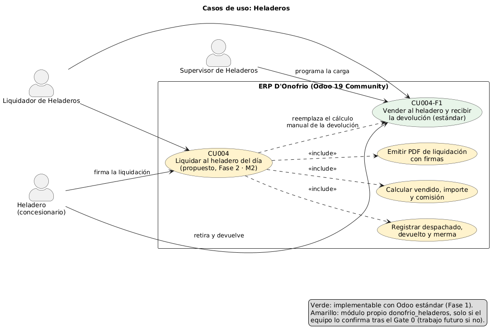
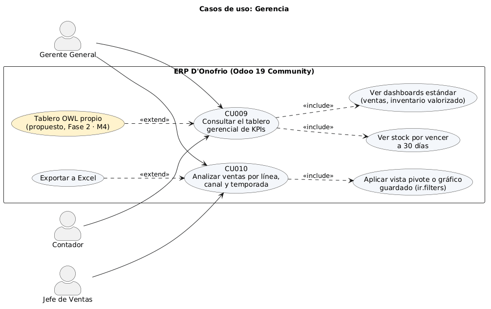

# 4.2.4 Diagramas de casos de uso y fichas (tabla 4)

> **Estado:** borrador del Sprint 1 · **Autora:** Evelyn (PO) · **Revisa:** Orlando · **Fuente:** [02 §2.2](../plan/02_mapeo_plantilla.md), [04 §4.2 y §4.4](../plan/04_scrum_pmbok.md), [03 §3.3](../plan/03_modulos_odoo.md)
>
> Los diagramas están en PlantUML (`docs/diagramas/cu/*.puml`, con su PNG). Aquí van los de **ventas, heladeros y gerencia**. Los CU de logística, producción y calidad (CU005 a CU008) los redacta Orlando con la misma plantilla y los números ya reservados. Los wireframes y mockups de cada CU se hacen en el Sprint 2 (4.4.1).

## Lista de casos de uso

| ID | Caso de uso | Área | RF | HU | Fase | Estado | Responsable |
|---|---|---|---|---|---|---|---|
| CU001 | Registrar oportunidad en el embudo CRM | Ventas | RF001 | HU-08 | F1 | Planificado | Evelyn |
| CU002 | Cotizar y confirmar pedido con lista de precios | Ventas | RF002 | HU-09 | F1 | Planificado | Evelyn |
| CU003 | Vender en el punto de venta con boleta | Ventas | RF003 | HU-10 | F1 | Planificado | Evelyn |
| CU004 | Liquidar al heladero del día | Heladeros | RF004 | HU-20, HU-21 | **F2** (M2) | **Propuesto** | Evelyn |
| CU005 a CU008 | Logística, cadena de frío, producción y calidad | Logística y Producción | RF005 a RF012 | — | F1 y F2 | Reservados | Orlando |
| CU009 | Consultar el tablero gerencial de KPIs | Gerencia | RF013 | HU-23 (F1), HU-22 (F2) | F1 (estándar) | Planificado | Evelyn |
| CU010 | Analizar ventas por línea, canal y temporada | Gerencia | RF014 | HU-23 | F1 | Planificado | Evelyn |

**Estados:** *Planificado* = su HU está en un sprint de la F1; *Propuesto* = depende de un módulo de la Fase 2 y queda como «Diseñado – trabajo futuro» si no se construye ([02 §2.3](../plan/02_mapeo_plantilla.md)).

---

## Diagramas

### Marketing y Ventas

### Heladeros

El verde es la variante estándar de la Fase 1 (pedido de venta al heladero con la lista «Heladero» más la devolución de lo no vendido). El amarillo es el módulo propio de la Fase 2.

### Gerencia

---

## Fichas de los casos de uso

### CU001: Registrar oportunidad en el embudo CRM

| Campo | Contenido |
|---|---|
| **ID / Nombre** | CU001 · Registrar oportunidad en el embudo CRM |
| **Requerimiento / HU** | RF001 · HU-08 (épica «Ventas, CRM y PdV» del Sprint 2) |
| **Actores** | Ejecutivo comercial (principal), Vendedor |
| **Descripción** | El usuario registra un posible cliente (distribuidor regional, autoservicio, bodega o heladero por reclutar) y lo mueve por las etapas del embudo hasta ganarlo o perderlo |
| **Precondiciones** | Usuario con permisos de ventas; equipo de venta (Canal Moderno, Canal Tradicional o Heladeros) y etapas cargados por `donofrio_base` |
| **Flujo principal** | 1. Abre CRM y crea una oportunidad con el cliente, el canal (equipo de venta) y el ingreso esperado. 2. La oportunidad inicia en **Prospecto**. 3. Registra llamadas, correos y notas en el chatter. 4. La mueve a **Calificado**, **Propuesta** y **Negociación** a medida que avanza. 5. Al cerrar el trato la marca **Ganado** |
| **Flujos alternos** | A1. Si el prospecto se descarta, la marca como **Perdida** e indica el motivo. A2. Desde **Propuesta** puede crear la cotización (pasa a CU002). A3. Si es un heladero por reclutar, usa el equipo «Heladeros» |
| **Postcondiciones** | La oportunidad queda en su etapa con historial; una oportunidad ganada puede tener cotización asociada |
| **Reglas de negocio** | 5 etapas fijas: Prospecto → Calificado → Propuesta → Negociación → Ganado. Cada oportunidad pertenece a un equipo de venta |
| **Datos de apoyo** | Unas 20 oportunidades ficticias cargadas por código |
| **Evidencia / prueba** | Captura del embudo en Kanban (Sprint 2); prueba de datos de CRM en `donofrio_base` |

### CU002: Cotizar y confirmar pedido con lista de precios

| Campo | Contenido |
|---|---|
| **ID / Nombre** | CU002 · Cotizar y confirmar pedido con lista de precios |
| **Requerimiento / HU** | RF002 · HU-09 (con HU-15 para la factura) |
| **Actores** | Vendedor (principal), Jefe de Ventas (aprueba descuentos), Cliente (externo) |
| **Descripción** | El vendedor arma una cotización con el precio que corresponde al canal y a la temporada, la confirma como pedido y deja lista la entrega |
| **Precondiciones** | Cliente y productos creados; listas de precios Mayorista, Bodega, Heladero, Campaña Navidad y Verano cargadas |
| **Flujo principal** | 1. Crea la cotización (puede partir de una oportunidad de CU001). 2. Elige el cliente; el sistema propone su lista de precios. 3. Agrega productos en unidad o caja ×24; el precio sale de la lista según la fecha. 4. Envía la cotización al cliente. 5. Al aceptarla, **confirma el pedido**. 6. El sistema genera la entrega y el pedido queda listo para facturar (HU-15) |
| **Flujos alternos** | A1. Si pide un descuento o condición especial, la cotización va al Jefe de Ventas, que la aprueba o la rechaza. A2. Si el cliente no acepta, la cotización se cancela con su motivo. A3. Para un heladero se usa la lista «Heladero» y, al volver, se registra la devolución estándar (ver CU004) |
| **Postcondiciones** | Pedido confirmado con precios de la lista vigente; entrega creada en inventario |
| **Reglas de negocio** | El precio cambia según la lista de precios y la fecha (verano, Navidad, heladero); moneda PEN; IGV 18 % |
| **Evidencia / prueba** | Test de integración pedido → entrega → factura (HU-33); capturas de la cotización y del pedido (Sprint 2) |

### CU003: Vender en el punto de venta con boleta

| Campo | Contenido |
|---|---|
| **ID / Nombre** | CU003 · Vender en el punto de venta con boleta |
| **Requerimiento / HU** | RF003 · HU-10 |
| **Actores** | Cajero de PdV (principal), Cliente (externo) |
| **Descripción** | El cajero abre la sesión de la tienda de planta, registra ventas al público, cobra y emite la boleta; al terminar cierra la caja |
| **Precondiciones** | PdV «Tienda de planta / Heladería Av. Venezuela» configurado con `l10n_pe_pos`; métodos de pago efectivo y Yape (diario genérico) |
| **Flujo principal** | 1. Abre la sesión de caja. 2. Agrega los productos de la venta. 3. Indica el cliente: DNI o «Cliente varios». 4. Cobra en efectivo o Yape. 5. El sistema emite la **boleta**. 6. Al final del turno, cierra la sesión y revisa el cuadre |
| **Flujos alternos** | A1. Si el cliente pide factura, se registra con su RUC. A2. Si la caja no cuadra, se anota la diferencia al cerrar. A3. Si el producto no tiene stock, se avisa antes de cobrar |
| **Postcondiciones** | Venta registrada, stock descontado, boleta emitida y caja cerrada con su diferencia |
| **Reglas de negocio** | Boleta (tipo 03) para consumidor final; IGV 18 %; sin envío a SUNAT: el EDI `l10n_pe_edi` es Enterprise y se declara como limitación |
| **Evidencia / prueba** | Captura de la sesión, la venta y la boleta (Sprint 2) |

### CU004: Liquidar al heladero del día (propuesto, Fase 2)

| Campo | Contenido |
|---|---|
| **ID / Nombre** | CU004 · Liquidar al heladero del día |
| **Requerimiento / HU** | RF004 · HU-20 y HU-21 (`donofrio_heladeros`, M2) |
| **Actores** | Liquidador de Heladeros (principal), Heladero concesionario, Supervisor de Heladeros |
| **Descripción** | Al terminar la jornada, el liquidador registra lo que se despachó al heladero, lo que devolvió y la merma, calcula lo vendido y su importe y entrega el PDF firmado |
| **Precondiciones** | Heladero registrado como contacto concesionario; despacho del día cargado |
| **Flujo principal** | 1. El liquidador abre una liquidación para el heladero y la fecha. 2. Registra por producto lo despachado, lo devuelto y la merma. 3. El sistema calcula **vendido = despachado − devuelto − merma** (no puede ser negativo), el importe y la comisión. 4. Confirma la liquidación. 5. El sistema crea y confirma el pedido de venta correspondiente. 6. Imprime el PDF con el detalle y las firmas |
| **Flujos alternos** | A1. Si lo devuelto más la merma supera lo despachado, el sistema rechaza la línea. A2. Si el efectivo no cuadra con el importe, la diferencia queda registrada en la liquidación. A3. **Sin la Fase 2:** se usa la variante estándar (CU004-F1): pedido de venta con la lista «Heladero» y devolución de lo no vendido |
| **Postcondiciones** | Liquidación confirmada, pedido creado y devolución al almacén registrada |
| **Reglas de negocio** | El heladero es concesionario (supuesto S4): compra a precio de heladero y liquida cada día; no es empleado |
| **Estado** | **Propuesto.** No se construye sin la confirmación explícita de Evelyn u Orlando tras el Gate 0. Si no se hace, queda como «Diseñado – trabajo futuro» con este caso de uso, su wireframe y su mockup |
| **Evidencia / prueba** | Wireframe y mockup de la pantalla de liquidación (Sprint 2); si se construye, tests de `donofrio_heladeros` |

### CU009: Consultar el tablero gerencial de KPIs

| Campo | Contenido |
|---|---|
| **ID / Nombre** | CU009 · Consultar el tablero gerencial de KPIs |
| **Requerimiento / HU** | RF013 · HU-23 (F1, estándar) y HU-22 (F2, tablero OWL propio) |
| **Actores** | Gerente General (principal), Contador |
| **Descripción** | El gerente revisa los indicadores clave de la unidad en los dashboards estándar de Odoo Community, que son de solo lectura |
| **Precondiciones** | Módulos de dashboards instalados (`spreadsheet_dashboard`, `_sale`, `_stock_account`); datos del script de transacciones |
| **Flujo principal** | 1. Abre el menú de Panel de control. 2. Elige el dashboard de ventas o el de inventario valorizado. 3. Revisa los indicadores y gráficos. 4. Abre el reporte de stock por vencer a 30 días |
| **Flujos alternos** | A1. Si falta un dashboard en Community, usa la vista pivote guardada equivalente (CU010). A2. **Con la Fase 2:** el tablero OWL propio muestra 6 tarjetas de KPI y un gráfico mensual, con filtro por almacén |
| **Postcondiciones** | El gerente conoce el estado de ventas, stock y vencimientos sin pedir reportes |
| **Reglas de negocio** | Solo lectura en Community; la carga debe ser menor de 3 s (RNF008) |
| **Evidencia / prueba** | Capturas de los dashboards (Sprint 3); Lighthouse (HU-28) |

### CU010: Analizar ventas por línea, canal y temporada

| Campo | Contenido |
|---|---|
| **ID / Nombre** | CU010 · Analizar ventas por línea, canal y temporada |
| **Requerimiento / HU** | RF014 · HU-23 |
| **Actores** | Gerente General, Jefe de Ventas |
| **Descripción** | El usuario aplica una vista pivote o un gráfico guardado para comparar ventas por línea de producto, canal y mes, y ver la estacionalidad |
| **Precondiciones** | Vistas guardadas (`ir.filters`) cargadas por código y compartidas; transacciones de 3 a 4 meses |
| **Flujo principal** | 1. Abre el análisis de ventas. 2. Elige un filtro guardado: ventas por línea, canal y mes; producción por línea; top de clientes por canal. 3. Cambia filas y columnas del pivote según lo que quiera ver. 4. Interpreta la estacionalidad (verano y Navidad) |
| **Flujos alternos** | A1. Exporta el resultado a Excel. A2. Guarda un filtro propio |
| **Postcondiciones** | El usuario obtiene una comparación por línea, canal y temporada para planificar campañas |
| **Reglas de negocio** | Los filtros son compartidos; los datos son ficticios (supuesto S2) |
| **Evidencia / prueba** | Capturas del pivote y del gráfico (Sprint 3) |

---

## Pendiente

- Wireframes y mockups de cada CU, **incluidos los de la Fase 2** (Sprint 2, 4.4.1).
- CU005 a CU008 de Orlando, con la misma plantilla.
- Pasar cada CU a «Implementado» cuando se verifique en la UI, y los de la F2 a «Diseñado – trabajo futuro» o «Implementado» según el Gate 0 ([02 §2.3](../plan/02_mapeo_plantilla.md)).
