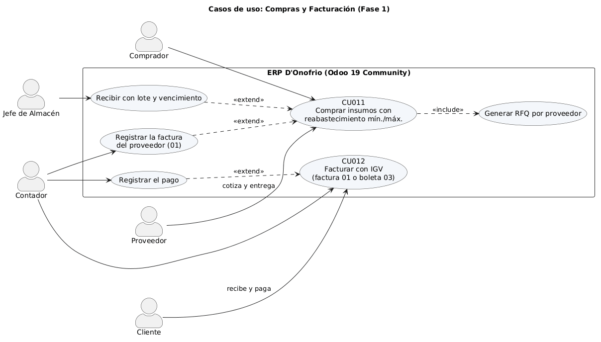

# 4.2.4 Diagramas de casos de uso y fichas (tabla 4)

> **Estado:** borrador del Sprint 1 · **Autora:** Evelyn (PO) · **Revisa:** Orlando · **Fuente:** [02 §2.2](../plan/02_mapeo_plantilla.md), [04 §4.2 y §4.4](../plan/04_scrum_pmbok.md), [03 §3.3](../plan/03_modulos_odoo.md)
>
> Los diagramas están en PlantUML (`docs/diagramas/cu/*.puml`, con su PNG). Aquí van los de **ventas, heladeros y gerencia** (Evelyn, Sprint 1) y los de **logística y producción** (CU005 a CU008, Orlando, Sprint 2), con la misma plantilla. Los wireframes y mockups de cada CU están en [4.4](04_04_prototipos.md) (Sprint 2). En el Sprint 2 se agregaron CU011 (compras) y CU012 (facturación).

## Lista de casos de uso

| ID | Caso de uso | Área | RF | HU | Fase | Estado | Responsable |
|---|---|---|---|---|---|---|---|
| CU001 | Registrar oportunidad en el embudo CRM | Ventas | RF001 | HU-08 | F1 | Implementado | Evelyn |
| CU002 | Cotizar y confirmar pedido con lista de precios | Ventas | RF002 | HU-09 | F1 | Implementado | Evelyn |
| CU003 | Vender en el punto de venta con boleta | Ventas | RF003 | HU-10 | F1 | Implementado | Evelyn |
| CU004 | Liquidar al heladero del día | Heladeros | RF004 | HU-20, HU-21 | **F2** (M2) | **Implementado** (24/11/2026) | Evelyn |
| CU005 | Recibir, almacenar y despachar con lotes y FEFO | Logística | RF005, RF006, RF007 | HU-06, HU-11, HU-12 | F1 | Planificado | Orlando |
| CU006 | Registrar temperaturas y alertar (cadena de frío) | Logística | RF008 | HU-19 | **F2** (M3) | **Implementado** (24/11/2026) | Orlando |
| CU007 | Planificar y ejecutar una orden de producción con lote | Producción | RF009, RF010 | HU-07, HU-14 | F1 | Planificado | Orlando |
| CU008 | Inspeccionar la calidad y liberar el lote | Producción | RF011, RF012 | HU-17, HU-18 | **F2** (M1) | **Implementado** (24/11/2026) | Orlando |
| CU009 | Consultar el tablero gerencial de KPIs | Gerencia | RF013 | HU-23 (F1), HU-22 (F2) | F1 (estándar) y F2 (M4) | Implementado (el tablero OWL, 24/11/2026) | Evelyn |
| CU010 | Analizar ventas por línea, canal y temporada | Gerencia | RF014 | HU-23 | F1 | Implementado | Evelyn |
| CU011 | Comprar insumos con reabastecimiento mín./máx. | Compras | RF015 | HU-13 | F1 | Implementado | Evelyn |
| CU012 | Facturar con IGV (factura 01 o boleta 03) | Facturación | RF016 | HU-15 | F1 | Implementado | Evelyn |

**Estados:** *Implementado* = su HU está fusionada en `develop`, con tests y capturas; *Planificado* = su HU está en un sprint de la F1; *Propuesto* = depende de un módulo de la Fase 2 y queda como «Diseñado – trabajo futuro» si no se construye ([02 §2.3](../plan/02_mapeo_plantilla.md)).

---

## Diagramas

### Marketing y Ventas

### Heladeros

El verde es la variante estándar de la Fase 1 (pedido de venta al heladero con la lista «Heladero» más la devolución de lo no vendido). El amarillo es el módulo propio de la Fase 2.

### Logística y Producción

El verde es lo que se hace con Odoo estándar en la Fase 1 (CU005 y CU007). El amarillo son los módulos propios de la Fase 2: cadena de frío (CU006, M3) y calidad (CU008, M1).

### Compras y Facturación

Todo con Odoo estándar de la Fase 1. CU011 y CU012 se agregaron en el Sprint 2 porque RF015 (compras) y RF016 (facturación) no tenían caso de uso propio.

### Gerencia

---

## Fichas de los casos de uso

### CU001: Registrar oportunidad en el embudo CRM

| Campo | Contenido |
|---|---|
| **ID / Nombre** | CU001 · Registrar oportunidad en el embudo CRM |
| **Requerimiento / HU** | RF001 · HU-08 (épica «Ventas, CRM y PdV» del Sprint 2) |
| **Actores** | Ejecutivo comercial (principal), Vendedor |
| **Descripción** | El usuario registra un posible cliente (distribuidor regional, autoservicio, bodega o heladero por reclutar) y lo mueve por las etapas del embudo hasta ganarlo o perderlo |
| **Precondiciones** | Usuario con permisos de ventas; equipo de venta (Canal Moderno, Canal Tradicional o Heladeros) y etapas cargados por `donofrio_base` |
| **Flujo principal** | 1. Abre CRM y crea una oportunidad con el cliente, el canal (equipo de venta) y el ingreso esperado. 2. La oportunidad inicia en **Prospecto**. 3. Registra llamadas, correos y notas en el chatter. 4. La mueve a **Calificado**, **Propuesta** y **Negociación** a medida que avanza. 5. Al cerrar el trato la marca **Ganado** |
| **Flujos alternos** | A1. Si el prospecto se descarta, la marca como **Perdida** e indica el motivo. A2. Desde **Propuesta** puede crear la cotización (pasa a CU002). A3. Si es un heladero por reclutar, usa el equipo «Heladeros» |
| **Postcondiciones** | La oportunidad queda en su etapa con historial; una oportunidad ganada puede tener cotización asociada |
| **Reglas de negocio** | 5 etapas fijas: Prospecto → Calificado → Propuesta → Negociación → Ganado. Cada oportunidad pertenece a un equipo de venta |
| **Datos de apoyo** | Unas 20 oportunidades ficticias cargadas por código |
| **Evidencia / prueba** | `tests/test_crm.py`; capturas `HU-08_*` |

### CU002: Cotizar y confirmar pedido con lista de precios

| Campo | Contenido |
|---|---|
| **ID / Nombre** | CU002 · Cotizar y confirmar pedido con lista de precios |
| **Requerimiento / HU** | RF002 · HU-09 (con HU-15 para la factura) |
| **Actores** | Vendedor (principal), Jefe de Ventas (aprueba descuentos), Cliente (externo) |
| **Descripción** | El vendedor arma una cotización con el precio que corresponde al canal y a la temporada, la confirma como pedido y deja lista la entrega |
| **Precondiciones** | Cliente y productos creados; listas de precios Mayorista, Bodega, Heladero, Campaña Navidad y Verano cargadas |
| **Flujo principal** | 1. Crea la cotización (puede partir de una oportunidad de CU001). 2. Elige el cliente; el sistema propone su lista de precios. 3. Agrega productos en unidad o caja ×24; el precio sale de la lista según la fecha. 4. Envía la cotización al cliente. 5. Al aceptarla, **confirma el pedido**. 6. El sistema genera la entrega y el pedido queda listo para facturar (HU-15) |
| **Flujos alternos** | A1. Si pide un descuento o condición especial, la cotización va al Jefe de Ventas, que la aprueba o la rechaza. A2. Si el cliente no acepta, la cotización se cancela con su motivo. A3. Para un heladero se usa la lista «Heladero» y, al volver, se registra la devolución estándar (ver CU004) |
| **Postcondiciones** | Pedido confirmado con precios de la lista vigente; entrega creada en inventario |
| **Reglas de negocio** | El precio cambia según la lista de precios y la fecha (verano, Navidad, heladero); moneda PEN; IGV 18 % |
| **Evidencia / prueba** | `tests/test_precios.py` (pedido confirmado → entrega con el precio de la lista); capturas `HU-09_*`; el test de integración completo es HU-33 (Sprint 3) |

### CU003: Vender en el punto de venta con boleta

| Campo | Contenido |
|---|---|
| **ID / Nombre** | CU003 · Vender en el punto de venta con boleta |
| **Requerimiento / HU** | RF003 · HU-10 |
| **Actores** | Cajero de PdV (principal), Cliente (externo) |
| **Descripción** | El cajero abre la sesión de la tienda de planta, registra ventas al público, cobra y emite la boleta; al terminar cierra la caja |
| **Precondiciones** | PdV «Tienda de planta / Heladería Av. Venezuela» configurado con `l10n_pe_pos`; métodos de pago efectivo y Yape (diario genérico) |
| **Flujo principal** | 1. Abre la sesión de caja. 2. Agrega los productos de la venta. 3. Indica el cliente: DNI o «Cliente varios». 4. Cobra en efectivo o Yape. 5. El sistema emite la **boleta**. 6. Al final del turno, cierra la sesión y revisa el cuadre |
| **Flujos alternos** | A1. Si el cliente pide factura, se registra con su RUC. A2. Si la caja no cuadra, se anota la diferencia al cerrar. A3. Si el producto no tiene stock, se avisa antes de cobrar |
| **Postcondiciones** | Venta registrada, stock descontado, boleta emitida y caja cerrada con su diferencia |
| **Reglas de negocio** | Boleta (tipo 03) para consumidor final; IGV 18 %; sin envío a SUNAT: el EDI `l10n_pe_edi` es Enterprise y se declara como limitación |
| **Evidencia / prueba** | `tests/test_pdv.py`; capturas `HU-10_*` y `HU-16_pdv_sesiones_cerradas` |

### CU004: Liquidar al heladero del día (implementado, Fase 2)

| Campo | Contenido |
|---|---|
| **ID / Nombre** | CU004 · Liquidar al heladero del día |
| **Requerimiento / HU** | RF004 · HU-20 y HU-21 (`donofrio_heladeros`, M2) |
| **Actores** | Liquidador de Heladeros (principal), Heladero concesionario, Supervisor de Heladeros |
| **Descripción** | Al terminar la jornada, el liquidador registra lo que se despachó al heladero, lo que devolvió y la merma, calcula lo vendido y su importe y entrega el PDF firmado |
| **Precondiciones** | Heladero registrado como contacto concesionario; despacho del día cargado |
| **Flujo principal** | 1. El liquidador abre una liquidación para el heladero y la fecha. 2. Registra por producto lo despachado, lo devuelto y la merma. 3. El sistema calcula **vendido = despachado − devuelto − merma** (no puede ser negativo), el importe y la comisión. 4. Confirma la liquidación. 5. El sistema crea y confirma el pedido de venta correspondiente. 6. Imprime el PDF con el detalle y las firmas |
| **Flujos alternos** | A1. Si lo devuelto más la merma supera lo despachado, el sistema rechaza la línea. A2. Si el efectivo no cuadra con el importe, la diferencia queda registrada en la liquidación. A3. **Sin la Fase 2:** se usa la variante estándar (CU004-F1): pedido de venta con la lista «Heladero» y devolución de lo no vendido |
| **Postcondiciones** | Liquidación confirmada, pedido creado y devolución al almacén registrada |
| **Reglas de negocio** | El heladero es concesionario (supuesto S4): compra a precio de heladero y liquida cada día; no es empleado |
| **Estado** | **Implementado** en `donofrio_heladeros` (M2) el 24/11/2026, con la confirmación de Evelyn: modelo y flujo en HU-20 (PR #223) y PDF en HU-21. La diferencia de efectivo es positiva cuando el heladero entregó de más (a su favor) y negativa cuando debe |
| **Evidencia / prueba** | [Wireframe y mockup](04_04_prototipos.md) (Sprint 2); 14 pruebas de `donofrio_heladeros`; capturas `HU-20_*` y `HU-21_*` en [`docs/capturas/sprint-4/`](../capturas/sprint-4/) |

### CU005: Recibir, almacenar y despachar con lotes y FEFO

| Campo | Contenido |
|---|---|
| **ID / Nombre** | CU005 · Recibir, almacenar y despachar con lotes y FEFO |
| **Requerimiento / HU** | RF005, RF006 y RF007 · HU-06 (almacenes), HU-11 (lotes y FEFO) y HU-12 (recepción y despacho en 2 pasos) |
| **Actores** | Jefe de Almacén (principal), Comprador, Proveedor y Cliente (externos), CD Arequipa |
| **Descripción** | El jefe de almacén recibe los insumos de una orden de compra con su lote y vencimiento, los guarda en la cámara que corresponde y despacha los pedidos en dos pasos, tomando siempre primero el lote que vence antes. También repone el CD Arequipa desde Lima |
| **Precondiciones** | Almacenes WH-LIM y WH-AQP con sus ubicaciones y la ruta Lima → Arequipa cargados por `donofrio_base`; productos con seguimiento por lote y vida útil; orden de compra confirmada o pedido de venta confirmado |
| **Flujo principal** | 1. La orden de compra confirmada crea la **recepción** en Lima. 2. Al llegar el camión, el jefe de almacén abre la recepción y escribe, por producto, el **lote y la fecha de vencimiento** (si no la escribe, Odoo la calcula con la vida útil del producto). 3. Valida la recepción: el stock entra a Lima/Stock y la orden de compra registra lo recibido. 4. Cuando se confirma un pedido, Odoo crea el **pick** y **reserva por FEFO**: el lote que vence antes. 5. El jefe de almacén confirma el pick y el producto pasa a la zona de salida. 6. Valida el **ship** con la guía y la mercadería sale al cliente |
| **Flujos alternos** | A1. Si intenta validar una recepción sin lote, Odoo lo impide. A2. Si un lote ya venció o está en su fecha de retiro, no se reserva y la entrega queda parcial hasta que haya stock vigente. A3. Para reponer Arequipa, se pide la reposición: se genera pick, ship (Lima) y recepción en AQP, y el lote viaja con la mercadería. A4. Treinta días antes de que un lote venza, Odoo crea una actividad para el jefe de almacén |
| **Postcondiciones** | Stock con lote y vencimiento en la ubicación correcta; entrega o reposición cerrada y trazable por lote |
| **Limitación** | La salida por FEFO y el bloqueo de lotes vencidos rigen en las **entregas y transferencias** (pick y ship). En el **punto de venta** (CU003) el cajero escribe el lote de cada producto y Odoo estándar no comprueba su fecha de vencimiento ni propone el lote que vence antes: una venta de mostrador puede salir con un lote vencido (RNF005). Se acepta como limitación de la Fase 1; la mejora sería una restricción sobre el detalle de movimientos con su prueba |
| **Reglas de negocio** | FEFO en todas las categorías de producto; helado y chocolate vencen a los 12 meses y el panetón a los 4; alerta 30 días antes (RNF005: no se despacha un lote vencido). Despacho en 2 pasos en Lima y en 1 paso en Arequipa; recepción en 1 paso |
| **Datos de apoyo** | Existencias iniciales con lotes por vencer y 16 semanas de recepciones y reposiciones generadas por `cargar_transacciones.py` |
| **Evidencia / prueba** | `test_fefo.py` y `test_recepcion_despacho.py` en `donofrio_base/tests`; capturas en `docs/capturas/sprint-2/` |

### CU006: Registrar temperaturas y alertar (implementado, Fase 2)

| Campo | Contenido |
|---|---|
| **ID / Nombre** | CU006 · Registrar temperaturas y alertar |
| **Requerimiento / HU** | RF008 · HU-19 (cadena de frío, M3) |
| **Actores** | Jefe de Almacén (principal), Operario de cámara |
| **Descripción** | El operario registra la temperatura de cada cámara en cada lectura; si sale del rango de la ubicación, el sistema avisa y deja historial |
| **Precondiciones** | Ubicaciones de frío con su rango (`temp_min` y `temp_max`, que en la Fase 1 solo van en el nombre de la ubicación) y «Controlar temperatura» marcado; `donofrio_calidad` instalado |
| **Flujo principal** | 1. El operario abre la cámara y registra la lectura (valor y hora). 2. El sistema compara con el rango de la ubicación. 3. Si está dentro del rango, la lectura queda en el historial. 4. Si está fuera, marca la lectura como «Fuera de rango» y crea una actividad para el jefe de almacén (no marca la ubicación) |
| **Flujos alternos** | A1. Si hay lotes en la cámara afectada, el jefe de almacén los revisa y decide su destino. A2. **Sin la Fase 2:** la temperatura se anota en planilla de papel y el rango queda solo como texto en el nombre de la ubicación |
| **Postcondiciones** | Historial de temperaturas por ubicación y alerta registrada |
| **Reglas de negocio** | Congelación: −25 °C (se exige −18 °C o menos en el producto terminado); refrigerado: 2-6 °C. Rangos cargados: −30 a −18 °C y 2 a 6 °C |
| **Estado** | **Implementado** en `donofrio_calidad` (M3) el 24/11/2026, con la confirmación de Orlando: lecturas, alerta fuera de rango y cron diario de lotes por vencer ([5.5d](05_05_modulo_donofrio_frio.md)). Lo que hace el código y difiere del diseño: la alerta es una actividad al jefe de almacén y **marca la lectura**, no la ubicación; el menú es Calidad › Cadena de frío |
| **Evidencia / prueba** | [Wireframe y mockup](04_04_prototipos.md) (Sprint 2); 29 pruebas en `tests/test_frio.py` (44 en `donofrio_calidad`); capturas `HU-19_*` en [`docs/capturas/sprint-4/`](../capturas/sprint-4/) |

### CU007: Planificar y ejecutar una orden de producción con lote

| Campo | Contenido |
|---|---|
| **ID / Nombre** | CU007 · Planificar y ejecutar una orden de producción con lote |
| **Requerimiento / HU** | RF009 y RF010 · HU-07 (recetas y centros de trabajo) y HU-14 (órdenes de producción) |
| **Actores** | Jefe de Producción (principal), Operario de línea, Jefe de Almacén |
| **Descripción** | El jefe de producción crea una orden desde la receta, Odoo reserva los insumos por FEFO, la línea ejecuta las operaciones y, al terminar, se crea el lote con su vencimiento y se calcula el costo |
| **Precondiciones** | Recetas con sus operaciones y los tres centros de trabajo (Línea Helados, Chocolates y Panetón) cargados; insumos en stock con lote |
| **Flujo principal** | 1. Crea la orden de producción con el producto, la cantidad y la receta, y la confirma. 2. Odoo **reserva los insumos por FEFO**. 3. El operario ejecuta cada operación en su centro de trabajo; el sistema registra el tiempo. 4. Verifica los controles críticos escritos en la operación (80-85 °C, −18 °C) y los anota en la orden. 5. Marca la orden como hecha con el lote producido. 6. Odoo consume los insumos, **crea el lote con su fecha de vencimiento**, **calcula el costo** (insumos más horas de centro de trabajo) y genera sus asientos |
| **Flujos alternos** | A1. Si falta un insumo, la orden queda por reservar hasta que llegue (CU005). A2. Si un control no se cumple, el jefe decide reproceso o descarte y lo anota en la orden. A3. Si el lote reservado venció, Odoo toma el siguiente que vence antes |
| **Postcondiciones** | Lote terminado en Lima/Stock con su vencimiento, insumos descontados y costo unitario calculado |
| **Reglas de negocio** | La receta es una **tanda industrial** (por ejemplo 10 000 paletas); el costo unitario del lote sale menor que su precio de venta; valoración FIFO en terminados e insumos; lote único por orden |
| **Datos de apoyo** | 12 recetas y 188 órdenes históricas con lote, generadas por `cargar_transacciones.py` |
| **Evidencia / prueba** | `test_produccion.py` en `donofrio_base/tests`; capturas en `docs/capturas/sprint-2/` |

### CU008: Inspeccionar la calidad y liberar el lote (propuesto, Fase 2)

| Campo | Contenido |
|---|---|
| **ID / Nombre** | CU008 · Inspeccionar la calidad y liberar el lote |
| **Requerimiento / HU** | RF011 y RF012 · HU-17 y HU-18 (`donofrio_calidad`, M1) |
| **Actores** | Inspector de Calidad (principal), Jefe de Producción, Jefe de Almacén |
| **Descripción** | Al terminar una orden de producción, el inspector mide los puntos de control del lote y lo aprueba o lo rechaza; si lo aprueba, emite el certificado de calidad |
| **Precondiciones** | Orden de producción terminada con su lote; puntos de control definidos (pasteurización 80-85 °C, endurecimiento a −18 °C o menos, peso neto ±2 %, análisis microbiológico, humedad del panetón) |
| **Flujo principal** | 1. Al terminar la orden, el sistema crea la inspección ligada a la orden y al lote. 2. El inspector registra la medición de cada punto de control. 3. Aprueba el lote si todos cumplen. 4. El sistema emite el certificado de calidad del lote (PDF). 5. El lote queda liberado para el despacho FEFO |
| **Flujos alternos** | A1. Si algún punto no cumple, el inspector rechaza el lote: el sistema **bloquea su despacho** y avisa al jefe de producción, que decide reproceso o descarte con el motivo. A2. **Sin la Fase 2:** el control es documental, con las instrucciones de cada operación y la nota en la orden |
| **Postcondiciones** | Lote liberado con certificado, o rechazado y bloqueado, con su historial de mediciones |
| **Reglas de negocio** | Un lote rechazado no se despacha (RNF005); un lote liberado conserva su trazabilidad a la orden y a los insumos |
| **Estado** | **Implementado** en `donofrio_calidad` (M1) el 24/11/2026, con la confirmación de Evelyn tras el Gate 0 (PR #219 y #220). El flujo A1 avisa con un mensaje y una actividad al responsable de la orden |
| **Evidencia / prueba** | Wireframe y mockup de la inspección (Sprint 2); 12 pruebas de `donofrio_calidad`; capturas `HU-17_*` y `HU-18_*` en [`docs/capturas/sprint-4/`](../capturas/sprint-4/) |

### CU009: Consultar el tablero gerencial de KPIs

| Campo | Contenido |
|---|---|
| **ID / Nombre** | CU009 · Consultar el tablero gerencial de KPIs |
| **Requerimiento / HU** | RF013 · HU-23 (F1, estándar) y HU-22 (F2, tablero OWL propio) |
| **Actores** | Gerente General (principal), Contador |
| **Descripción** | El gerente revisa los indicadores clave de la unidad en los dashboards estándar de Odoo Community, que son de solo lectura |
| **Precondiciones** | Módulos de dashboards instalados (`spreadsheet_dashboard`, `_sale`, `_stock_account`); datos del script de transacciones |
| **Flujo principal** | 1. Abre el menú de Panel de control. 2. Elige el dashboard de ventas o el de inventario valorizado. 3. Revisa los indicadores y gráficos. 4. Abre el reporte de stock por vencer a 30 días |
| **Flujos alternos** | A1. Si falta un dashboard en Community, usa la vista pivote guardada equivalente (CU010). A2. **Con la Fase 2 (implementado):** el tablero OWL propio (Tablero › Gerencia) muestra hasta 6 tarjetas de KPI y un gráfico de ventas de los últimos 6 meses, con filtro por almacén; las tarjetas de calidad, heladeros y cadena de frío salen solo si su módulo está instalado y el usuario puede leerlo |
| **Postcondiciones** | El gerente conoce el estado de ventas, stock y vencimientos sin pedir reportes |
| **Reglas de negocio** | Solo lectura en Community; la carga debe ser menor de 3 s (RNF008) |
| **Evidencia / prueba** | Capturas de los dashboards (Sprint 3); Lighthouse (HU-28); 21 pruebas de `donofrio_tablero` y capturas `HU-22_*` en [`docs/capturas/sprint-4/`](../capturas/sprint-4/) |

### CU010: Analizar ventas por línea, canal y temporada

| Campo | Contenido |
|---|---|
| **ID / Nombre** | CU010 · Analizar ventas por línea, canal y temporada |
| **Requerimiento / HU** | RF014 · HU-23 |
| **Actores** | Gerente General, Jefe de Ventas |
| **Descripción** | El usuario aplica una vista pivote o un gráfico guardado para comparar ventas por línea de producto, canal y mes, y ver la estacionalidad |
| **Precondiciones** | Vistas guardadas (`ir.filters`) cargadas por código y compartidas; transacciones de 3 a 4 meses |
| **Flujo principal** | 1. Abre el análisis de ventas. 2. Elige un filtro guardado: ventas por línea, canal y mes; producción por línea; top de clientes por canal. 3. Cambia filas y columnas del pivote según lo que quiera ver. 4. Interpreta la estacionalidad (verano y Navidad) |
| **Flujos alternos** | A1. Exporta el resultado a Excel. A2. Guarda un filtro propio |
| **Postcondiciones** | El usuario obtiene una comparación por línea, canal y temporada para planificar campañas |
| **Reglas de negocio** | Los filtros son compartidos; los datos son ficticios (supuesto S2) |
| **Evidencia / prueba** | Capturas `HU-23_*` (dashboards estándar y vistas guardadas); `tests/test_gerencia.py` |

### CU011: Comprar insumos con reabastecimiento mín./máx.

| Campo | Contenido |
|---|---|
| **ID / Nombre** | CU011 · Comprar insumos con reabastecimiento mín./máx. |
| **Requerimiento / HU** | RF015 · HU-13 (con HU-15 para la factura del proveedor) |
| **Actores** | Comprador (principal), Jefe de Almacén, Proveedor (externo), Contador |
| **Descripción** | Cuando el stock de un insumo baja de su mínimo, Odoo genera la solicitud de cotización al proveedor hasta el máximo; el comprador la confirma, el almacén recibe con lote y vencimiento y finanzas registra la factura |
| **Precondiciones** | 22 reglas de reabastecimiento (una por insumo) en Planta Lima con ruta «Comprar»; proveedor y comprador asignados |
| **Flujo principal** | 1. El planificador calcula lo que falta hasta el máximo. 2. Odoo crea **una RFQ por proveedor**, a cargo del Comprador. 3. El comprador revisa y **confirma**: la RFQ pasa a orden de compra. 4. Odoo crea la recepción en Lima. 5. El almacén recibe con lote y vencimiento (CU005). 6. Finanzas registra la factura del proveedor (01) con IGV 18 % y programa el pago |
| **Flujos alternos** | A1. Si el stock está sobre el mínimo, no se genera ninguna RFQ. A2. Si ya hay una RFQ abierta, la regla no pide dos veces. A3. El comprador puede cancelar la RFQ antes de confirmarla |
| **Postcondiciones** | Orden de compra confirmada, recepción creada y regla satisfecha; factura del proveedor con IGV |
| **Reglas de negocio** | Mínimo = consumo semanal × (plazo del proveedor + 7 días) / 7; máximo = mínimo + 2 semanas de consumo (supuestos ficticios); un proveedor principal por insumo |
| **Evidencia / prueba** | `tests/test_reabastecimiento.py` (5 pruebas); capturas `HU-13_*` y `HU-16_facturas_de_proveedor` |

### CU012: Facturar con IGV (factura 01 o boleta 03)

| Campo | Contenido |
|---|---|
| **ID / Nombre** | CU012 · Facturar con IGV |
| **Requerimiento / HU** | RF016 · HU-15 |
| **Actores** | Contador (principal), Vendedor, Cliente (externo) |
| **Descripción** | Desde un pedido de venta confirmado se emite la factura (cliente con RUC) o la boleta (cliente con DNI o consumidor final) en su diario, con el IGV 18 % calculado, y se imprime el PDF |
| **Precondiciones** | Pedido confirmado; diarios «Facturas» y «Boletas»; IGV 18 % en los productos terminados |
| **Flujo principal** | 1. Abre el pedido y crea la factura. 2. Odoo elige el diario y el tipo de documento según el cliente: **01** con RUC, **03** con DNI. 3. Odoo calcula la base y el IGV (el precio al público ya lo incluye). 4. Confirma la factura: recibe su número (`F 00000001` o `B 00000001`). 5. Imprime el PDF y registra el pago |
| **Flujos alternos** | A1. Un cliente sin documento recibe boleta como «consumidor final». A2. Si el cliente pide factura en el PdV, se registra con su RUC (CU003) |
| **Postcondiciones** | Factura o boleta publicada, en soles y en su diario; cuenta por cobrar creada |
| **Reglas de negocio** | IGV 18 % incluido en el precio de venta; moneda PEN; sin envío electrónico a SUNAT (`l10n_pe_edi` es Enterprise). Limitación: la plantilla estándar titula «Factura» al PDF de la boleta y rotula «RUC» al DNI |
| **Evidencia / prueba** | `tests/test_facturacion.py`; capturas `HU-15_*` |

---

## Pendiente

- ~~Wireframes y mockups de cada CU, incluidos los de la Fase 2~~: hechos en el Sprint 2, ver [4.4](04_04_prototipos.md).
- Pasar cada CU a «Implementado» cuando se verifique en la UI, y los de la F2 a «Diseñado – trabajo futuro» o «Implementado» según el Gate 0 ([02 §2.3](../plan/02_mapeo_plantilla.md)).
