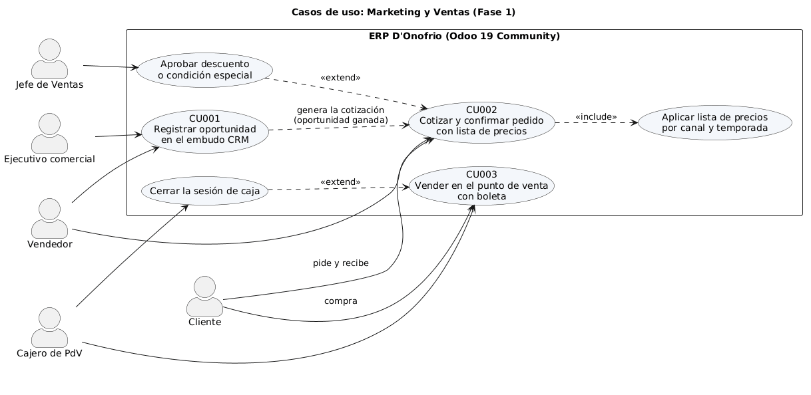
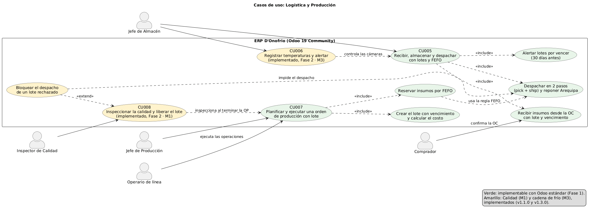

# 2.2.1.3 Diagramas de casos de uso

Se definieron doce casos de uso (CU), uno o más por requerimiento, que cubren ventas, heladeros, logística, producción, gerencia, compras y facturación. Todos están implementados y verificados con pruebas automáticas y capturas con datos de demostración. Los de la Fase 2 son CU004 (M2), CU006 (M3), CU008 (M1) y la parte propia de CU009 (M4).

**Tabla 4.8. Lista de casos de uso**

| Código | Caso de uso | Área | RF | Fase |
|---|---|---|---|---|
| CU001 | Registrar oportunidad en el embudo CRM | Ventas | RF001 | F1 |
| CU002 | Cotizar y confirmar pedido con lista de precios | Ventas | RF002 | F1 |
| CU003 | Vender en el punto de venta con boleta | Ventas | RF003 | F1 |
| CU004 | Liquidar al heladero del día | Heladeros | RF004 | F2 (M2) |
| CU005 | Recibir, almacenar y despachar con lotes y FEFO | Logística | RF005 a RF007 | F1 |
| CU006 | Registrar temperaturas y alertar (cadena de frío) | Logística | RF008 | F2 (M3) |
| CU007 | Planificar y ejecutar una orden de producción con lote | Producción | RF009, RF010 | F1 |
| CU008 | Inspeccionar la calidad y liberar el lote | Producción | RF011, RF012 | F2 (M1) |
| CU009 | Consultar el tablero gerencial de KPI | Gerencia | RF013 | F1 y F2 (M4) |
| CU010 | Analizar ventas por línea, canal y temporada | Gerencia | RF014 | F1 |
| CU011 | Comprar insumos con reabastecimiento mín./máx. | Compras | RF015 | F1 |
| CU012 | Facturar con IGV (factura 01 o boleta 03) | Facturación | RF016 | F1 |

Los diagramas se agrupan por área. En ellos el verde es la variante estándar de la Fase 1 y el amarillo, el módulo desarrollado para D'Onofrio.

*Figura 4.8. Casos de uso de Marketing y Ventas (CU001 a CU003).*

*Figura 4.9. Casos de uso de Heladeros (CU004).*

*Figura 4.10. Casos de uso de Logística y Producción (CU005 a CU008).*

Los casos de Gerencia (CU009, CU010) y de Compras y Facturación (CU011, CU012) siguen la misma notación y se resuelven con Odoo estándar.

### Ficha de ejemplo

Cada caso de uso tiene una ficha con la misma plantilla (actores, precondiciones, flujos, postcondiciones y reglas); se presenta como ejemplo la de un caso de la Fase 2 (CU008).

**Tabla 4.9. Ficha CU008: inspeccionar la calidad y liberar el lote**

| Campo | Contenido |
|---|---|
| **Actores** | Inspector de Calidad (principal), Jefe de Producción, Jefe de Almacén |
| **Descripción** | Al terminar una orden de producción, el inspector mide los puntos de control del lote y lo aprueba o rechaza; si lo aprueba, emite el certificado de calidad |
| **Precondiciones** | Orden terminada con su lote; puntos de control definidos (pasteurización 80-85 °C, endurecimiento a −18 °C o menos, peso neto, microbiología) |
| **Flujo principal** | 1. Al terminar la orden, se crea la inspección ligada a la orden y al lote. 2. El inspector registra cada medición. 3. Aprueba si todos los puntos cumplen. 4. Se emite el certificado en PDF y el lote queda liberado para el despacho FEFO |
| **Flujos alternos** | A1. Si algún punto no cumple, el lote se rechaza, se bloquea su despacho y el jefe de producción decide reproceso o descarte con el motivo |
| **Reglas de negocio** | Un lote rechazado no se despacha (RNF005); un lote liberado conserva su trazabilidad a la orden y a los insumos |
