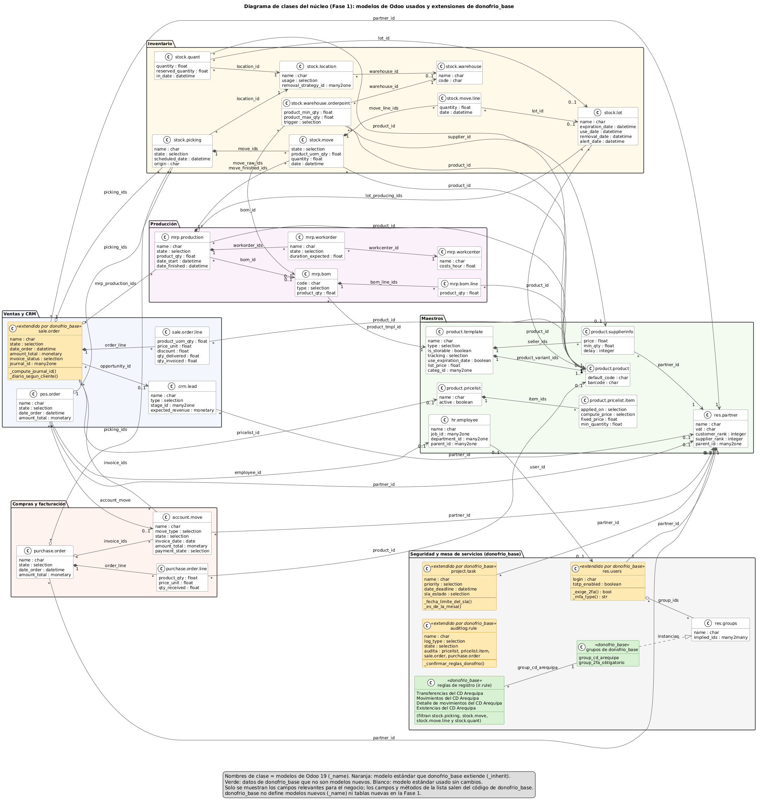
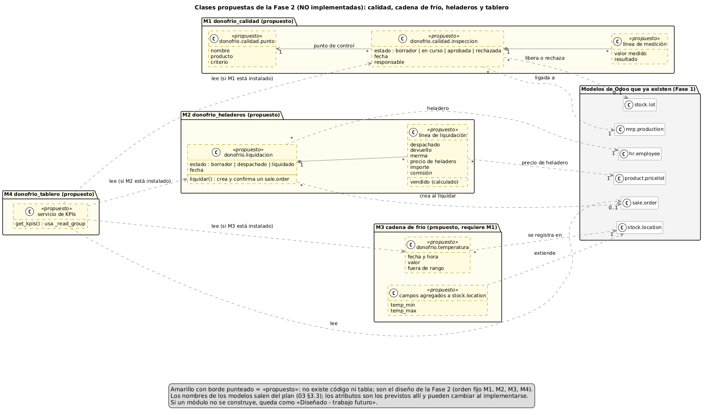
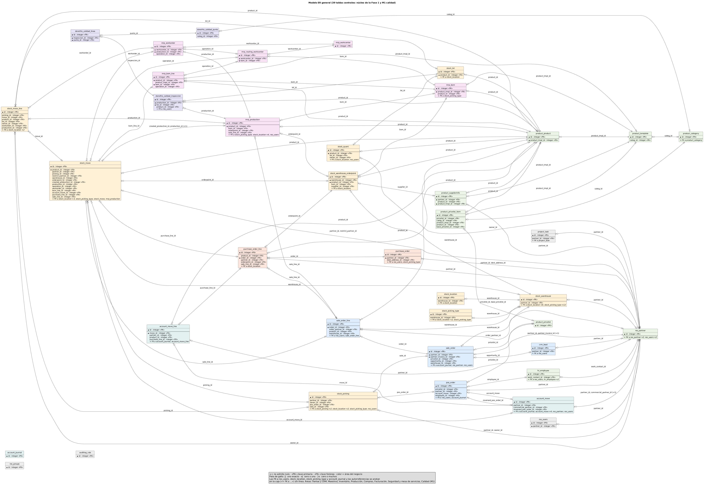
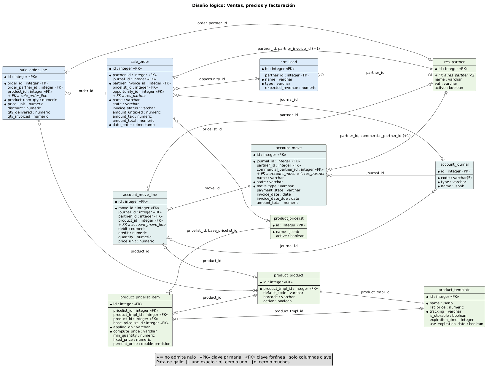
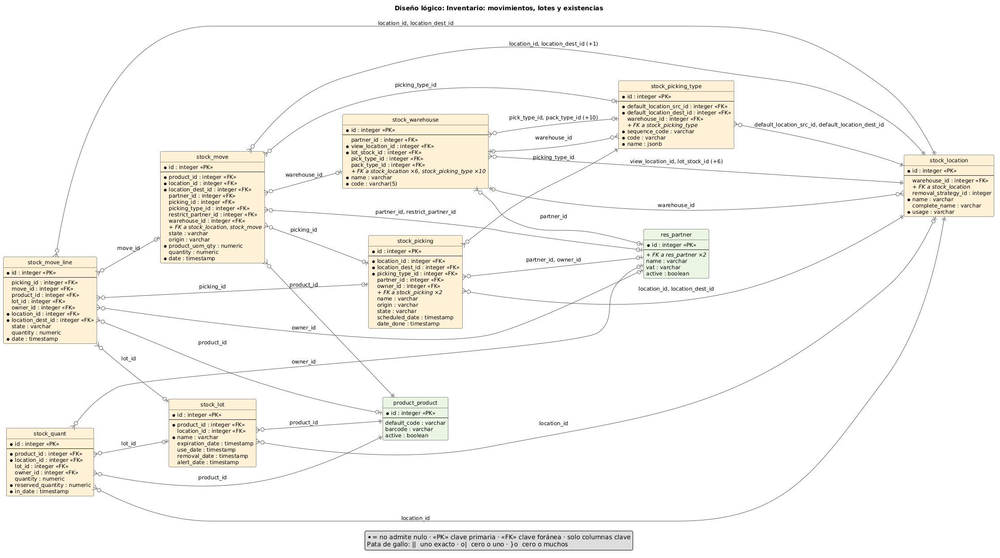
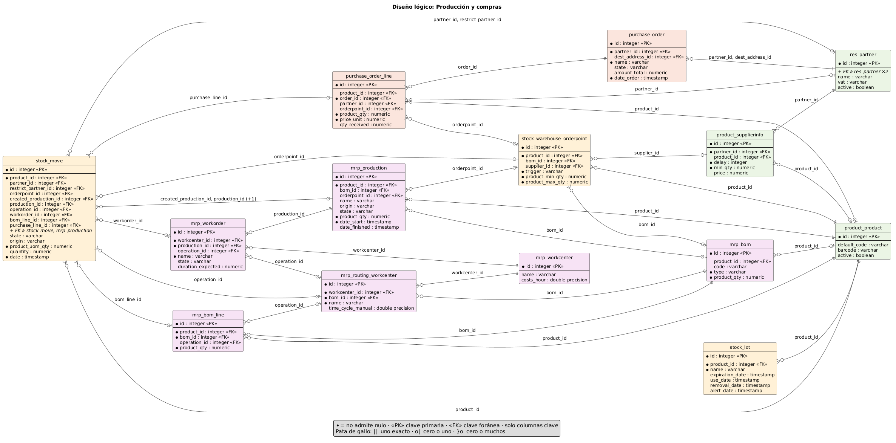

# 4.2.5 a 4.2.8 Modelo de datos del núcleo: clases, ER, diseño lógico y diccionario

> **Estado:** borrador del Sprint 3 · **Autor:** Orlando (SM) · **Revisa:** Evelyn · **Fuente:** [02 §2.2](../plan/02_mapeo_plantilla.md), [04 §4.5](../plan/04_scrum_pmbok.md), [05](../plan/05_reparto_equipo.md), [03 §3.3](../plan/03_modulos_odoo.md)
>
> Cubre el **núcleo de la Fase 1** (Odoo 19.0 Community + `donofrio_base`). Todo sale de lo que existe: las clases, del código de `addons/donofrio_base/` y de los modelos de Odoo instalados; el ER, el diseño lógico y el diccionario, de una **base de datos real** con `donofrio_base` recién instalado desde `develop`, no de un dibujo a mano. Las clases de la Fase 2 (calidad, cadena de frío, heladeros y tablero) se dibujan aparte como **propuesto**: **no están implementadas** y no tienen tablas. Cómo regenerar cada figura: [docs/diagramas/README.md](../diagramas/README.md).

## 4.2.5 Diagrama de clases

El dominio de D'Onofrio no se modela con clases nuevas: se apoya en los modelos estándar de Odoo (cada modelo es una clase de Python con sus campos y métodos y una tabla en PostgreSQL). La Figura 4.2.5-a muestra los 31 modelos que intervienen en los procesos del núcleo (venta B2B y PdV, inventario con lotes y FEFO, producción, compras, facturación con IGV, seguridad y mesa de servicios) con sus campos de negocio y las relaciones reales entre ellos (`many2one`, `one2many`, `many2many`).

*Figura 4.2.5-a. Clases del núcleo (Fase 1). Nombre de clase = `_name` del modelo de Odoo. Naranja: modelo estándar que `donofrio_base` extiende con `_inherit`. Verde: datos de `donofrio_base` que no son modelos. Se genera con [`clases_nucleo.puml`](../diagramas/clases/clases_nucleo.puml).*

| Clase (modelo de Odoo) | Origen | Papel en D'Onofrio |
|---|---|---|
| `res.partner` | `base` | Clientes (distribuidores, autoservicios, bodegas, heladeros), proveedores y direcciones; el RUC va en `vat` |
| `product.template`, `product.product` | `product`, `stock`, `product_expiry` | Terminados (helados, panetón, chocolate) e insumos; `tracking = lot` y `use_expiration_date` dan lote y vencimiento |
| `product.pricelist`, `product.pricelist.item`, `product.supplierinfo` | `product` | Listas de precios por canal y campaña; precios y plazos de los proveedores |
| `hr.employee` | `hr` | Personal de las áreas; enlazado a `res.users`. Los datos de contrato viven en `hr.version` (Odoo 19 no tiene `hr_contract`) |
| `crm.lead`, `sale.order`, `sale.order.line`, `pos.order` | `crm`, `sale`, `point_of_sale` | Embudo comercial, pedidos de venta B2B y ventas de mostrador |
| `stock.warehouse`, `stock.location`, `stock.picking`, `stock.move`, `stock.move.line`, `stock.quant` | `stock` | Almacenes (CD Lima y CD Arequipa), ubicaciones, transferencias y movimientos; las existencias son `stock.quant` |
| `stock.lot` | `stock`, `product_expiry` | Lote con fecha de vencimiento, de consumo preferente, de retiro y de alerta; base de la trazabilidad y de FEFO |
| `stock.warehouse.orderpoint` | `stock` | Reglas de reabastecimiento mínimo/máximo |
| `mrp.bom`, `mrp.bom.line`, `mrp.production`, `mrp.workorder`, `mrp.workcenter` | `mrp` | Recetas, órdenes de producción (con el lote producido en `lot_producing_ids`), operaciones y centros de trabajo |
| `purchase.order`, `purchase.order.line`, `account.move` | `purchase`, `account`, `l10n_pe` | Compras de insumos y facturas o boletas (diario 01 o 03 según el cliente) |
| `res.users`, `res.groups`, `auditlog.rule`, `project.task` | `base`, `auth_totp_mail`, `auditlog` (OCA), `project` | Usuarios por rol, grupos, auditoría de cambios y mesa de servicios TI con SLA |

**Lo que agrega `donofrio_base`** (leído de [`addons/donofrio_base/`](../../addons/donofrio_base/)):

| Elemento | Qué es | Dónde |
|---|---|---|
| `sale.order` (extendido) | `_compute_journal_id` y `_diario_segun_cliente`: el pedido factura en el diario «Facturas» (01) si el cliente tiene RUC y en «Boletas» (03) si no (HU-15) | `models/sale_order.py` |
| `res.users` (extendido) | `_exige_2fa` y `_mfa_type`: el administrador y la gerencia usan segundo factor (TOTP o código por correo) en el despliegue protegido (HU-27). No agrega campos | `models/res_users.py` |
| `auditlog.rule` (extendido) | `_confirmar_reglas_donofrio`: confirma las 4 reglas de auditoría (listas de precios, líneas de lista, pedidos de venta y de compra) | `models/auditlog_rule.py`, `data/seguridad_data.xml` |
| `project.task` (extendido) | Campo **`sla_estado`** (selección calculada y almacenada) y `_fecha_limite_del_sla`: fecha límite según la prioridad del ticket (HU-32) | `models/project_task.py` |
| Grupos (`res.groups`) | «Solo operaciones del CD Arequipa» y «2FA obligatorio», bajo el privilegio «D'Onofrio» | `security/donofrio_security.xml` |
| Reglas de registro (`ir.rule`) | 4 reglas que limitan a `stock.picking`, `stock.move`, `stock.move.line` y `stock.quant` al almacén de Arequipa para el grupo «Solo operaciones del CD Arequipa» (HU-04) | `security/donofrio_security.xml` |
| Permisos (`ir.model.access`) | 1 línea: el usuario de punto de venta lee y crea `stock.lot` | `security/ir.model.access.csv` |
| Parámetros del sistema | Política de contraseñas (mínimo 12 caracteres) y bloqueo de 60 s tras 5 intentos fallidos; `donofrio.2fa_privilegiados` (opcional, lo lee el código) para forzar o apagar el 2FA | `data/seguridad_data.xml`, `models/res_users.py` |

`donofrio_base` **no define ningún modelo nuevo (`_name`)**: solo extiende cuatro modelos estándar con `_inherit`, y de ellos únicamente `project.task` gana una columna. Los 10 usuarios por rol, la compañía, los almacenes, los productos, las listas de materiales, los precios, los clientes, los empleados y los reabastecimientos son **registros** (datos XML) en las tablas de Odoo, no estructura.

### Clases propuestas de la Fase 2

Las clases de los módulos de la Fase 2 se diseñan a partir del plan ([03 §3.3](../plan/03_modulos_odoo.md)) y se dibujan con el estereotipo `<<propuesto>>`, borde punteado y fondo amarillo. **No existe código, ni tabla, ni prueba de ellas.** Si un módulo no se construye (orden fijo M1 → M2 → M3 → M4), queda como «Diseñado – trabajo futuro».

*Figura 4.2.5-b. Clases propuestas (no implementadas) de la Fase 2, ligadas a los modelos de Odoo que sí existen. Se genera con [`clases_fase2_propuesto.puml`](../diagramas/clases/clases_fase2_propuesto.puml).*

| Clase propuesta | Módulo | Estado | Relación con el núcleo |
|---|---|---|---|
| `donofrio.calidad.punto`, `donofrio.calidad.inspeccion` y su línea de medición | M1 `donofrio_calidad` | **Implementado** (24/11/2026) | La inspección se liga a `mrp.production` y `stock.lot`; un lote rechazado no se despacha. Tablas y diccionario en [5.5b](05_05_modulo_donofrio_calidad.md) |
| `donofrio.temperatura` y `temp_min`/`temp_max` en `stock.location` | M3 cadena de frío (requiere M1) | **Propuesto** | Registra temperaturas por ubicación y alerta si salen de rango |
| `donofrio.liquidacion` y su línea | M2 `donofrio_heladeros` | **Propuesto** | Al liquidar crea y confirma un `sale.order` |
| Servicio de KPIs (`get_kpis()`) | M4 `donofrio_tablero` | **Propuesto** | Lee ventas y, si están instalados, los módulos anteriores |

## 4.2.6 Diseño de base de datos: modelo ER

El modelo ER se **extrae de la base de datos real**, no se dibuja. Se instaló `donofrio_base` desde `develop` en una BD limpia (PostgreSQL 16, 697 tablas de Odoo en total) y el script [`scripts/diagrama_er.py`](../../scripts/diagrama_er.py) leyó de `information_schema` y `pg_constraint` las columnas, las claves primarias y las foráneas y si cada FK admite nulo (cardinalidad 1 o 0..1). De las 697 tablas se filtraron las **36 centrales del núcleo**: las de ventas, inventario con lotes, producción, compras, facturación, maestros y seguridad. El resto (mensajería, contabilidad auxiliar, vistas, tablas de configuración) está en el [anexo del diccionario de datos](anexo_diccionario_datos.md).

*Figura 4.2.6-a. Modelo ER de las 36 tablas centrales del núcleo, con 85 líneas de relación (pata de gallo). Color por área. Versión vectorial para ampliar: [`er_nucleo.svg`](../diagramas/er/er_nucleo.svg). Se genera con [`scripts/diagrama_er.py`](../../scripts/diagrama_er.py).*

Cómo leer la figura:

* **Cardinalidad.** `||` = uno exacto (FK no nula), `o|` = cero o uno (FK nula), `}o` = cero o muchos. Toda relación es 1:N desde la tabla con la FK; las N:M de Odoo (por ejemplo, `sale_order` ↔ `account_move`) pasan por tablas intermedias `*_rel` que no se dibujan y se listan en el anexo.
* **Líneas omitidas a propósito.** Las FK hacia `res_users`, `stock_location`, `stock_picking_type` y `account_journal` (las tienen casi todas las tablas) y las autorreferencias (`parent_id`, `backorder_id`…) **no llevan línea** y se anotan en cada caja como «+ FK a …». Son 75 de las 170 columnas FK que hay entre tablas del conjunto; las otras 95 se agrupan en las 85 líneas dibujadas (una por par de tablas).
* **Tablas sin línea.** `account_journal`, `res_groups` y `auditlog_rule` no tienen relaciones directas con otras tablas del conjunto dibujadas (los usuarios se enlazan con los grupos por la tabla intermedia `res_groups_users_rel`, y la regla de auditoría apunta a `ir_model`, fuera del conjunto).
* **Columnas.** Solo se listan la PK y las FK; los atributos están en 4.2.7 y 4.2.8. Los diagramas se leen mejor en SVG.

Cantidad de datos de las tablas centrales (BD de carga `donofrio_perf`, 16 semanas de transacciones de demostración, [HU-16](../plan/04_scrum_pmbok.md)): las mayores son `account_move_line` (17.852 filas), `stock_move_line` (6.535) y `stock_move` (6.063); las maestras tienen entre 2 y 90 filas. El detalle por tabla está en la tabla de resumen de [4.2.8](04_02_diccionario_datos.md).

## 4.2.7 Diseño lógico

El diseño lógico (físico, en términos de PostgreSQL) muestra las tablas centrales del negocio con el **tipo de dato, PK/FK, columnas clave y cardinalidades**, agrupadas en tres flujos. Salen del mismo extractor que el ER, así que coinciden con la base real.

*Figura 4.2.7-a. Diseño lógico de pedidos de venta, precios y facturación: `sale_order` (pedido) con sus líneas, la lista de precios, el cliente y la factura o boleta (`account_move`). 11 tablas. Fuente: [`logico_ventas.puml`](../diagramas/er/logico_ventas.puml).*

*Figura 4.2.7-b. Diseño lógico de movimientos de stock, lotes y existencias: `stock_picking` → `stock_move` → `stock_move_line` → `stock_lot`, y las existencias en `stock_quant`. 10 tablas. Fuente: [`logico_inventario.puml`](../diagramas/er/logico_inventario.puml).*

*Figura 4.2.7-c. Diseño lógico de órdenes de producción, listas de materiales y compras: `mrp_bom` → `mrp_bom_line`, `mrp_production` (con sus movimientos de consumo y de producto terminado), `purchase_order` y el reabastecimiento mínimo/máximo. 14 tablas. Fuente: [`logico_produccion_compras.puml`](../diagramas/er/logico_produccion_compras.puml).*

**Cómo se relacionan.**

* **Pedido → entrega → factura.** `sale_order_line.order_id` (1:N, con borrado en cascada) cuelga de `sale_order`; la entrega es un `stock_picking` (con `sale_id`) que agrupa `stock_move`; la factura es un `account_move` cuyas líneas apuntan al producto. Todo cliente es un `res_partner`, y el precio sale de `product_pricelist` y sus `product_pricelist_item`.
* **Trazabilidad por lote.** Cada `stock_move_line` registra qué `stock_lot` salió o entró, de qué ubicación a cuál; `stock_quant` guarda la cantidad por producto, ubicación y lote. `stock_lot` guarda `expiration_date`, `use_date`, `removal_date` y `alert_date`: con la fecha de retiro Odoo aplica **FEFO** (la estrategia `removal_strategy_id` se fija por código en las categorías de producto, en `donofrio_base`) y el vencimiento permite la alerta a 30 días.
* **Producción.** `mrp_production.bom_id` apunta a la receta (`mrp_bom` con sus `mrp_bom_line`); la orden consume y produce mediante `stock_move` (`raw_material_production_id` y `production_id`), de modo que el lote producido queda ligado a los insumos que se consumieron. Las operaciones son `mrp_workorder` sobre un `mrp_workcenter`.
* **Compras.** `purchase_order_line.order_id` cuelga de `purchase_order`; la recepción es un `stock_picking` de tipo entrada; `stock_warehouse_orderpoint` (mínimo y máximo) genera la compra o la orden de producción, y se enlaza a `purchase_order_line.orderpoint_id` y `mrp_production.orderpoint_id`.

**Por qué se usa el ORM de Odoo y no SQL propio.** El esquema no se diseña a mano: lo crea el ORM a partir de las clases de los modelos al instalar cada módulo (`models.Model` → tabla, `many2one` → columna FK con su `ON DELETE`, `one2many` → la FK inversa, `many2many` → tabla `*_rel`). Esto da cuatro ventajas para el proyecto: (1) el esquema, las claves y los índices siempre coinciden con el código instalado, y se actualizan con `-u`; (2) las **reglas de negocio** (reservas por FEFO, valoración FIFO, asientos de stock, IGV) viven en los métodos de los modelos y no se saltan al escribir SQL directo; (3) los **permisos** (`ir.model.access`, `ir.rule`) y la **auditoría** (`auditlog`) se aplican en el ORM, así que un `INSERT` manual los eludiría; y (4) el código del proyecto es más corto y se prueba con `TransactionCase`. Por eso `donofrio_base` solo escribe datos (XML/CSV) y *hooks* que usan el ORM, y el SQL del proyecto se limita a consultas de **lectura** para documentar (este capítulo) y medir (4.6).

## 4.2.8 Diccionario de datos

El diccionario se **genera con un script reproducible**, [`scripts/diccionario_datos.py`](../../scripts/diccionario_datos.py), desde `information_schema` (tablas, columnas, tipo, tamaño y nulidad), `pg_constraint` (PK y FK) y `ir_model_fields` (etiqueta y ayuda de cada campo, en es_PE). Tiene el formato de la **Tabla 5** de la plantilla: una tabla por entidad con **clave (PK/FK), campo, tipo, tamaño, si admite nulo y descripción**.

| Archivo | Contenido | Tamaño |
|---|---|---|
| [`04_02_diccionario_datos.md`](04_02_diccionario_datos.md) | **Diccionario del núcleo (cuerpo del informe):** resumen de las 36 tablas centrales con su número de columnas y filas, lo que agrega `donofrio_base` y la Tabla 5 de cada una (Tablas 4.2.8-1 a 4.2.8-36) | 36 tablas, unas 1.700 filas de columnas |
| [`anexo_diccionario_datos.md`](anexo_diccionario_datos.md) | **Anexo:** las otras 661 tablas del esquema, agrupadas por el módulo de Odoo que define cada una | Archivo generado, grande |

**Tablas propias del núcleo: ninguna.** `donofrio_base` **no crea tablas** en la Fase 1 (ni modelos nuevos). Lo que agrega al esquema es, en estricto sentido:

* **Una columna:** `project_task.sla_estado` (`varchar`, calculada y almacenada, de `project.task`), marcada **[donofrio_base]** en la Tabla 5 de `project_task`.
* **Datos** en las tablas de Odoo (por XML/CSV y *hooks*): la configuración de la compañía (la existente), 2 almacenes (CD Lima y CD Arequipa) con 8 ubicaciones, 47 productos, 12 listas de materiales con 71 líneas, 5 listas de precios con 7 reglas, 46 contactos, 10 usuarios, 21 empleados, 20 oportunidades de CRM, 22 reglas de reabastecimiento y 5 tickets de ejemplo en la mesa de servicios.
* **Seguridad:** 2 grupos (`res_groups`), 4 reglas de registro (`ir_rule`), 1 permiso (`ir_model_access`), 4 reglas de auditoría (`auditlog_rule`) y 3 parámetros de sistema (`ir_config_parameter`: largo mínimo de la contraseña y bloqueo tras intentos fallidos; `donofrio.2fa_privilegiados` es opcional y no se crea).

Las descripciones vienen de la etiqueta y la ayuda que Odoo guarda por campo; las columnas sin campo (tablas intermedias) se describen por su destino. Ejemplo de la Tabla 5, para `stock_lot` (el lote con vencimiento, base de la trazabilidad):

*Tabla 4.2.8-19. `stock_lot` (extracto del [diccionario del núcleo](04_02_diccionario_datos.md))*

**Número de serie/lote** · modelo `stock.lot` · módulo `stock` · 18 columnas

| Clave | Campo | Tipo | Tamaño | Nulo | Descripción |
|---|---|---|---|---|---|
| PK | `id` | integer | 4 B | No | ID |
| FK | `product_id` | integer | 4 B | No | Producto → `product_product` |
| FK | `company_id` | integer | 4 B | Sí | Empresa → `res_company` |
| FK | `location_id` | integer | 4 B | Sí | Ubicación → `stock_location` |
| FK | `create_uid` | integer | 4 B | Sí | Creado por → `res_users` |
| FK | `write_uid` | integer | 4 B | Sí | Última actualización por → `res_users` |
|  | `name` | varchar | variable | No | Número de serie/lote — Número de lote o de serie único |
|  | `ref` | varchar | variable | Sí | Referencia interna — Número de referencia interno en caso de que difiera del número de lote/serie del fabricante |
|  | `lot_properties` | jsonb | variable | Sí | Propiedades |
|  | `note` | text | variable | Sí | Descripción |
|  | `create_date` | timestamp | 8 B | Sí | Creado el |
|  | `write_date` | timestamp | 8 B | Sí | Última actualización el |
|  | `product_expiry_reminded` | boolean | 1 B | Sí | Se recordó la fecha de caducidad |
|  | `expiration_date` | timestamp | 8 B | Sí | Fecha de caducidad — Esta fecha indica que los bienes con este número de serie pueden representar un riesgo y no se deben consumir. |
|  | `use_date` | timestamp | 8 B | Sí | Consumir preferentemente antes de — Esta fecha indica que los bienes con este número de serie empiezan a deteriorarse, pero todavía no representan un peligro. |
|  | `removal_date` | timestamp | 8 B | Sí | Fecha de remoción — Esta es la fecha en que los productos con este número de serie deben retirarse del inventario y dejar de contarse como existencias a la m… |
|  | `alert_date` | timestamp | 8 B | Sí | Fecha de alerta — Fecha que determina la caducidad de los números de lote y serie con el filtro "Alertas de caducidad". |
|  | `standard_price` | jsonb | variable | Sí | Costo — El valor del lote (calculado de forma automática con AVCO) Se utiliza para valorar el producto cuando se desconoce el costo de compra (po… |

El diccionario completo y el anexo se regeneran con un comando (ver [README de diagramas](../diagramas/README.md)); también puede escribirse un CSV (`--csv`) que se abre en Excel. Si cambia el esquema (por ejemplo, cuando se construya el módulo M1), basta volver a ejecutar los scripts sobre una BD limpia: aparecerán las tablas `donofrio_*` en el ER, el diseño lógico y el diccionario.

## Notas de verificación

* **Origen de los datos de esta sección:** BD limpia con `donofrio_base` instalado desde `develop` (commit `9a05891`) y las traducciones es_PE; la cantidad de filas, de `donofrio_perf`.
* **Base de desarrollo desactualizada:** la BD de desarrollo `donofrio` y la de carga `donofrio_perf` se crearon antes de HU-32 y no tienen los módulos `project*` ni `project_task.sla_estado`; por eso el esquema no se extrajo de ellas. Para el diccionario, `project_task` no tiene filas en `donofrio_perf` («n/d»).
* **SchemaSpy:** el plan preveía SchemaSpy y DBeaver; se usó un extractor propio (`diagrama_er.py`, PlantUML en Docker) porque permite filtrar a las tablas del núcleo, controlar las columnas y regenerar el diagrama con un comando sin descargar otra imagen. El resultado es equivalente: sale de la BD real.
* **Cantidad de tablas:** el plan decía «unas 30»; son 36 (se añadieron `stock_picking_type`, `stock_warehouse`, `account_journal`, `res_groups`, `auditlog_rule` y `project_task`, que intervienen en el núcleo).
