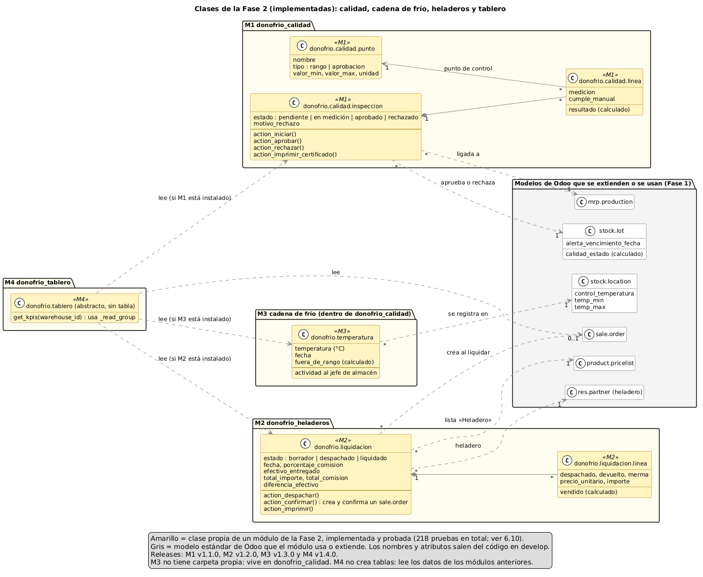

# 4.2.5 a 4.2.8 Modelo de datos: clases, ER, diseño lógico y diccionario

El modelo de datos cubre el núcleo (Odoo 19.0 Community con `donofrio_base`) y los cuatro módulos de la Fase 2. Las clases salen del código de `addons/`; el ER, el diseño lógico y el diccionario se extraen de una **base de datos real** con los módulos instalados, no de un dibujo a mano.

## 4.2.5 Diagrama de clases

El dominio de D'Onofrio se apoya en los modelos estándar de Odoo: cada modelo es una clase de Python con sus campos y métodos y una tabla en PostgreSQL. La figura muestra los 31 modelos que intervienen en los procesos del núcleo (venta B2B y PdV, inventario con lotes y FEFO, producción, compras, facturación con IGV, seguridad y mesa de servicios) con sus relaciones reales. `donofrio_base` **no define modelos nuevos**: extiende cuatro con `_inherit` (`sale.order` para elegir el diario de factura o boleta según el cliente, `res.users` para el 2FA, `auditlog.rule` para las reglas de auditoría y `project.task`, que gana el campo `sla_estado`); lo demás son registros de datos.

*Figura 4.11. Clases del núcleo (Fase 1). Naranja: modelo estándar que `donofrio_base` extiende; verde: datos que no son modelos.*

Las clases propias de la Fase 2 se muestran con los nombres y atributos reales del código, en amarillo, ligadas a los modelos de Odoo que usan o extienden.

*Figura 4.12. Clases de la Fase 2 (M1 a M4) y su relación con el núcleo.*

Las clases propias son `donofrio.calidad.punto`, `donofrio.calidad.inspeccion` y su línea de medición (M1, ligadas a `mrp.production` y `stock.lot`), `donofrio.temperatura` con los campos de rango en `stock.location` (M3), `donofrio.liquidacion` y su línea (M2, que al liquidar crea un `sale.order`) y el servicio de KPI `get_kpis()` de M4, un modelo abstracto sin tablas.

## 4.2.6 Diseño de base de datos: modelo ER

El ER se extrajo de una base limpia de PostgreSQL 16 con 703 tablas de Odoo: un script lee de `information_schema` y `pg_constraint` las columnas, claves primarias y foráneas, y la cardinalidad según si la FK admite nulo. De las 703 tablas se filtraron las **42 centrales**: 36 del núcleo (ventas, inventario con lotes, producción, compras, facturación, maestros y seguridad), 3 de calidad (M1), 2 de heladeros (M2) y 1 de cadena de frío (M3); M4 no crea tablas.

*Figura 4.13. Modelo ER de las 42 tablas centrales (pata de gallo, color por área).*

Las relaciones son 1:N desde la tabla con la FK; las N:M de Odoo pasan por tablas intermedias que no se dibujan, y las FK hacia `res_users`, `stock_location`, `stock_picking_type` y `account_journal` se anotan en cada caja sin línea. Las tablas mayores son `account_move_line` (17.852 filas), `stock_move_line` (6.535) y `stock_move` (6.063).

## 4.2.7 Diseño lógico

El diseño lógico muestra, para las tablas centrales del negocio, el tipo de dato, las PK y FK y las cardinalidades; sale del mismo extractor, por lo que coincide con la base real. Se presenta el flujo de inventario y lotes, base de la trazabilidad y del FEFO.

El flujo es `stock_picking` → `stock_move` → `stock_move_line` → `stock_lot`, con las existencias en `stock_quant`. `stock_move_line` registra el `stock_lot` que entró o salió, `stock_quant` guarda la cantidad por producto, ubicación y lote, y `stock_lot` guarda las fechas de vencimiento, retiro y alerta: con la de retiro Odoo aplica FEFO y con el vencimiento, la alerta a 30 días. El pedido se une a su entrega y a su factura por `sale_id` y `account_move`, y la orden de producción consume y produce mediante `stock_move`, de modo que el lote queda ligado a sus insumos.

**Por qué el ORM y no SQL propio.** El esquema lo crea el ORM de Odoo a partir de las clases de los modelos, así que siempre coincide con el código instalado; las reglas de negocio (FEFO, FIFO, IGV), los permisos y la auditoría se aplican en el ORM y un `INSERT` manual los eludiría; y el código es más corto y se prueba con `TransactionCase`. Por eso `donofrio_base` solo escribe datos y *hooks* que usan el ORM, y el SQL del proyecto se limita a consultas de lectura para documentar y medir.

## 4.2.8 Diccionario de datos

El diccionario de la plantilla (una tabla por entidad con clave, campo, tipo, tamaño, nulidad y descripción) se genera con una herramienta del proyecto desde `information_schema`, `pg_constraint` e `ir_model_fields`. Aquí se presentan solo los **modelos propios** (calidad, heladeros y cadena de frío); el diccionario completo de las 42 tablas centrales y del resto del esquema de Odoo se obtiene con esa misma herramienta y se entrega como archivo aparte.

`donofrio_base` no crea tablas: agrega la columna `project_task.sla_estado` y carga como datos la compañía, 2 almacenes, 47 productos, 12 listas de materiales, 5 listas de precios, 10 usuarios, 21 empleados y las reglas de seguridad y auditoría.
