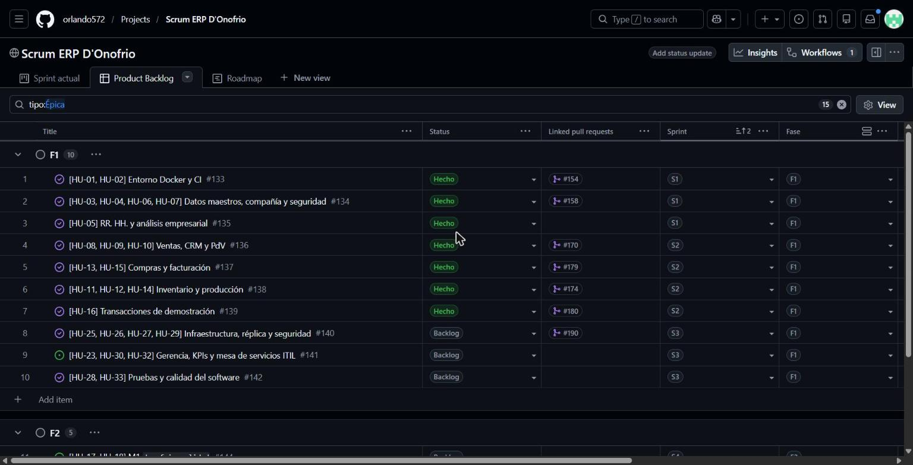
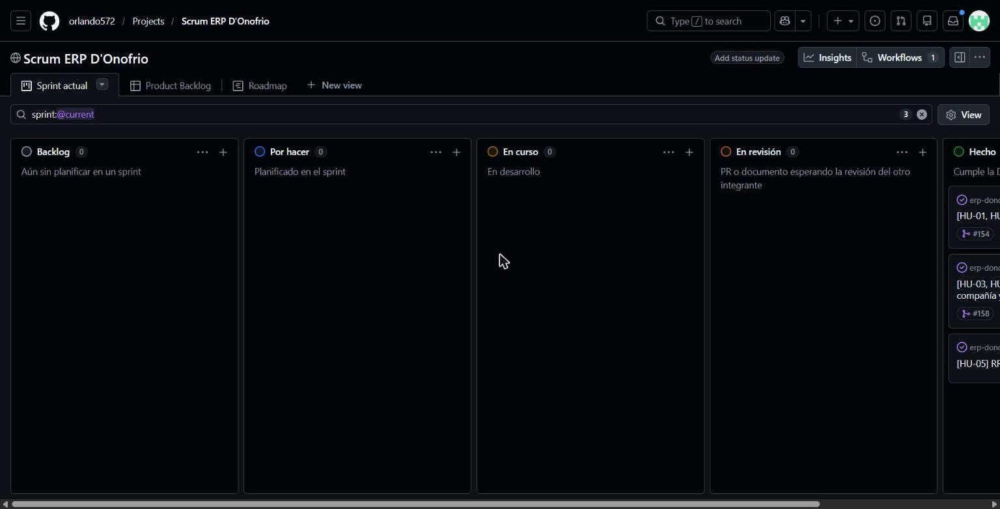
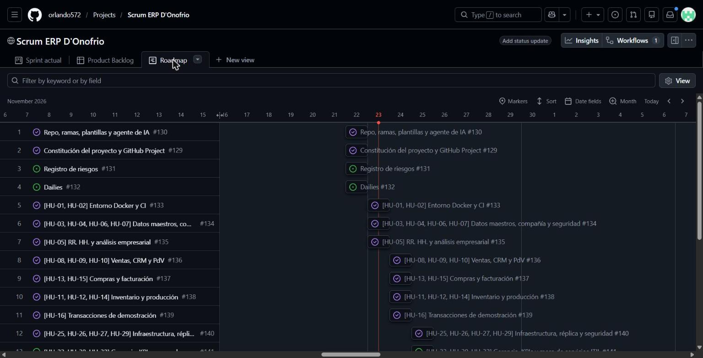
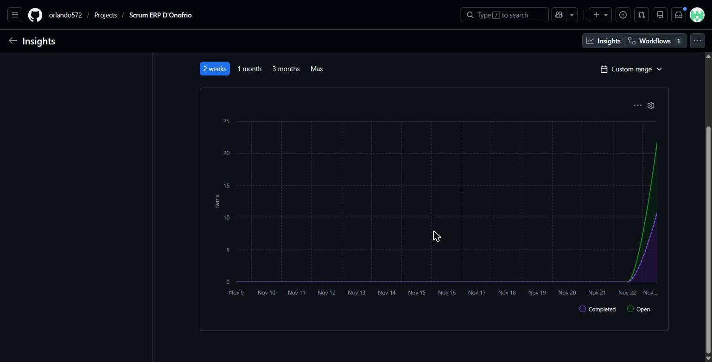

# 4.3.4 y 4.3.9 IDEs y lenguajes de programación; plataforma de gestión de proyectos

> **Estado:** borrador del Sprint 3 · **Autora:** Evelyn · **Revisa:** Orlando · **Fuente:** [manual de herramientas](../manuales/manual_herramientas.md), [`docs/pm/github-projects/`](../pm/github-projects/README.md), [04 §4.11](../plan/04_scrum_pmbok.md) y el repositorio (`git ls-files`, 23/11/2026)
>
> Solo se describe **lo que se usó**. Lo que el plan nombraba y no se usó está en la [sección 11 del manual](../manuales/manual_herramientas.md) y se resume al final de 4.3.4.

---

## 4.3.4 Aplicación de herramientas: IDEs y lenguajes de programación

### 4.3.4.1 Entorno de desarrollo

| Herramienta | Versión | Para qué se usó en el proyecto |
|---|---|---|
| **Visual Studio Code** | 1.146.0 | Editor de los dos integrantes para `addons/`, `scripts/` y `docs/`; vista previa de Markdown. En Windows se usa con la extensión **WSL**, de modo que el código queda en Ubuntu. No se exige ninguna extensión; las útiles son *Python*, *PlantUML* y *Markdown All in One* |
| **Claude Code** (asistente de IA) | 2.1.328 | Ayuda a programar y a redactar bajo las reglas de `CLAUDE.md`; un *hook* (`.claude/hooks/bloquear_legacy.py`) rechaza los patrones de Odoo anteriores a la 19. Es una herramienta de los *Developers*, no un rol (riesgo R5) |
| **Git** y **`gh`** | 2.53.0 y 2.46.0 | Control de versiones; la CLI de GitHub crea PR y lee el Project |
| **Docker y Compose** | 29.1.3 y 2.40.3 | Entorno reproducible con un comando; los scripts de pruebas, diagramas y rendimiento corren en contenedores |
| **DBeaver** | — | Lectura de PostgreSQL (`localhost:5432` y réplica en `5433`) para revisar tablas y consultas |

Las versiones del grupo A son las de la PC de Orlando el 23/11/2026; el manual explica cómo instalarlas en Ubuntu y en Windows con WSL2.

### 4.3.4.2 Lenguajes y formatos

Los conteos son de `git ls-files` al 23/11/2026. Los lenguajes están ordenados de mayor a menor peso en el producto.

| Lenguaje o formato | Versión | Dónde se usa | Archivos |
|---|---|---|---|
| **Python** | 3.12.3 (la de la imagen `odoo:19.0-20261112`) | El módulo `donofrio_base` (modelos, *hooks* y 136 pruebas con `TransactionCase`); los scripts de carga de datos, medición y trazabilidad (`scripts/`); los generadores de diagramas (`docs/diagramas/`) | 43 |
| **XML** | — | Datos y configuración del ERP por código (empresa, usuarios, almacenes, productos, recetas, listas de precios, reglas de acceso, vistas guardadas); los diagramas BPMN 2.0 | 14 de datos del módulo y 12 `.bpmn` |
| **CSV** | — | Permisos de acceso del módulo (`security/ir.model.access.csv`) y la lista de issues del Project (`epicas.csv`) | 6 |
| **Bash** | — | `docker compose` y 20 scripts: pruebas (`test.sh`), respaldo y restauración, despliegue protegido, verificaciones | 20 |
| **YAML** | — | `docker-compose.yml` y los *workflows* de GitHub Actions (`ci.yml`, `perf.yml` y `release.yml`) | 6 |
| **JavaScript** | — | Solo el script de carga de k6 (`scripts/perf/carga.js`) | 1 |
| **Markdown** | — | Informe, manuales, actas de Scrum y plan | 80 |
| **PlantUML** | 1.2026.10 | Casos de uso, clases, ER y arquitectura C4; se convierte a PNG con Graphviz 14.0.1 en un contenedor | 14 |
| **SVG** | — | Los generadores en Python escriben los BPMN, la arquitectura y los mockups; `rsvg-convert` los pasa a PNG | 58 |
| **SQL** | — | Consultas de comprobación en DBeaver y en los scripts (`pg_stat_replication`, extracción del esquema para el ER); no hay archivos `.sql` versionados | — |
| **Mermaid** | — | Organigrama y algunos diagramas dentro del Markdown del informe | — |

**Cómo se verifica el código.**
- `ruff` 0.8.4 revisa el estilo de `addons/` en el trabajo `lint` del CI (reglas por defecto, 120 columnas).
- `scripts/check_legacy.sh` busca los patrones de Odoo ≤ 16 (por ejemplo `<tree>`, `attrs=`); corre en el CI y como *hook* del asistente de IA.
- `scripts/test.sh` instala el módulo con `--test-enable` e imprime solo los errores; es lo que corre el trabajo `test` en cada PR.

### 4.3.4.3 Lo que no se usó

| Previsto | Estado | Por qué |
|---|---|---|
| **JavaScript con OWL** (tablero del módulo M4) | **No se usó** | El módulo `donofrio_tablero` es de la Fase 2 y no se construyó; el tablero de la Fase 1 sale de los dashboards estándar |
| **SCSS** (marca visual, HU-24) | **No se usó** | También es del M4 |
| Módulos propios en Python más allá de `donofrio_base` | **No hay** | Los módulos M1 a M4 esperan la decisión del Gate 0 |
| SchemaSpy, draw.io, Camunda Modeler | No se usaron | Se reemplazaron por `scripts/diagrama_er.py` con PlantUML y por generadores en Python ([manual, sección 11](../manuales/manual_herramientas.md)) |

Si el equipo construye alguno de esos módulos tras el Gate 0, esta sección se actualiza con el JavaScript y el SCSS reales.

---

## 4.3.9 Plataformas de gestión de proyectos

### 4.3.9.1 Por qué GitHub Projects

La plantilla nombra otra herramienta de tableros (6.3 menciona *Monday*). Se usó **GitHub Projects (v2)** porque es gratuito, está integrado con los issues, los PR y los *commits*, y el docente lo ve sin invitación: el repositorio y el Project son públicos. Es **un solo Project**, «Scrum ERP D'Onofrio» (<https://github.com/users/orlando572/projects/4>), vinculado al repositorio `erp-donofrio`. El Project tiene **22 ítems**: 15 épicas y 7 de gestión.

### 4.3.9.2 Estructura de los ítems

- Las **HU** van como checklist dentro de un issue de **épica**, una por área y dueño en cada sprint. Los riesgos viven en [`plan_riesgos.md`](../pm/plan_riesgos.md) y los entregables del informe, en la checklist del issue «Informe final».
- El título de la épica nombra sus HU: `[HU-08, HU-09, HU-10] Ventas, CRM y PdV`.
- Una rama por HU (`feature/HU-xx-*`), `[HU-xx]` en cada commit y `Parte de #n` en cada PR; el último PR de la épica la cierra con `Closes #n`.
- Los issues de gestión son: constitución (#129), repositorio (#130), registro de riesgos (#131), «Dailies» (#132), Gate 0 (#143), informe final (#149) y entrega (#150). Los riesgos y las dailies reciben un comentario en cada Retro y cada Daily.
- Los bugs reales usan la plantilla `bug.yml`.

### 4.3.9.3 Campos (tabla de campos)

| Campo | Tipo | Valores | Para qué sirve |
|---|---|---|---|
| **Status** | Selección | Backlog · Por hacer · En curso · En revisión · Hecho | Estado de la tarjeta |
| **Sprint** | Iteración | S0 · S1 · S2 · S3 · S4 · Cierre (1 día cada una) | Sprint al que pertenece la épica; lo usa el filtro `@current` |
| **Puntos** | Número | Suma de los puntos de las HU de la épica; 0 en gestión | Burndown por puntos |
| **Responsable** | Selección | Evelyn · Orlando (un solo valor) | Dueño de la épica |
| **Fase** | Selección | F1 · F2 | Núcleo o módulos propios |
| **Tipo** | Selección | Épica · Gestión · Bug | Clase de ítem |
| **Prioridad** | Selección | Must (F1 y gestión) · Should (M1 a M4) · Could (opcionales) | Orden |

Los campos se crean por código con [`crear_project.sh`](../pm/github-projects/crear_project.sh) (CLI `gh`; el campo de iteración, con GraphQL porque la CLI no lo soporta). La lista de los 22 issues está en [`epicas.csv`](../pm/github-projects/epicas.csv).

### 4.3.9.4 Vistas

| Vista | Diseño | Filtro | Uso en la gestión |
|---|---|---|---|
| **Product Backlog** | Tabla | `tipo:Épica` (agrupada por Fase) | Tabla 8 de la plantilla ([4.2.11](04_02_10_a_12_scrum.md)) |
| **Sprint actual** | Tablero por Status | `sprint:@current` | Sprint Backlog (tabla 9), Planning, Daily y Review |
| **Roadmap** | Línea de tiempo | — (por la fecha de cada iteración) | Gantt de la calendarización ([4.2.9](04_02_calendarizacion.md)) |

La API no configura la **agrupación ni el orden** de las vistas; esos dos pasos se hicieron a mano en la interfaz. Las vistas se crean con [`crear_vistas.sh`](../pm/github-projects/crear_vistas.sh) (GraphQL).

*Ilustración 16a: vista «Product Backlog». Captura del 23/11/2026.*

*Ilustración 16b: vista «Sprint actual».*

*Ilustración 16c: vista «Roadmap».*

*Ilustración 16d: Insights, con el *burn up* de ítems abiertos y cerrados.*

### 4.3.9.5 Automatizaciones

El Project tiene seis *workflows* integrados de GitHub; al 23/11/2026 **solo uno está activo**.

| *Workflow* | Estado | Qué hace |
|---|---|---|
| Auto-add sub-issues to project | **Activo** | Agrega al Project los sub-issues de un ítem |
| Item closed | Desactivado | Pasaría la tarjeta a «Hecho» al cerrar el issue |
| Pull request merged | Desactivado | Pasaría la tarjeta a «Hecho» al fusionar su PR |
| Pull request linked to issue | Desactivado | Cambiaría el estado al enlazar un PR |
| Item added to project | Desactivado | Fijaría un estado inicial a los ítems nuevos |
| Auto-close issue | Desactivado | Cerraría el issue al pasar a «Hecho» |

**Consecuencia.** El estado de las tarjetas se cambia **a mano**. Por eso, al 23/11/2026 las épicas #140 y #142 están cerradas pero siguen en «Backlog», y los puntos de Insights (que cuenta ítems) no coinciden con el burndown por puntos de [6.2](06_01_a_06_03_equipo_sprints_y_project.md). La mejora prevista es activar «Item closed» con el valor «Hecho».

Fuera del Project, la automatización está en el repositorio: el CI exige `lint` y `test` en cada PR a `develop`, y `scripts/burndown.py` calcula el burndown por puntos leyendo el Project con `gh project item-list`.

### 4.3.9.6 Cómo se usó en cada evento Scrum

| Evento | Qué se hizo en el Project |
|---|---|
| Planning | Se asignó el sprint y los puntos a las épicas; la vista «Sprint actual» muestra lo planificado |
| Daily | Un comentario por Daily en el issue «Dailies» (#132) |
| Review | Se marcó la checklist de cada épica con el enlace al PR y se pasaron las tarjetas a «Hecho» |
| Retro | Un comentario en el issue «Registro de riesgos» (#131) con el seguimiento de los riesgos |
| Gate 0 | El issue #143 recibe un comentario con la decisión del equipo |

Detalle de cada evento: [4.2.12](04_02_10_a_12_scrum.md).

### 4.3.9.7 Límites conocidos

1. **Iteraciones con fechas planificadas.** Se crearon de un día cada una desde el 23/11 (S1 = 23/11, S2 = 24/11, S3 = 25/11, S4 = 26/11, Cierre = 27/11) y S0 quedó como iteración completada (22/11). Los tres sprints reales se hicieron entre el 22/11 y el 23/11, así que «Sprint actual» sigue mostrando el S1 y el Roadmap dibuja barras que no coinciden con las fechas reales ([6.2](06_01_a_06_03_equipo_sprints_y_project.md)). Hay que corregir las fechas de las iteraciones.
2. **Estado de las tarjetas a mano** (ver 4.3.9.5).
3. **Insights cuenta ítems, no puntos.** Para medir por puntos se usa `scripts/burndown.py`.
4. **Permisos.** La cuenta de Evelyn solo lee el Project (que pertenece a la cuenta de Orlando); cambiar tarjetas, iteraciones y *workflows* lo hace quien tenga permiso de escritura.
5. **Las capturas muestran los estados previos a esa corrección.** Se repiten cuando se actualicen las fechas y las tarjetas.
