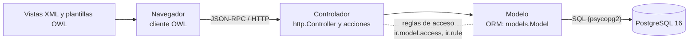
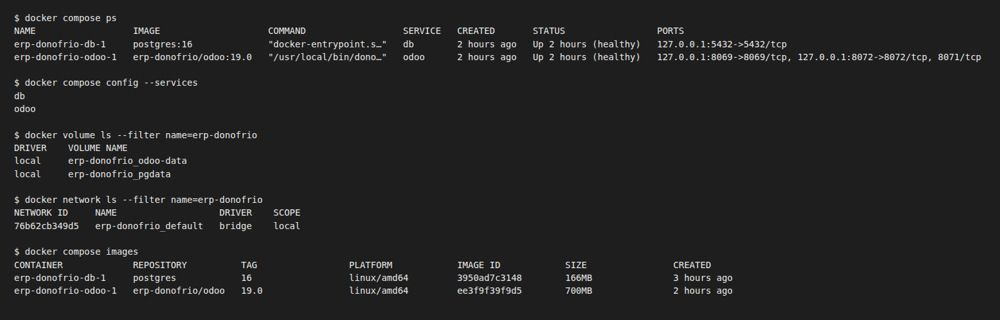

# 4.3 Back-end y despliegue: infraestructura y contenedores

> **Estado:** borrador del Sprint 3 (estados actualizados el 23/11/2026 con lo que ya está en `develop`: HU-25, HU-26, HU-27, HU-28 y HU-29) · **Autor:** Orlando (SM) · **Revisa:** Evelyn · **Fuente:** [06 §6.5](../plan/06_github_ci_infra.md), [02 §2.2](../plan/02_mapeo_plantilla.md)
>
> Aquí van 4.3.1 y 4.3.7 (Sprint 1) y 4.3.2 y 4.3.3 (Sprint 2). La sección 4.3.4 es de Evelyn. La 4.3.5 (paquetes, librerías y dependencias) está en [5.2 a 5.4](05_01_a_05_06_backend.md); la 4.3.6 y la 4.3.8 (versionamiento y nube) siguen pendientes y las ramas y el pipeline están en [5.15](05_15_despliegue.md).

## 4.3.1 Infraestructura tecnológica

El ERP corre sobre contenedores en la PC de cada integrante (Ubuntu o Ubuntu dentro de WSL2). El mismo `docker-compose.yml` y la misma imagen de Odoo con etiqueta fechada (`odoo:19.0-20261112`) se usan en las dos PC y en el CI de GitHub, de modo que el entorno es reproducible con un solo comando (RNF012).


*Figura 4.3.1-a. Infraestructura tecnológica al 23/11/2026. Línea continua: ya existe en `develop`. Línea punteada: opcional o aún sin publicar (GHCR). Se genera con [`generar_arquitectura.py`](../diagramas/generar_arquitectura.py). Los diagramas C4 de contexto, contenedores y componentes están en [5.7 y 5.8](05_07_a_05_09_arquitectura_bd.md).*

| Elemento | Qué es | Estado |
|---|---|---|
| **PC de desarrollo** | Ubuntu nativo o WSL2 con Docker Engine y el plugin Compose; unos 4 GB de RAM libres. Una por integrante | En uso |
| **Contenedor `odoo`** | Imagen propia (`docker/odoo/Dockerfile`) sobre `odoo:19.0-20261112`; HTTP en 8069 y *websocket* en 8072, solo en `127.0.0.1`; monta `./addons` en modo lectura | En uso |
| **Contenedor `db`** | `postgres:16` con el rol `odoo` sin superusuario; puerto 5432 solo en `127.0.0.1` para DBeaver | En uso |
| **Contenedor `db-replica`** | Segundo `postgres:16` en *hot standby* de solo lectura, en *streaming* asíncrono con el primario (perfil `replica`, `127.0.0.1:5433`) | **En uso** (HU-25): [evidencia](../capturas/sprint-3/HU-25_evidencia_replica.txt) y [5.9](05_07_a_05_09_arquitectura_bd.md) |
| **Contenedor `nginx`** | Proxy inverso con TLS 1.2/1.3, HSTS, CSP, gzip y caché de *assets* (perfil `proxy`, puertos 8080 y 8443 del anfitrión) | **En uso** (HU-27): [evidencia](../capturas/sprint-3/HU-27_evidencia_seguridad.txt) y [5.11](05_10_a_05_12_seguridad.md) |
| **GitHub** | Repositorio público, Projects e Issues; ramas `main`, `develop` y `feature/HU-xx` con protección | En uso |
| **GitHub Actions** | *Runner* `ubuntu-24.04` efímero; `ci.yml` con los jobs `lint` (`check_legacy.sh` y `ruff`), `test` (`scripts/test.sh`), `replica`, `backup` y `proxy` en cada PR; `perf.yml` (k6 y ZAP, solo manual) y `release.yml` | En uso (HU-02, HU-25 a HU-29); detalle en [5.15](05_15_despliegue.md) |
| **GHCR** | Registro de imágenes (`ghcr.io/orlando572/erp-donofrio`); una imagen y un zip del código por cada tag `v*` | Flujo `release.yml` listo y probado en ensayo (HU-29, [evidencia](../capturas/sprint-3/HU-29_evidencia_release.txt)); **sin imagen publicada**, porque todavía no hay ningún tag |
| **VM en la nube** | Oracle Free u otra, con Compose, Nginx y Let's Encrypt; despliegue por SSH desde Actions | Opcional (decisión abierta) |

**Protección de la rama `develop`** (verificada en la configuración del repositorio el 23/11/2026):

| Regla | Valor |
|---|---|
| Aprobaciones requeridas en el PR | 1, y se descartan si el código cambia o el PR cambia de rama base |
| Checks obligatorios | `lint` y `test` (CI de GitHub Actions) |
| Conversaciones resueltas | Obligatorio |
| *Force push* y borrado de la rama | Prohibidos |
| Aplica a administradores | **No** (`enforce_admins` desactivado): quien tiene rol de administrador puede saltarse las reglas |

La rama `main` exige 1 aprobación y conversaciones resueltas, prohíbe el *force push* y tampoco aplica a administradores, pero **no** tiene checks obligatorios (verificado con la API de GitHub el 23/11/2026).

**Excepciones en el Sprint 1.** El CI llegó con la HU-02, así que los PR #152 y #153, abiertos antes, no podían reportar `lint` ni `test` y se fusionaron como administrador con la aprobación de Evelyn. Los PR #154, #155 y #156 se apilaron sobre el #153 y, al cambiar su base a `develop`, GitHub descartó sus aprobaciones; se fusionaron como administrador con el código ya revisado y los checks en verde. Los PR #157 y #158 esperaron una nueva aprobación. A partir del Sprint 2, los PR se abren directos contra `develop` para no repetir esas excepciones.

**Seguridad de la infraestructura ya aplicada:** los puertos de Odoo y PostgreSQL solo escuchan en `127.0.0.1` (Nginx publica 8080 y 8443); el gestor de bases de datos de Odoo está deshabilitado (`list_db = False`) y Nginx responde 404 a `/web/database/`; la contraseña maestra y las claves de PostgreSQL salen de `.env`, que no se sube al repositorio, y en el modo protegido Odoo exige una contraseña maestra de 16 caracteres o más; el rol de la aplicación no es superusuario de PostgreSQL; TLS 1.2 y 1.3 con HSTS en Nginx; 2FA para el administrador y el gerente. Riesgos, controles y pruebas: [5.10 a 5.12](05_10_a_05_12_seguridad.md).

## 4.3.2 Plataforma tecnológica

El ERP se construye sobre **Odoo 19.0 Community** (Python 3.12) con **PostgreSQL 16**. Odoo sigue el patrón **Modelo-Vista-Controlador** y deja el acceso a datos en su ORM. Esta sección explica cómo se aplica cada concepto en el proyecto.



*Figura 4.3.2-a. Capas de Odoo 19 y su relación con el proyecto.*

| Concepto | Cómo lo hace Odoo | Ejemplo en el proyecto |
|---|---|---|
| **Modelo (M)** | Una clase `models.Model` por entidad. Los campos son atributos y la tabla de PostgreSQL se crea sola | `stock.lot` (lote con vencimiento), `mrp.production` (orden de producción), `mrp.bom` (receta) |
| **ORM como DAO / Active Record** | El registro es un objeto con sus operaciones: `create`, `write`, `search`, `unlink`. El código nunca escribe SQL: usa `self.env['stock.lot'].search([...])`. El ORM abre, consulta y cierra la conexión | `post_init_hook` de `donofrio_base` y las pruebas de `donofrio_base/tests` consultan y crean registros solo con el ORM |
| **Vista (V)** | Archivos XML que declaran cómo se ve un modelo (`list`, `form`, `kanban`, `pivot`) y plantillas OWL (componentes JavaScript) para pantallas propias | Las vistas estándar de Inventario y Fabricación; en la Fase 2, el tablero OWL (`donofrio_tablero`) |
| **Controlador (C)** | Tres piezas: las acciones de ventana (`ir.actions.act_window`) que abren una vista con un filtro, los **métodos de negocio** que llaman los botones (`button_validate`, `button_mark_done`) y los controladores HTTP (`http.Controller`, rutas `type='jsonrpc'`) | Validar una recepción o terminar una orden de producción llama a métodos del modelo; la ruta `/web/health` sirve al *healthcheck* |
| **DTO** | Odoo mueve datos entre capas como **diccionarios**: `vals` en `create`/`write`, la lista de diccionarios que devuelve `read()` y el cuerpo JSON de las llamadas JSON-RPC. No hay clases DTO propias | El script `cargar_transacciones.py` arma diccionarios `vals` para crear recepciones, órdenes y lotes |
| **Seguridad** | Permisos por modelo (`ir.model.access.csv`), reglas por registro (`ir.rule`) y grupos | La regla que limita al liquidador al almacén de Arequipa (HU-04) |
| **Persistencia** | PostgreSQL 16 por `psycopg2`; adjuntos en el *filestore* de Odoo | Volúmenes `pgdata` y `odoo-data` (4.3.7) |

### SOLID aplicado a los módulos y la herencia

Odoo extiende por **herencia**, sin modificar el código de origen. Así se aplican los principios en el proyecto:

| Principio | Cómo se aplica |
|---|---|
| **S**: responsabilidad única | Un módulo por área de negocio: `donofrio_base` solo configura y carga datos; cada módulo de la Fase 2 (`donofrio_calidad`, `donofrio_heladeros`, `donofrio_tablero`) tendrá una sola responsabilidad. Un archivo de datos por área |
| **O**: abierto/cerrado | Se extiende con `_inherit` y con datos XML sin tocar los módulos estándar (`stock`, `mrp`, `product_expiry`). Por ejemplo, FEFO es solo configurar `removal_strategy_id` en las categorías |
| **L**: sustitución de Liskov | Un modelo heredado sigue cumpliendo el contrato del original: los métodos sobreescritos llaman a `super()` y mantienen firma y resultado |
| **I**: segregación de interfaces | Cada módulo declara solo las dependencias que usa en su `__manifest__.py`, y los usuarios reciben los grupos mínimos de su rol (10 roles en HU-04) |
| **D**: inversión de dependencias | Los módulos dependen de modelos y estrategias abstractas del registro (`env['stock.lot']`, la estrategia de retiro `product_expiry.removal_fefo`) y no de implementaciones concretas ni de SQL |

Limitación declarada: en la Fase 1 el proyecto **no define modelos nuevos**: configura y verifica Odoo por datos, *hooks* y pruebas, y extiende cuatro modelos existentes con `_inherit` (`sale.order`, `res.users`, `project.task`, que agrega el campo `sla_estado`, y `auditlog.rule`; ver [5.5.5](05_01_a_05_06_backend.md)). Los modelos propios (con su ACL y sus pruebas) aparecen si se construyen los módulos de la Fase 2. Qué patrones se aplicaron de verdad, y por qué no se afirma TDD estricto: [5.6](05_01_a_05_06_backend.md).

## 4.3.3 Configuración de herramientas: desarrollo, despliegue, mantenimiento y monitoreo

Lineamientos breves; el detalle de cada comando está en el README del repositorio y en el [**Manual de instalación y configuración de las herramientas**](../manuales/manual_herramientas.md) (borrador del Sprint 3; se exporta a PDF en el Cierre), que para cada herramienta explica el uso en este proyecto, la versión, la instalación en Ubuntu y WSL2, la comprobación y los problemas frecuentes, y dice cuáles del plan no se usaron (SchemaSpy, draw.io, Camunda Modeler). El ERP se instala con el [Manual de instalación](../manuales/manual_instalacion.md).

| Etapa | Herramientas y configuración | Lineamiento |
|---|---|---|
| **Desarrollo** | Ubuntu o WSL2, VS Code y Claude Code (con el hook que bloquea código legacy de Odoo); `docker compose` para levantar Odoo y PostgreSQL; DBeaver contra `localhost:5432`; Git y GitHub. Comandos: `scripts/init_db.sh` (BD nueva), `scripts/test.sh` (instala y prueba en una BD temporal), `scripts/check_legacy.sh` (patrones de versiones anteriores), `odoo shell` para el script de datos de demostración | Datos y configuración **siempre por código** en `donofrio_base`; la interfaz web solo para verificar. Antes de usar una API se consulta la ficha de cambios de Odoo 19 y el código fuente de 19.0 |
| **Despliegue** | Imagen propia de Odoo con la etiqueta fechada fija (`odoo:19.0-20261112`), la misma en las dos PC y en el CI; configuración generada al arrancar desde `.env`. GitHub Actions corre en cada PR el job `lint` (`check_legacy.sh` y `ruff`) y el job `test` (instalación limpia y pruebas). Ramas `feature/HU-xx` → `develop` → `main`, con revisión del otro integrante | Un PR por HU directo a `develop`, con CI en verde. Nginx con TLS (`scripts/levantar_prod.sh`, HU-27) y la réplica de PostgreSQL (HU-25) ya existen; la imagen en GHCR queda lista en `release.yml` (HU-29) y se publica con el primer tag. Procedimiento completo y rollback en [5.15](05_15_despliegue.md) |
| **Mantenimiento** | Actualización de módulos con `-u` sobre una BD con datos; datos de configuración con `noupdate` (para cambiarlos hay que recrear la BD); ficha `odoo19_cambios.md` que se amplía con cada diferencia encontrada; ejecución semanal del CI (regresión) | Cada cambio pasa por PR y por pruebas; un dato con `noupdate` que cambia exige avisar al equipo y recrear la BD |
| **Monitoreo** | `healthcheck` de PostgreSQL (`pg_isready`) y de Odoo (`/web/health`); `docker compose ps` y `docker compose logs -f odoo`; reinicio automático (`restart: unless-stopped`) | Respaldos con `backup.sh` y restauración con `restore.sh` (HU-26, RTO medido de 31 s; el *cron* diario está documentado, no instalado). **Uptime Kuma no se implementó**: no hay medición continua de disponibilidad |

## 4.3.7 Máquinas virtuales y contenedores

La plataforma de contenedores es **Docker Compose** (un archivo `docker-compose.yml` en la raíz del repositorio). No se usan máquinas virtuales en desarrollo; la VM en la nube es opcional (4.3.8).

### Servicios

| Servicio | Imagen | Perfil | Puertos publicados | Volumen | Salud y reinicio |
|---|---|---|---|---|---|
| `db` | `postgres:16` | (siempre) | `127.0.0.1:5432` → 5432 | `pgdata` → `/var/lib/postgresql/data` | `pg_isready` cada 5 s, 10 reintentos · `restart: unless-stopped` |
| `odoo` | `erp-donofrio/odoo:19.0` (construida desde `docker/odoo`) | (siempre) | `127.0.0.1:8069` → 8069 · `127.0.0.1:8072` → 8072 | `odoo-data` → `/var/lib/odoo` · `./addons` → `/mnt/extra-addons` (solo lectura) | `GET /web/health` cada 15 s, inicio con 30 s de gracia · `depends_on: db` (saludable) · `restart: unless-stopped` |
| `db-replica` | `postgres:16` | `replica` | `127.0.0.1:5433` → 5432 | `pgdata-replica` → `/var/lib/postgresql/data` | `pg_isready` cada 5 s, 20 reintentos · `restart: unless-stopped` · **En uso** (HU-25) |
| `nginx` | `nginx:stable` | `proxy` | 8080 → 80 y 8443 → 443 | configuración de `docker/nginx/` (solo lectura) y certificado local | `depends_on: odoo` (saludable) · `restart: unless-stopped` · **En uso** (HU-27) |
| `schemaspy` | — | `tools` | — | — | **No implementado:** el ER se genera con `scripts/diagrama_er.py` y PlantUML ([4.2.6](04_02_modelo_de_datos.md)) |

### Volúmenes y red

| Recurso | Tipo | Contenido | Cómo se borra |
|---|---|---|---|
| `erp-donofrio_pgdata` | Volumen local | Base de datos PostgreSQL | `docker compose down -v` |
| `erp-donofrio_pgdata-replica` | Volumen local | Datos de la réplica (solo con el perfil `replica`) | `docker compose down -v` |
| `erp-donofrio_odoo-data` | Volumen local | *Filestore* de Odoo (adjuntos, sesiones) | `docker compose down -v` |
| `erp-donofrio_default` | Red `bridge` | Red interna; los servicios se ven por nombre (`db`, `odoo`) | `docker compose down` |

### Configuración

- **Variables de entorno:** `.env` (copia de `.env.example`; no se versiona) define la base de datos, las contraseñas de prueba y los puertos. Compose las inyecta y el `entrypoint.sh` de la imagen genera `odoo.conf` a partir de `docker/odoo/odoo.conf.template`.
- **Primer arranque:** `scripts/init_db.sh` crea la base de datos `donofrio` e instala `donofrio_base`; es idempotente.
- **Base de datos:** el rol `odoo` lo crea `docker/postgres/primary/init-usuario-odoo.sh` solo la primera vez que se crea el volumen.

### Evidencia



*Figura 4.3.7-a. Servicios, volúmenes, red e imágenes del proyecto, con ambos contenedores en estado `healthy`.*

```text
$ docker compose ps
NAME                  IMAGE                    SERVICE   STATUS                 PORTS
erp-donofrio-db-1     postgres:16              db        Up 2 hours (healthy)   127.0.0.1:5432->5432/tcp
erp-donofrio-odoo-1   erp-donofrio/odoo:19.0   odoo      Up 2 hours (healthy)   127.0.0.1:8069->8069/tcp, 127.0.0.1:8072->8072/tcp, 8071/tcp
```

> La captura y la salida son del Sprint 1 (solo `db` y `odoo`); la salida de `docker compose --profile replica ps` y la del perfil `proxy` están en [`HU-25_evidencia_replica.txt`](../capturas/sprint-3/HU-25_evidencia_replica.txt) y [`HU-27_evidencia_seguridad.txt`](../capturas/sprint-3/HU-27_evidencia_seguridad.txt). El tamaño de las imágenes y el tiempo de arranque dependen de la PC; la primera vez se descargan unos 900 MB.
