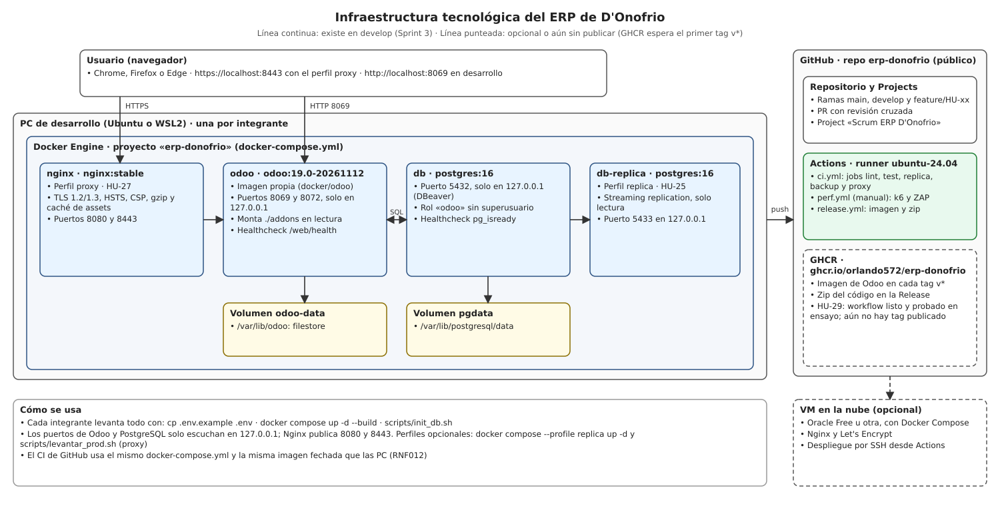

# 4.3 Gestión de desarrollo de software, infraestructura y plataforma

## 4.3.1 Infraestructura tecnológica

El ERP corre sobre contenedores en la PC de cada integrante (Ubuntu o WSL2). El mismo `docker-compose.yml` y la misma imagen de Odoo con etiqueta fechada (`odoo:19.0-20261112`) se usan en las dos PC y en el CI de GitHub, de modo que el entorno se levanta con un solo comando (RNF012).

*Figura 4.7. Infraestructura tecnológica: PC de desarrollo, contenedores, GitHub, Actions y GHCR.*

Los componentes son el contenedor `odoo` (HTTP en 8069 y *websocket* en 8072, solo en `127.0.0.1`, con `addons/` en solo lectura), `db` (`postgres:16` con un rol sin superusuario), `db-replica` (segundo `postgres:16` en *hot standby* de solo lectura, con *streaming* asíncrono) y `nginx` (proxy inverso con TLS 1.2/1.3, HSTS, CSP, gzip y caché de *assets*). GitHub aloja el repositorio público con `main` y `develop` protegidas; GitHub Actions corre en cada PR los trabajos `lint`, `test`, `replica`, `backup` y `proxy`; y GHCR guarda la imagen y el zip del código de cada versión `v1.0.0` a `v1.4.0`. Los puertos de Odoo y PostgreSQL solo escuchan en `127.0.0.1`, el gestor de bases de datos de Odoo está deshabilitado y las claves salen de un `.env` fuera del repositorio.

## 4.3.2 Plataforma tecnológica

El ERP usa **Odoo 19.0 Community** (Python 3.12) con **PostgreSQL 16**. Odoo sigue el patrón Modelo-Vista-Controlador y deja el acceso a datos en su ORM.

**Tabla 4.8. Patrones de la plataforma y su uso en el proyecto**

| Concepto | Cómo lo hace Odoo | Ejemplo en el proyecto |
|---|---|---|
| **Modelo y ORM (DAO)** | Una clase `models.Model` por entidad con `create`, `write` y `search`; el código nunca escribe SQL | `stock.lot`, `mrp.production`; `post_init_hook` de `donofrio_base` |
| **Vista** | XML (`list`, `form`, `kanban`, `pivot`) y plantillas OWL | Vistas de Inventario y Fabricación; tablero OWL de M4 |
| **Controlador** | Acciones de ventana, métodos de los botones y controladores HTTP | Validar una recepción; la ruta `/web/health` |
| **DTO** | Diccionarios (`vals`, `read()`, cuerpo JSON-RPC) | `cargar_transacciones.py` arma `vals` |
| **Seguridad** | Permisos por modelo, reglas por registro y grupos | Regla que limita al personal de Arequipa a su almacén |

**SOLID.** Cada módulo tiene una responsabilidad (`donofrio_base` solo configura y carga datos); se extiende con `_inherit` y datos XML sin tocar los módulos estándar (FEFO es solo configurar la estrategia de retiro); los métodos sobreescritos llaman a `super()`; cada módulo declara solo las dependencias que usa y los usuarios reciben los grupos mínimos de su rol; y los módulos dependen de modelos y estrategias del registro y no de SQL.

## 4.3.3 Configuración de herramientas: desarrollo, despliegue, mantenimiento y monitoreo

En **desarrollo** se usan Ubuntu o WSL2, VS Code, Docker Compose, DBeaver, Git y un asistente de IA con un *hook* que bloquea patrones obsoletos de Odoo; datos y configuración van siempre por código en `donofrio_base` y la interfaz solo se usa para verificar. El **despliegue** usa una imagen con etiqueta fija, configuración generada desde `.env`, CI en cada PR y ramas `feature` → `develop` → `main` con revisión cruzada, más Nginx con TLS y la réplica de PostgreSQL (5.15). El **mantenimiento** actualiza módulos con `-u` sobre una base con datos; los datos con `noupdate` exigen recrear la base para cambiarse; y el CI se ejecuta cada semana. El **monitoreo** usa *healthchecks* de PostgreSQL y de Odoo (`/web/health`), reinicio automático y respaldos con restauración medida de 31 s; no hay medición continua de disponibilidad.

## 4.3.6 Controles de versionamiento

Todo el trabajo (código, datos, scripts, documentación e informe) está en un solo repositorio de Git en GitHub (público, licencia LGPL-3.0).

**Tabla 4.9. Controles de versionamiento**

| Control | Implementación y qué previene |
|---|---|
| Ramas con propósito | `main` (entregado, un tag por entrega), `develop` (integración) y `feature/HU-xx-*` de corta vida; evita trabajo mezclado |
| Convención de commits | *Conventional Commits* en español con la HU entre corchetes; evita un historial ilegible |
| PR y revisión cruzada | Plantilla con HU, pruebas y capturas; 1 aprobación del otro integrante, que se descarta si el código cambia |
| Protección de ramas y CI | Checks `lint` y `test` obligatorios, conversaciones resueltas, sin *force push*; evita fusionar sin revisión |
| Archivos que no se versionan | `.gitignore` con `.env`, llaves y respaldos; *secret scanning* y *push protection* activos |
| Freno al código obsoleto | *Hook* del asistente y `check_legacy.sh` en el CI con 17 patrones de Odoo 16 o anteriores |
| Release por tag | Cada tag `vX.Y.Z` publica la imagen en GHCR y el zip en GitHub Releases |

Las reglas no se aplican a administradores (`enforce_admins` desactivado), decisión del equipo compensada con la revisión cruzada. El paso de `develop` a `main` ocurrió dos veces (núcleo `v1.0.0` y Fase 2 completa `v1.4.0`).

## 4.3.7 Máquinas virtuales y contenedores

La plataforma de contenedores es Docker Compose; en desarrollo no se usan máquinas virtuales. Los servicios son `db` y `odoo` (siempre activos, con *healthcheck* y reinicio automático), `db-replica` (perfil `replica`, 127.0.0.1:5433) y `nginx` (perfil `proxy`, puertos 8080 y 8443). Los volúmenes son `pgdata`, `pgdata-replica` y `odoo-data` (el *filestore*), con una red interna `bridge`. El arranque inicial crea la base `donofrio` e instala `donofrio_base`.

## 4.3.8 Plataformas cloud

El proyecto no usa máquinas virtuales en la nube: el ERP se ejecuta en la PC de cada integrante y la demostración protegida usa el perfil `proxy` (`https://localhost:8443`). Las plataformas cloud en uso son las de GitHub: repositorio, Projects, Actions (tres flujos: CI, rendimiento y *release*), Releases (`v1.0.0` a `v1.4.0`, con zip de 23,5 a 26,1 MiB) y GHCR (imagen de unos 3.25 GB por versión). Una VM con Let's Encrypt, un despliegue por SSH y un monitor externo se recomiendan como trabajo futuro (sección 8), porque el costo es cero y la reproducibilidad local ya cubre TLS, cabeceras y modo producción.
