# 4.4 Diseño de prototipos: wireframes y mockups

Los prototipos se hicieron con un generador propio en Python: es gratuito, deja el diseño versionado y revisable en un PR, y de una sola descripción de cada pantalla salen el wireframe y el mockup, de modo que no se desfasan. Los datos que aparecen en las pantallas son ficticios.

- **Wireframes (2.4.1).** Escala de grises y sin marca, para acordar la estructura: qué campos, tabla y acciones tiene cada pantalla. Hay uno por caso de uso.
- **Mockups (2.4.2).** Alta fidelidad con la paleta de marca: el **amarillo de los carritos** (`#F7C60A`, desde 1919) como color de acción y de cabecera, tinta oscura para el texto, y verde, rojo y azul solo para alertas.
- **Pantallas de la Fase 2.** Las de liquidación, inspección, temperaturas y tablero se diseñaron antes de implementarse y hoy tienen su pantalla real. Las pantallas estándar son una propuesta de cómo se vería Odoo configurado con la marca.
- **Vista móvil.** Solo la liquidación del heladero la necesita, porque el liquidador la usa de pie, junto al despacho.

**Tabla 4.22. Resumen de pantallas diseñadas**

| CU | Pantalla | Módulo de Odoo | Estado |
|---|---|---|---|
| CU001 | Embudo CRM por canal | CRM | Implementada (estándar) |
| CU002 | Cotización con lista de precios | Ventas | Implementada (estándar) |
| CU003 | Punto de venta con boleta | Punto de venta | Implementada (estándar) |
| CU004 | Liquidación diaria del heladero (y vista móvil) | Heladeros (M2) | Implementada; móvil revisada en 375 × 812 |
| CU005 | Recepción de insumos con lote y vencimiento | Inventario | Implementada (estándar) |
| CU006 | Registro de temperaturas de las cámaras | Cadena de frío (M3) | Implementada |
| CU007 | Orden de producción con lote | Fabricación | Implementada (estándar) |
| CU008 | Inspección de calidad del lote | Calidad (M1) | Implementada |
| CU009 | Tablero gerencial de KPI | Tablero (M4) | Implementada |
| CU010 | Análisis de ventas por línea, canal y temporada | Ventas | Implementada (estándar) |
| CU011 | Solicitud de cotización por regla mín./máx. | Compras | Implementada (estándar) |
| CU012 | Factura (01) o boleta (03) con IGV | Facturación | Implementada (estándar) |

## 2.4.1 Wireframes

Se muestran los wireframes de las pantallas desarrolladas para D'Onofrio más representativas: la liquidación diaria del heladero (CU004) y la inspección de calidad del lote (CU008).

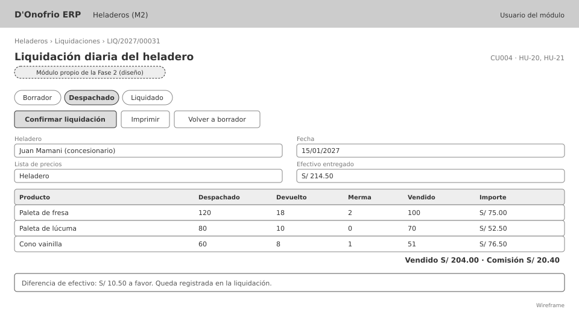

*Figura 4.17. Wireframe de la liquidación diaria del heladero (CU004).*

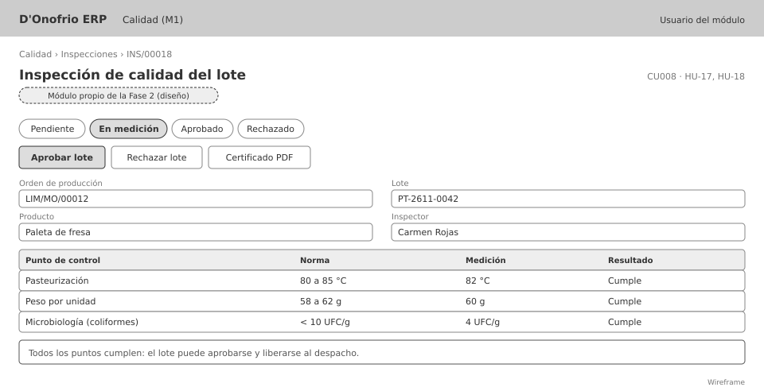

*Figura 4.19. Wireframe de la inspección de calidad del lote (CU008).*

## 2.4.2 MockUps

Los mockups muestran las pantallas principales de cada área con la paleta de marca: venta, liquidación del heladero, recepción, producción, calidad, temperaturas, tablero gerencial, facturación y los dos reportes impresos.

**Ventas.**

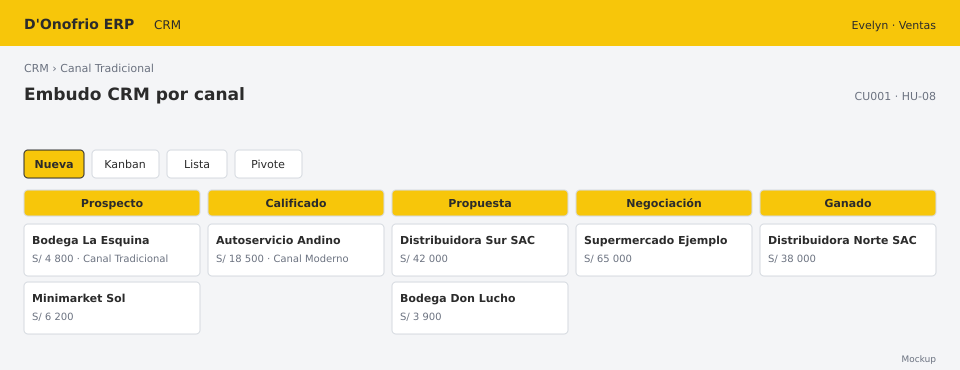

*Figura 4.22. Mockup del embudo de oportunidades por canal de venta (CU001).*

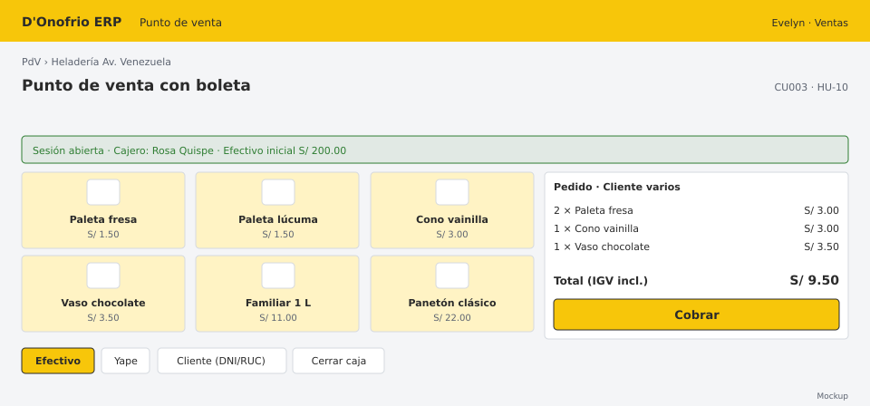

*Figura 4.23. Mockup del punto de venta de la heladería con boleta (CU003).*

**Heladeros.**

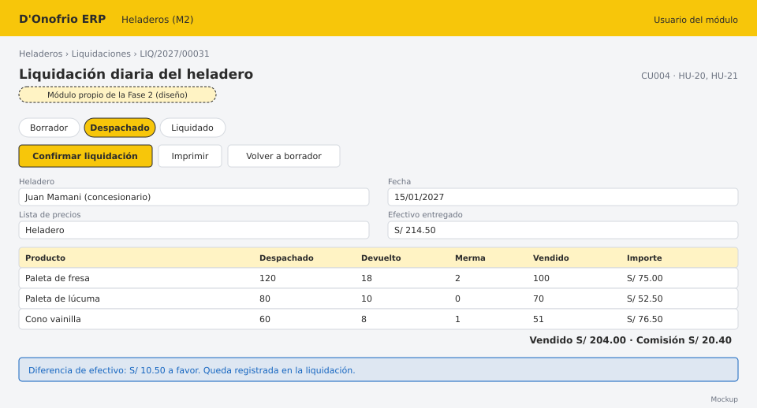

*Figura 4.18. Mockup de la liquidación diaria del heladero (CU004).*

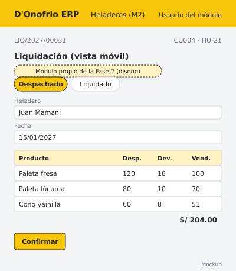

*Figura 4.24. Mockup de la liquidación diaria del heladero en el celular (CU004).*

**Logística.**

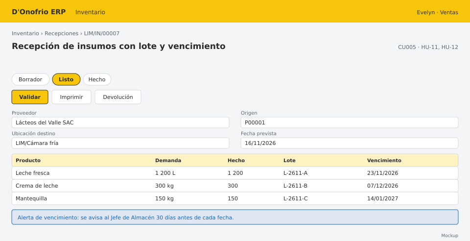

*Figura 4.25. Mockup de la recepción de insumos con lote y vencimiento (CU005).*

**Producción y calidad.**

*Figura 4.26. Mockup de la orden de producción con lote (CU007).*

*Figura 4.20. Mockup de la inspección de calidad del lote (CU008).*

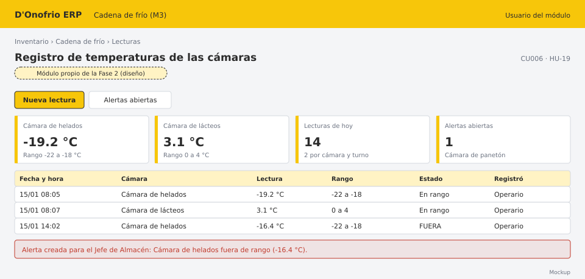

*Figura 4.27. Mockup del registro de temperaturas de las cámaras de frío (CU006).*

**Gerencia y facturación.**

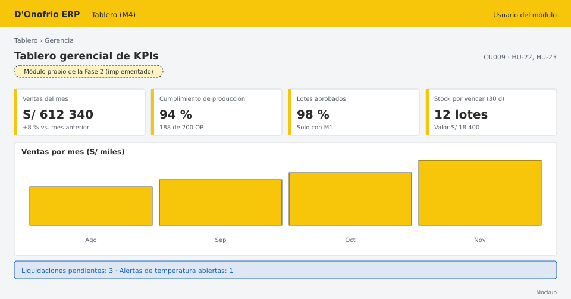

*Figura 4.21. Mockup del tablero gerencial de KPI (CU009).*

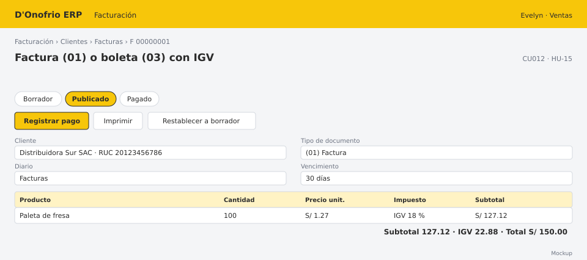

*Figura 4.28. Mockup de la factura (01) o boleta (03) con IGV (CU012).*

**Reportes impresos.**

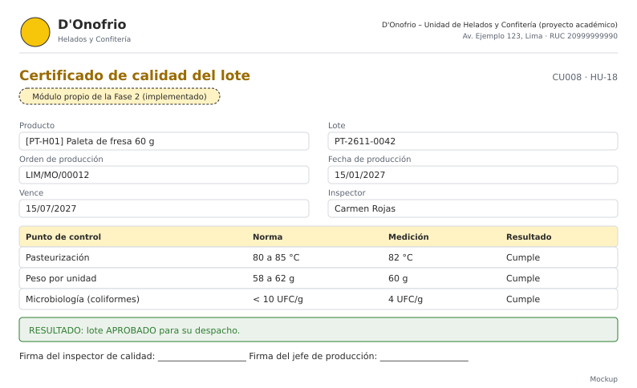

*Figura 4.29. Mockup del certificado de calidad del lote en PDF.*

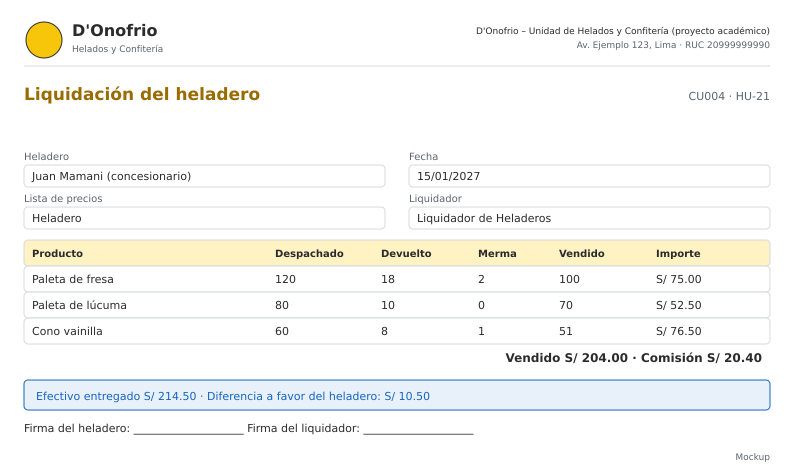

*Figura 4.30. Mockup de la liquidación del heladero en PDF, con firmas.*

**Decisiones de diseño.** Una acción principal por pantalla, en amarillo y a la izquierda, con las secundarias en blanco. La barra de estado muestra el ciclo del documento (borrador → confirmado → hecho), como en Odoo, para no cambiar los hábitos del usuario. Los colores de alerta siempre llevan un texto y el contraste cumple el mínimo de 4.5 (2.6.1). Las etiquetas están en español y los montos en soles (`S/`), con el IGV a la vista cuando aplica. La rejilla de productos del punto de venta, el kanban del CRM y la tabla de líneas siguen la estructura de Odoo 19, por lo que el wireframe sirve también como guía de configuración.
