# 4.4 Diseño de prototipos: wireframes y mockups

> **Estado:** borrador del Sprint 2 · **Autora:** Evelyn (PO) · **Revisa:** Orlando · **Fuente:** [02 §2.2](../plan/02_mapeo_plantilla.md) (4.4.1 y 4.4.2), [03 §3.3](../plan/03_modulos_odoo.md), [04 §4.4](../plan/04_scrum_pmbok.md)
>
> Los datos que aparecen en las pantallas son ficticios y verosímiles (supuesto S7).

## 4.4.0 Cómo se hicieron

La plantilla sugiere Excalidraw o Figma. Aquí se usó un **generador propio** ([`generar_pantallas.py`](../diagramas/generar_pantallas.py)) por tres razones: es gratuito y funciona sin cuenta, deja el diseño **versionado en el repositorio** y revisable en un PR, y de **una sola descripción** de cada pantalla sale el wireframe y el mockup, así que no se desfasan. Como el generador se parece al de los BPMN, cualquiera del equipo puede cambiar una pantalla editando unas líneas y volviendo a generar:

```bash
python3 docs/diagramas/generar_pantallas.py        # escribe .svg en docs/diagramas/pantallas/
```

El PNG sale del SVG con el mismo comando de Docker de [`docs/diagramas/README.md`](../diagramas/README.md).

- **Wireframes (4.4.1):** escala de grises, sin marca, para acordar la **estructura**: qué campos, qué tabla y qué acciones tiene cada pantalla. Uno por caso de uso.
- **Mockups (4.4.2):** alta fidelidad con la paleta de marca: **amarillo de los carritos** (`#F7C60A`, desde 1919) como color de acción y de cabecera, tinta oscura para el texto y verde, rojo y azul solo para alertas.
- **Pantallas de la Fase 2:** las de liquidación, inspección, temperaturas y tablero llevan la etiqueta «Módulo propio de la Fase 2 (diseño)». Se diseñan en la Fase 1 **aunque no se construyan**; si el Gate 0 no confirma su módulo, quedan como «Diseñado – trabajo futuro» con su caso de uso, su wireframe y su mockup ([02 §2.3](../plan/02_mapeo_plantilla.md)).
- **Pantallas estándar de la Fase 1:** muestran lo que ya existe en Odoo configurado; el mockup es una **propuesta de cómo se vería con la marca**, no una pantalla nueva por construir. Las capturas reales de la interfaz están en `docs/capturas/sprint-2/`.
- **Vista móvil:** solo la liquidación del heladero (CU004) la necesita, porque el liquidador la usa de pie, junto al despacho.

## 4.4.0b Resumen de pantallas

| CU | Pantalla | Módulo de Odoo | HU | Estado |
|---|---|---|---|---|
| CU001 | Embudo CRM por canal | CRM | HU-08 | Implementada (CRM estándar, HU-08) |
| CU002 | Cotización con lista de precios | Ventas | HU-09 | Implementada (Ventas estándar, HU-09) |
| CU003 | Punto de venta con boleta | Punto de venta | HU-10 | Implementada (PdV, HU-10) |
| CU004 | Liquidación diaria del heladero | Heladeros (M2) | HU-20, HU-21 | Diseño: trabajo futuro si no se construye el módulo |
| CU004 | Liquidación (vista móvil) | Heladeros (M2) | HU-21 | Diseño: trabajo futuro si no se construye el módulo |
| CU005 | Recepción de insumos con lote y vencimiento | Inventario | HU-11, HU-12 | Implementada (Inventario estándar, HU-11, HU-12) |
| CU006 | Registro de temperaturas de las cámaras | Cadena de frío (M3) | HU-19 | Diseño: trabajo futuro si no se construye el módulo |
| CU007 | Orden de producción con lote | Fabricación | HU-14 | Implementada (Fabricación estándar, HU-14) |
| CU008 | Inspección de calidad del lote | Calidad (M1) | HU-17, HU-18 | Diseño: trabajo futuro si no se construye el módulo |
| CU009 | Tablero gerencial de KPIs | Tablero (M4) | HU-22, HU-23 | Diseño: trabajo futuro si no se construye el módulo |
| CU010 | Análisis de ventas por línea, canal y temporada | Ventas | HU-23 | Estándar; capturas en el Sprint 3 (HU-23) |
| CU011 | Solicitud de cotización generada por la regla mín./máx. | Compras | HU-13 | Implementada (Compras estándar, HU-13) |
| CU012 | Factura (01) o boleta (03) con IGV | Facturación | HU-15 | Implementada (Facturación estándar, HU-15) |

## 4.4.1 y 4.4.2 Wireframes y mockups por caso de uso

### CU001 · Embudo CRM por canal

**Estado de la pantalla:** Implementada (CRM estándar, HU-08). **Ruta:** CRM › Canal Tradicional.

| Wireframe (4.4.1) | Mockup (4.4.2) |
|---|---|
| 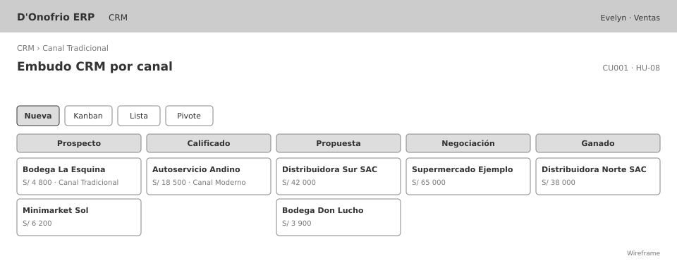 |  |

### CU002 · Cotización con lista de precios

**Estado de la pantalla:** Implementada (Ventas estándar, HU-09). **Ruta:** Ventas › Cotizaciones › S00015.

| Wireframe (4.4.1) | Mockup (4.4.2) |
|---|---|
| 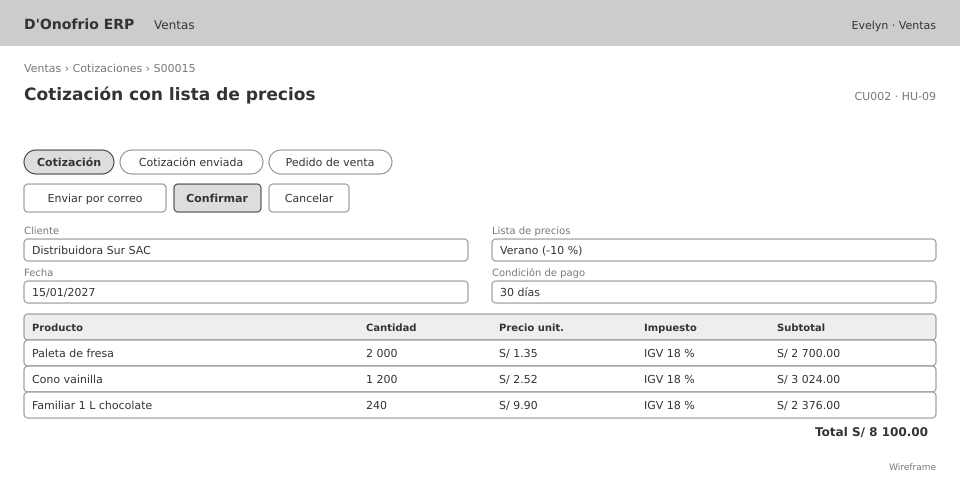 | 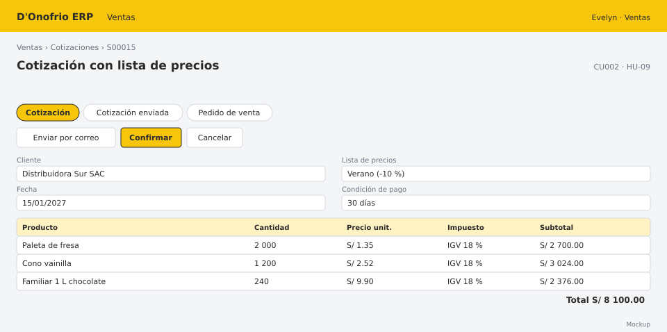 |

### CU003 · Punto de venta con boleta

**Estado de la pantalla:** Implementada (PdV, HU-10). **Ruta:** PdV › Heladería Av. Venezuela.

| Wireframe (4.4.1) | Mockup (4.4.2) |
|---|---|
| 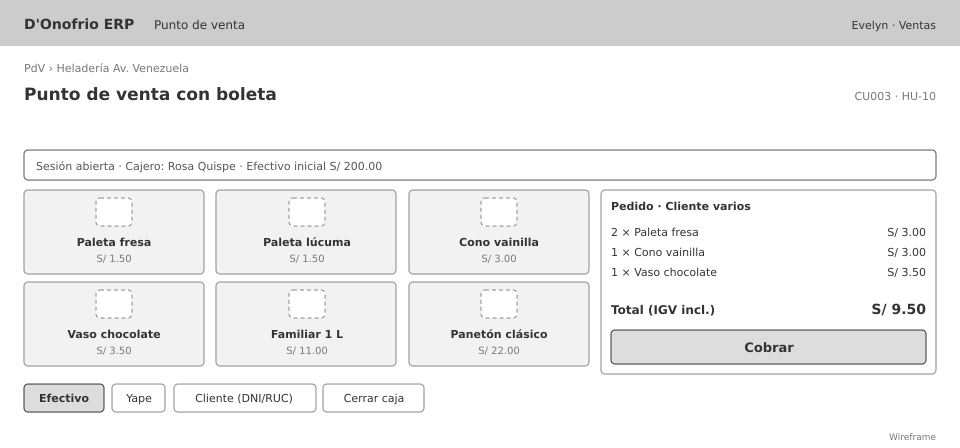 |  |

### CU004 · Liquidación diaria del heladero

**Estado de la pantalla:** Diseño: trabajo futuro si no se construye el módulo. **Ruta:** Heladeros › Liquidaciones › LIQ/2027/00031.

| Wireframe (4.4.1) | Mockup (4.4.2) |
|---|---|
|  |  |

### CU004 · Liquidación (vista móvil)

**Estado de la pantalla:** Diseño: trabajo futuro si no se construye el módulo. **Ruta:** LIQ/2027/00031.

| Wireframe (4.4.1) | Mockup (4.4.2) |
|---|---|
| 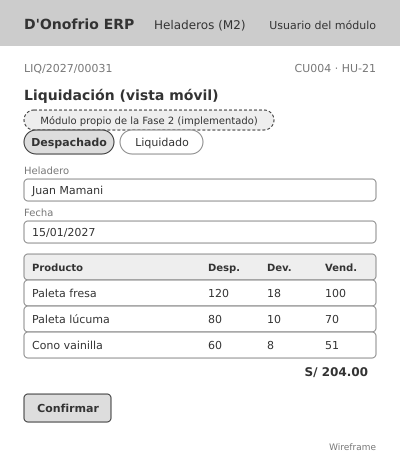 |  |

### CU005 · Recepción de insumos con lote y vencimiento

**Estado de la pantalla:** Implementada (Inventario estándar, HU-11, HU-12). **Ruta:** Inventario › Recepciones › LIM/IN/00007.

| Wireframe (4.4.1) | Mockup (4.4.2) |
|---|---|
| 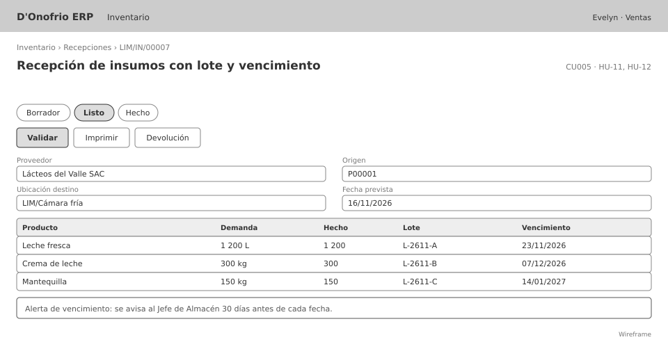 |  |

### CU006 · Registro de temperaturas de las cámaras

**Estado de la pantalla:** Diseño: trabajo futuro si no se construye el módulo. **Ruta:** Inventario › Cadena de frío › Lecturas.

| Wireframe (4.4.1) | Mockup (4.4.2) |
|---|---|
| 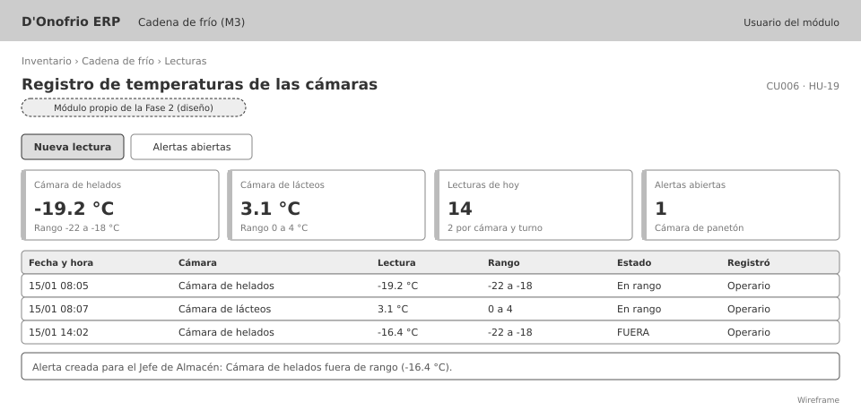 |  |

### CU007 · Orden de producción con lote

**Estado de la pantalla:** Implementada (Fabricación estándar, HU-14). **Ruta:** Fabricación › Órdenes › LIM/MO/00012.

| Wireframe (4.4.1) | Mockup (4.4.2) |
|---|---|
| 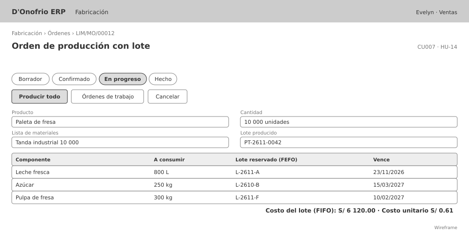 | 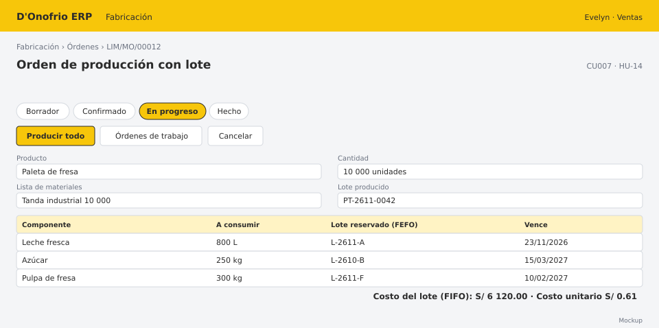 |

### CU008 · Inspección de calidad del lote

**Estado de la pantalla:** Implementada (`donofrio_calidad`, HU-17 y HU-18); capturas reales en `docs/capturas/sprint-4/`. **Ruta:** Calidad › Inspecciones › INS/00003.

| Wireframe (4.4.1) | Mockup (4.4.2) |
|---|---|
|  | 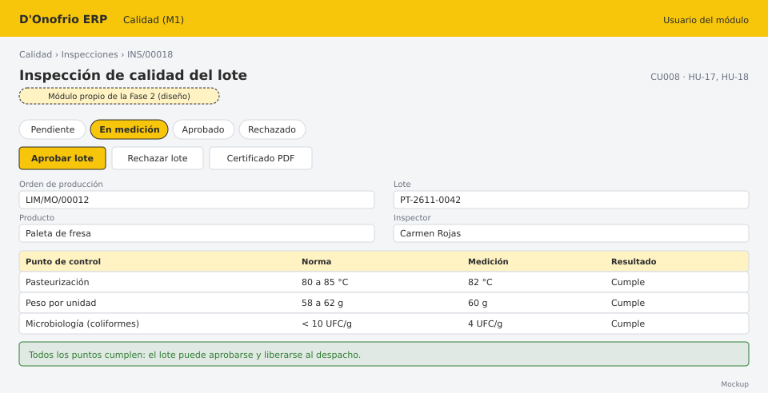 |

### CU009 · Tablero gerencial de KPIs

**Estado de la pantalla:** Diseño: trabajo futuro si no se construye el módulo. **Ruta:** Tablero › Gerencia.

| Wireframe (4.4.1) | Mockup (4.4.2) |
|---|---|
| 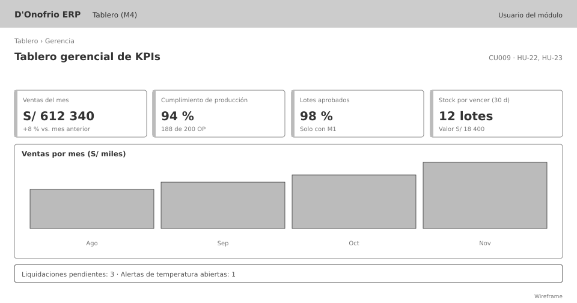 |  |

### CU010 · Análisis de ventas por línea, canal y temporada

**Estado de la pantalla:** Estándar; capturas en el Sprint 3 (HU-23). **Ruta:** Ventas › Informes › Análisis de ventas.

| Wireframe (4.4.1) | Mockup (4.4.2) |
|---|---|
| 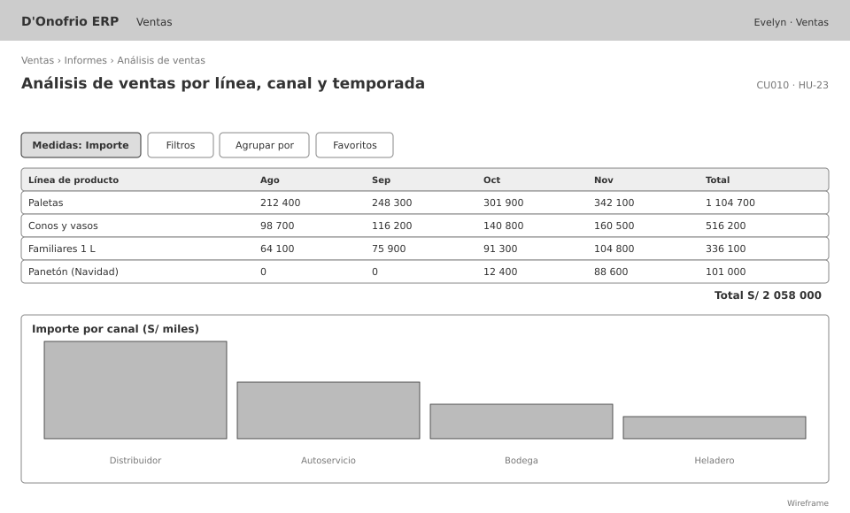 |  |

### CU011 · Solicitud de cotización generada por la regla mín./máx.

**Estado de la pantalla:** Implementada (Compras estándar, HU-13). **Ruta:** Compras › Solicitudes de cotización › P00001.

| Wireframe (4.4.1) | Mockup (4.4.2) |
|---|---|
| 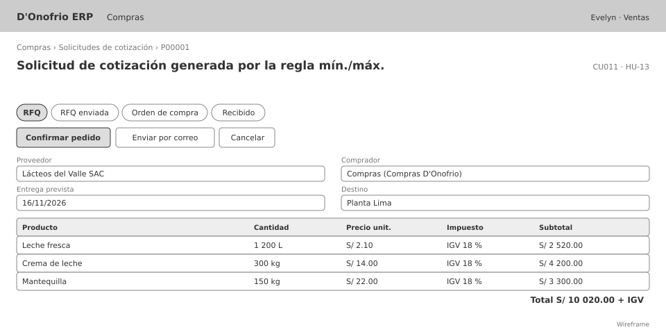 |  |

### CU012 · Factura (01) o boleta (03) con IGV

**Estado de la pantalla:** Implementada (Facturación estándar, HU-15). **Ruta:** Facturación › Clientes › Facturas › F 00000001.

| Wireframe (4.4.1) | Mockup (4.4.2) |
|---|---|
| 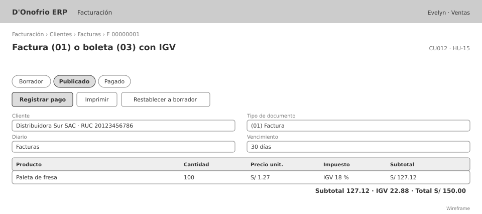 |  |

## Decisiones de diseño

- **Una acción principal por pantalla**, en amarillo y a la izquierda (confirmar, validar, cobrar), con las secundarias en blanco.
- **La barra de estado** muestra el ciclo del documento (borrador → confirmado → hecho), igual que en Odoo, para no cambiar los hábitos del usuario.
- **Contraste:** texto oscuro sobre amarillo y blanco; los colores de alerta siempre llevan un texto, nunca se usan solos.
- **Etiquetas en español** y montos en soles (`S/`), con el IGV a la vista cuando aplica.
- **Consistencia con Odoo:** la rejilla de productos del PdV, el kanban del CRM y la tabla de líneas siguen la estructura de Odoo 19, así el wireframe sirve también como guía de configuración.

## Pendiente

- Probar los prototipos de la Fase 2 con el usuario (SUS) si se construyen sus módulos (Sprint 3 y 4).
- Reemplazar el mockup por la pantalla real en 4.6.2 (Sprint 3).
