# 4.6 Prototipos web, buenas prácticas de UI/UX y reportes

> **Estado:** versión final del Cierre (25/11/2026) · **Autora:** Evelyn (PO) · **Revisa:** Orlando · **Fuente:** [02 §2.2](../plan/02_mapeo_plantilla.md) (4.6.1 a 4.6.4), [03 §3.3](../plan/03_modulos_odoo.md), wireframes y mockups de [4.4](04_04_prototipos.md)
>
> La 4.6.4 (optimización de rendimiento web) está en [04_06_wpo.md](04_06_wpo.md). Los datos de las pantallas son los de demostración (ficticios).

## 4.6.1 Buenas prácticas de conversión de prototipos a web UI/UX

El sistema no se programa pantalla por pantalla: se **configura Odoo 19 Community** con datos y vistas guardadas por código. Por eso la «conversión» de un prototipo a pantalla real consiste en **elegir la pantalla estándar de Odoo que se parece al mockup** y dejarla bien configurada, no en maquetar de cero. Las prácticas que se siguieron:

### Heurísticas de usabilidad de Nielsen

| Heurística | Cómo se aplica en el proyecto |
|---|---|
| 1. Visibilidad del estado del sistema | La barra de estado muestra el ciclo del documento (borrador → confirmado → hecho). Los tickets de la mesa de servicios muestran su etapa y su cumplimiento del SLA |
| 2. Relación entre el sistema y el mundo real | Interfaz en español peruano (`es_PE`), soles (`S/`), IGV 18 %, y los términos del negocio: lote, FEFO, heladero, boleta y factura |
| 3. Control y libertad del usuario | Se pueden descartar los cambios de un formulario, restablecer un documento a borrador, cancelar un pedido y archivar en vez de borrar |
| 4. Consistencia y estándares | Se mantienen las pantallas estándar de Odoo (embudo, formulario con barra de estado, lista, pivote, punto de venta); los mockups respetan su estructura |
| 5. Prevención de errores | No se puede recibir un insumo sin lote; FEFO no reserva un lote vencido; el tipo de documento (factura o boleta) y el IGV salen solos según el cliente |
| 6. Reconocer antes que recordar | Listas desplegables de clientes, productos y listas de precios; vistas guardadas en «Favoritos» para los análisis de gerencia |
| 7. Flexibilidad y eficiencia | Vistas guardadas por código (HU-23) y listas de precios por canal evitan repetir filtros y cálculos |
| 8. Diseño estético y minimalista | Una acción principal por pantalla y tarjetas de KPI en el tablero; el catálogo del PdV muestra solo los productos terminados |
| 9. Ayudar a reconocer y corregir errores | Los avisos de Odoo salen en español; las líneas con error se marcan en el formulario |
| 10. Ayuda y documentación | Manual de instalación, historial (chatter) en cada documento y las actas del equipo en el repositorio |

### Consistencia con el diseño de Odoo

Los mockups de [4.4](04_04_prototipos.md) conservan la estructura de Odoo: encabezado con ruta, barra de estado, fila de botones, formulario a dos columnas, tabla de líneas, kanban y tarjetas de KPI. Lo único que se cambia en el mockup es el **color de marca** (el amarillo de los carritos, desde 1919). La pantalla real conserva los colores estándar de Odoo hasta que se haga el *branding* del módulo del tablero (M4, Fase 2); el logo y los datos de la compañía **ya salen** en la factura, la boleta y la nota de entrega.

### Accesibilidad: contraste de color

Se midió la relación de contraste de los pares de color de los mockups (WCAG 2.1: mínimo **4.5** para texto normal).

| Par de colores (texto sobre fondo) | Contraste | ¿Cumple 4.5? |
|---|---|---|
| Texto oscuro `#2B2B2B` sobre amarillo de marca `#F7C60A` | 8.79 | Sí |
| Texto oscuro sobre el fondo gris claro `#F4F5F7` | 12.98 | Sí |
| Gris de apoyo `#5C6370` sobre el fondo gris claro | 5.54 | Sí |
| Amarillo oscuro `#9A6B00` (títulos de reporte) sobre blanco | 4.69 | Sí |
| Verde de alerta `#2E7D32` sobre blanco | 5.13 | Sí |
| Rojo de alerta `#C0392B` sobre blanco | 5.44 | Sí |
| Azul de alerta `#1565C0` sobre blanco | 5.75 | Sí |
| Amarillo de marca sobre blanco, **como texto** | 1.61 | **No** |

Reglas que salen de la tabla: **el amarillo de marca se usa solo como fondo** de botones y cabeceras, con texto oscuro; no se usa como color de texto; y **los colores de alerta siempre llevan un texto**, no se usan solos. En la primera versión de los mockups el gris de apoyo (`#6B7280`) daba 4.43 y no llegaba al mínimo; se oscureció a `#5C6370`.

### Diseño adaptable (responsive)

Odoo es adaptable por diseño. Para la única pantalla que lo exige en el plan se diseñó una **vista móvil**: la liquidación del heladero (CU004). La vista móvil de la liquidación y del tablero se vio en un emulador de 375 × 812 (sin desplazamiento horizontal); la comprobación en Chrome, Firefox y Edge y en un celular real (RNF001) no se hizo: **[PENDIENTE: prueba del tablero y de la liquidación en un celular real, a cargo del equipo]**.

### Etiquetas en español

Todo el texto visible está en español (`es_PE`). Limitaciones: los títulos de algunos gráficos del dashboard «Métricas del almacén» salen en inglés porque Odoo no los traduce, y la plantilla estándar del PDF de la boleta la titula «Factura» ([4.6.3](#463-prototipos-de-informes-y-reportes)).

## 4.6.2 Propuesta de prototipos web

Cada caso de uso de la Fase 1 tiene su **mockup** (propuesta con la marca) y la **pantalla real** ya configurada. Los de la Fase 2 (M1 a M4) **también tienen ya su pantalla real**, con los datos de demostración de la HU-16 (más abajo).

### Fase 1: pantallas estándar configuradas

| CU | Pantalla | Mockup | Pantalla real |
|---|---|---|---|
| CU001 | Embudo CRM por canal (HU-08) |  | 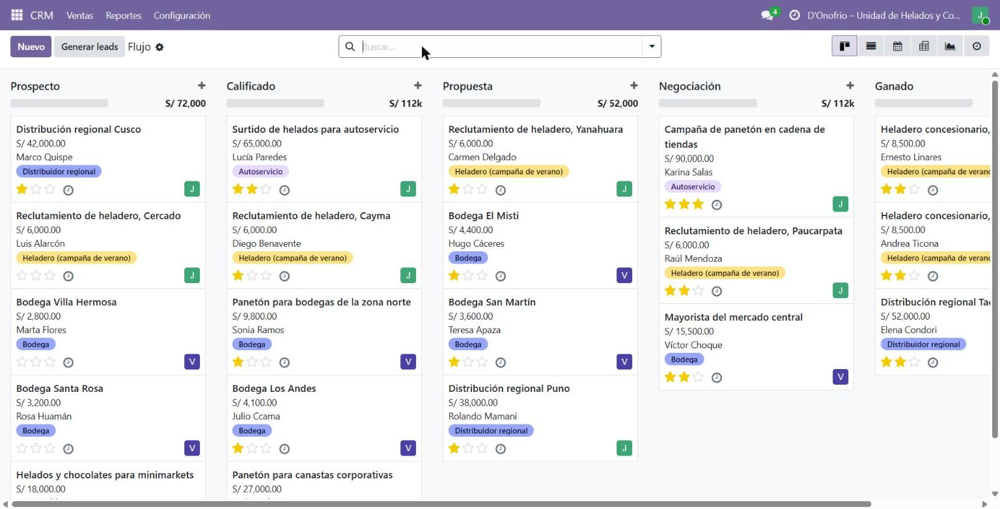 |
| CU002 | Pedido con lista de precios (HU-09) |  | 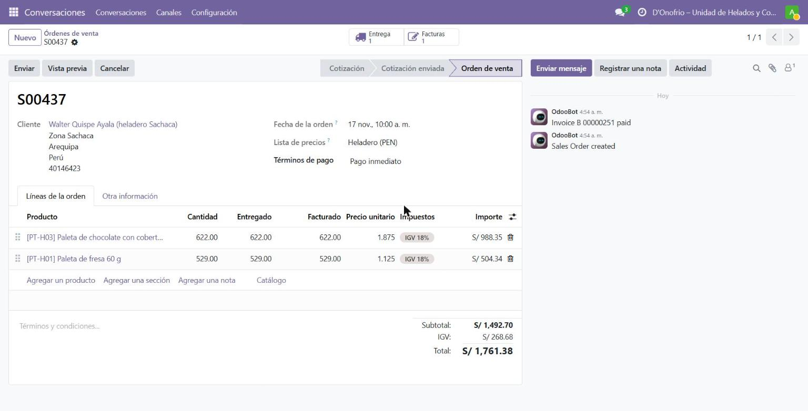 |
| CU003 | Punto de venta con boleta (HU-10) | 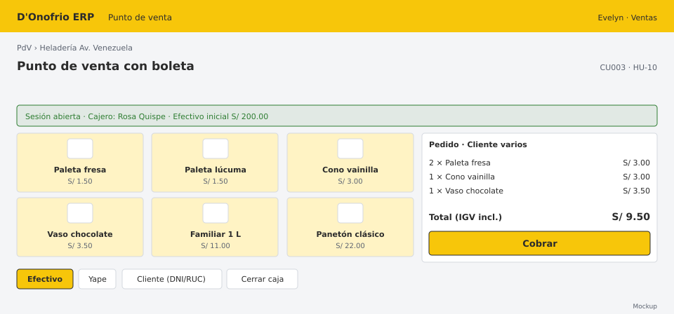 | 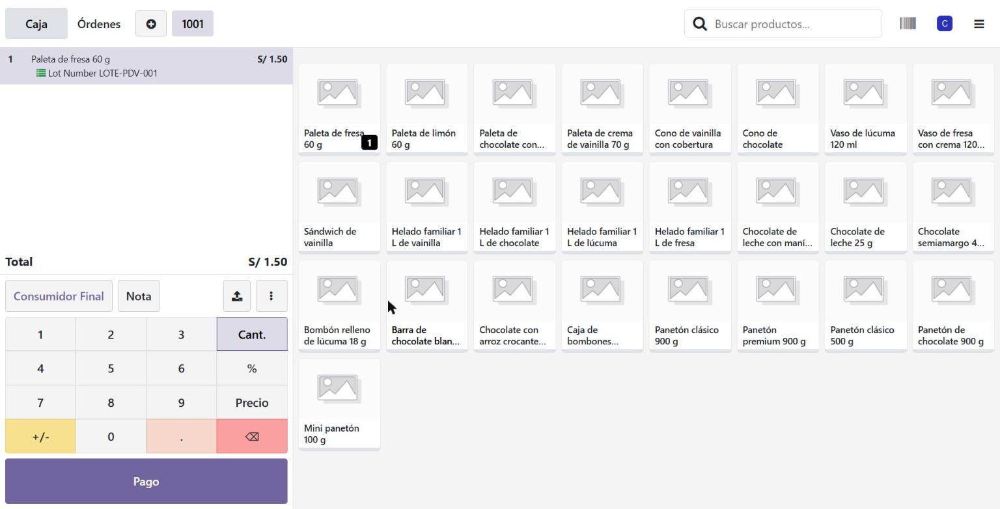 |
| CU005 | Recepción con lote y vencimiento (HU-11, HU-12) |  | 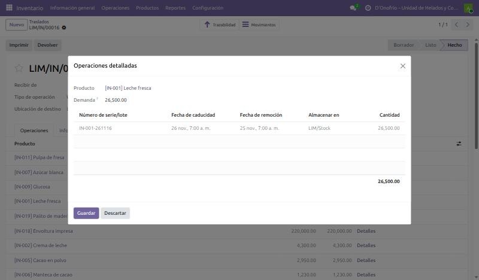 |
| CU007 | Orden de producción con lote (HU-14) |  | 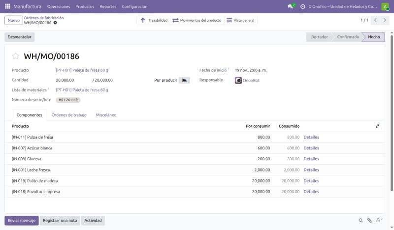 |
| CU009 | Tablero con dashboards estándar (HU-23) |  | 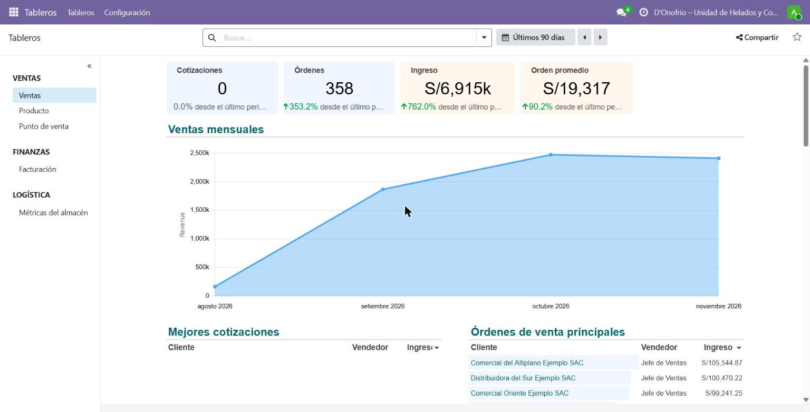 |
| CU010 | Análisis de ventas (HU-23) | 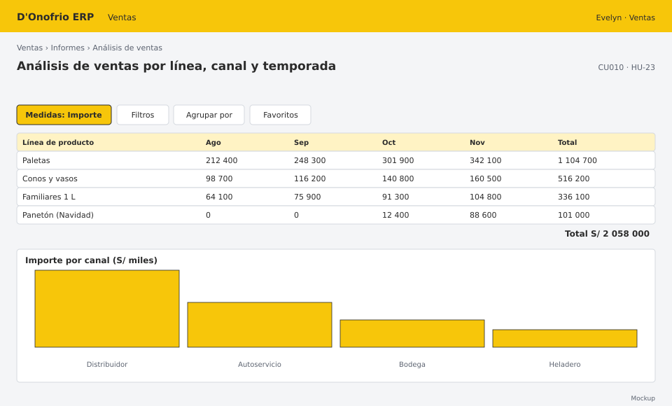 | 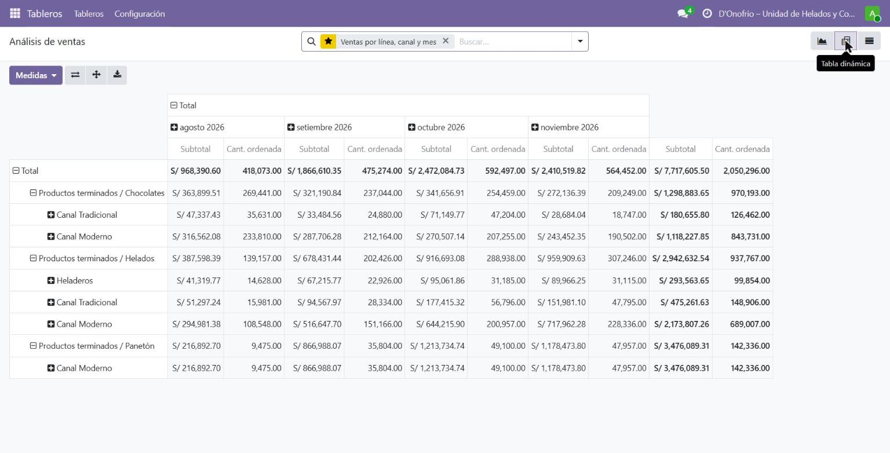 |
| CU011 | RFQ de compra por reabastecimiento (HU-13) | 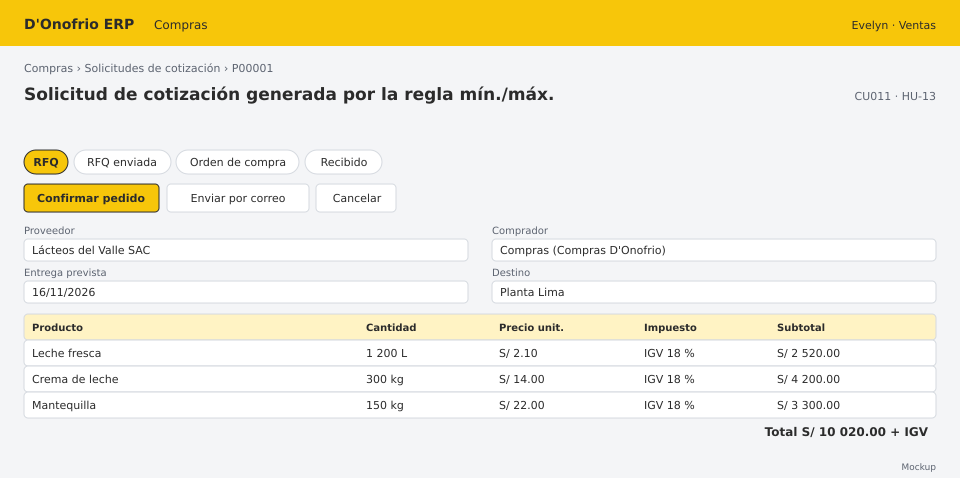 | 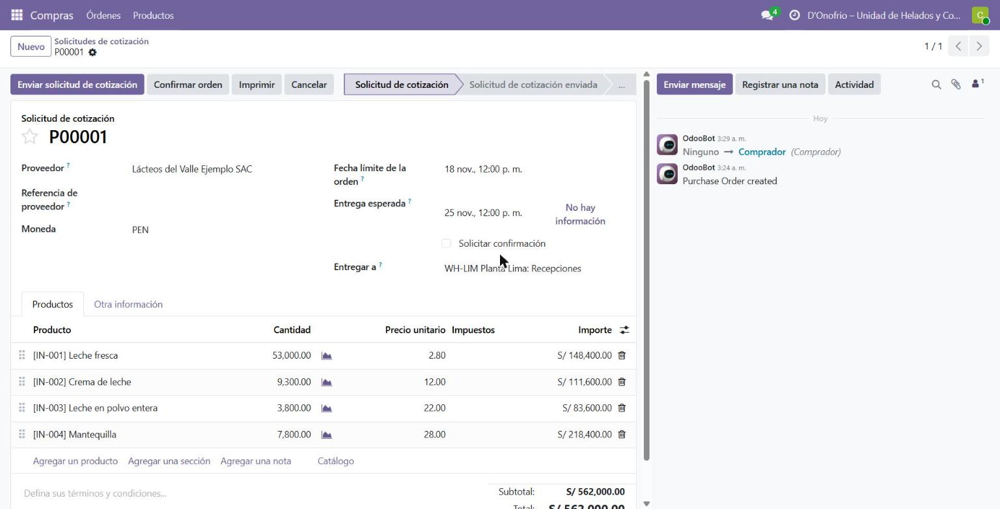 |
| CU012 | Factura con IGV (HU-15) | 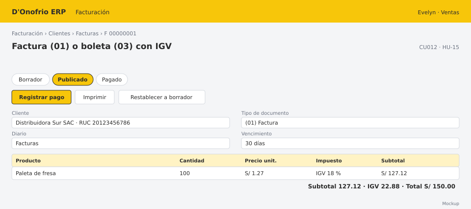 | 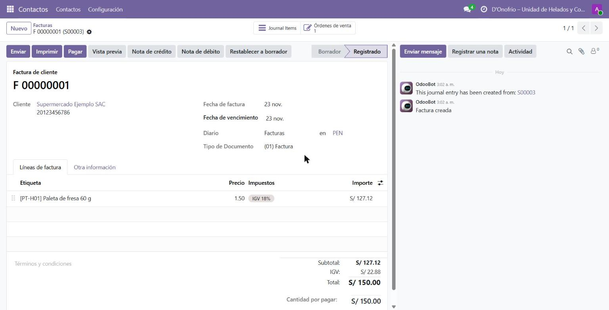 |

La **mesa de servicios TI** (HU-32) no tiene caso de uso propio; su pantalla real es el Kanban de tickets: 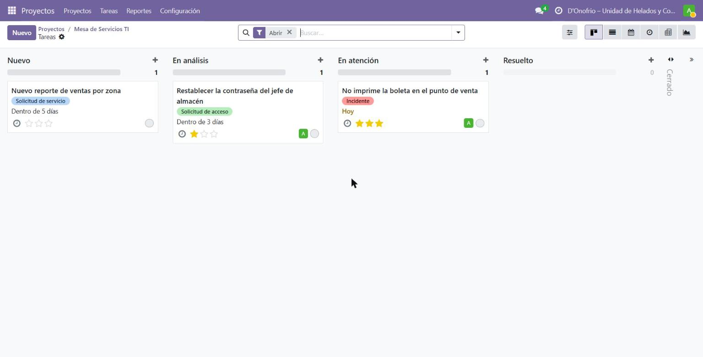

**Qué cambia entre el mockup y la pantalla real.** La estructura es la misma; cambian el color (el mockup usa el amarillo de marca y Odoo usa su tema estándar) y algunos nombres de campo. El mockup del tablero (CU009) es el del módulo propio de M4; la pantalla real de la Fase 1 son los dashboards estándar de Odoo, y la de M4 está abajo.

### Fase 2: pantallas propias (implementadas)

Capturas reales en PNG de 1600 × 900, tomadas con los datos de demostración de la HU-16 ([PR #231](https://github.com/orlando572/erp-donofrio/pull/231)); el juego completo para el manual está en [`docs/capturas/manual/`](../capturas/manual/).

| CU | Pantalla | Módulo | Mockup (diseño original) | Pantalla real |
|---|---|---|---|---|
| CU004 | Liquidación diaria del heladero (y vista móvil) | M2 `donofrio_heladeros` (`v1.2.0`) | 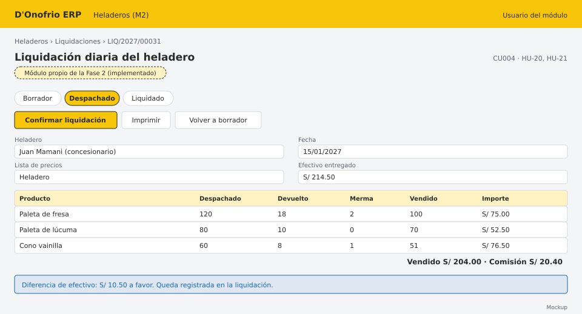 |  |
| CU006 | Registro de temperaturas de las cámaras | M3 cadena de frío (`v1.3.0`) | 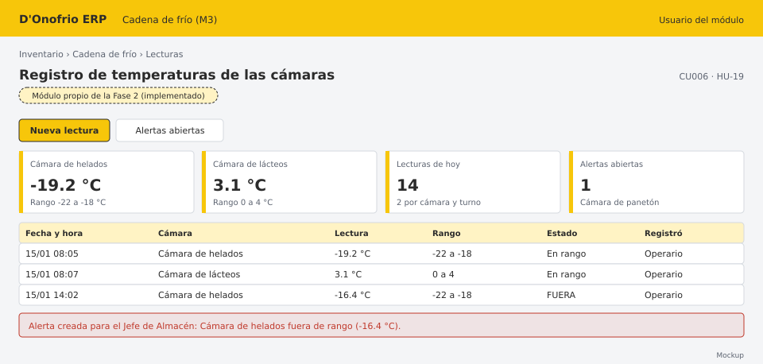 |  |
| CU008 | Inspección de calidad del lote | M1 `donofrio_calidad` (`v1.1.0`) |  |  |
| CU009 | Tablero gerencial de KPI propio | M4 `donofrio_tablero` (`v1.4.0`) |  |  |

## 4.6.3 Prototipos de informes y reportes

Los reportes se hacen con **QWeb**, el motor nativo de Odoo, y no con JasperReports como sugiere la plantilla: QWeb no requiere un servidor aparte, se versiona como XML en el repositorio, genera el PDF con el mismo motor de todo Odoo y hereda el layout de la compañía (logo, nombre, RUC y dirección). El layout de los PDF se configura una sola vez en la compañía.

### Fase 1: reportes estándar con el layout de la compañía

| Reporte | Caso de uso | Pantalla real (PDF) |
|---|---|---|
| Factura (01) | CU012, HU-15 | 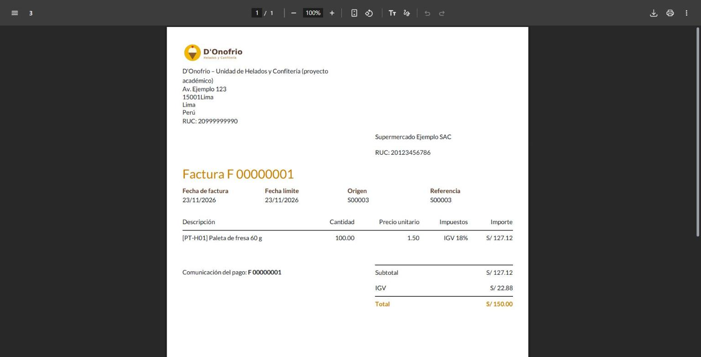 |
| Boleta (03) | CU012, HU-15 |  |
| Nota de entrega (guía de despacho) | CU005, CU002 | 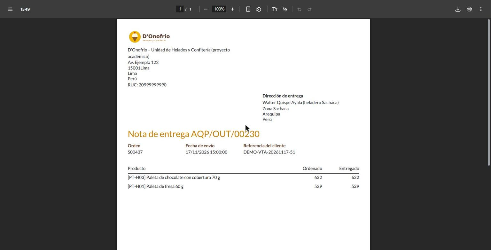 |
| Orden de producción | CU007, HU-14 | 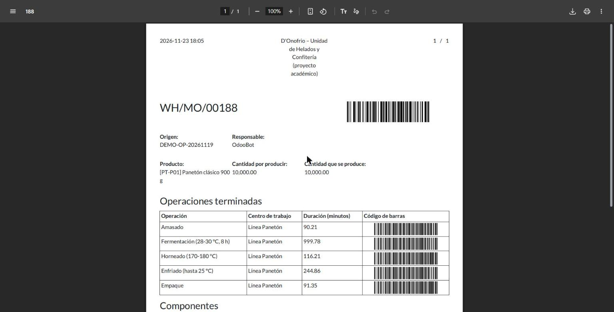 |

La factura, la boleta y la nota de entrega llevan el **logo y los datos de la compañía** (D'Onofrio, RUC ficticio 20999999990). La orden de producción es un documento interno de taller con otro formato: solo trae el nombre de la compañía y códigos de barras para las operaciones, sin logo.

**Limitaciones declaradas**

- **La «guía de despacho» es una nota de entrega interna.** La guía de remisión electrónica de SUNAT necesita el módulo `l10n_pe_edi`, que es Enterprise. La nota de entrega de Odoo cumple el papel de comprobante de la salida, pero no tiene valor tributario.
- **La nota de entrega no muestra el lote entregado ni su vencimiento**, solo producto, cantidad ordenada y cantidad entregada. Agregar el lote sería un cambio de la plantilla QWeb; queda como mejora.
- **La boleta se titula «Factura» y rotula «RUC» al DNI**, porque usa la plantilla estándar de la factura (ya declarado en HU-15).
- **El PDF no se prueba en el CI:** `wkhtmltopdf` se cuelga cuando la prueba corre dentro del propio servidor; la prueba automática revisa el HTML del reporte y el PDF se verifica a mano.

### Fase 2: reportes propios (implementados)

Los dos reportes se hicieron con QWeb sobre la misma plantilla: el certificado de calidad (M1, HU-18) y la liquidación del heladero con firmas (M2, HU-21).

| Reporte | Módulo | Mockup (hoja A4) | PDF real |
|---|---|---|---|
| Certificado de calidad del lote | M1 `donofrio_calidad` (HU-18) |  | 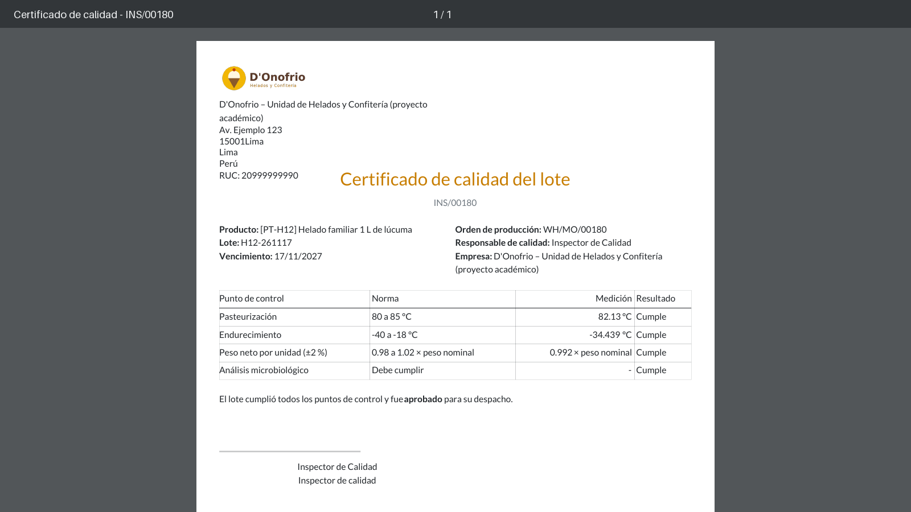 |
| Liquidación del heladero (con firmas) | M2 `donofrio_heladeros` (HU-21) |  | 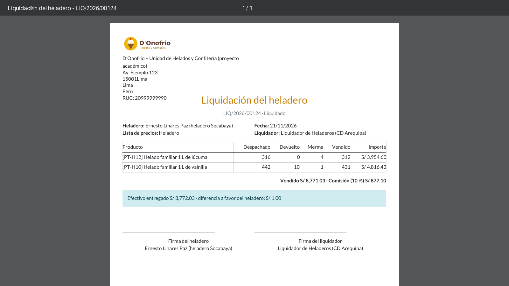 |

Los wireframes en escala de grises de estos dos reportes están en `docs/diagramas/pantallas/wf_rp_*.png`.

## Pendiente

- Probar la vista móvil en un celular real y los tres navegadores (RNF001): **[PENDIENTE: prueba en un celular real]**.
- ~~Reemplazar los mockups de la Fase 2 por las pantallas reales~~: hecho en este cierre.
- Pasar las capturas de la nota de entrega y de la orden de producción a una versión con lote si se mejora la plantilla.
