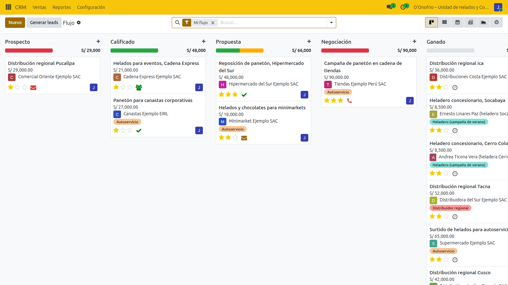
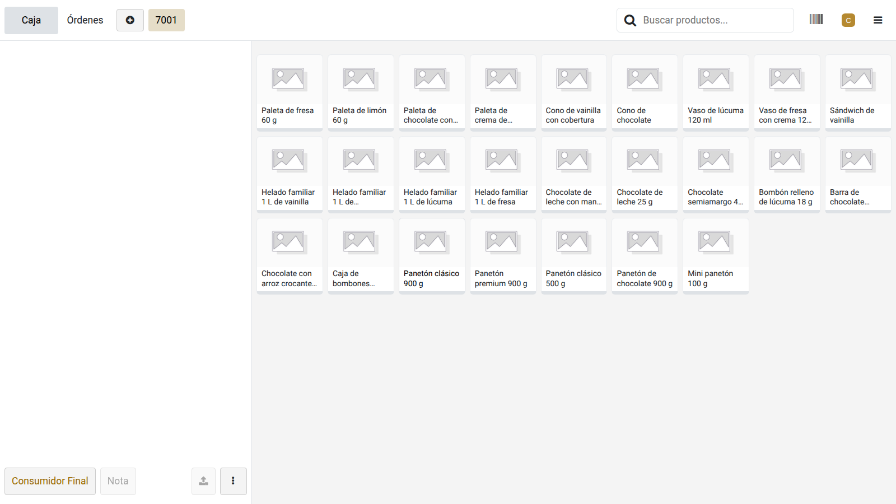
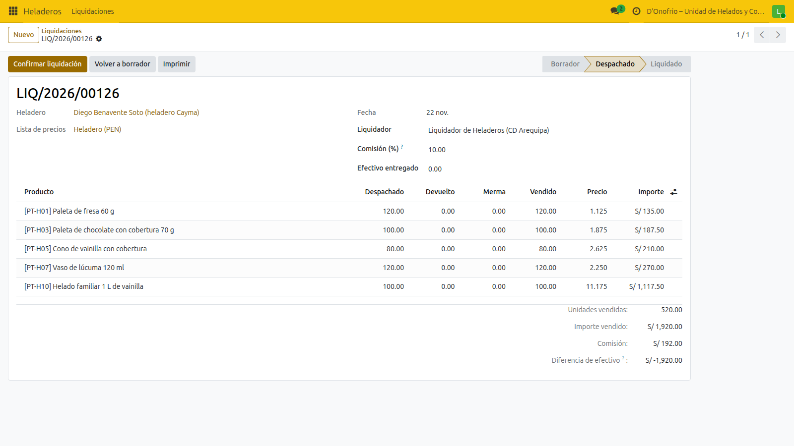
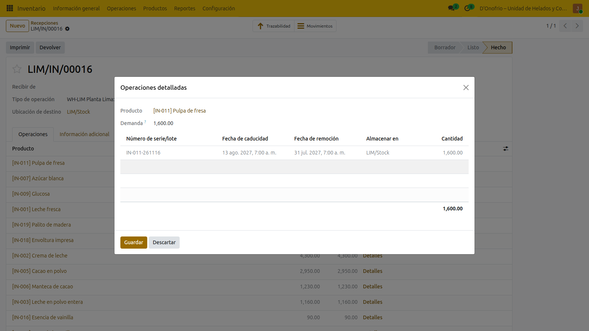
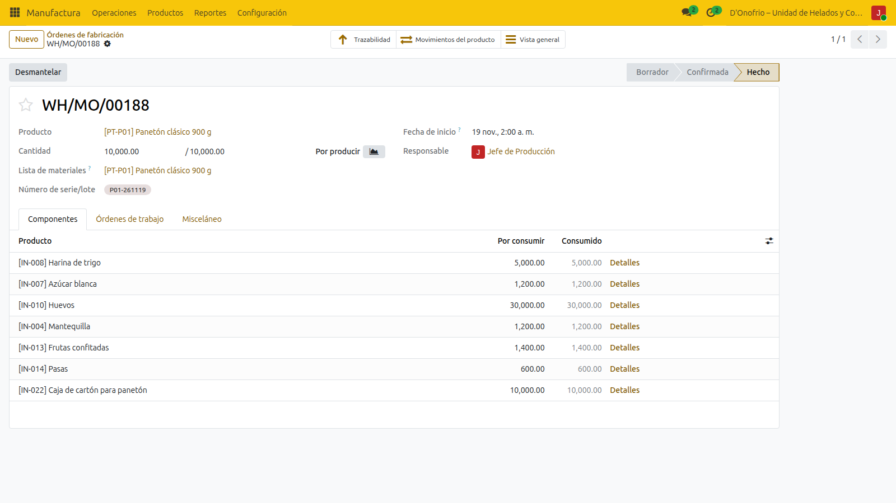
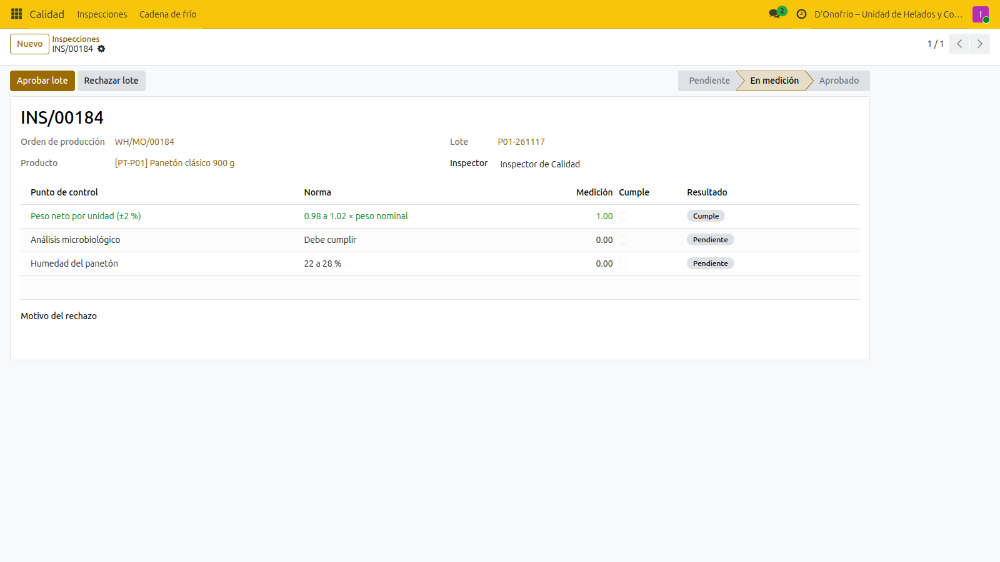
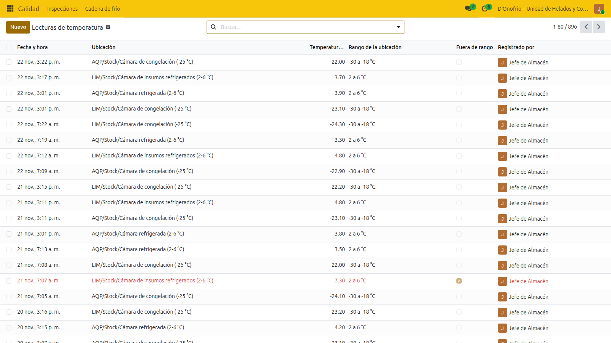
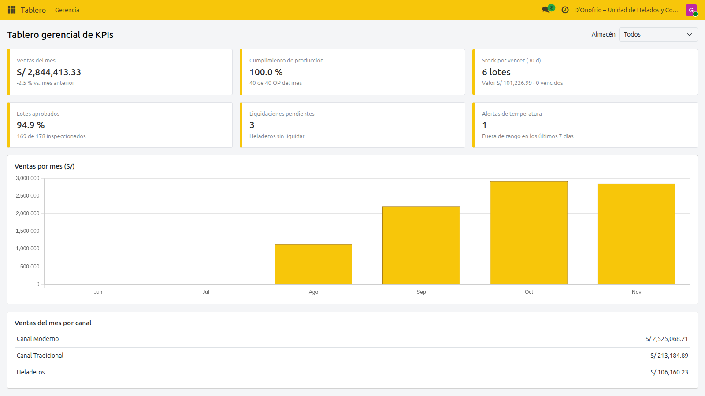
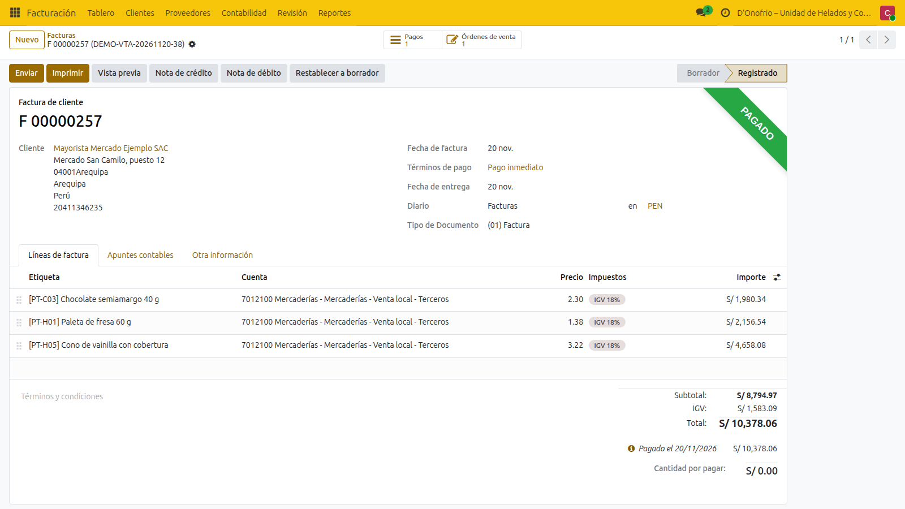

# 4.6 Desarrollo front-end: prototipos web, buenas prácticas de UI/UX y reportes

## 2.6.1 Buenas prácticas de conversión de prototipos a web UI/UX

El sistema no se programa pantalla por pantalla: se configura Odoo 19 Community con datos y vistas guardadas por código. La conversión de un prototipo en pantalla real consiste en elegir la pantalla estándar de Odoo que se parece al mockup y dejarla bien configurada. Las prácticas siguieron las heurísticas de Nielsen (1994).

La visibilidad del estado se logra con la barra de estado del documento (borrador → confirmado → hecho); la relación con el mundo real, con la interfaz en español peruano, soles, IGV 18 % y los términos del negocio (lote, FEFO, heladero, boleta); el control del usuario, con descartar cambios, volver a borrador y archivar en vez de borrar; la consistencia, al mantener las pantallas estándar de Odoo; la prevención de errores, porque no se recibe un insumo sin lote, FEFO no reserva un lote vencido y el comprobante y el IGV salen según el cliente; y la eficiencia, con listas de precios por canal, vistas guardadas en «Favoritos» y una acción principal por pantalla.

Contraste y adaptabilidad. El contraste de los pares de color de los mockups cumple el mínimo de WCAG 2.1 (4.5; World Wide Web Consortium, 2018): texto oscuro sobre el amarillo de marca da 8.79 y los colores de alerta sobre blanco, de 5.13 a 5.75; el amarillo como texto sobre blanco da 1.61 y no cumple, por lo que se usa solo como fondo y las alertas siempre llevan un texto. La liquidación y el tablero se revisaron en una ventana de 375 × 812 sin desplazamiento horizontal (solo con Chrome, RNF001). Todo el texto visible está en español, salvo los títulos de algunos gráficos del dashboard «Métricas del almacén», que Odoo no traduce.

## 2.6.2 Propuesta de prototipos web

Cada mockup de 2.4.2 se convirtió en una pantalla del sistema. Las figuras siguientes son pantallas reales del sistema implementado, tomadas con los usuarios de cada rol y los datos de demostración, en el mismo orden de los mockups. X

Ventas.

*Figura 2.6.2-a. Pantalla real del embudo de oportunidades por etapa en el CRM (CU001).*

*Figura 2.6.2-b. Pantalla real del punto de venta de la heladería (CU003).*

Heladeros.

*Figura 2.6.2-c. Pantalla real de la liquidación del heladero despachada (CU004).*

Logística.

*Figura 2.6.2-d. Pantalla real de la recepción de insumos con lote y fecha de caducidad (CU005).*

Producción y calidad.

*Figura 2.6.2-e. Pantalla real de la orden de producción terminada con su lote (CU007).*

*Figura 2.6.2-f. Pantalla real de la inspección de calidad del lote en medición (CU008).*

*Figura 2.6.2-g. Pantalla real de las lecturas de temperatura con una fuera de rango (CU006).*

Gerencia y facturación.

*Figura 2.6.2-h. Pantalla real del tablero gerencial de KPI (CU009).*

*Figura 2.6.2-i. Pantalla real de la factura (01) con IGV (CU012).*

## 2.6.3 Prototipos de informes y reportes

Los reportes se hacen con QWeb, el motor nativo de Odoo, y no con JasperReports como sugiere la plantilla: no requiere un servidor aparte, se versiona como XML, genera el PDF con el mismo motor de Odoo y hereda el layout de la compañía (logo, nombre, RUC y dirección).

La factura (01) y la boleta (03) llevan el logo y los datos de la compañía (la boleta usa la plantilla de la factura y se titula «Factura»). La nota de entrega es un comprobante interno de la salida, sin valor tributario, porque la guía de remisión electrónica requiere el módulo de factura electrónica de Odoo Enterprise, que es Enterprise. La orden de producción es un documento interno de taller con códigos de barras. Los dos reportes propios son el certificado de calidad del lote (M1, hoja A4) y la liquidación del heladero con detalle por producto y firmas de ambas partes (M2).

La prueba automática de los reportes revisa su contenido y el PDF final se revisó en pantalla.
