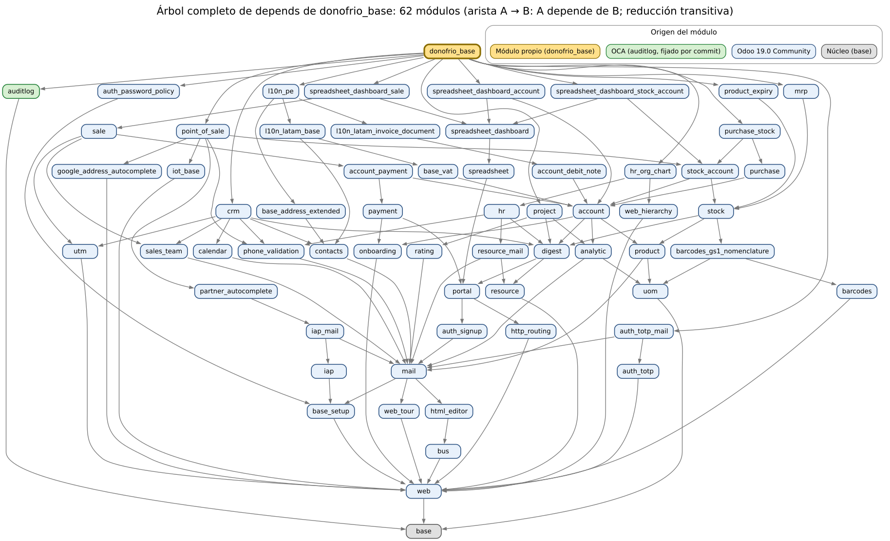
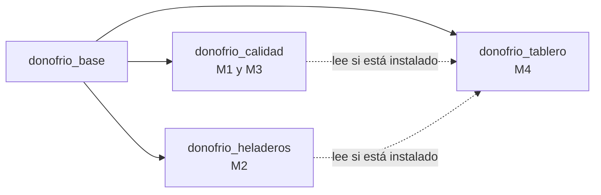

# 5.1 a 5.6 Back-end: integración con la base de datos, paquetes, librerías, dependencias, `donofrio_base` y patrones

> **Estado:** versión final del Cierre (25/11/2026) · **Autor:** Orlando (SM) · **Revisa:** Evelyn · **Fuente:** [02 §2.2](../plan/02_mapeo_plantilla.md), [06 §6.1 y §6.5](../plan/06_github_ci_infra.md), [03 §3.3](../plan/03_modulos_odoo.md)
>
> Cubre el **núcleo de la Fase 1** (Odoo 19.0 Community + `donofrio_base`), tal como estaba en `develop` el 23/11/2026, y, en un apartado propio de cada subsección, los **cuatro módulos de la Fase 2** (`donofrio_calidad` con la cadena de frío, `donofrio_heladeros` y `donofrio_tablero`) tal como están en `develop` el 25/11/2026 (`339c907`). Las cifras de la Fase 1 (por ejemplo, la medición de la base `donofrio_perf`) son las del 23/11/2026 y no se repitieron. Todo sale del repositorio: los árboles, con `find`; el inventario de librerías, de `__manifest__.py` y de la imagen de Docker; el grafo de dependencias, de [`scripts/grafo_dependencias.py`](../../scripts/grafo_dependencias.py). Los módulos propios de la Fase 2 **sí están implementados** y se describen en el apartado «Módulos de la Fase 2» de 5.2, 5.3 y 5.4 y en 5.5b a 5.5e. Cómo regenerar cada figura: [el README](../diagramas/README.md).

## 5.1 Integración con la base de datos

D'Onofrio no escribe SQL. El acceso a PostgreSQL 16 pasa siempre por el **ORM de Odoo** (`odoo.models` y `odoo.api`), que abre la conexión con `psycopg2` y administra la transacción de cada petición. Cada modelo de Python se vuelve una tabla y cada campo, una columna:

| Concepto de Odoo | Qué hace el ORM en PostgreSQL | Ejemplo real (base `donofrio_perf`, solo lectura) |
|---|---|---|
| Modelo (`_name = 'stock.lot'`) | Una tabla con el nombre del modelo cambiando los puntos por guiones bajos | `stock.lot` → tabla `stock_lot` |
| Campo simple (`Char`, `Datetime`…) | Una columna del tipo equivalente; `required=True` pasa a `NOT NULL` | `name` → `character varying NOT NULL`; `expiration_date` → `timestamp without time zone` |
| `Many2one` | Una columna entera con clave foránea y la regla `ondelete` | `product_id` → `FOREIGN KEY … REFERENCES product_product(id) ON DELETE RESTRICT` |
| `Many2many` | Una tabla intermedia con las dos claves | `stock_reference_move_rel` |
| `index=True` | Un índice B-tree (o `pg_trgm` en búsquedas por texto) | `stock_lot__name_index`, `stock_lot__product_id_index` |
| Campos de auditoría | Se agregan solos: `create_uid`, `create_date`, `write_uid`, `write_date` | claves foráneas a `res_users` |
| Campo calculado con `store=True` | Una columna que el ORM recalcula al cambiar sus dependencias | `project_task.sla_estado` (HU-32, módulo `donofrio_base`) |
| Registro de datos con identificador (`<record id="…">`) | Una fila en `ir_model_data` (módulo, nombre, modelo, `res_id`, `noupdate`) que permite referirse a él por nombre | `donofrio_base.wh_aqp` → `stock.warehouse` con `res_id = 2`, `noupdate = true` |
| Metadatos del modelo | Las tablas `ir_model` y `ir_model_fields` describen cada modelo y campo | 559 modelos registrados en la base medida |

Con los datos medidos el 23/11/2026, la base `donofrio_perf` (`donofrio_base` + 16 semanas de transacciones) tiene **665 tablas, 1 651 índices y 115 MB** de tablas con sus índices (143 MB la base completa); `donofrio_base` aporta 459 registros identificados en `ir_model_data`, entre ellos las 4 reglas de registro. Las tablas propias del núcleo, sus relaciones y el diccionario de datos están en [4.2.5 a 4.2.8](04_02_modelo_de_datos.md) (clases, ER, diseño lógico y [diccionario](04_02_diccionario_datos.md)); no se repiten aquí.

**Dos consecuencias para el proyecto.**
- **Con la Fase 2 el esquema sí tiene tablas propias:** `donofrio_calidad` crea 4 (`donofrio_calidad_punto`, `donofrio_calidad_inspeccion`, `donofrio_calidad_linea` y `donofrio_temperatura`), `donofrio_heladeros` crea 2 (`donofrio_liquidacion` y `donofrio_liquidacion_linea`) y `donofrio_tablero` ninguna (su modelo es abstracto); las tablas están en el ER ([4.2.6](04_02_modelo_de_datos.md)) y el diccionario ([4.2.8](04_02_diccionario_datos.md)).
- `donofrio_base` **no crea tablas nuevas** de su autoría: extiende modelos existentes con `_inherit`. El único campo nuevo con columna propia es `sla_estado` de `project.task`. Por eso no hay migraciones ni scripts DDL en el repositorio, y el esquema se obtiene instalando el módulo (`scripts/init_db.sh`).
- Los datos maestros se cargan por código (XML con `noupdate`, funciones y `post_init_hook`), no con `INSERT`. Una base se recrea igual en cualquier PC (RNF012).

## 5.2 Organización de paquetes

Los árboles se generaron con `find … | sort | sed` sobre la rama `develop` (no se dibujaron a mano; se omiten `__pycache__` y el certificado local de `docker/nginx/certs/`).

```bash
find addons/donofrio_base -not -path '*/__pycache__*' -not -name '*.pyc' | LC_ALL=C sort | sed -e 's|[^/]*/|│   |g' -e 's|│   \([^│]\)|├── \1|'
```

**Módulo `addons/donofrio_base/`**

```text
├── donofrio_base
│   ├── __init__.py
│   ├── __manifest__.py
│   ├── data
│   │   ├── almacenes_data.xml
│   │   ├── clientes_data.xml
│   │   ├── compania_data.xml
│   │   ├── crm_data.xml
│   │   ├── mesa_servicios_data.xml
│   │   ├── precios_data.xml
│   │   ├── produccion_data.xml
│   │   ├── productos_data.xml
│   │   ├── reabastecimiento_data.xml
│   │   ├── rrhh_data.xml
│   │   ├── seguridad_data.xml
│   │   ├── usuarios_data.xml
│   │   ├── vistas_gerencia_data.xml
│   ├── hooks.py
│   ├── models
│   │   ├── __init__.py
│   │   ├── auditlog_rule.py
│   │   ├── project_task.py
│   │   ├── res_users.py
│   │   ├── sale_order.py
│   ├── security
│   │   ├── donofrio_security.xml
│   │   ├── ir.model.access.csv
│   ├── static
│   │   ├── img
│   │   │   ├── logo.png
│   │   │   ├── logo.svg
│   ├── tests
│   │   ├── __init__.py
│   │   ├── common.py
│   │   ├── test_almacenes.py
│   │   ├── test_clientes.py
│   │   ├── test_compania.py
│   │   ├── test_crm.py
│   │   ├── test_facturacion.py
│   │   ├── test_fefo.py
│   │   ├── test_flujo_compra_produccion.py
│   │   ├── test_flujo_venta.py
│   │   ├── test_gerencia.py
│   │   ├── test_hardening.py
│   │   ├── test_instalacion.py
│   │   ├── test_mesa_servicios.py
│   │   ├── test_pdv.py
│   │   ├── test_precios.py
│   │   ├── test_produccion.py
│   │   ├── test_productos.py
│   │   ├── test_reabastecimiento.py
│   │   ├── test_recepcion_despacho.py
│   │   ├── test_rrhh.py
│   │   ├── test_seguridad.py
```

*Figura 5.2-a. Paquete `donofrio_base`: un archivo de datos por área (`data/`), seguridad (`security/`), extensiones de modelos (`models/`), `hooks.py` y 20 archivos de pruebas (`tests/`).*

**Infraestructura: `docker/`**

```text
docker
├── nginx
│   ├── odoo.conf.template
│   ├── seguridad.conf
├── odoo
│   ├── Dockerfile
│   ├── entrypoint.sh
│   ├── odoo.conf.template
├── postgres
│   ├── primary
│   │   ├── init-usuario-odoo.sh
│   │   ├── pg_hba.conf
│   ├── replica
│   │   ├── entrypoint-replica.sh
```

*Figura 5.2-b. Contenedores: imagen de Odoo, PostgreSQL (primario y réplica) y Nginx.*

**Automatización: `scripts/` y `.github/`**

```text
scripts
├── backup.sh
├── cargar_demo_completa.py
├── cargar_transacciones.py
├── check_legacy.sh
├── diagrama_er.py
├── diccionario_datos.py
├── empaquetar_release.sh
├── esquema_limpio.sh
├── generar_certificado.sh
├── grafo_dependencias.py
├── init_db.sh
├── levantar_prod.sh
├── perf
│   ├── .gitkeep
│   ├── Dockerfile.lighthouse
│   ├── carga.js
│   ├── k6.sh
│   ├── lighthouse.py
│   ├── zap-reglas.conf
│   ├── zap.sh
├── probar_imagen.sh
├── restore.sh
├── test.sh
├── verificar_backup.sh
├── verificar_despliegue.sh
├── verificar_replica.sh
```

```text
.github
├── ISSUE_TEMPLATE
│   ├── bug.yml
│   ├── epica.yml
├── pull_request_template.md
├── workflows
│   ├── .gitkeep
│   ├── ci.yml
│   ├── perf.yml
│   ├── release.yml
```

*Figura 5.2-c. Scripts de operación (`init_db.sh`, `test.sh`, `backup.sh`, `restore.sh`…), de verificación (`verificar_*.sh`), de pruebas no funcionales (`perf/`) y de documentación (`diagrama_er.py`, `diccionario_datos.py`, `grafo_dependencias.py`), y los flujos de GitHub Actions.*

**Documentación: `docs/`.** Carpetas de primer nivel y cantidad de archivos al 23/11/2026: `plan/` (10, el plan del proyecto), `informe/` (borradores del informe), `diagramas/` (143: `bpmn/`, `c4/`, `clases/`, `cu/`, `dependencias/`, `er/`, `arquitectura/`, `pantallas/`), `capturas/` (77, evidencias por sprint), `dev/` (3: la guía de cambios de Odoo 19, el procedimiento de pruebas no funcionales, la guía de release), `manuales/` (instalación), `pm/` (10, gestión del proyecto) y `scrum/` (15, actas y gates).

| Carpeta del paquete | Responsabilidad (una sola) | Por qué está separada |
|---|---|---|
| `data/` | Datos maestros y configuración por área: compañía, almacenes, productos, producción, precios, clientes, CRM, RR. HH., usuarios, reabastecimiento, vistas de gerencia, mesa de servicios y seguridad | Un archivo por área reduce los conflictos de Git entre las dos personas y permite probar cada área por separado (principio de responsabilidad única) |
| `security/` | Grupos, reglas de registro (`ir.rule`) y permisos de acceso (`ir.model.access.csv`) | Es lo que más se revisa en una auditoría (ISO 27001 5.15, 5.18, 8.3) |
| `models/` | Extensiones Python de modelos de Odoo con `_inherit` | Cada archivo extiende un solo modelo |
| `hooks.py` | Lo que no se puede expresar como datos: contraseñas de prueba, plan contable, valoración, punto de venta y facturación | Los pasos dependen de que `l10n_pe` ya haya cargado el plan contable |
| `tests/` | Pruebas `TransactionCase` por área y de integración por flujo | Corren en el CI en cada PR |
| `static/img/` | Logo de la compañía | Lo usa `data/compania_data.xml` |

### Módulos de la Fase 2

Los tres módulos propios de la Fase 2, con el mismo comando `find` (25/11/2026). La cadena de frío (M3) vive en `donofrio_calidad`; `donofrio_tablero` no tiene `security/` porque su modelo es abstracto y lee con los permisos de quien lo abre.

**Módulo `addons/donofrio_calidad/`** (M1 y M3)

```text
donofrio_calidad
├── __init__.py
├── __manifest__.py
├── data
│   ├── calidad_data.xml
├── i18n
│   ├── donofrio_calidad.pot
│   ├── es.po
├── models
│   ├── __init__.py
│   ├── calidad_inspeccion.py
│   ├── calidad_punto.py
│   ├── calidad_temperatura.py
│   ├── mrp_production.py
│   ├── report_certificado.py
│   ├── stock_location.py
│   ├── stock_lot.py
│   ├── stock_move_line.py
├── report
│   ├── calidad_report.xml
├── security
│   ├── donofrio_calidad_security.xml
│   ├── ir.model.access.csv
├── tests
│   ├── __init__.py
│   ├── common.py
│   ├── test_frio.py
│   ├── test_idioma.py
│   ├── test_inspeccion.py
│   ├── test_pdv.py
├── views
│   ├── calidad_views.xml
```

**Módulo `addons/donofrio_heladeros/`** (M2)

```text
donofrio_heladeros
├── __init__.py
├── __manifest__.py
├── data
│   ├── heladeros_data.xml
├── models
│   ├── __init__.py
│   ├── liquidacion.py
│   ├── report_liquidacion.py
├── report
│   ├── liquidacion_report.xml
├── security
│   ├── donofrio_heladeros_security.xml
│   ├── ir.model.access.csv
├── tests
│   ├── __init__.py
│   ├── test_liquidacion.py
├── views
│   ├── liquidacion_views.xml
```

**Módulo `addons/donofrio_tablero/`** (M4: acción OWL, SCSS y marca)

```text
donofrio_tablero
├── __init__.py
├── __manifest__.py
├── models
│   ├── __init__.py
│   ├── tablero.py
├── static
│   ├── img
│   │   ├── favicon.png
│   │   ├── neutral_face.svg
│   │   ├── smiling_face.svg
│   ├── src
│   │   ├── scss
│   │   │   ├── primary_variables.scss
│   │   │   ├── sin_datos.scss
│   │   ├── tablero
│   │   │   ├── tablero.js
│   │   │   ├── tablero.scss
│   │   │   ├── tablero.xml
├── tests
│   ├── __init__.py
│   ├── test_tablero.py
├── views
│   ├── layout_templates.xml
│   ├── tablero_views.xml
```

## 5.3 Organización de librerías

Hay tres capas de dependencias: los módulos de Odoo que declara `donofrio_base`, lo que agrega la imagen de Docker y las herramientas de desarrollo y prueba, todas con versión fija.

**a) Módulos declarados en el `depends` de `__manifest__.py` (19)**

| Módulo | Origen | Para qué se usa en D'Onofrio |
|---|---|---|
| `base` | Odoo 19.0 | Núcleo: usuarios, grupos, compañías y contactos |
| `l10n_pe` | Odoo 19.0 | Localización peruana: plan contable, IGV 18 %, factura (01) y boleta (03) |
| `stock` | Odoo 19.0 | Almacenes, ubicaciones, transferencias, lotes y existencias |
| `product_expiry` | Odoo 19.0 | Fecha de vencimiento, de retiro y alerta; estrategia FEFO |
| `sale` | Odoo 19.0 | Cotizaciones, pedidos y listas de precios |
| `purchase`, `purchase_stock` | Odoo 19.0 | Compras de insumos, reabastecimiento y recepción desde la orden de compra |
| `mrp` | Odoo 19.0 | Recetas, centros de trabajo y órdenes de producción con lote |
| `point_of_sale` | Odoo 19.0 | Punto de venta de la Heladería Av. Venezuela (efectivo y Yape) |
| `crm` | Odoo 19.0 | Embudo comercial por canal |
| `hr`, `hr_org_chart` | Odoo 19.0 | Empleados, puestos y organigrama |
| `project` | Odoo 19.0 | Mesa de servicios TI (la app Helpdesk es Enterprise) |
| `spreadsheet_dashboard_sale`, `spreadsheet_dashboard_stock_account`, `spreadsheet_dashboard_account` | Odoo 19.0 | Dashboards estándar para la gerencia |
| `auth_totp_mail` | Odoo 19.0 | Segundo factor (app TOTP o código por correo) |
| `auth_password_policy` | Odoo 19.0 | Longitud mínima de contraseña |
| `auditlog` | **OCA** `server-tools`, 19.0.2.0.2 (AGPL-3) | Bitácora de cambios: quién, cuándo, antes y después |

Ninguno es de Enterprise (`quality`, `account_reports`, `hr_payroll`, `l10n_pe_edi` y `web_enterprise` quedan fuera, regla de [las reglas del proyecto](../../CLAUDE.md)). El árbol completo que Odoo resuelve a partir de estos 19 módulos son **62 módulos** (59 de Odoo, `base` y `auditlog`, más `donofrio_base`), y al instalar se suman **60 más por `auto_install`** (por ejemplo `sale_stock`, `mrp_account`, `l10n_pe_pos`…), 122 en total. Ver 5.4.

**b) Lo que agrega `docker/odoo/Dockerfile`**

| Elemento | Detalle | Cómo se fija |
|---|---|---|
| Imagen base | `odoo:19.0-20261112` (Ubuntu 24.04, Python 3.12.3) | Etiqueta con fecha; la misma en las dos PC y en el CI (RNF012). Para actualizarla se cambia la fecha en el `Dockerfile` |
| `auditlog` de OCA | Solo la carpeta `auditlog` del repositorio `OCA/server-tools`, rama 19.0, en `/opt/oca` | Por **commit** (`ARG OCA_SERVER_TOOLS_SHA=13e504f8…a484`), descarga con `curl` y comprobación de que existe el manifiesto. No se usa una rama móvil (OWASP A06) |
| Configuración | `odoo.conf.template` y `entrypoint.sh`: generan `odoo.conf` desde `.env`; con `proxy_mode` rechazan una `admin_passwd` corta o de ejemplo | Variables `ODOO_*` del compose |
| Módulos propios | Etapa `addons` vacía; la release la llena con `--build-context addons=./addons` para publicar una imagen que corre sin montar nada | la guía de release |

**c) Librerías de Python que la imagen trae y Odoo usa** (leídas con `importlib.metadata` dentro de la imagen): `psycopg2` 2.9.9 (conexión a PostgreSQL), `lxml` 5.2.1, `Werkzeug` 3.0.1 (HTTP), `gevent` 24.2.1 (puerto del websocket 8072), `Jinja2` 3.1.2, `Babel` 2.10.3 (traducciones `es_PE`), `reportlab` 4.1.0 (PDF de facturas y reportes), `Pillow` 10.2.0, `num2words` 0.5.13 (importes en letras), `passlib` 1.7.4 (hash PBKDF2 de contraseñas), `python-stdnum` 1.19 (validación de RUC y DNI), `openpyxl` 3.1.2 y `XlsxWriter` 3.1.9 (exportaciones). El cliente web usa OWL y Chart.js, ya incluidos en Odoo. El proyecto **no agrega** librerías de Python propias.

**d) Herramientas de desarrollo y pruebas, cada una en su imagen de Docker con versión fija**

| Herramienta | Versión | Dónde |
|---|---|---|
| PostgreSQL | `postgres:16` (16.16 medido) | `docker-compose.yml` |
| Nginx | `nginx:stable` (1.30.7 medido en HU-28) | perfil `proxy` |
| `ruff` | 0.8.4 | job `lint` de `ci.yml` |
| k6 | `grafana/k6:1.7.1` | `scripts/perf/k6.sh` |
| OWASP ZAP | `ghcr.io/zaproxy/zaproxy:2.17.0` | `scripts/perf/zap.sh` |
| Lighthouse | `node:22-bookworm-slim` | `scripts/perf/Dockerfile.lighthouse` (parte de Evelyn, [4.6.4](04_06_wpo.md)) |
| PlantUML (con Graphviz 14.0.1) | `plantuml/plantuml:1.2026.10` | diagramas C4, de clases y ER, y grafo de dependencias |

**d) Módulos propios de la Fase 2 y su `depends`** (de cada `__manifest__.py`, versión `19.0.1.0.0`, LGPL-3, `application: True`)

| Módulo | `depends` | Archivos de datos y de vistas | Librerías nuevas |
|---|---|---|---|
| `donofrio_calidad` (M1 y M3) | `donofrio_base`, `mrp`, `stock`, `product_expiry` | `security/` (grupos y ACL), `data/calidad_data.xml`, `views/calidad_views.xml`, `report/calidad_report.xml` (QWeb) | Ninguna; `i18n/es.po` |
| `donofrio_heladeros` (M2) | `donofrio_base`, `sale`, `stock` | `security/`, `data/heladeros_data.xml`, `views/liquidacion_views.xml`, `report/liquidacion_report.xml` (QWeb) | Ninguna |
| `donofrio_tablero` (M4) | `donofrio_base`, `web`, `sale`, `stock`, `mrp`, `product_expiry` | `views/` y *assets* (`web.assets_backend`: componente OWL y SCSS; `web._assets_primary_variables`: color primario) | **Chart.js**, que ya trae Odoo (no se agregó ninguna librería externa) |

## 5.4 Gestión de dependencias de comunicación entre módulos

El script [`scripts/grafo_dependencias.py`](../../scripts/grafo_dependencias.py) lee los `__manifest__.py` (los del repositorio, los de Odoo 19.0 en `~/src/odoo-19.0` o en la imagen de Docker, y `auditlog` de la imagen), resuelve el árbol de `depends` de `donofrio_base`, escribe un grafo DOT de Graphviz y lo convierte a SVG y PNG con Docker (imagen `plantuml/plantuml:1.2026.10`, que trae Graphviz 14.0.1, y `python:3.12-slim` para el PNG). No se instala nada en el equipo. Además calcula qué módulos entran solos por `auto_install` con la misma regla que `button_install` de Odoo 19 (los que declaran `countries` solo entran si la compañía es de Perú) y, con `--bd`, lo compara con lo que tiene instalado una base real (solo lectura).

```bash
python3 scripts/grafo_dependencias.py --imagen erp-donofrio/odoo:19.0 --bd donofrio_perf
# sin Docker de Odoo: lee ~/src/odoo-19.0 (y auditlog de la imagen del compose)
python3 scripts/grafo_dependencias.py
```


*Figura 5.4-a. Los 19 `depends` directos de `donofrio_base`. Las flechas doradas son lo que declara el manifiesto; las grises, las relaciones entre esos módulos (solo la reducción transitiva). Cada nodo indica cuántos módulos arrastra. Fuente: [`dependencias_directas.dot`](../diagramas/dependencias/dependencias_directas.dot), [SVG](../diagramas/dependencias/dependencias_directas.svg).*



*Figura 5.4-b. Árbol completo de `depends`: 62 módulos y 12 niveles de profundidad desde `base`. Fuente: [`dependencias_completo.dot`](../diagramas/dependencias/dependencias_completo.dot), [SVG](../diagramas/dependencias/dependencias_completo.svg); el listado con origen, nivel y `depends` de cada módulo está en [la tabla de dependencias](../diagramas/dependencias/dependencias.csv).*

| Dato | Valor |
|---|---|
| Módulos propios | 1 (`donofrio_base`) |
| `depends` directos | 19 |
| Árbol de `depends` (con `donofrio_base`) | 62: 59 de Odoo, `base`, `auditlog` (OCA) y `donofrio_base` |
| Profundidad máxima | 12 niveles |
| Se instalan solos (`auto_install`) | 60 (122 módulos en total para una instalación limpia) |
| Módulos pesados en el árbol | `point_of_sale` (+27), `spreadsheet_dashboard_sale` (+24), `l10n_pe` (+23), `spreadsheet_dashboard_stock_account` (+23), `purchase_stock` (+22) |

**Verificación contra bases reales.** Las bases de desarrollo `donofrio` y `donofrio_perf` tienen 109 módulos instalados y **los 109 coinciden** con lo calculado. Los 13 que el script espera y no ve (`project`, `project_*`, `rating`, `portal_rating`) son exactamente lo que trajo la HU-32 (mesa de servicios), posterior a la creación de esas bases: 122 − 13 = 109. Una instalación limpia (la del CI) carga los 122.

**Sentido de la dependencia.** `donofrio_base` depende de módulos estándar y de dos de seguridad; **los tres módulos de la Fase 2 dependen de él** y de `stock`, `mrp`, `sale` o `web` (apartado de abajo), y ningún otro módulo depende de ellos. Los números y gráficos de esta sección son los de `donofrio_base` (23/11/2026); los módulos propios no agregan módulos de Odoo nuevos al árbol (`mrp`, `stock`, `sale`, `web` y `product_expiry` ya estaban).

**Dependencias de los módulos de la Fase 2** (de los manifiestos; no se regeneró el grafo de Graphviz, que sigue siendo el del núcleo):



Las flechas punteadas no son un `depends`: el tablero lee las inspecciones, las liquidaciones y las temperaturas **solo si** esos módulos están instalados y el usuario puede leerlos (por eso `donofrio_tablero` no depende de ellos). La comunicación entre capas (HTTP, JSON-RPC, websocket 8072, SQL 5432, replicación) está en la Figura 5.7-b.

## 5.5 Documentación del módulo `donofrio_base`

> Esta subsección es la de `donofrio_base`. Los módulos propios de la Fase 2 tienen la suya: [5.5b `donofrio_calidad` (M1)](05_05_modulo_donofrio_calidad.md), [5.5c `donofrio_heladeros` (M2)](05_05_modulo_donofrio_heladeros.md), [5.5d cadena de frío (M3)](05_05_modulo_donofrio_frio.md) y [5.5e `donofrio_tablero` (M4)](05_05_modulo_donofrio_tablero.md).

**Resumen:** versión `19.0.1.0.0`, licencia LGPL-3, `application: False`. Configura y carga por código el núcleo de D'Onofrio sobre Odoo estándar. Tamaño: 13 archivos de datos (3 960 líneas de XML), 4 archivos de modelos, 1 archivo de seguridad XML y 1 CSV, `hooks.py` (218 líneas) y 20 archivos de pruebas (2 535 líneas con `common.py`).

### 5.5.1 Orden de carga (`__manifest__.py`)

`compania_data` → `almacenes_data` → `security/donofrio_security.xml` → `security/ir.model.access.csv` → `usuarios_data` → `productos_data` → `crm_data` → `precios_data` → `produccion_data` → `reabastecimiento_data` → `clientes_data` → `rrhh_data` → `vistas_gerencia_data` → `mesa_servicios_data` → `seguridad_data` → `post_init_hook`. El orden importa: la seguridad necesita el almacén de Arequipa, y los usuarios necesitan los grupos.

### 5.5.2 `post_init_hook` (`hooks.py`)

Se ejecuta **una vez, al instalar** (no en `-u`). Llama a cuatro pasos:

| Paso | Qué hace | HU |
|---|---|---|
| `_asignar_clave_a_usuarios` | Pone la contraseña de prueba (`DONOFRIO_USER_PASSWORD` del `.env`) a los 10 usuarios del módulo. La clave no está en el código ni en los datos; si la variable falta, los usuarios quedan sin contraseña y se avisa en el registro | HU-04 |
| `_asignar_responsable_de_inventario` | El jefe de almacén es responsable de todos los terminados e insumos, para que la actividad «Alerta de vencimiento» le llegue a él y no al superusuario | HU-11 |
| `_configurar_valoracion` | Valoración **FIFO** en tiempo real en las categorías de terminados e insumos; con ella el costo del lote producido sale de los insumos consumidos más las horas de los centros de trabajo | HU-14 |
| `_programar_plan_contable` | Registra `cargar_plan_contable` para ejecutarse al terminar de cargar el registro (`_auto_install_template`), con la compañía ya en Perú. Esa función carga el plan contable `pe` de `l10n_pe`, configura las cuentas de valoración, crea el punto de venta y configura la facturación | HU-03, HU-10, HU-14, HU-15 |

Los pasos que corren dentro de `cargar_plan_contable`:
- `_configurar_cuentas_de_valoracion`: una cuenta de contrapartida por ubicación virtual (proveedor 6020000, producción 7111000, ajustes 7111000, cliente 6922100) y una cuenta de valoración por categoría (terminados 2111100, insumos 2411100). Es una simplificación declarada del proyecto.
- `crear_punto_de_venta`: crea los diarios «Efectivo PdV» y «Yape», los métodos de pago y el PdV «Heladería Av. Venezuela»; habilita los terminados en el PdV. Es idempotente (`donofrio_base.pos_config_venezuela`).
- `configurar_facturacion`: pasa la lista de precios por defecto a soles, fija el idioma `es_PE` de los contactos nuevos, marca el IGV 18 % como incluido en el precio de los terminados, pone el IGV de compras en los insumos y crea los diarios «Facturas» (01) y «Boletas» (03). Es idempotente.

Estos pasos van en el hook y no en un XML porque dependen de diarios y cuentas que solo existen cuando el plan contable ya se cargó, o porque los registros `noupdate` de un XML no se pueden cambiar en una base existente.

### 5.5.3 Datos por área (`data/*.xml`)

Todos los datos son **ficticios y verosímiles** (RUC inventados, correos `.example.com`) y los datos maestros están en bloques `noupdate="1"` (para cambiarlos en una base que ya existe hay que usar el hook o recrear la base). Conteo de registros por archivo (contados con una expresión regular sobre `<record id=… model=…>`):

| Archivo | HU | Registros principales |
|---|---|---|
| `compania_data.xml` | HU-03 | Activa la moneda PEN y el idioma `es_PE` y ajusta el contacto, la compañía (país Perú, RUC ficticio) y el usuario administrador existentes (4 registros más una función) |
| `almacenes_data.xml` | HU-06 | 2 almacenes (CD Lima y CD Arequipa), 8 ubicaciones con cámaras de frío, y la activación de ubicaciones múltiples y rutas avanzadas para los usuarios internos |
| `usuarios_data.xml` | HU-04 | 10 usuarios, uno por rol |
| `productos_data.xml` | HU-07 | 47 productos (terminados e insumos), 22 datos de proveedor, 9 categorías con FEFO, 6 proveedores |
| `produccion_data.xml` | HU-07 | 12 recetas (`mrp.bom`) con 71 líneas de componentes, 47 operaciones y 3 centros de trabajo (con los PCC en el nombre de las operaciones) |
| `crm_data.xml` | HU-08 | 3 equipos por canal, 5 etapas, 4 etiquetas, 20 oportunidades |
| `precios_data.xml` | HU-09 | 5 listas de precios por canal y temporada, 7 reglas, y la activación de listas de precios para los usuarios internos |
| `reabastecimiento_data.xml` | HU-13 | 22 reglas mín./máx. de insumos en la Planta Lima |
| `clientes_data.xml` | HU-16 | 30 clientes por canal con su lista de precios y plazo de pago, 4 categorías |
| `rrhh_data.xml` | HU-05 | 18 departamentos, 18 puestos, 21 empleados |
| `vistas_gerencia_data.xml` | HU-23 | 4 vistas guardadas (filtros compartidos) para la gerencia |
| `mesa_servicios_data.xml` | HU-32 | Proyecto «Mesa de Servicios TI», 5 etapas, 3 etiquetas, 5 tickets de ejemplo y un filtro |
| `seguridad_data.xml` | HU-27 | 3 parámetros del sistema, 4 reglas de auditoría y el alta del gerente en el grupo de 2FA |

Los 10 roles: gerente, jefe de ventas, vendedor, cajero del PdV, jefe de almacén, jefe de producción, inspector de calidad, liquidador (usuario del CD Arequipa), compras y contador. Ninguno es administrador.

### 5.5.4 Seguridad (`security/`)

| Elemento | Qué hace | Archivo |
|---|---|---|
| Privilegio «D'Onofrio» (`res.groups.privilege`) | Agrupa los grupos propios bajo «Cadena de suministro» (Odoo 19 usa `privilege_id` en vez de categorías) | `donofrio_security.xml` |
| Grupo «Solo operaciones del CD Arequipa» | Hereda `base.group_user`. Lo usa el liquidador | `donofrio_security.xml` |
| 4 `ir.rule` del grupo anterior | Limitan `stock.picking`, `stock.move`, `stock.move.line` (origen o destino en el almacén de Arequipa) y `stock.quant` (ubicación en Arequipa). Solo afectan a quien está en el grupo | `donofrio_security.xml` |
| Grupo «2FA obligatorio» | Quien está en él (administrador y gerente) usa segundo factor en el despliegue protegido | `donofrio_security.xml` y `seguridad_data.xml` |
| ACL (`ir.model.access.csv`) | 1 línea: el usuario del PdV lee y crea `stock.lot` (sin esto no podría escribir el lote de lo que vende) | `ir.model.access.csv` |
| Parámetros del sistema | `auth_password_policy.minlength = 12`, `base.login_cooldown_after = 5`, `base.login_cooldown_duration = 60` | `seguridad_data.xml` |
| Reglas de auditoría | Listas de precios y sus líneas (crear, modificar y borrar, `log_type = full`); pedidos de venta y de compra (modificar y borrar, `fast`) | `seguridad_data.xml` |

Los módulos propios de la Fase 2 traen sus grupos de seguridad y sus permisos de acceso (`ir.model.access.csv`) en su propio `security/`, descritos en 5.5b a 5.5d; **no hay `ir.rule` propias** en ellos (la única regla por registro es la del CD Arequipa de `donofrio_base`).

### 5.5.5 Modelos extendidos (`models/`)

Cuatro extensiones con `_inherit`; ninguna define un modelo nuevo ni una tabla nueva.

| Archivo | Modelo extendido | Qué agrega | HU |
|---|---|---|---|
| `sale_order.py` | `sale.order` | `_compute_journal_id` (sobreescribe y llama a `super()`) y `_diario_segun_cliente`: el pedido factura en «Facturas» (01) si el cliente tiene RUC y en «Boletas» (03) si no; el usuario puede cambiarlo | HU-15 |
| `res_users.py` | `res.users` | `_exige_2fa` y `_mfa_type`: administrador y gerente usan TOTP o código por correo cuando `proxy_mode` está activo; el parámetro `donofrio.2fa_privilegiados` (`si`/`no`/`auto`) lo fuerza o lo apaga | HU-27 |
| `auditlog_rule.py` | `auditlog.rule` | `_confirmar_reglas_donofrio`: confirma las 4 reglas que sigan en borrador (idempotente; se llama desde `seguridad_data.xml`) | HU-27 |
| `project_task.py` | `project.task` | Campo `sla_estado` (calculado y almacenado: abierto, cumplido o incumplido), `_fecha_limite_del_sla` y la fecha límite automática según la prioridad: P1 4 h, P2 8 h, P3 72 h, P4 120 h | HU-32 |

### 5.5.6 Script de transacciones (`scripts/cargar_transacciones.py`)

Se ejecuta con `odoo shell` (no es un módulo). Genera **16 semanas** de datos de demostración (lunes 3/8/2026 a domingo 22/11/2026) con **semilla fija** (`SEMILLA = 2026`) y es idempotente: si ya hay movimientos con origen `DEMO-`, no vuelve a cargar. Reproduce la estacionalidad (helados de agosto a noviembre; panetón desde octubre). Se divide en la parte de Orlando (inventario inicial con lotes por vencer, recepciones semanales de insumos, órdenes de producción con lote y costo, y reposición Lima → Arequipa) y la de Evelyn (ventas, PdV y compras; semilla `SEMILLA + 1`). Resultado medido en `donofrio_perf` (HU-28): 437 pedidos de venta, 939 pedidos del PdV, 1 647 transferencias, 6 063 movimientos de stock, 488 lotes, 3 369 asientos y facturas, 188 órdenes de producción y 101 órdenes de compra.

```bash
docker compose stop odoo
docker compose run --rm -T odoo odoo shell -d donofrio --no-http < scripts/cargar_transacciones.py
docker compose up -d odoo
```

**Ampliación: demostración completa (`scripts/cargar_demo_completa.py`).** Se corre después del anterior, encima de la misma base, y deja con datos las vistas que quedaban vacías (calidad, heladeros, cadena de frío, CRM, contactos, mesa de servicios y calendario). Usa la misma semilla (`SEMILLA = 2026`), fechas dentro del 3/8 al 22/11/2026 y la fecha de referencia 25/11 para decidir qué actividades están vencidas. Cada parte hace su propio *commit* y deja el parámetro del sistema `donofrio_demo_completa.<parte>`: si existe, esa parte no se repite, así que correrlo dos veces no duplica nada. Los datos pasan por los métodos del propio módulo (`_crear_inspecciones`, `action_aprobar`, `action_rechazar`, `action_despachar`, `_alertar`), no por SQL; el SQL solo corrige las fechas históricas.

| Parte | Qué carga |
|---|---|
| `contactos` | Teléfono (`+51`, con el bloque ficticio `555`), correo `.example.com` o `.example.pe`, distrito, código postal y departamento para los 63 contactos, y teléfono móvil y correo de los 22 empleados. Las calles que ya traían los clientes se conservan; los heladeros pasan de «Zona Cercado» a una calle de Arequipa. |
| `crm` | Las 20 oportunidades quedan enlazadas a su cliente, con fecha de alta repartida entre agosto y noviembre, historial de etapas, actividades hechas, vencidas y pendientes, notas, 5 perdidas con su motivo y 10 ganadas ligadas al primer pedido del cliente; más 6 oportunidades nuevas (26 en total). |
| `calidad` | Una inspección por cada una de las 188 órdenes de producción terminadas, con sus mediciones: 169 aprobadas (certificado imprimible), 9 rechazadas (con motivo, bloqueo y la actividad de reproceso o descarte), 6 en medición (3 con un punto que no cumple) y 4 pendientes. Además corrige la fecha de fin de las órdenes, que había quedado en la de la carga inicial. |
| `heladeros` | 124 liquidaciones, una por cada pedido ya hecho al canal heladeros, que cuadran con ese pedido (mismas unidades e importe, con IGV) y con merma, devoluciones y alguna diferencia pequeña de efectivo; quedan ligadas al pedido sin crear otro. 3 del 22/11 siguen pendientes (2 despachadas y 1 en borrador). |
| `frio` | 896 lecturas (dos al día en cada una de las 4 cámaras), 7 de ellas fuera de rango, cada una con su actividad para el jefe de almacén; las de los últimos 7 días siguen pendientes y alimentan la tarjeta del tablero. |
| `mesa` | 17 tickets nuevos de la mesa de servicios (más los 5 de antes) con las cuatro prioridades, todas las etapas, tipos de ticket y SLA cumplido e incumplido. |
| `calendario` | 45 reuniones: la semanal de producción y calidad (martes), el comité de gerencia (primer lunes del mes), capacitación de heladeros, auditoría HACCP, cierre contable y 17 visitas ligadas a las oportunidades. |
| `fechas` | Lleva a la ventana del 3/8 al 22/11 lo que la carga inicial dejó con la fecha de la corrida (25/11): 188 asientos de mano de obra de las órdenes de fabricación (por borrador → fecha → publicar, con el número del mes que corresponde) y 94 cierres de Yape del PdV (conservan su conciliación), 939 albaranes del PdV, 318 operaciones de órdenes, el vencimiento de las 437 cotizaciones y 3 tickets de la mesa. Las 6 solicitudes de compra que genera el planificador (S/ 2,4 millones, unas 3,6 semanas de compras, porque los insumos terminan en cero) se conservan en borrador con fecha del 22/11: mientras existan cuentan como entrada prevista y el cron diario no las duplica. |
| `ajustes` | Pasa a español lo que Odoo creó en inglés al correr sin idioma: la tarea de bienvenida del administrador, el diario «Punto de venta» y las referencias de 282 asientos («Combinar pagos de Yape del PdV de…», «… - Mano de obra», «Pago manual:»; son las traducciones estándar de `point_of_sale`, `mrp_account` y `account`), y deja con plazo dentro de la ventana los tickets abiertos de la mesa (uno se resuelve el 22/11 y los otros vencen el 22/11). |

```bash
scripts/backup.sh
docker compose stop odoo
docker compose run --rm -T odoo odoo shell -d donofrio --no-http < scripts/cargar_demo_completa.py
docker compose up -d odoo
```

Dos cambios van en los módulos y no en el script: el usuario `admin` queda en los grupos de jefatura de Calidad y de Heladeros (sin ellos daba 403 al imprimir el certificado) y su contacto y empleado pasan a «Administrador». Como `base.user_admin` es `noupdate`, se aplican con `<function>` y no con `<record>`, para que también valgan al actualizar una base ya instalada (`-u`).

Con `DONOFRIO_DEMO_PARTES=crm,mesa` (variable de entorno del contenedor, `-e`) corre solo esas partes. Tarda unos segundos. Para repetir una parte, se borra su parámetro o se restaura el respaldo.

### 5.5.7 Pruebas (`tests/`)

**137 pruebas** en 20 archivos (136 el 23/11/2026; `test_compania` ganó una con la HU-16), todas `TransactionCase` de Odoo (cada una corre en una transacción que se revierte). Las de los módulos de la Fase 2 (81) están en la Tabla 30b de [6.10](06_09_a_06_13_pruebas.md). Resultado del 23/11/2026 con `scripts/test.sh donofrio_base`: **0 fallidas, 0 con error de 136, en 2 min 1 s** (instalación y pruebas en una base temporal).

| Archivo | Pruebas | Qué verifica |
|---|---|---|
| `test_instalacion` | 1 | Prueba de humo: el módulo queda instalado |
| `test_compania` | 8 | Compañía peruana, moneda, plan contable cargado por el hook (HU-03) |
| `test_seguridad` | 9 | 10 usuarios con sus grupos, ninguno administrador, regla del CD Arequipa y `AccessError` (HU-04) |
| `test_almacenes` | 5 | Lima y Arequipa, despacho en 2 pasos y en 1, ubicaciones de frío y ruta (HU-06) |
| `test_productos` | 11 | Terminados e insumos con lote y vida útil, FEFO, recetas, centros de trabajo y PCC (HU-07) |
| `test_rrhh` | 5 | Organigrama, puestos y empleados (HU-05) |
| `test_crm` | 5 | Embudo por canal (HU-08) |
| `test_precios` | 6 | Precio según lista y fecha; el pedido genera la entrega (HU-09) |
| `test_pdv` | 6 | Sesión de PdV, venta, boleta y cierre de caja cuadrado (HU-10) |
| `test_fefo` | 10 | Lotes, vencimiento, FEFO, lote vencido o en fecha de retiro no se reserva, alerta a 30 días (HU-11) |
| `test_recepcion_despacho` | 7 | Recepción desde la OC y despacho pick + ship, reposición a Arequipa (HU-12) |
| `test_reabastecimiento` | 5 | Regla mín./máx. → RFQ → recepción (HU-13) |
| `test_produccion` | 10 | OP con insumos FEFO, lote con vencimiento, costo y asientos de valoración (HU-14) |
| `test_facturacion` | 10 | Factura (01) y boleta (03) con IGV, en su diario y con PDF (HU-15) |
| `test_clientes` | 3 | 30 clientes con lista y plazo (HU-16) |
| `test_gerencia` | 5 | Dashboards activos y vistas guardadas (HU-23) |
| `test_hardening` | 12 | Contraseña de 12 caracteres, bloqueo tras 5 intentos, 2FA y auditoría (HU-27) |
| `test_mesa_servicios` | 11 | Mesa de servicios y SLA por prioridad (HU-32) |
| `test_flujo_venta` | 4 | Integración: pedido → entrega FEFO → factura o boleta (HU-33, de Evelyn) |
| `test_flujo_compra_produccion` | 4 | Integración: planificador → compra → recepción → OP → lote con vencimiento (HU-33) |
| **Total** | **136** | |

`tests/common.py` aporta `DonofrioStockCase` (utilidades de lotes y recepciones compartidas por logística y producción). En el CI, `scripts/test.sh` falla si hay `ERROR`, una prueba roja o **cero pruebas** ejecutadas.

## 5.6 Arquitectura de desarrollo impulsada por patrones

Se describe lo que se hizo, sin afirmar más. En la Fase 1 el proyecto **no tiene modelos propios**: aplica los patrones de Odoo sobre configuración, extensiones y pruebas. Con la Fase 2 sí los tiene (`donofrio.calidad.*`, `donofrio.temperatura`, `donofrio.liquidacion*` y el modelo abstracto `donofrio.tablero`) y la tabla de abajo agrega una fila para ellos. La explicación conceptual (MVC, DAO, DTO, SOLID) está en [4.3.2](04_03_infraestructura.md).

| Patrón | Cómo se aplica de verdad | Evidencia | Límite |
|---|---|---|---|
| **MVC sobre el ORM** | Modelo: clases `models.Model` de Odoo (`stock.lot`, `mrp.production`…); Vista: XML y OWL estándar de Odoo; Controlador: acciones de ventana, métodos de negocio (`button_validate`, `action_confirm`) y rutas HTTP/JSON-RPC | `donofrio_base` extiende modelos y no define vistas ni controladores propios; los flujos de HU-33 llaman a los mismos métodos que los botones | En la F1 no hay vistas ni controladores propios; con la F2, vistas XML propias, reportes QWeb y el componente OWL del tablero (`tablero.js` y `tablero.xml`) |
| **Herencia** (`_inherit`) | 4 extensiones: `sale.order`, `res.users`, `project.task` y `auditlog.rule`, con `super()` y sin tocar el código original | `models/` (5.5.5) | — |
| **DAO / Active Record = ORM** | Acceso a datos solo con `env['modelo'].search/create/write`; sin SQL en el código del módulo | `hooks.py`, `models/`, `tests/` | Odoo es el DAO; el proyecto no implementó uno |
| **DTO** | Los datos viajan como diccionarios (`vals` en `create` y `write`, lo que devuelve `read`, el cuerpo de JSON-RPC). No hay clases DTO | `scripts/cargar_transacciones.py`, `scripts/perf/carga.js` | Es el DTO implícito de Odoo |
| **Datos como configuración (inversión de dependencias)** | FEFO, valoración FIFO, IGV y reglas de reabastecimiento se configuran sobre estrategias del registro, no con código propio | `productos_data.xml` (`removal_strategy_id`), `hooks.py` | — |
| **Idempotencia** | `crear_punto_de_venta`, `configurar_facturacion`, `_confirmar_reglas_donofrio` y el script de transacciones se pueden repetir sin duplicar | `hooks.py`, `models/auditlog_rule.py` | — |
| **Pruebas de integración de los flujos** | `TransactionCase` por área y 2 flujos de punta a punta (venta y compra → producción) | 218 pruebas (137 + 45 + 15 + 21), 5.5.7 y 6.10; CI en cada PR | Ver nota |
| **Modelos propios de la Fase 2** | `models.Model` con campos calculados y `store=True`, estados con métodos `action_*` (inspección, liquidación), restricciones `UNIQUE` y `@api.constrains`, `mail.thread` con `tracking`, *cron* (`_cron_lotes_por_vencer`) y un modelo abstracto con `get_kpis()` sobre `_read_group` | `addons/donofrio_calidad`, `addons/donofrio_heladeros`, `addons/donofrio_tablero` (5.5b a 5.5e) | Los módulos de la Fase 2 no definen `ir.rule` propias; el tablero tiene un componente OWL sin pruebas de JavaScript |
| **SOLID** | Responsabilidad única por archivo de datos y por modelo extendido; abierto/cerrado por `_inherit`; segregación de dependencias con un `depends` explícito por módulo | 5.2 y [4.3.2](04_03_infraestructura.md) | Aplicado a configuración y extensiones, no a una jerarquía de clases propia |

**Nota sobre TDD.** El plan decía «tests escritos antes de la lógica». **No se puede afirmar TDD estricto:** en el historial de Git, las pruebas de cada HU llegan en el **mismo commit** que el código o los datos que verifican (por ejemplo `feat(inventario): … [HU-11]` agrega `hooks.py`, `tests/common.py` y `tests/test_fefo.py` juntos) y las de la HU-33 se agregaron después de las funciones que prueban (`test(ventas): …`, `test(integracion): …`). Lo que sí se hizo es **escribir las pruebas junto con cada HU**, ejecutarlas en el CI en cada PR y usarlas como criterio de aceptación; por eso en el informe se las llama *pruebas de integración de los flujos* y no TDD. Si se construye un módulo de la Fase 2, los cálculos y estados nuevos se podrían escribir con prueba primero.
