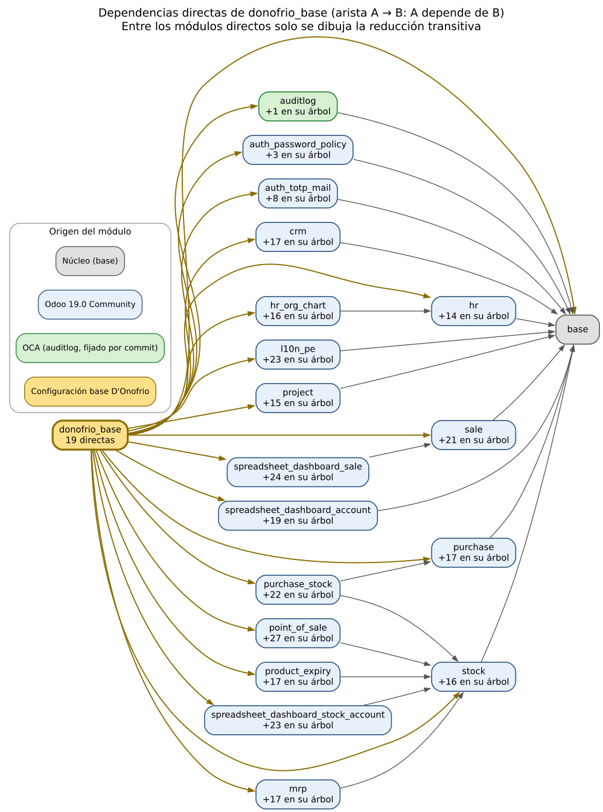

# 5.1 a 5.6 Back-end: integración con la base de datos, paquetes, librerías, dependencias, `donofrio_base` y patrones

El back-end de D'Onofrio es Odoo 19.0 Community sobre PostgreSQL 16, con un módulo de configuración (`donofrio_base`) y tres módulos propios de la Fase 2 (`donofrio_calidad`, `donofrio_heladeros` y `donofrio_tablero`). Todo se carga por código y se reproduce igual en cualquier equipo (RNF012).

## 5.1 Integración con la base de datos

El sistema no escribe SQL: todo acceso a PostgreSQL pasa por el **ORM de Odoo**, que abre la conexión con `psycopg2` y administra una transacción por petición. Cada modelo de Python es una tabla y cada campo una columna; los campos obligatorios son `NOT NULL`, los `Many2one` son claves foráneas, los `Many2many` tienen una tabla intermedia, `index=True` crea un índice B-tree y un campo calculado con `store=True` es una columna que se recalcula al cambiar sus dependencias (por ejemplo, `project_task.sla_estado`).

La base de demostración (`donofrio_base` más 16 semanas de transacciones) tiene 665 tablas y 143 MB. `donofrio_base` no crea tablas: extiende modelos existentes con `_inherit`. `donofrio_calidad` crea 4, `donofrio_heladeros` 2 y `donofrio_tablero` ninguna (modelo abstracto). Los datos maestros se cargan con XML `noupdate`, funciones y un `post_init_hook`, nunca con `INSERT`.

## 5.2 Organización de paquetes

| Carpeta | Contenido |
|---|---|
| `addons/donofrio_base/` | `data/` (un XML por área), `security/` (grupos, `ir.rule` y ACL), `models/` (4 extensiones), `hooks.py` y `tests/` (20 archivos) |
| `addons/donofrio_calidad/`, `donofrio_heladeros/`, `donofrio_tablero/` | `models/`, `views/`, `security/`, `tests/` y, según el caso, `data/`, `report/` (QWeb) y `static/src/` (OWL y SCSS) |
| `docker/`, `scripts/`, `.github/workflows/` | Imagen de Odoo, PostgreSQL primario y réplica y Nginx; scripts de operación, verificación y pruebas no funcionales; flujos `ci.yml`, `perf.yml` y `release.yml` |

Un archivo de datos por área reduce los conflictos de Git; la seguridad vive aparte porque es lo que más se revisa en una auditoría.

## 5.3 Organización de librerías

| Capa | Contenido |
|---|---|
| Módulos del `depends` de `donofrio_base` (19) | De Odoo 19.0: `base`, `l10n_pe`, `stock`, `product_expiry`, `sale`, `purchase`, `purchase_stock`, `mrp`, `point_of_sale`, `crm`, `hr`, `hr_org_chart`, `project`, tres `spreadsheet_dashboard_*`, `auth_totp_mail` y `auth_password_policy`. De OCA: `auditlog` 19.0.2.0.2 (AGPL-3) |
| Imagen de Docker | `odoo:19.0-20261112` (Ubuntu 24.04, Python 3.12) con `auditlog` fijado por commit; librerías de Python de Odoo (`psycopg2`, `lxml`, `Werkzeug`, `reportlab`, `Pillow`, `passlib`, `python-stdnum`, entre otras). El proyecto no agrega librerías propias; el cliente web usa OWL y Chart.js, ya incluidos |

Ningún módulo es de Enterprise.

## 5.4 Gestión de dependencias de comunicación entre módulos

Un script lee los `__manifest__.py`, resuelve el árbol de `depends` de `donofrio_base` y dibuja el grafo con Graphviz: 62 módulos y 12 niveles; al instalar se suman 60 por `auto_install`, 122 en total.

*Figura 5.4-a. Los 19 `depends` directos de `donofrio_base`; cada nodo indica cuántos módulos arrastra.*

Los tres módulos de la Fase 2 dependen de `donofrio_base` y ningún otro módulo depende de ellos. El tablero lee inspecciones, liquidaciones y temperaturas solo si `donofrio_calidad` y `donofrio_heladeros` están instalados y el usuario puede leerlos, por lo que no los declara como dependencia. La comunicación entre capas se muestra en la figura 5.8-a.

## 5.5 Documentación del módulo `donofrio_base`

`donofrio_base` (versión `19.0.1.0.0`, LGPL-3) configura el núcleo de D'Onofrio sobre Odoo estándar sin crear modelos nuevos: 13 archivos de datos (3 960 líneas de XML), 4 extensiones de modelos, `hooks.py` y 20 archivos de pruebas. Los módulos de la Fase 2 se describen en 5.5b a 5.5e.

| Área | Qué carga por código |
|---|---|
| Compañía y almacenes | Moneda PEN, idioma `es_PE`, compañía en Perú; 2 almacenes (CD Lima y CD Arequipa) y 8 ubicaciones con cámaras de frío |
| Productos y producción | 47 productos, 9 categorías con FEFO, 6 proveedores; 12 recetas con 71 componentes, 47 operaciones y 3 centros de trabajo con los puntos críticos de control |
| Comercial y abastecimiento | 3 equipos de CRM y 20 oportunidades; 5 listas de precios por canal y temporada; 30 clientes; 22 reglas mín./máx. de insumos |
| RR. HH., gerencia y TI | 18 departamentos, 18 puestos y 21 empleados; 4 vistas guardadas; proyecto «Mesa de Servicios TI» con SLA por prioridad (P1 4 h, P2 8 h, P3 72 h, P4 120 h) |
| Usuarios y seguridad | 10 usuarios, uno por rol, ninguno administrador; grupo «Solo operaciones del CD Arequipa» con 4 `ir.rule`; contraseña de 12 caracteres, bloqueo tras 5 intentos, 2FA obligatorio para administrador y gerente y 4 reglas de auditoría |

El `post_init_hook` se ejecuta una vez, al instalar: asigna la contraseña de prueba desde una variable de entorno (no está en el código), responsabiliza al jefe de almacén de los productos, configura la valoración FIFO en tiempo real y programa la carga del plan contable `pe`, con el punto de venta «Heladería Av. Venezuela» (efectivo y Yape) y los diarios de facturas (01) y boletas (03). Va en el hook y no en XML porque depende de cuentas que solo existen después del plan contable. Las cuatro extensiones son `sale.order` (factura si el cliente tiene RUC, boleta si no), `res.users` (2FA), `auditlog.rule` y `project.task` (campo `sla_estado`).

Para la demostración, un script ejecutado con `odoo shell` genera 16 semanas de transacciones (3/8 al 22/11/2026) con semilla fija e idempotente: 437 pedidos de venta, 939 del punto de venta, 488 lotes, 188 órdenes de producción y 101 órdenes de compra; otro completa las vistas de calidad, heladeros, cadena de frío y mesa de servicios con los métodos de los propios módulos. `donofrio_base` tiene 137 pruebas `TransactionCase` en 20 archivos, sin fallos (5.13).

## 5.6 Arquitectura de desarrollo impulsada por patrones

La explicación conceptual está en 4.3.2. El proyecto aplica estos patrones:

| Patrón | Cómo se aplica |
|---|---|
| MVC sobre el ORM | Modelos `models.Model`, vistas XML y OWL, y controladores como acciones y métodos de negocio (`action_confirm`, `button_validate`) |
| Herencia (`_inherit`) | 4 extensiones en `donofrio_base`, con `super()` y sin tocar el código de Odoo |
| Idempotencia | El punto de venta, la facturación, las reglas de auditoría y los scripts de datos se repiten sin duplicar |
| Modelos de la Fase 2 | Campos calculados con `store=True`, estados con métodos `action_*`, restricciones `UNIQUE` y `@api.constrains`, `mail.thread` con seguimiento, un *cron* y un modelo abstracto con `get_kpis()` |
