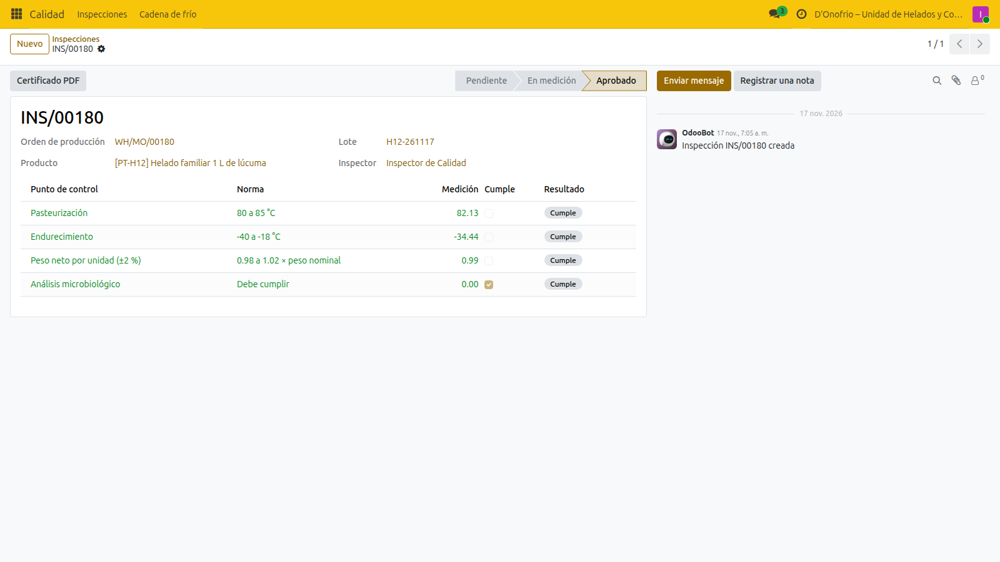

# 5.5b Documentación del módulo `donofrio_calidad` (M1)

La Calidad estándar de Odoo es Enterprise, así que M1 la construye como módulo propio (HU-17 y HU-18; RF011 y RF012; CU008). Se publicó en la release `v1.1.0` y depende de `donofrio_base`, `mrp`, `stock` y `product_expiry`.

**Qué hace.** Define puntos de control (qué se mide y su norma) y, al terminar una orden de producción, crea una inspección por cada lote producido. El inspector mide los puntos y el lote se aprueba (solo si todo cumple) o se rechaza con motivo. Un lote rechazado no se despacha a un cliente (RNF005), ni por transferencia ni por el punto de venta, y de una inspección aprobada se emite el certificado de calidad del lote en PDF, con las mediciones, el responsable y el logo.

**Modelos.** `donofrio.calidad.punto` (punto de control, con rango o «cumple / no cumple»), `donofrio.calidad.inspeccion` (una por orden y lote, con restricción `UNIQUE`) y `donofrio.calidad.linea` (la medición de cada punto, con resultado calculado). La inspección pasa por **Pendiente** (estado `borrador`, se crea sola), **En medición** (genera una línea por cada punto que aplica al producto), **Aprobado** (todos los puntos cumplen; un punto sin medir no deja aprobar) y **Rechazado** (exige motivo y deja una actividad al responsable de la orden). Los cinco puntos cargados son pasteurización (80 a 85 °C), endurecimiento (−40 a −18 °C), peso neto por unidad (±2 %), análisis microbiológico y humedad del panetón (22 a 28 %); las normas son supuestos del caso. Los usuarios de inventario solo leen las inspecciones, el grupo `Calidad: inspector` las crea y modifica y `Calidad: jefatura` además gestiona los puntos de control; sin esos grupos hay `AccessError`.

*Figura 5.5b-a. Inspección INS/00180 aprobada, con las cuatro mediciones dentro de su norma (datos de demostración).*

**Pruebas y límites.** `donofrio_calidad` tiene 45 pruebas sin errores: 13 de inspección y certificado, 2 del punto de venta, 1 de idioma y 29 de la cadena de frío (5.5d). En la pantalla se verificaron la lista de inspecciones, la aprobación, el rechazo por pasteurización a 79.46 °C y el certificado PDF. El bloqueo del lote rechazado se probó con pruebas automáticas y no en la pantalla del punto de venta, y un lote sin inspección no se bloquea, para no romper los flujos de la Fase 1.
