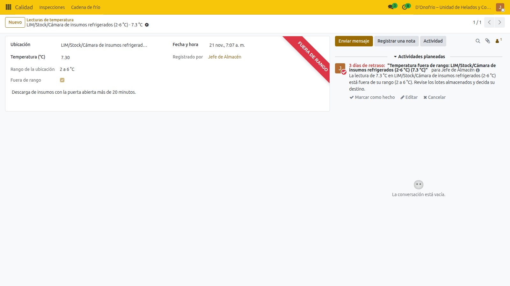

# 3.1.4.4 Cadena de frío (M3, ampliación del módulo de Calidad)

En la Fase 1 el rango de temperatura de una cámara iba solo en el nombre de la ubicación y las lecturas se anotaban en papel. La cadena de frío (M3; HU-19; RF008; CU006) lo lleva al sistema como una ampliación del módulo de Calidad, y cubre el punto crítico de control de temperatura de HACCP. Se publicó en la versión v1.3.0.

**Qué hace.** Cada ubicación interna puede tener un rango de temperatura (mínimo y máximo, en °C) y la casilla «Controlar temperatura». El almacén registra lecturas por ubicación; la lectura queda marcada como «Fuera de rango» si el valor sale del rango (los extremos cuentan como dentro) y entonces el sistema crea una actividad para el jefe de almacén con la ubicación, el valor y el rango, una sola vez por lectura. Una tarea programada diaria avisa además de los lotes con stock que vencen en los próximos 7 días (parámetro configurable), una sola vez por lote. El sistema no mueve ni bloquea lotes: la actividad pide revisarlos y decidir su destino.

| Elemento | Descripción |
|---|---|
| Lectura de temperatura | Ubicación, temperatura, fecha, quién la tomó, observaciones y la marca «Fuera de rango», que se calcula sola; guarda su historial y sus actividades |
| Ubicaciones y lotes (ampliados) | La casilla «Controlar temperatura» y el rango mínimo y máximo de cada ubicación (el mínimo no puede superar al máximo); la fecha de aviso de cada lote y la tarea programada «Calidad: lotes por vencer» |
| Rangos de las cámaras | Congelación (Lima y Arequipa) de −30 a −18 °C y refrigerados de 2 a 6 °C, cargados por código sin sobrescribir lo que se haya editado a mano |
| Historial y seguridad | Una lectura se juzga con el rango que tenía al registrarse. No hay roles nuevos: el operario de inventario lee, crea y modifica pero no borra; el jefe de almacén también borra; el usuario interno solo lee |

*Figura 5.5d-a. Lectura fuera de rango: cinta «Fuera de rango» y actividad para el jefe de almacén (datos de demostración).*

**Pruebas.** Las 29 pruebas de la cadena de frío pasan sin errores: rangos, lecturas dentro y fuera de rango, una sola actividad por lectura, correcciones, destinatario, permisos y las nueve de la tarea programada. En la pantalla se verificaron la lista de lecturas, una lectura dentro y otra fuera de rango, el rango en la ubicación y el aviso de la tarea programada sobre un lote que vence en 4 días, junto a la alerta estándar del control de vencimientos de Odoo. Las cuatro cámaras del módulo de configuración base traen su rango de temperatura.
