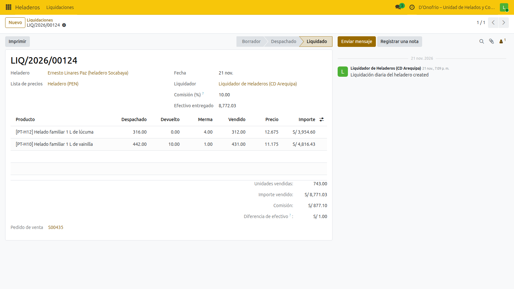

# 5.5c Documentación del módulo `donofrio_heladeros` (M2)

El heladero es un concesionario: compra al precio de la lista «Heladero» (25 % de descuento supuesto) y liquida cada día. M2 (HU-20 y HU-21; RF004; CU004) reemplaza el papel y el Excel de esa liquidación. Se publicó en la release `v1.2.0` y depende de `donofrio_base`, `sale` y `stock`.

**Qué hace.** El liquidador abre una liquidación por heladero y fecha (una por día, solo para contactos con la etiqueta «Heladero concesionario») y registra por producto lo despachado, devuelto y la merma. El sistema calcula lo vendido, el importe a precio de heladero, la comisión y la diferencia de efectivo; al confirmar, crea y confirma el pedido de venta con lo vendido, que sigue el flujo estándar (entrega con FEFO y factura o boleta), y permite imprimir el PDF con las firmas del heladero y del liquidador.

**Modelos y cálculos.** `donofrio.liquidacion` (cabecera, con estados y cálculos) y `donofrio.liquidacion.linea` (por producto). La liquidación pasa de Borrador a Despachado (exige al menos un producto) y a Liquidado (exige al menos una unidad vendida; ya no vuelve a borrador).

| Cálculo | Fórmula |
|---|---|
| Vendido | despachado − devuelto − merma (se rechaza si devuelto + merma supera lo despachado) |
| Importe de la línea | vendido × precio de la lista «Heladero» a la fecha |
| Comisión | importe vendido × porcentaje (10 % supuesto, editable) |
| Diferencia de efectivo | efectivo entregado − importe vendido (positiva: entregó de más; negativa: debe la diferencia) |

El pedido usa solo lo vendido: la mercadería devuelta no sale del almacén y la merma no se factura. El grupo `Heladeros: liquidador` crea y modifica liquidaciones, `Heladeros: jefatura` además las borra y los vendedores solo las leen.

*Figura 5.5c-a. Liquidación LIQ/2026/00124 en estado Liquidado, con su pedido de venta ligado (usuario Liquidador, datos de demostración).*

**Pruebas y límites.** `donofrio_heladeros` tiene 15 pruebas sin errores: cálculos, rechazo de cantidades inválidas, una liquidación por día, flujo completo con su pedido, estados, permisos y PDF. En la pantalla se verificaron la liquidación despachada y la confirmada, la lista con totales y el PDF con las firmas. El PDF es un documento para firmar y no reemplaza a la factura o boleta del pedido, y la merma no se modela como ajuste de inventario.
