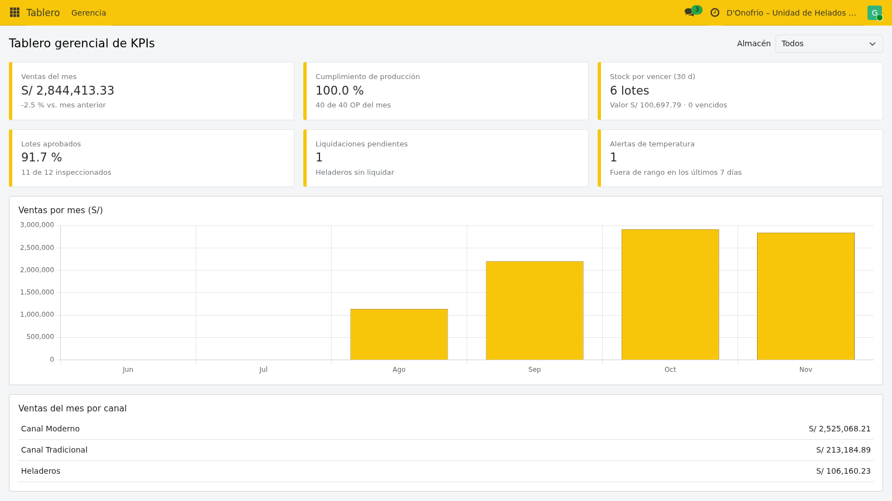

# 5.5e Documentación del módulo `donofrio_tablero` (M4)

Gerencia ya tenía en la Fase 1 los dashboards estándar de Community, de solo lectura. M4 (HU-22 y HU-24; RF013; CU009) agrega un tablero gerencial propio y la marca visual. Se publicó en la release `v1.4.0`; no crea tablas, porque su servicio de datos es un modelo abstracto.

**Qué hace.** El tablero (menú Tablero › Gerencia) es una acción de cliente OWL con hasta seis tarjetas de KPI, un gráfico de ventas de los últimos seis meses (Chart.js, que ya trae Odoo), una tabla de ventas del mes por canal y un filtro por almacén. La marca (HU-24) pone la barra superior del backend en amarillo (`#F7C60A`, con texto oscuro), el color primario en `#9A6B00` (contraste 4.69 con texto blanco) y el mismo color en el inicio de sesión y en las ilustraciones de «sin datos», más el favicon del helado.

| Tarjeta | Qué cuenta |
|---|---|
| Ventas del mes | Pedidos confirmados del mes con IGV, variación contra el mes anterior y desglose por canal |
| Cumplimiento de producción | Órdenes del mes hechas entre las confirmadas, en curso y por cerrar |
| Stock por vencer (30 d) | Lotes con existencias que vencen en 30 días, a costo estándar, y lotes ya vencidos |
| Lotes aprobados (M1), liquidaciones pendientes (M2) y alertas de temperatura (M3) | Inspecciones aprobadas entre aprobadas y rechazadas; liquidaciones que no están en «Liquidado»; lecturas fuera de rango de los últimos 7 días |

Las tres últimas tarjetas solo salen si el módulo está instalado y el usuario puede leer su modelo, por lo que `donofrio_tablero` depende solo de `donofrio_base`, `web`, `sale`, `stock`, `mrp` y `product_expiry`. El modelo abstracto `donofrio.tablero` expone `get_kpis(warehouse_id)`, que usa `_read_group` y respeta los permisos de quien lo abre, sin `sudo`: si el usuario no puede leer pedidos, existencias, lotes u órdenes, devuelve un aviso «sin permiso» que el componente muestra como una alerta amarilla y no como un error de acceso. El Gerente General ve el tablero completo; el Jefe de Ventas y el Vendedor reciben el aviso de que falta acceso a Inventario.

*Figura 5.5e-a. Tablero del Gerente General: ventas de noviembre de S/ 2,844,413.33, igual a la suma de los pedidos confirmados.*

**Pruebas y límites.** `donofrio_tablero` tiene 21 pruebas sin errores: estructura de `get_kpis`, ventas contra un pedido real, filtro de almacén, producciones, stock por vencer, tarjetas opcionales con y sin su módulo, aviso de «sin permiso» y carga en menos de 3 s (`get_kpis` tardó entre 30 y 57 ms). En la pantalla se verificaron el tablero completo, el filtro, el aviso para el vendedor, una ventana de 375 × 812 sin desplazamiento horizontal y el inicio de sesión con la marca. Lighthouse da 76 al tablero en escritorio (meta 80), un límite conocido del JavaScript del cliente web de Odoo, con un LCP de 2.11 s que sí cumple la carga en menos de 3 s. El componente OWL no tiene pruebas de JavaScript y el filtro de almacén no aplica a las liquidaciones, que no tienen almacén.
