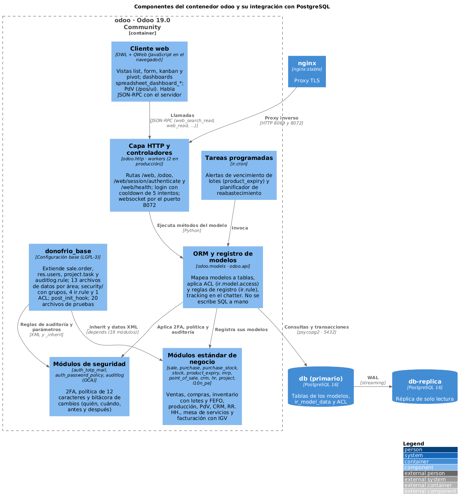

# 5.7 a 5.9 Arquitectura del sistema, integración con la base de datos, replicación y administración de la BD

> **Estado:** versión final del Cierre (25/11/2026; los datos medidos son los del 23/11/2026 salvo donde se indica) · **Autor:** Orlando (SM) · **Revisa:** Evelyn · **Fuente:** [02 §2.2](../plan/02_mapeo_plantilla.md), [06 §6.5](../plan/06_github_ci_infra.md), [09 §9.2](../plan/09_normas_marcos.md)
>
> Describe el **estado real de `develop`**: las mediciones son del 23/11/2026 y los módulos de la Fase 2 se suman al 25/11/2026. Existen la réplica (HU-25), los respaldos con restauración (HU-26), Nginx con TLS (HU-27), pruebas de carga y seguridad (HU-28) y el flujo de release hacia GHCR (HU-29; publicadas `v1.0.0` a `v1.4.0`). Las consultas a PostgreSQL de este documento se hicieron en modo de solo lectura sobre la base de desarrollo `donofrio_perf`. Cómo regenerar cada diagrama: [el README](../diagramas/README.md).

## 5.7 Diagramas de arquitectura del sistema (C4)

Se usa el modelo C4 (contexto, contenedores y componentes) escrito en **PlantUML con la librería C4** (`!include <C4/…>`, ya incluida en la imagen de PlantUML). Las fuentes `.puml` están versionadas junto a los PNG y SVG en [`docs/diagramas/c4/`](../diagramas/c4/).

### Nivel 1: contexto

*Figura 5.7-a. Contexto del ERP de D'Onofrio: personas, sistema y sistemas externos. Fuente: [`c4_contexto.puml`](../diagramas/c4/c4_contexto.puml).*

| Elemento | Estado real |
|---|---|
| Gerencia, jefes de área y personal operativo | 10 usuarios por rol cargados por `donofrio_base` (HU-04); el administrador y el gerente usan segundo factor en el despliegue protegido |
| ERP D'Onofrio | Odoo 19.0 Community + `donofrio_base` sobre PostgreSQL 16, en Docker Compose |
| GitHub | Repositorio público, Actions (CI), GHCR y releases |
| Servidor de correo saliente | **No configurado** en el proyecto. El código de verificación por correo (`auth_totp_mail`) lo necesitaría en un despliegue real; con la app de autenticación (TOTP) no hace falta |
| SUNAT / OSE | **No implementado**: el envío electrónico (`l10n_pe_edi`) es Enterprise. La numeración es la de Odoo (F 00000001, B 00000001) |

### Nivel 2: contenedores

*Figura 5.7-b. Contenedores del proyecto Compose `erp-donofrio`, volúmenes, respaldos y GitHub. Fuente: [`c4_contenedores.puml`](../diagramas/c4/c4_contenedores.puml).*

| Contenedor | Tecnología | Puertos | Estado |
|---|---|---|---|
| `nginx` | `nginx:stable` (perfil `proxy`) | 8080 → 80 y 8443 → 443 (el compose los publica en todas las interfaces del host) | Implementado (HU-27) |
| `odoo` | `erp-donofrio/odoo:19.0` (`odoo:19.0-20261112` + `auditlog`) | `127.0.0.1:8069` y `127.0.0.1:8072` | Implementado |
| `db` | `postgres:16` | `127.0.0.1:5432` | Implementado |
| `db-replica` | `postgres:16` (perfil `replica`) | `127.0.0.1:5433` | Implementado (HU-25) |
| Volúmenes | `pgdata`, `pgdata-replica`, `odoo-data` | — | Implementado |
| `backups/` | Carpeta del anfitrión (ignorada por Git) | — | Implementado (HU-26); el cron diario está documentado, no instalado por el repositorio |
| GitHub Actions y GHCR | `ci.yml`, `perf.yml`, `release.yml` | — | Actions implementado; GHCR con imagen publicada para los tags `v1.0.0` a `v1.4.0` |
| Uptime Kuma, SchemaSpy, VM en la nube | — | — | **No implementados** (opcionales del plan). El ER se genera con `diagrama_er.py` y PlantUML |

## 5.8 Integración sistema – base de datos

### Diagrama de componentes

*Figura 5.8-a. Componentes del contenedor `odoo` y su integración con PostgreSQL. Fuente: [`c4_componentes.puml`](../diagramas/c4/c4_componentes.puml).*

| Capa | Componentes | Cómo llega a la base de datos |
|---|---|---|
| Front-end | Cliente web de Odoo: OWL y plantillas QWeb que corren en el navegador (listas, formularios, kanban, pivote, dashboards y PdV). `donofrio_base` no agrega componentes propios; con la Fase 2, `donofrio_tablero` agrega el **tablero OWL** (acción de cliente con Chart.js, [5.5e](05_05_modulo_donofrio_tablero.md)) | Nunca directo: llama al servidor por JSON-RPC (`web_search_read`, `web_read`, `web_read_group`), el mismo que mide k6 |
| Back-end | Capa HTTP de Odoo (2 *workers* en el despliegue protegido, ninguno en desarrollo), controladores y acciones, ORM y registro de modelos, módulos estándar, módulos de seguridad y `donofrio_base`; tareas programadas (`ir.cron`) | El ORM abre la conexión con `psycopg2` y ejecuta las consultas dentro de una transacción por petición, aplicando ACL y reglas de registro antes de tocar las tablas |
| Datos | PostgreSQL 16 primario (`db`) y su réplica en *streaming* (`db-replica`) | Odoo lee y escribe **solo en el primario** (`HOST: db`). La réplica no recibe tráfico de Odoo: sirve para consultas de lectura (DBeaver, reportes) y como copia caliente |
| Archivos | Volumen `odoo-data` (*filestore*) | Los adjuntos no van a la base: la base guarda el nombre del archivo y Odoo lo lee del volumen. Por eso el respaldo incluye las dos cosas |

### Canales de comunicación

| Canal | Protocolo y puerto | Seguridad |
|---|---|---|
| Navegador → Nginx | HTTPS, 8443 (HTTP en 8080 responde 301 a HTTPS) | TLS 1.2 y 1.3, HSTS, CSP |
| Nginx → Odoo | HTTP 8069; `/websocket` a 8072 | Red interna de Docker; `proxy_mode = True` lee `X-Forwarded-*` |
| Odoo → PostgreSQL | Protocolo de PostgreSQL, 5432, `scram-sha-256` | Rol `odoo` sin superusuario; sin TLS en esta red interna (ver 5.9b) |
| Primario → réplica | Replicación física en *streaming* | Rol `replicador` con `scram-sha-256`; sin TLS en la red interna |
| Desarrollo (sin Nginx) | HTTP `127.0.0.1:8069` | Solo desde el propio equipo |

El mapeo de modelos a tablas está en [5.1](05_01_a_05_06_backend.md) y el modelo de datos en [4.2.5 a 4.2.8](04_02_modelo_de_datos.md).

## 5.9 Gestión de replicación

**Estrategia.** Replicación física **primario → *standby*** en *streaming*, **asíncrona** y con *hot standby* de solo lectura. Justificación: es nativa de PostgreSQL (sin software extra), Odoo escribe en un único primario, la réplica sirve para lectura y como base de recuperación, y el multi-maestro no aplica porque Odoo no lo soporta. La replicación lógica queda como alternativa no elegida.

### Configuración (todo versionado)

| Pieza | Dónde | Qué hace |
|---|---|---|
| Perfil `replica` | [`docker-compose.yml`](../../docker-compose.yml), servicio `db-replica` | `postgres:16`, volumen propio `pgdata-replica`, `127.0.0.1:5433`, `depends_on` el primario saludable, *healthcheck* `pg_isready` |
| `pg_hba.conf` del primario | [`docker/postgres/primary/pg_hba.conf`](../../docker/postgres/primary/pg_hba.conf) | Es el de la imagen más **una línea**: el rol `replicador` puede pedir la copia física con `scram-sha-256` |
| Parámetros del primario | `command` del servicio `db` | `hba_file=/etc/postgresql/pg_hba.conf` y `max_slot_wal_keep_size=1GB` (límite del WAL que retiene el *slot*) |
| Arranque de la réplica | [`docker/postgres/replica/entrypoint-replica.sh`](../../docker/postgres/replica/entrypoint-replica.sh) | La primera vez: espera al primario, crea el rol `replicador` (`REPLICATION`, sin superusuario) y el *slot* físico `donofrio_replica`, copia con `pg_basebackup -X stream -R -S …` y arranca con `hot_standby=on`. Es idempotente |
| Verificación | [`scripts/verificar_replica.sh`](../../scripts/verificar_replica.sh) y el job `replica` de `ci.yml` | 5 comprobaciones; falla si alguna no se cumple |

Los demás parámetros son los **valores por defecto de PostgreSQL 16**, verificados con `pg_settings` en el primario: `wal_level = replica`, `max_wal_senders = 10`, `max_replication_slots = 10`, `hot_standby = on`, `password_encryption = scram-sha-256`.

### Evidencias (23/11/2026, 15:01; [la evidencia de la réplica](../capturas/sprint-3/HU-25_evidencia_replica.txt))

| # | Comprobación | Resultado |
|---|---|---|
| 1 | `SELECT client_addr, state, sync_state, replay_lag, slot_name, active FROM pg_stat_replication` en el primario | `172.19.0.4` · `streaming` · `async` · retraso de reproducción **0.002255 s** · *slot* `donofrio_replica` activo |
| 2 | `SELECT pg_is_in_recovery()` en la réplica | `t` |
| 3 | Dato escrito en el primario y leído en la réplica | `hu25_1795464072` llegó a la réplica; además, `product_template = 48`, `stock_lot = 488` y `sale_order = 0` coinciden en ambas |
| 4 | `INSERT` y `UPDATE` en la réplica con el rol `odoo` | `ERROR: cannot execute INSERT in a read-only transaction` |
| 5 | Privilegios del rol `odoo` | No es superusuario ni tiene `REPLICATION` |

Resultado final de `scripts/verificar_replica.sh`: «Réplica verificada: todas las comprobaciones pasaron».

### Límites declarados

- La replicación es **asíncrona**: ante una falla del primario podrían perderse las últimas transacciones (en la medición, el retraso fue de milisegundos).
- **No hay *failover* automático.** La **promoción** de la réplica (`pg_promote()`) y la reconexión de Odoo **no se probaron**: queda como procedimiento manual no demostrado. La copia verificada de recuperación es la restauración de respaldos (5.9b).
- Odoo no usa la réplica para leer; no hay balanceo de lecturas.
- Con la réplica encendida, el primario retiene WAL para el *slot*; si la réplica se apaga mucho tiempo, `max_slot_wal_keep_size = 1GB` evita llenar el disco.

## 5.9b Gestión de administración de la base de datos

### Respaldos y restauración (HU-26, ISO 27001 8.13, ISO 22301)

| Pieza | Detalle |
|---|---|
| [`scripts/backup.sh`](../../scripts/backup.sh) | Genera por corrida: `<bd>_AAAAMMDD_HHMMSS.dump` (`pg_dump -Fc`), `…_filestore.tar.gz` (adjuntos) y `.sha256` con las sumas de ambos. Escribe en archivos `.parcial` y los renombra al terminar; borra los respaldos con más de **7 días** (`RETENCION_DIAS`) |
| [`scripts/restore.sh`](../../scripts/restore.sh) | Restaura en una **base nueva** (nunca sobrescribe una existente), verifica las sumas antes, restaura el *filestore*, muestra el conteo de módulos, usuarios y adjuntos y **mide el RTO** |
| [`scripts/verificar_backup.sh`](../../scripts/verificar_backup.sh) y job `backup` de `ci.yml` | Ciclo completo en una BD temporal: respaldo → restauración → comparación → rechazo de un respaldo alterado → retención de 7 días |
| Programación diaria | **Documentada, no instalada:** el encabezado de `backup.sh` y el manual de instalación indican la línea de `cron` (`0 2 * * * …`); el repositorio no la instala. Una copia fuera del equipo se logra apuntando `BACKUP_DIR` a una carpeta sincronizada |

Evidencia ([la evidencia del respaldo](../capturas/sprint-3/HU-26_evidencia_respaldo.txt), 23/11/2026, base `donofrio`):

| Medida | Valor |
|---|---|
| Respaldo | `.dump` de 7.4 MB y *filestore* de 5.4 MB, en **2 s** |
| Restauración en `donofrio_restaurada` | **RTO medido: 31 s** (objetivo: 7 200 s = 2 h, RNF006); 105 módulos, 14 usuarios y 751 adjuntos |
| Odoo sobre la base restaurada | Carga el registro de 105 módulos en 0.87 s |
| `verificar_backup.sh` | Las 6 comprobaciones pasaron: coinciden módulos, usuarios, adjuntos y contactos (105/14/751/33) y 505 archivos del *filestore*; el RTO de esa corrida fue de **11 s** |

**RPO:** respaldo diario → hasta 24 h de pérdida si solo se usa el respaldo; réplica en *streaming* → segundos. Los 31 s de RTO se midieron con una base de unos 100 MB y sin otros procesos: con más datos o un disco más lento crecerán.

### Roles y acceso (ISO 27001 8.2, 8.3)

Consulta a `pg_roles` en el primario:

| Rol | Superusuario | `CREATEDB` | `REPLICATION` | Uso |
|---|---|---|---|---|
| `odoo` | **No** | Sí | No | Lo usa Odoo; lo crea [`init-usuario-odoo.sh`](../../docker/postgres/primary/init-usuario-odoo.sh) (`NOSUPERUSER`) la primera vez que se crea el volumen |
| `replicador` | No | No | Sí | Solo la copia física del primario |
| `postgres` | Sí | Sí | Sí | Administración interna (respaldos y *healthchecks* dentro del contenedor); no lo usa Odoo |

Desde fuera del contenedor, la autenticación es `scram-sha-256` (`pg_hba.conf`); solo el *socket* local y el *loopback* del contenedor usan `trust`. Los puertos 5432 y 5433 se publican únicamente en `127.0.0.1`. El gestor de bases de datos de Odoo está deshabilitado (`list_db = False`) y Nginx responde 404 a `/web/database/`.

### Cifrado en tránsito

| Tramo | Estado |
|---|---|
| Navegador ↔ Nginx | **TLS 1.2 y 1.3** (certificado autofirmado de la demo; en una VM real iría Let's Encrypt), HSTS. Detalle y verificación en [5.11](05_10_a_05_12_seguridad.md) |
| Odoo ↔ PostgreSQL y primario ↔ réplica | **Sin TLS** (`ssl = off` en `pg_settings`): el tráfico queda dentro de la red `bridge` de Docker en un solo equipo. Es una limitación aceptada de la demo; en un despliegue con varios nodos habría que activar `ssl` y `sslmode=require` |
| Respaldos | Sin cifrar; protegidos solo por los permisos de la carpeta. Las sumas SHA-256 verifican integridad, no confidencialidad |

### VACUUM y ANALYZE

No hay tareas de `VACUUM` ni `ANALYZE` programadas por el proyecto: se confía en el ***autovacuum*** de PostgreSQL, **activo con los valores por defecto** (`autovacuum = on`, `naptime = 60 s`, `scale_factor` de 0.2 para *vacuum* y 0.1 para *analyze*). En la base medida, el *autovacuum* ya actuó sobre las tablas que más se escriben:

| Tabla | Filas vivas | Tuplas muertas | Autovacuum | Autoanalyze |
|---|---|---|---|---|
| `account_move_line` | 17 852 | 1 523 | 17 | 18 |
| `stock_move_line` | 6 535 | 0 | 15 | 17 |
| `stock_move` | 6 063 | 262 | 17 | 17 |
| `account_move` | 3 369 | 317 | 16 | 17 |
| `mail_message` | 12 595 | 51 | 5 | 15 |

Todas tienen su último *autovacuum* y *autoanalyze* el 23/11/2026, el día de la carga de datos. No se ajustó ningún parámetro porque con 143 MB no hace falta; con años de datos convendría revisar los umbrales de las tablas grandes.

### `pg_stat_statements`: **no implementado**

El plan contemplaba `pg_stat_statements` para medir las consultas más lentas. **No está activado** en el *compose*: la extensión está disponible en la imagen (`pg_available_extensions` la lista, versión 1.10), pero `shared_preload_libraries` está vacío y `pg_extension` solo tiene `plpgsql` y `pg_trgm`. Queda como **trabajo futuro**: bastaría agregar `-c shared_preload_libraries=pg_stat_statements` al `command` de `db` y ejecutar `CREATE EXTENSION pg_stat_statements` en la base. La capacidad se midió, en cambio, con k6 y `docker stats` (5.14).

### Índices

`donofrio_base` **no define índices propios** (no tiene modelos nuevos, solo el campo `sla_estado`, sin `index=True`). Los módulos de la Fase 2 **sí** declaran `index=True` en los campos por los que se busca (`production_id` y `lot_id` en la inspección, `location_id`, `fecha` y `fuera_de_rango` en la temperatura, y `inspeccion_id` y `liquidacion_id` en las líneas de inspección y de liquidación); el ORM los crea al instalar, sin medición aparte. Los índices los crea el ORM de Odoo: la base medida tiene **1 651 índices** sobre 665 tablas, 11 MB de ellos en `account_move_line` (18 MB en total). Por ejemplo, `stock_lot` (base del FEFO) tiene índices por `name`, `product_id` y `company_id`, y `sale_order`, por `partner_id`, `state`, `date_order` y `name`. En las tablas del núcleo el ORM ya cubre las claves foráneas; con 488 lotes y 437 pedidos, PostgreSQL elige el recorrido secuencial en parte de las lecturas (`stock_lot`: 17 373 secuenciales frente a 56 012 por índice) sin costo apreciable: los p95 de las listas fueron de 12 ms (k6). Si un módulo de la Fase 2 agrega modelos, sus campos de búsqueda frecuente deberían llevar `index=True`.

### Tamaño

La base `donofrio_perf` ocupa 143 MB (115 MB en tablas e índices del esquema `public`); las más grandes: `account_move_line` 18 MB, `ir_model_data` 8.6 MB, `mail_message` 7.9 MB, `ir_model_fields` 7.8 MB y `ir_ui_view` 5.9 MB.

## Resumen de lo que no está implementado

| Punto del plan | Estado |
|---|---|
| `pg_stat_statements` | No activado; trabajo futuro |
| Promoción de la réplica (`pg_promote`) y *failover* | No probado |
| TLS entre Odoo, primario y réplica | No; Docker en un solo nodo |
| Cron diario de `backup.sh` | Documentado; no instalado por el repositorio |
| Uptime Kuma, SchemaSpy, VM en la nube | No implementados (opcionales) |
| Imagen en GHCR | Publicada con cada tag `v1.0.0` a `v1.4.0` (24 y 25/11/2026) |
