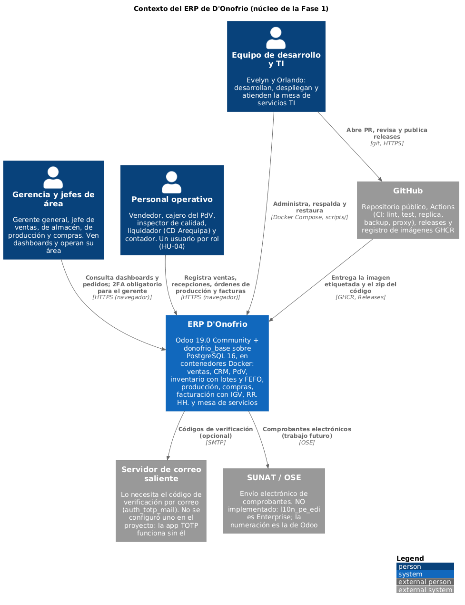
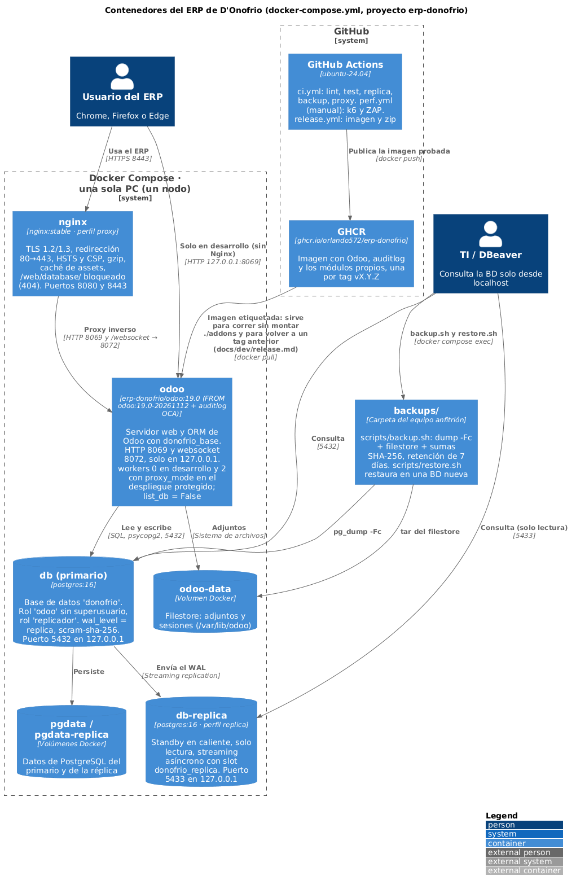

# 5.7 a 5.9 Arquitectura del sistema, integración con la base de datos, replicación y administración de la BD

## 5.7 Diagramas de arquitectura del sistema (C4)

La arquitectura se describe con el modelo C4 (contexto, contenedores y componentes), dibujado en PlantUML con la librería C4. El sistema corre en Docker Compose sobre un solo nodo.

*Figura 5.7-a. Contexto del ERP de D'Onofrio: personas, sistema y sistemas externos.*

En el contexto participan los 10 usuarios por rol, el ERP (Odoo 19.0 Community sobre PostgreSQL 16) y GitHub (repositorio, Actions, GHCR y releases). Quedan fuera del alcance el servidor de correo saliente, que el código de verificación por correo necesitaría en un despliegue real (con la app TOTP no hace falta), y el envío electrónico a SUNAT, que es Enterprise.

*Figura 5.7-b. Contenedores del proyecto Compose, volúmenes, respaldos y GitHub.*

| Contenedor | Tecnología | Puertos |
|---|---|---|
| `nginx` (perfil `proxy`) | `nginx:stable` | 8080 → 80 y 8443 → 443 |
| `odoo` | `odoo:19.0-20261112` + `auditlog` | `127.0.0.1:8069` y `8072` (websocket) |
| `db` y `db-replica` (perfil `replica`) | `postgres:16` | `127.0.0.1:5432` y `5433` |

## 5.8 Integración sistema – base de datos

*Figura 5.8-a. Componentes del contenedor `odoo` y su integración con PostgreSQL.*

El front-end (cliente web de Odoo con OWL y QWeb, y el tablero OWL de 5.5e) nunca llega directo a la base: llama al servidor por JSON-RPC. El back-end (capa HTTP con 2 *workers* en el despliegue protegido, ORM, módulos estándar, de seguridad y propios, y tareas `ir.cron`) abre la conexión con `psycopg2` y ejecuta cada petición en una transacción, aplicando ACL y reglas de registro. Odoo lee y escribe solo en el primario; la réplica sirve para consultas de lectura y como copia caliente. Los adjuntos van al volumen `odoo-data` y la base guarda su nombre, por lo que el respaldo incluye ambos.

Los canales son: navegador → Nginx por HTTPS (TLS 1.2 y 1.3, HSTS y CSP; el HTTP responde 301), Nginx → Odoo por HTTP 8069 y `/websocket` a 8072 dentro de la red interna de Docker, y Odoo → PostgreSQL por el puerto 5432 con `scram-sha-256` y un rol sin superusuario.

## 5.9 Gestión de replicación

**Estrategia.** Replicación física primario → *standby* en *streaming*, asíncrona y con *hot standby* de solo lectura. Es nativa de PostgreSQL, Odoo escribe en un único primario y el multi-maestro no aplica. La réplica usa un rol `replicador` (`REPLICATION`, sin superusuario) con `scram-sha-256` y un *slot* físico, y el primario limita el WAL retenido con `max_slot_wal_keep_size = 1GB`. Todo está versionado y se verifica con un script y con un job del CI.

| Comprobación (23/11/2026) | Resultado |
|---|---|
| `pg_stat_replication` en el primario | `streaming`, `async`, retraso de reproducción 0.002 s, *slot* activo |
| `pg_is_in_recovery()` en la réplica | `t` |
| Dato escrito en el primario y leído en la réplica | Llegó; las tablas de control coinciden |
| `INSERT` y `UPDATE` en la réplica | `cannot execute INSERT in a read-only transaction` |

**Límites conocidos.** La replicación es asíncrona, por lo que ante una falla del primario podrían perderse las últimas transacciones (en la medición, milisegundos). No hay *failover* automático: la promoción de la réplica con `pg_promote()` es un procedimiento manual.

## 5.9b Gestión de administración de la base de datos

**Respaldo y restauración (HU-26).** `backup.sh` genera por corrida un volcado `pg_dump -Fc`, el *filestore* comprimido y un archivo de sumas SHA-256, y borra los respaldos con más de 7 días. `restore.sh` restaura en una base nueva (nunca sobrescribe), verifica las sumas y mide el RTO. `verificar_backup.sh`, que corre también en el CI, ejecuta el ciclo completo: respaldo, restauración, comparación, rechazo de un respaldo alterado y retención.

| Medida | Valor |
|---|---|
| Respaldo | Volcado de 7.4 MB y *filestore* de 5.4 MB, en 2 s |
| Restauración | RTO medido de 31 s (objetivo RNF006: 2 h); 105 módulos, 14 usuarios y 751 adjuntos |
| RPO | Hasta 24 h con respaldo diario; segundos con la réplica |

**Roles, cifrado y mantenimiento.** Odoo usa el rol `odoo` sin superusuario; los puertos 5432 y 5433 se publican solo en `127.0.0.1`, el gestor de bases de datos de Odoo está deshabilitado (`list_db = False`) y Nginx responde 404 a `/web/database/`. El tráfico del navegador va con TLS; entre Odoo, PostgreSQL y la réplica va sin TLS, dentro de la red interna de un solo nodo, y los respaldos están protegidos por permisos de carpeta (las sumas verifican integridad, no confidencialidad). El *autovacuum* de PostgreSQL, con sus valores por defecto, ya actuó sobre las tablas más escritas. Los índices los crea el ORM (1 651 sobre 665 tablas) y los módulos de la Fase 2 declaran `index=True` en los campos que se buscan; con 143 MB no hizo falta ajustar nada y el p95 de las listas fue de 12 ms.
