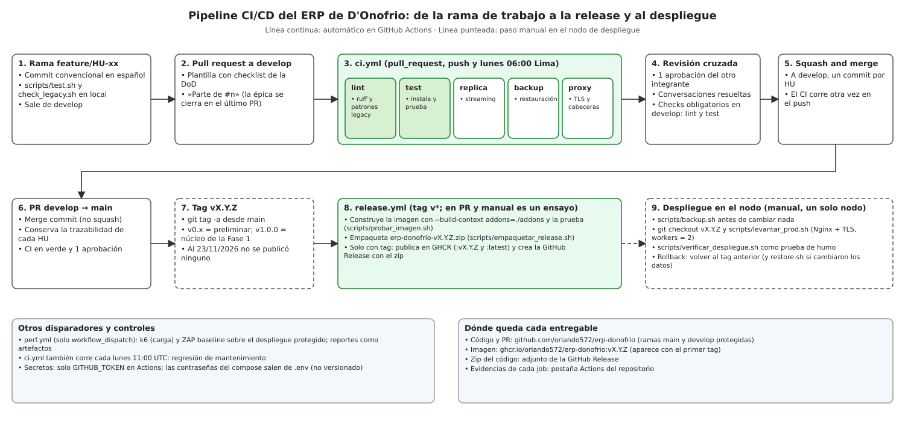

# 5.15 Despliegue: enfoque, herramientas, mejores prácticas y gestión de servicios

> **Estado:** borrador del Sprint 3 · **Autor:** Orlando (SM) · **Revisa:** Evelyn · **Fuente:** [06 §6.4 y §6.5](../plan/06_github_ci_infra.md), [02 §2.2](../plan/02_mapeo_plantilla.md) (5.15 y 5.16), [09 §9.3](../plan/09_normas_marcos.md), [docs/dev/release.md](../dev/release.md), [manual de instalación](../manuales/manual_instalacion.md), `.github/workflows/*.yml`
>
> Describe lo que **existe en `develop` al 23/11/2026**. Dos cosas que el plan nombraba **no existen**: un despliegue automático a una VM (`cd.yml` y `deploy.sh` eran opcionales) y una release publicada (todavía no hay ningún tag `v*`: la imagen de GHCR y el zip son un flujo listo y probado en ensayo). Cómo regenerar el pipeline: [docs/diagramas/README.md](../diagramas/README.md).

## 5.15.1 Enfoque de despliegue

| Aspecto | Decisión real |
|---|---|
| **Entornos** | (1) **Desarrollo:** la PC de cada integrante, `workers = 0`, `http://localhost:8069`. (2) **CI:** el *runner* efímero `ubuntu-24.04` de GitHub Actions. (3) **Demostración «en producción»:** la PC de la exposición con el perfil `proxy` (Nginx con TLS, `workers = 2`, `proxy_mode`), `https://localhost:8443`. No hay una VM en la nube |
| **Estrategia** | **Un solo nodo con reemplazo de contenedores** (*rolling* de un nodo): `docker compose up -d --build --wait` recrea solo lo que cambió y espera a que quede `healthy`. Hay unos segundos de corte; es aceptable para una demo y un solo equipo |
| **Rollback** | **Por versión etiquetada:** volver al tag anterior (`git checkout vX.Y.Z` y `scripts/levantar_prod.sh`, o correr la imagen `ghcr.io/orlando572/erp-donofrio:vX.Y.Z`) y, si los datos cambiaron, restaurar con `scripts/restore.sh` en una base nueva. **No se ensayó un rollback real** porque aún no hay tags publicados |
| **Backup previo** | Obligatorio por procedimiento: `scripts/backup.sh` antes de actualizar. Está documentado en el manual; **no lo ejecuta ningún script de despliegue** |
| **Blue-green** | Descrito como mejora (dos pilas de Compose detrás de Nginx). **No implementado** |
| **Actualización de datos** | `odoo -u donofrio_base` sobre la base con datos; los datos `noupdate` **no** se actualizan con `-u`: hay que recrear la base o usar el hook |
| **Kubernetes** | No aplica: un solo nodo, sin necesidad de orquestar réplicas de Odoo, y la curva de aprendizaje no se justifica para el alcance del proyecto |

### Perfiles y servicios de Compose

| Perfil | Servicios | Comando | Para qué |
|---|---|---|---|
| (base) | `db`, `odoo` | `docker compose up -d --build` | Desarrollo |
| `replica` | `db-replica` | `docker compose --profile replica up -d --wait` | Réplica de lectura (HU-25) |
| `proxy` | `nginx` | `scripts/levantar_prod.sh` | Despliegue protegido (HU-27): genera el certificado autofirmado, fija `workers = 2` y `proxy_mode`, y levanta con `--build --wait` |

(El perfil `tools` del plan, con SchemaSpy y Uptime Kuma, **no existe**.)

### Procedimiento

| Paso | Comando | Resultado |
|---|---|---|
| 1. Entorno | `cp .env.example .env` y, para el modo protegido, una `ODOO_ADMIN_PASSWD` de 16 caracteres o más | `.env` no se versiona |
| 2. Contenedores y base | `docker compose up -d --build` · `scripts/init_db.sh` | Odoo y PostgreSQL `healthy`; base `donofrio` con `donofrio_base` |
| 3. Datos de demostración (opcional) | `docker compose run --rm -T odoo odoo shell -d donofrio --no-http < scripts/cargar_transacciones.py` | 16 semanas de transacciones |
| 4. Despliegue protegido | `scripts/levantar_prod.sh` | `https://localhost:8443`, Nginx con TLS |
| 5. Prueba de humo | `scripts/verificar_despliegue.sh` | Ver resultados abajo |
| 6. Réplica (opcional) | `docker compose --profile replica up -d --wait` · `scripts/verificar_replica.sh` | Standby en *streaming* |
| 7. Respaldo | `scripts/backup.sh` (y, para probarlo, `scripts/verificar_backup.sh`) | `.dump`, filestore y sumas en `backups/` |

Volver a desarrollo: `docker compose --profile proxy down && docker compose up -d`.

### Resultados del despliegue (23/11/2026)

| Verificación | Resultado | Evidencia |
|---|---|---|
| `scripts/verificar_despliegue.sh` (7 grupos: redirección, TLS, cabeceras, gestor de BD, gzip y *websocket*, modo producción, bloqueo de login) | **Todas las comprobaciones pasaron**, también tras los cambios de HU-28 | [`HU-27_evidencia_seguridad.txt`](../capturas/sprint-3/HU-27_evidencia_seguridad.txt), [`HU-28_evidencia_k6_zap.txt`](../capturas/sprint-3/HU-28_evidencia_k6_zap.txt) |
| Contenedores | `db`, `db-replica` y `odoo` en `healthy`; Nginx en marcha | ídem |
| Imagen de release (ensayo local) | Construida con `--build-context addons=./addons` (3.25 GB); `scripts/probar_imagen.sh`: Odoo 19.0, `donofrio_base` y `auditlog` dentro, configuración de desarrollo y de producción correctas, contraseña de ejemplo rechazada; la imagen arranca sola y carga 109 módulos | [`HU-29_evidencia_release.txt`](../capturas/sprint-3/HU-29_evidencia_release.txt) |
| Zip del código (ensayo) | `erp-donofrio-v0.0.0-prueba.zip`: 17 MB, 349 entradas, sin `.env` | ídem |

## 5.15.2 Herramientas utilizadas

### Tabla 25. Herramientas de despliegue

| Herramienta | Uso en el proyecto | Estado |
|---|---|---|
| Git y GitHub | Control de versiones, PR con revisión cruzada, ramas `main` y `develop` protegidas, issues y Project | Implementado |
| Docker 29.1.3 y Compose 2.40.3 | Contenedores, perfiles `replica` y `proxy`, *healthchecks* y volúmenes; mismo `docker-compose.yml` en las dos PC y en el CI | Implementado |
| GitHub Actions | `ci.yml` (jobs `lint`, `test`, `replica`, `backup`, `proxy`), `perf.yml` (manual) y `release.yml` | Implementado |
| GHCR | Registro de imágenes `ghcr.io/orlando572/erp-donofrio`; lo llena `release.yml` con cada tag `vX.Y.Z` | **Flujo listo y probado en ensayo; sin imagen publicada** |
| Nginx 1.30.7 (`nginx:stable`) | Proxy inverso con TLS 1.2/1.3, HSTS, CSP, gzip, caché de *assets* y *websocket* | Implementado |
| Nube (VM con Let's Encrypt) | VM opcional | **No implementado** |
| Kubernetes | No aplica (ver arriba) | No aplica |
| Uptime Kuma | Monitoreo de `/web/health` | **No implementado** |

## 5.15.3 Pipeline CI/CD

*Figura 5.15-a. Pipeline CI/CD: de la rama de trabajo a la release y al despliegue en el nodo. Línea continua: automático en GitHub Actions; línea punteada: paso manual. Se genera con [`generar_arquitectura.py`](../diagramas/generar_arquitectura.py) (fuente: función `pipeline_cicd`); [SVG](../diagramas/arquitectura/pipeline_cicd.svg).*

### Flujos de GitHub Actions

| Flujo | Disparador | Job | Qué hace | Duración (corrida de `develop` del 23/11/2026) |
|---|---|---|---|---|
| `ci.yml` | `pull_request`, `push` a `develop` y `main`, lunes 11:00 UTC y manual | `lint` | `scripts/check_legacy.sh` y `ruff` 0.8.4 sobre `addons/`. **Obligatorio** en `develop` | 11 s |
| | | `test` | Construye la imagen, instala `donofrio_base` en una base nueva y corre las 136 pruebas con `scripts/test.sh`; falla con `ERROR`, una prueba roja o cero pruebas. **Obligatorio** en `develop` | 199 s |
| | | `replica` | Levanta el primario y la réplica y corre `scripts/verificar_replica.sh` | 24 s |
| | | `backup` | Base mínima y `scripts/verificar_backup.sh` (respaldo, restauración, integridad y retención) | 65 s |
| | | `proxy` | Despliegue protegido (`levantar_prod.sh`) y `scripts/verificar_despliegue.sh` | 105 s |
| `perf.yml` («Pruebas no funcionales») | **Solo manual** (`workflow_dispatch`), con semanas de datos, usuarios y duración como parámetros | `carga-y-seguridad` | Crea la base, carga datos, levanta el despliegue protegido y corre k6 y ZAP; sube los reportes como artefactos. **No** es un check requerido: tarda | — (no se ejecutó en Actions; las corridas de HU-28 son locales) |
| `release.yml` | Tag `v*`; en PR que toca la release y en ejecución manual es un **ensayo** | `release` | Construye y prueba la imagen, empaqueta el zip y, **solo con tag**, publica en GHCR (`:vX.Y.Z` y `:latest`) y crea la GitHub Release con el zip | 2 min 59 s (ensayo del PR de HU-29) |

`ci.yml` usa `concurrency` (cancela las corridas viejas solo en los PR) y permisos de solo lectura; `release.yml` pide `contents: write` y `packages: write` y usa únicamente `GITHUB_TOKEN`.

### Protección de ramas (API de GitHub, 23/11/2026)

| Rama | Aprobaciones | Checks obligatorios | Conversaciones resueltas | *Force push* | Aplica a administradores |
|---|---|---|---|---|---|
| `develop` | 1 (se descartan al cambiar el código) | `lint`, `test` | Sí | Prohibido | **No** |
| `main` | 1 | **Ninguno** | Sí | Prohibido | **No** |

Las releases salen de `main` (merge commit desde `develop`); los PR de trabajo entran a `develop` con *squash*.

## 5.15.4 Mejores prácticas aplicadas

| Práctica | Cómo se aplica | Límite |
|---|---|---|
| **Secretos** | `.env` fuera de Git (`.gitignore`); `.env.example` solo con valores de desarrollo; la contraseña maestra se puede leer de un archivo (`ODOO_ADMIN_PASSWD_FILE`); en modo protegido Odoo se niega a arrancar con menos de 16 caracteres o con la de ejemplo; `GITHUB_TOKEN` como único secreto de Actions; *secret scanning* y *push protection* activados | La contraseña de prueba de los usuarios está en `.env.example` (valor de desarrollo) |
| **Backups** | `backup.sh` con sumas y retención de 7 días; `restore.sh` a una base nueva con RTO medido (31 s); `verificar_backup.sh` en el CI | El *cron* diario está documentado y no instalado; sin cifrado ni copia fuera del equipo por defecto |
| **Monitoreo** | *Healthchecks* de Odoo (`/web/health`), PostgreSQL y réplica; `restart: unless-stopped`; `docker compose ps` y `logs`; `docker stats` durante k6 | **Sin monitoreo continuo** de disponibilidad (Uptime Kuma no implementado) |
| **Imágenes y versiones fijadas** | `odoo:19.0-20261112`, `postgres:16`, k6, ZAP y PlantUML con versión; `auditlog` por commit | Dependabot no configurado |
| **Mismo entorno en todas partes** | El CI usa el mismo `docker-compose.yml` y la misma imagen que las PC (RNF012) | — |
| **Superficie mínima** | Puertos de Odoo y PostgreSQL solo en `127.0.0.1`; gestor de BD cerrado; TLS | Nginx publica 8080 y 8443 en todas las interfaces |
| **Cambios controlados** | PR con revisión cruzada y CI antes de fusionar; `-u` sobre una base con datos como criterio de aceptación | `enforce_admins` desactivado; `main` sin checks obligatorios |

## 5.15.5 URLs de publicación

| Qué | URL | Estado al 23/11/2026 |
|---|---|---|
| Repositorio | <https://github.com/orlando572/erp-donofrio> | Público |
| Actions | <https://github.com/orlando572/erp-donofrio/actions> | Corridas en verde de `ci.yml` |
| Releases | <https://github.com/orlando572/erp-donofrio/releases> | **Vacía** (sin tags) |
| Imagen | `ghcr.io/orlando572/erp-donofrio:vX.Y.Z` | **Aún no publicada** (aparece con el primer tag) |
| ERP, front-end y back-end (demo protegida) | `https://localhost:8443` (entrada `/odoo`; `http://localhost:8080` redirige) | Solo en la PC donde se levanta el perfil `proxy`; certificado autofirmado |
| ERP en desarrollo | `http://localhost:8069` (*websocket* en `8072`) | Solo en la PC |
| Persistencia (PostgreSQL primario) | `localhost:5432` | Solo en la PC |
| Réplica de lectura | `localhost:5433` | Solo en la PC, perfil `replica` |

No hay un servidor público: el sistema se ejecuta en la PC de quien lo levanta.

## 5.15.6 Gestión de servicios (ITIL 4 / ISO 20000-1)

> Corresponde a la fila 5.16 de [02 §2.2](../plan/02_mapeo_plantilla.md), asignada a Orlando, y cubre las entradas del índice de la plantilla sobre control de cambios y capacidad (tablas 26 a 38). El plan indica **consultar al docente si espera estas secciones** (no están en el cuerpo de la plantilla); esa consulta sigue pendiente. Aquí solo va lo que **ya existe**; la mesa de servicios TI (incidentes y solicitudes) es de Evelyn (HU-32, `donofrio_base/data/mesa_servicios_data.xml`).

### Control de cambios (habilitación del cambio)

| Etapa ITIL | Cómo se hace hoy | Evidencia |
|---|---|---|
| Solicitud de cambio | Issue de GitHub (épicas y bugs con plantilla: `.github/ISSUE_TEMPLATE/epica.yml` y `bug.yml`); cada HU nace de una épica | Issues del repositorio |
| Evaluación | Revisión del PR por el otro integrante con la checklist de la DoD (sin patrones legacy, ACL y pruebas, `-u` sin errores, textos en español) | `.github/pull_request_template.md` |
| Autorización | Aprobación del PR; conversaciones resueltas | Protección de `develop` (5.15.3) |
| Implementación | *Squash and merge* a `develop`; *merge commit* a `main` | Historial de Git |
| Verificación | CI en verde (`lint`, `test`, `replica`, `backup`, `proxy`) y, antes de entregar, `verificar_despliegue.sh` | Figura 5.15-a; Actions |
| Cierre y despliegue | Tag `vX.Y.Z` → `release.yml` → imagen y zip; despliegue y rollback manuales (5.15.1) | `docs/dev/release.md` |

**No existe** la plantilla de solicitud de cambio (RFC, `solicitud_cambio.yml`) ni las etiquetas `tipo:cambio-*` que contemplaba [09 §9.3](../plan/09_normas_marcos.md); el formato RFC del anexo 10.4 está pendiente. El flujo anterior se representa con la Figura 5.15-a; **no se dibujaron** los dos BPMN que pedía el plan (control de cambios y solicitud de acceso).

### Capacidad y desempeño

| Elemento | Resultado real | Fuente |
|---|---|---|
| Medición de capacidad | k6 con 20 usuarios virtuales sobre el despliegue protegido; `docker stats` cada 10 s | [5.14, Tabla 22](05_13_a_05_14_pruebas.md) |
| Carga normal (20 usuarios, pausas de 1 a 3 s) | p95 de 12 ms en listas; Odoo 39 % de una CPU y 440 MiB como máximo | `HU-28_evidencia_k6_zap.txt` |
| Esfuerzo (20 usuarios sin pausas, ritmo 20 veces mayor) | p95 de 100 ms; Odoo hasta 160 % de CPU (los 2 *workers* casi saturados) y 513 MiB | ídem |
| Umbral de capacidad observado | El primer recurso que se agota es la **CPU de Odoo** (2 *workers*); PostgreSQL llegó a 57 % y 201 MiB | ídem |
| Proyección de usuarios (heladeros en verano frente a invierno) | **No hecha:** no hay datos de usuarios concurrentes reales; k6 solo mide 20 virtuales | — |
| Recursos mínimos | Unos 4 GB de RAM libres para todos los perfiles; la PC medida tiene 12 CPU y 14 GB | [R7](../pm/plan_riesgos.md) |

### Resumen de lo que no existe

Despliegue automático a una VM (`cd.yml`, `deploy.sh`), release y paquete en GHCR publicados, Uptime Kuma, Dependabot, plantilla de RFC, BPMN de control de cambios y de solicitud de acceso, proyección de usuarios y *cron* de respaldo instalado.
