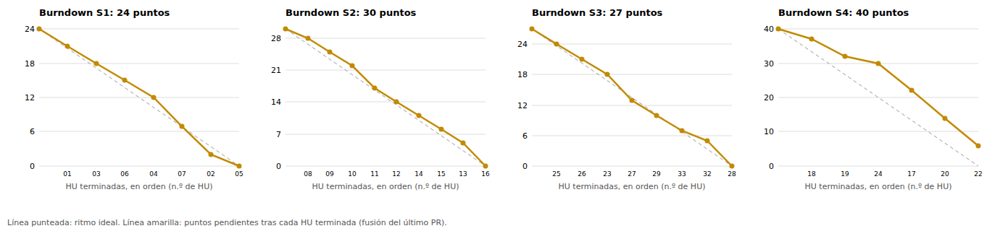

# 6.1 a 6.3 Equipo Scrum, cuadro de sprints y GitHub Projects

Las cifras salen de GitHub al 25/11/2026 y se pueden repetir en cualquier momento con el script `burndown.py` del repositorio.

## 6.1 Descripción del Scrum Team

El equipo tiene dos personas que comparten los roles de desarrollo. La Guía Scrum permite que el Product Owner y el Scrum Master también sean Developers; en un equipo de dos es la única opción realista, y las responsabilidades se reparten para que quien hace algo no sea quien lo controla (el PR de cada uno lo aprueba el otro).

| Rol | Responsable | Responsabilidades |
|---|---|---|
| Product Owner | Evelyn | Ordena el Product Backlog, redacta las HU y sus criterios de aceptación, representa a D'Onofrio, acepta o rechaza el incremento y mantiene el Project |
| Scrum Master | Orlando | Facilita Planning, Daily, Review y Retro; cuida la Definition of Done y el CI; mide velocidad y burndown; protege el *timebox* y verifica la entrega |
| Developers | Evelyn y Orlando | Construyen el incremento (módulos, configuración, pruebas y documentación) y revisan todos los PR del otro |

Evelyn tiene Marketing y Ventas, Gerencia y los extras administrativos, con los módulos M2 (`donofrio_heladeros`) y M4 (`donofrio_tablero`). Orlando tiene Logística, Producción, la configuración base, la infraestructura y la seguridad, con los módulos M1 (`donofrio_calidad`) y M3 (cadena de frío). El asistente de IA es una herramienta de los Developers y no un rol. El trabajo es una rama y un PR por HU contra `develop`, con aprobación del otro integrante y CI en verde: los 82 PR fusionados tienen al menos una revisión cruzada.

## 6.2 Resumen del cuadro de sprints

Los sprints duran un día porque el plazo es único y fijo (entrega del viernes 27/11 a las 14:30). Los puntos salen de las HU de cada épica y las fechas reales, en hora de Lima, son las del último PR fusionado de cada HU.

| Sprint | Objetivo | HU | Puntos plan. | Puntos compl. | Fechas reales |
|---|---|---|---|---|---|
| S0 Inicio | Proyecto constituido y backlog inicial | — | 0 | 0 | 22/11 |
| S1 Fundaciones | Odoo 19 corre igual en ambas PC, con CI y datos maestros | 7 | 24 | 24 | 22/11 a 23/11 |
| S2 Procesos estándar | Ciclo vender-comprar-producir-facturar con datos | 9 | 30 | 30 | 23/11 a 25/11 |
| S3 Calidad del núcleo | Núcleo v1.0.0 seguro, replicado, probado, desplegado y documentado | 8 | 27 | 27 | 23/11 |
| S4 Módulos propios (Fase 2) | M1, M2, M3 y M4 uno a uno | 8 | 40 | 34 | 24/11 a 25/11 |
| Cierre | Informe, manuales, presentación y entrega | — | 0 | 0 | hasta 27/11 |
| **Total** | | **32** | **121** | **115 (95 %)** | |

La velocidad fue de 24, 30, 27 y 34 puntos por sprint, con un promedio de 29. En el S4, la HU-21 (liquidación en PDF, 3 puntos) está implementada y fusionada, pero su casilla del backlog no se marcó, y la HU-31 (página de aterrizaje opcional, 3 puntos) no se desarrolló.

*Figura 6.2-a. Burndown por puntos: cada punto de la línea es una HU terminada y la línea punteada es el ritmo ideal. Los escalones se deben a que varias HU se fusionan casi a la vez.*

Los tres sprints de la Fase 1 se hicieron en unas 21 horas y la Fase 2 entre el 24 y el 25/11; las barras del Roadmap del Project muestran fechas planificadas y no las reales de la tabla.

## 6.3 Resumen del Monday: GitHub Projects

La gestión se hace con GitHub Projects, que es gratuito, está integrado con los issues, los PR y los commits, y el docente lo ve sin invitación porque el repositorio es público (la plantilla menciona Monday). El proyecto «Scrum ERP D'Onofrio» tiene 22 ítems: 15 épicas y 7 de gestión.

| Campo | Valores |
|---|---|
| Status | Backlog, Por hacer, En curso, En revisión, Hecho (se cambia a mano) |
| Puntos y Sprint | Puntos de la épica; iteración S0 a S4 y Cierre |
| Responsable, Fase y Tipo | Evelyn u Orlando; F1 o F2; Épica, Gestión o Bug |
| Prioridad | Must, Should o Could |

Las vistas son cuatro: Sprint actual (tablero), Product Backlog (tabla de las 15 épicas agrupada por fase), Roadmap (línea de tiempo por iteración) e Insights (*burn up* de ítems). El registro de las dailies está en el issue «Dailies».

Como el estado de las tarjetas se actualiza a mano, Insights (que cuenta ítems) no coincide exactamente con el burndown por puntos, que sale de los issues y los PR; para medir por puntos se usa el script de burndown.
