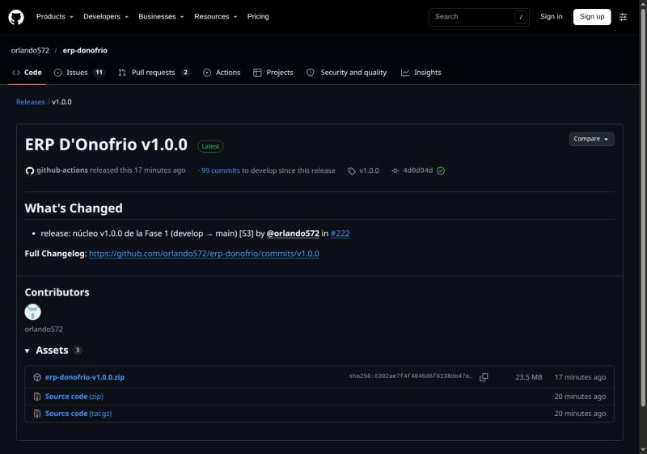
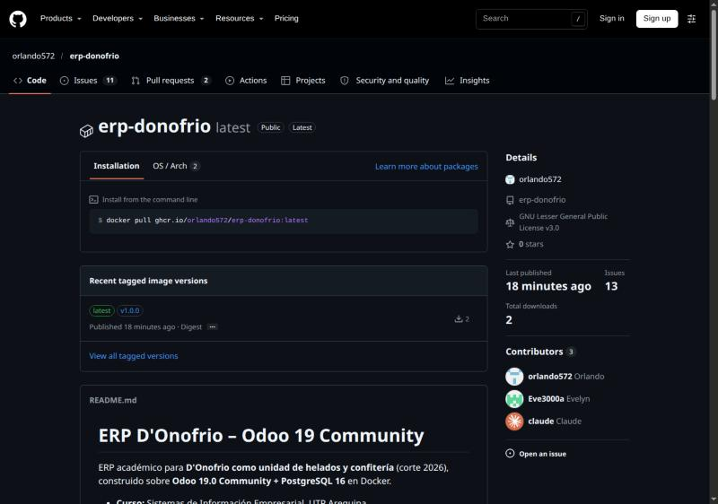
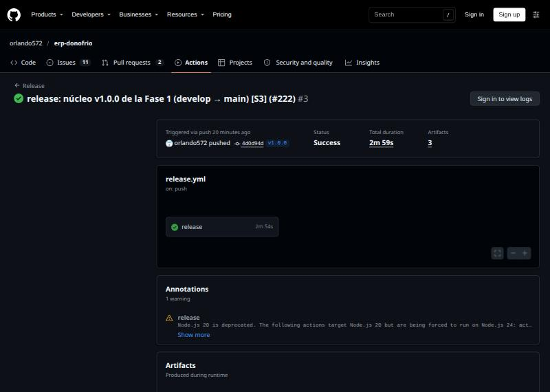
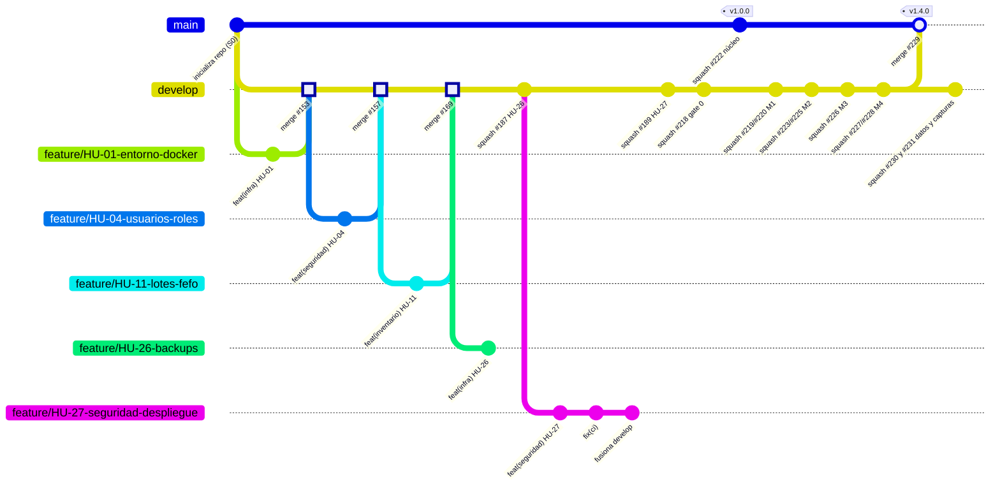

# 6.4 a 6.6 Repositorio: resumen de GitHub, ramificación y estrategia de fusión

> **Estado:** versión final del Cierre (25/11/2026) · **Autor:** Orlando (SM) · **Revisa:** Evelyn · **Fuente:** [02 §2.2](../plan/02_mapeo_plantilla.md), [06 §6.2 a §6.6](../plan/06_github_ci_infra.md), [docs/dev/release.md](../dev/release.md), [4.3.1](04_03_infraestructura.md)
>
> Mide el **estado real del repositorio al 25/11/2026** (`develop` en `339c907`, tras el PR #231; `main` en el merge commit del PR #229). Los datos salen de `gh` y `git` en modo de solo lectura y están guardados con fecha en la tabla de los **82 PR** [`S4_informe_final_prs_fusionados.tsv`](../capturas/sprint-4/S4_informe_final_prs_fusionados.tsv) (que amplía la del 23/11, [`S3-informe6_prs_fusionados.tsv`](../capturas/sprint-3/S3-informe6_prs_fusionados.tsv)) y, para el 23/11, en [`S3-informe6_evidencia_github.txt`](../capturas/sprint-3/S3-informe6_evidencia_github.txt). Entre ambas fechas pasaron la Fase 2 completa (M1 a M4), los tags `v1.0.0` a `v1.4.0` y los PR #199 a #231. De Evelyn son 6.1, 6.2, 6.3, 6.7, 6.8 y 6.12; aquí solo se enlazan.

## 6.4 Resumen del GitHub

### Tabla 26. Qué hay en GitHub y su estado

| Elemento | URL o ubicación | Estado al 25/11/2026 |
|---|---|---|
| Repositorio | <https://github.com/orlando572/erp-donofrio> | **Público**, licencia LGPL-3.0, rama por defecto `develop` (para que `Closes #n` cierre las épicas al fusionar) |
| Ramas | `develop` (integración) y `main` (entregado) | Ambas **protegidas**, con `lint` y `test` como checks obligatorios (ver Tabla 27). `main` recibió dos PR de release: el #222 (24/11, núcleo, *squash*) y el #229 (25/11, Fase 2 completa, *merge commit*). Al 25/11, `develop` va 2 commits por delante de `main` (los PR #230 y #231, de datos de demostración y capturas) |
| Pull requests | <https://github.com/orlando572/erp-donofrio/pulls?q=is%3Apr> | **82** PR, todos **fusionados** (80 a `develop` y 2 a `main`; 0 abiertos, 0 cerrados sin fusionar). 43 de Orlando y 39 de Evelyn. En el 23/11 eran 49 |
| Actions | <https://github.com/orlando572/erp-donofrio/actions> | 3 workflows: `CI` (`ci.yml`), `Release` (`release.yml`) y `Pruebas no funcionales` (`perf.yml`, solo manual). **199 ejecuciones** (Tabla 28) |
| Releases | <https://github.com/orlando572/erp-donofrio/releases> | **5 releases** con su zip: `v1.0.0` (núcleo), `v1.1.0` (M1), `v1.2.0` (M2), `v1.3.0` (M3) y `v1.4.0` (M4, *Latest*); detalle en la Tabla 26b |
| Paquete (GHCR) | `ghcr.io/orlando572/erp-donofrio` | **Público.** `release.yml` publica la imagen con cada tag `v*`; el 24/11/2026 se verificó en el navegador, sin sesión, que `v1.0.0` y `latest` se descargan. La CLI no pudo listar las versiones (falta el permiso `read:packages`), así que la visibilidad de `v1.1.0` a `v1.4.0` no se comprobó una por una |
| GitHub Project | <https://github.com/users/orlando572/projects/4> | Público, «Scrum ERP D'Onofrio», 22 ítems. Vistas, Insights y *Dailies* son de Evelyn ([6.2](06_01_a_06_03_equipo_sprints_y_project.md), 6.3) |
| Issues | <https://github.com/orlando572/erp-donofrio/issues> | 22 (9 abiertos y 13 cerrados); plantillas `epica.yml` y `bug.yml`. Lo explica Evelyn en 6.8 |
| Seguridad del repositorio | Settings → Code security | `secret scanning` y `push protection` **activos**; *Dependabot security updates* **desactivado** |

### Tabla 26b. Releases publicadas

| Release | Qué entrega | Commit del tag | Fecha del commit (Lima) | Zip adjunto |
|---|---|---|---|---|
| [`v1.0.0`](https://github.com/orlando572/erp-donofrio/releases/tag/v1.0.0) | Núcleo de la Fase 1 (`donofrio_base`); PR #222 | `4d0d94d` (en `main`) | 24/11/2026 00:38 | `erp-donofrio-v1.0.0.zip`, 23,5 MiB |
| [`v1.1.0`](https://github.com/orlando572/erp-donofrio/releases/tag/v1.1.0) | M1 `donofrio_calidad` (HU-17 y HU-18) | `16c1ad0` (cierre de M1 en `develop`) | 24/11/2026 00:30 | `erp-donofrio-v1.1.0.zip`, 23,6 MiB |
| [`v1.2.0`](https://github.com/orlando572/erp-donofrio/releases/tag/v1.2.0) | M2 `donofrio_heladeros` (HU-20 y HU-21) | `bcfd523` | 24/11/2026 01:32 | `erp-donofrio-v1.2.0.zip`, 24,4 MiB |
| [`v1.3.0`](https://github.com/orlando572/erp-donofrio/releases/tag/v1.3.0) | M3 cadena de frío (HU-19) | `602a037` | 24/11/2026 02:14 | `erp-donofrio-v1.3.0.zip`, 24,9 MiB |
| [`v1.4.0`](https://github.com/orlando572/erp-donofrio/releases/tag/v1.4.0) | M4 `donofrio_tablero` y marca (HU-22 y HU-24); **Latest** | `5e97fbc` | 24/11/2026 04:01 | `erp-donofrio-v1.4.0.zip`, 26,1 MiB |

Los tags `v1.1.0` a `v1.4.0` apuntan al commit en que cerró cada módulo en `develop`; como el PR #229 (*merge commit*) llevó todo ese historial a `main`, los cuatro son **ancestros de `main`**. Las cuatro releases y sus imágenes se publicaron (ejecuciones de `release.yml`) el 25/11/2026 entre las 00:40 y las 00:50 (hora de Lima), una tras otra, con el flujo `release.yml` (cuatro ejecuciones en verde).

**Estructura del repositorio.** Es la prevista en [06 §6.1](../plan/06_github_ci_infra.md) con estas diferencias, comprobadas en el árbol de `develop`: existen los cuatro módulos en `addons/` (`donofrio_base`, `donofrio_calidad`, `donofrio_heladeros` y `donofrio_tablero`), `docker/` (Odoo, PostgreSQL, Nginx), `scripts/` (23 scripts y la carpeta `perf/`; entre ellos los `verificar_*.sh`), `docs/` (`plan`, `informe`, `capturas`, `scrum`, `pm`, `dev`, `diagramas`, `manuales`, `usabilidad`) y `.github/` con 3 workflows, 2 plantillas de *issue* y la plantilla de PR. El repositorio tiene unos 570 archivos versionados.

**Plan frente a realidad en `.github/`.** No existen `dependabot.yml`, `CODEOWNERS`, `cd.yml`, `.pre-commit-config.yaml` ni la plantilla `solicitud_cambio.yml` de [09 §9.3](../plan/09_normas_marcos.md). La calidad del código la comprueba el job `lint` con `scripts/check_legacy.sh` y `ruff` 0.8.4 (no `pylint-odoo` ni *pre-commit*), y la solicitud de cambio es el propio PR con su plantilla (anexo [10.4](anexo_10_04_rfc.md)).

### Tabla 27. Protección de ramas (`gh api …/branches/{rama}/protection`, 25/11/2026)

| Regla | `develop` | `main` |
|---|---|---|
| Aprobaciones requeridas del PR | 1 | 1 |
| Descartar aprobaciones al cambiar el código (`dismiss_stale_reviews`) | Sí | Sí |
| Checks obligatorios | **`lint` y `test`** | **`lint` y `test`** (el 23/11 no tenía ninguno) |
| Resolver las conversaciones antes de fusionar | Sí | Sí |
| *Force push* y borrado de la rama | Prohibidos | Prohibidos |
| Historial lineal / commits firmados | No | No |
| **Aplica a administradores (`enforce_admins`)** | **No** | **No** |

El plan pedía «1 aprobación y CI en verde» en `main`; el 23/11 `main` exigía la aprobación pero no tenía checks (no tenía commits que probar) y, con el primer PR de release, se le pusieron `lint` y `test`. Los *rulesets* no se usan (0).

### Tabla 28. Ejecuciones de GitHub Actions (25/11/2026)

| Workflow | Ejecuciones | Resultado | Cuándo corre |
|---|---|---|---|
| **CI** | 192 | 165 correctas · 23 canceladas · **4 en rojo** | `pull_request` (113), `push` a `develop` y `main` (78) y `schedule` semanal (1: lunes 06:00 hora de Lima) |
| **Release** | 7 | 7 correctas: 2 ensayos en PR (#190 y #222) y 5 publicaciones, una por tag (`v1.0.0` a `v1.4.0`) | Tag `v*` (publica), PR que toque la release o ejecución manual (ensayo) |
| **Pruebas no funcionales** | 0 | — | Solo manual (`workflow_dispatch`): k6 y ZAP |

Los **4 rojos** del CI son 4 ejecuciones de PR que el propio PR corrigió antes de fusionarse: 2 del #189 (HU-27, el paso de verificación del despliegue, 23/11) y 2 del job `lint` en los PR de M1 y M3 (`feature/HU-17-inspecciones-calidad` el 24/11, por dos variables llamadas `l`, y `feature/HU-19-cadena-de-frio` el 24/11); en los dos casos se corrigió en el mismo PR y se fusionó con el CI en verde. Es la evidencia de que el control funciona. Las **23 canceladas** las reemplazó una corrida más reciente del mismo grupo de concurrencia; no son fallos. La corrida más reciente sobre `develop` (`339c907`, 25/11/2026, tras el PR #231) terminó **en verde**, con `0 failed, 0 error(s) of 218 tests`.

Los **jobs de `ci.yml`** (medición del 23/11/2026, a la hora del corte del Sprint 3, antes de la Fase 2; no se repitió el conteo por job):

| Job | Qué hace | Ejecuciones | Resultado | Duración (mediana · máx.) |
|---|---|---|---|---|
| `lint` | `scripts/check_legacy.sh` y `ruff check addons` (0.8.4) | 101 | 101 correctas | 13 s · 18 s |
| `test` | Construye la imagen y corre `scripts/test.sh` (todos los tests de `addons/`) | 101 | 98 correctas · 3 canceladas | 133 s · 199 s |
| `replica` | Levanta la réplica y corre `verificar_replica.sh` (HU-25) | 38 | 38 correctas | 32 s · 245 s |
| `backup` | Respaldo, restauración en una base nueva y retención con `verificar_backup.sh` (HU-26) | 36 | 36 correctas | 75 s · 97 s |
| `proxy` | Nginx con TLS y `verificar_despliegue.sh` (HU-27) | 32 | 29 correctas · **2 en rojo** · 1 cancelada | 87 s · 119 s |

Los jobs `replica`, `backup` y `proxy` se agregaron en el Sprint 3, por eso tienen menos ejecuciones. Las 2 ejecuciones en rojo del job `proxy` son del PR #189: la segunda falló con «no acepta tls1_3» y «ningún intento se bloqueó» (el script de verificación usaba `openssl` y contaba mal el bloqueo por *worker*). De la corrida programada hay **una** ejecución (éxito, id `45279340817`).

**Capturas de la Release `v1.0.0` (24/11/2026).** Se tomaron en el navegador integrado **sin iniciar sesión**, lo que prueba que son públicas: la GitHub Release `v1.0.0` con el zip adjunto, el paquete de GHCR con sus etiquetas y la corrida del flujo Release en verde. No se repitieron para `v1.1.0` a `v1.4.0`; su evidencia es la lista de la Tabla 26b (`gh release list`) y las cuatro ejecuciones de `release.yml`.

*Ilustración 6.4-a. Release «ERP D'Onofrio v1.0.0» (*Latest* el 24/11; hoy lo es `v1.4.0`) con `erp-donofrio-v1.0.0.zip` entre los *assets*. Captura: [`S4-release_v1.0.0.png`](../capturas/sprint-4/S4-release_v1.0.0.png).*

*Ilustración 6.4-b. Paquete `erp-donofrio` en GHCR: visibilidad **Public**, etiquetas `latest` y `v1.0.0`, instalación con `docker pull ghcr.io/orlando572/erp-donofrio:latest`. Captura: [`S4-paquete_ghcr.png`](../capturas/sprint-4/S4-paquete_ghcr.png).*

*Ilustración 6.4-c. Corrida del flujo `release.yml` (id `45335041382`) sobre `4d0d94d` y el tag `v1.0.0`: éxito en 2 min 59 s y 3 artefactos. Captura: [`S4-release_corrida.png`](../capturas/sprint-4/S4-release_corrida.png).*

**Capturas que siguen sin tomarse.** De las del plan ([06 §6.6](../plan/06_github_ci_infra.md)) faltan la página principal del repositorio, las reglas de protección de ramas y *Insights*; para ellas la evidencia es el texto fechado de arriba.

## 6.5 Ramificación

### Esquema real

| Rama | Propósito | Cómo se usó (de los 82 PR) |
|---|---|---|
| `main` | Lo entregado y aceptado; un tag por entrega (`v1.0.0` = núcleo) | Al 23/11 solo tenía el commit inicial. **24/11/2026:** el PR #222 llevó el núcleo a `main` (*squash*) y se creó `v1.0.0`. **25/11/2026:** el PR #229 fusionó la Fase 2 (*merge commit*) y se crearon `v1.1.0` a `v1.4.0`. Recibió **2 PR** (`release/v1.0.0` y `release/v1.4.0`) |
| `develop` | Integración continua del sprint | Base de **80 PR**; 81 commits en la primera línea de historia (`git log --first-parent`) |
| `feature/HU-xx-*` | Una HU | **43 ramas** (tipo `feature/`): 39 llevan una HU en el nombre (las del núcleo y las de los módulos de la Fase 2, incluidos sus PR de cierre y de correcciones) y 4 son de informe o manuales (`feature/S3-informe-4-2`, `S3-informe-5`, `S3-informe-6` y `S3-manual-herramientas-abstract`) |
| `docs/*` | Avance del informe y de Scrum | **34 ramas** (`docs/s1-planning`, `docs/s2-review-retro`, `docs/s3-informe-*-evelyn`…) |
| `fix/*` | Corrección de un defecto | **1 rama**: `fix/HU-09-vigencia-hora-lima` |
| `chore/*` | Mantenimiento (no está en el plan) | **2 ramas**: `chore/s0-cierre-windows` y `chore/ci-no-cancelar-develop` |
| `release/*` | PR `develop` → `main` con su tag (no está en el plan como rama) | **2 ramas**: `release/v1.0.0` (PR #222) y `release/v1.4.0` (PR #229) |
| `hotfix/*` | Corrección urgente sobre `main` | **No se usó** |

**Diferencias con [06 §6.2](../plan/06_github_ci_infra.md):** (1) aparecieron las ramas `chore/*` y `release/*`; (2) los PR del informe del Sprint 3 salieron de `feature/S3-informe-*` y no de `docs/*`; (3) la rama de corrección lleva la HU y no el número del *issue* (`fix/HU-09-…`). Ninguna rama vive más de unas horas: el proyecto entero (de la creación del repositorio al cierre de la Fase 2) ocurrió entre el 22 y el 25/11/2026.

### Figura 12. Flujograma de ramas (`gitGraph`)

Resumen fiel del esquema real. `develop` sale del commit inicial de `main`; cada HU vive en su rama y vuelve por PR. Hasta el Sprint 2 los PR se fusionaron con *merge commit* (rombo resaltado) y desde el #184 con *squash* (un solo commit por PR). `develop` → `main` es el paso del Gate 0 (PR #222, *squash*, 24/11/2026) y el de la Fase 2 (PR #229, *merge commit*, 25/11/2026); el gráfico los muestra, resumiendo con un solo nodo los PR de cada módulo. Los tags `v1.1.0` a `v1.2.0` y `v1.3.0` apuntan a commits de `develop` que `main` ya contiene tras el #229 y no se dibujan por separado.

*Lectura.* Las ramas `feature/HU-26-backups` y `feature/HU-27-seguridad-despliegue` traen un commit «fusiona develop»: es la forma de resolver los conflictos (6.6). Los pasos a `main` (PR #222 con `v1.0.0` y PR #229 con `v1.4.0`) están dibujados al final.

### Listado real de ramas

**Remotas** (`git branch -r`, 25/11/2026): **40**, de las cuales 2 están protegidas (`main` y `develop`).

| Rama remota | Estado |
|---|---|
| `main` | Protegida; recibió los PR #222 y #229 |
| `develop` | Protegida; rama de integración |
| 38 ramas de trabajo (`docs/*`, `feature/*` y `release/*`) | Todas con su PR **fusionado** (82 PR en total, 0 abiertos): `docs/s2-aceptacion-po`, `docs/s3-planning`, las `docs/s3-informe-*`, `feature/HU-16-*`, `HU-17-*`, `HU-18-*`, `HU-19-*`, `HU-20-*`, `HU-22-*`, `HU-23` a `HU-30`, `HU-33`, `feature/S3-*`, `release/v1.0.0` y `release/v1.4.0` |

Las 38 ramas de trabajo que quedan en el remoto **ya están fusionadas**: GitHub las ve «por delante» de `develop` porque el *squash* crea otro commit; no tienen trabajo sin fusionar. Las otras **44** ramas de los 82 PR se borraron al fusionar (`delete_branch_on_merge = true`). Esta rama (`feature/cierre-informe-final`) se suma a la lista al abrir su PR.

**Fusionadas** (por el encabezado de cada PR): 82 ramas en total: 43 `feature/*`, 34 `docs/*`, 2 `chore/*`, 2 `release/*` y 1 `fix/*`. La tabla completa, con número de PR, autor, quién fusionó, método y rama base, está en [`S4_informe_final_prs_fusionados.tsv`](../capturas/sprint-4/S4_informe_final_prs_fusionados.tsv).

## 6.6 Merge strategy

### Lo que dice el plan

1. PR de `feature/*` a `develop` con la plantilla ([`.github/pull_request_template.md`](../../.github/pull_request_template.md)).
2. Revisión cruzada del otro integrante con la checklist de la DoD.
3. **Squash and merge** a `develop`, un commit por HU.
4. `develop` → `main` con **merge commit** (no *squash*) y tag.
5. Conflictos: `git rebase origin/develop` en la rama antes de fusionar.

### Lo que se hizo (discrepancias plan–realidad)

| Punto | Plan | **Realidad al 25/11/2026** |
|---|---|---|
| Método a `develop` | Siempre *squash* | **Mixto: 63 *squash* y 17 *merge commit*** (de los 80 PR a `develop`). Los 17 *merge commit* son todos hasta el PR #183 (Sprint 0, 1 y 2): #151, #153 a #158, #160, #166, #169, #173 a #177, #180 y #183. **Desde el #184 (cierre del Sprint 2) los 46 PR son *squash*** (el repositorio permite los dos métodos: `allow_squash_merge` y `allow_merge_commit` en `true`; el *rebase* está desactivado). Desde ese PR coincide con el plan: un commit por PR |
| Historial de `develop` | Un commit por HU | `git log --first-parent origin/develop`: 81 commits (1 raíz, 63 *squash* y 17 *merge commit*); el historial de los primeros sprints conserva los commits de cada rama |
| Revisión cruzada | 1 aprobación del otro integrante | **79 de 82 PR** (96 %) con aprobación vigente del otro integrante; en los 82 revisó el otro. Los otros **3** (#154, #155 y #156, del Sprint 1) se fusionaron con la aprobación **descartada** al cambiar su base a `develop` y con el código ya revisado y los checks en verde (4.3.1). Los 33 PR nuevos (#199 a #231) tienen todos su aprobación vigente |
| Quién fusiona | El revisor | De los 82 PR, **34** los fusionó su propio autor **después** de la aprobación del otro y **48** los fusionó el otro integrante |
| Conversaciones resueltas | Obligatorio | Activado en las dos ramas; **0** comentarios en línea de código (la revisión se dejó en la aprobación y en 3 comentarios de conversación) |
| Aprobación al cambiar el código | — | `dismiss_stale_reviews` está activo: **13 revisiones** de 11 PR se descartaron al hacer un push nuevo y hubo que volver a aprobar |
| Conflictos | `git rebase` | **Se resolvieron fusionando `develop` en la rama (merge, no *rebase*)**, sin *force push*. Ver abajo |
| `develop` → `main` | *Merge commit* con tag | **Hecho dos veces:** el PR #222 (24/11, núcleo, `v1.0.0`) se fusionó con *squash* —`main` solo tenía el commit inicial y quedó con un solo commit—, no con *merge commit*; el PR #229 (25/11, Fase 2, `v1.4.0`) sí fue *merge commit*, con sus padres `4d0d94d` y el último commit de `develop`. Los tags `v1.1.0` a `v1.3.0` se pusieron sobre commits de `develop` que `main` contiene desde el #229 |

Con el método real, el *merge commit* de los primeros sprints es una **forma válida** de conservar el detalle de cada rama, y el *squash* desde el #184 es el del plan. La documentación del plan ([06 §6.2](../plan/06_github_ci_infra.md)) se mantiene como objetivo; el informe documenta la realidad.

### Conflictos y su resolución

Un conflicto aparece cuando otro PR toca los mismos archivos entre que se abre el PR y se fusiona. **10 PR** integraron `develop` dentro de su rama con un *merge commit* (12 *merge commits* en total, sin contar los dos PR de release): #168, #170, #179, #187, #189 (dos veces), #192, #194, #196, #216 y #224 (dos veces). Tres lo explicaron en un comentario del PR:

| PR | Qué chocó | Cómo se resolvió |
|---|---|---|
| #187 (HU-26) | `ci.yml` con la HU-25 (réplica) | Se fusionó `develop` en la rama y se conservaron los jobs `lint`, `test`, `replica` y `backup` |
| #189 (HU-27) | `__manifest__.py` y `tests/__init__.py` con la HU-23 (dashboards); antes, `ci.yml` con la HU-26 | Cambios **aditivos**: se conservaron las dependencias, los datos y los tests de las dos HU; `donofrio_base` pasó 117 pruebas |
| #192 (HU-33) | `tests/__init__.py` con el test de ventas de Evelyn (#191, también HU-33) | Se fusionó `develop` y se conservaron los dos tests; 125 pruebas sin errores |

De los otros 5 PR con *merge* de `develop` (#168, #170, #179, #194 y #196) no hay comentario que describa un conflicto: el *merge commit* solo los puso al día con `develop` y, en #194, conservó las secciones de HU-28 y HU-32 del README de capturas. El número exacto de conflictos con edición manual no se registró; con evidencia hay **al menos 3 PR** (#187, #189 y #192). Los conflictos se concentraron donde el plan lo preveía: `donofrio_base` (`__manifest__.py`, `tests/__init__.py`), `ci.yml` y `docs/`.

**Límite.** Como cada fusión de `develop` en una rama descarta la aprobación (`dismiss_stale_reviews`), el PR vuelve a revisarse: lo anotó el propio autor en el #192 («hace falta aprobar de nuevo cuando el CI termine»).

### Limitación conocida: `enforce_admins` desactivado

Las reglas de `develop` y `main` (Tabla 27) **no aplican a los administradores** (`enforce_admins = false`). El repositorio tiene **un solo administrador, Orlando** (`orlando572`, rol *admin*); Evelyn tiene rol *write* (`gh api …/collaborators`) y sí queda sujeta a las reglas. En la práctica, Orlando podría fusionar sin aprobación o sin CI, y su propio PR no lo frena la regla de la aprobación del otro integrante. **Se usó dos veces con motivo documentado** (los PR #152 y #153 del Sprint 1, abiertos antes de que existiera el CI, fusionados con la aprobación de Evelyn) y en los PR #154 a #156 (aprobación descartada al cambiar la base). Desde el Sprint 2 los PR se abren directos contra `develop` y no se repitió. **No se activó, por decisión del PO:** en la Retro del Sprint 2 ([`docs/scrum/sprint-2/retro.md`](../scrum/sprint-2/retro.md)) Evelyn decidió el 23/11/2026 dejarlo desactivado como salida de emergencia y compensarlo cumpliendo siempre la revisión cruzada; activar `enforce_admins` en `develop` y `main` queda como recomendación técnica ([8.2.8](08_recomendaciones.md)). *Mitigaciones:* los PR de los 3 sprints pasan por la plantilla con la DoD, la aprobación del otro integrante se registra en GitHub y el CI corre en cada PR. Este es el control **C-14** de [5.11](05_10_a_05_12_seguridad.md) (estado «Parcial»).

### Evidencia

| Qué | Dónde |
|---|---|
| Configuración del repo, protección de ramas, PR, Actions, releases (23/11/2026; el 25/11 se repitió con `gh`, ver las Tablas 26 a 28) | [`S3-informe6_evidencia_github.txt`](../capturas/sprint-3/S3-informe6_evidencia_github.txt) |
| Los 82 PR: método, autor, quién fusionó, aprobación, merges de `develop` y rama base | [`S4_informe_final_prs_fusionados.tsv`](../capturas/sprint-4/S4_informe_final_prs_fusionados.tsv) (los 49 del 23/11: [`S3-informe6_prs_fusionados.tsv`](../capturas/sprint-3/S3-informe6_prs_fusionados.tsv)) |
| Trazabilidad requisito → HU → PR | [`trazabilidad.md`](trazabilidad.md) |
| Excepciones del Sprint 1 y reglas de protección | [4.3.1](04_03_infraestructura.md) |
