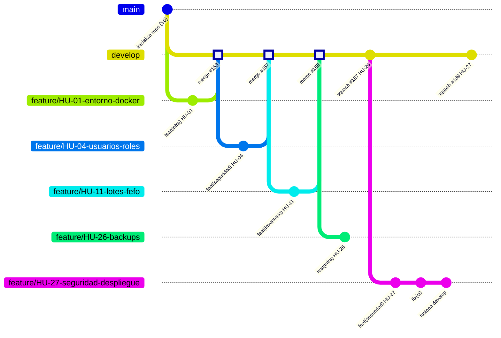

# 6.4 a 6.6 Repositorio: resumen de GitHub, ramificación y estrategia de fusión

> **Estado:** borrador del Sprint 3 · **Autor:** Orlando (SM) · **Revisa:** Evelyn · **Fuente:** [02 §2.2](../plan/02_mapeo_plantilla.md), [06 §6.2 a §6.6](../plan/06_github_ci_infra.md), [docs/dev/release.md](../dev/release.md), [4.3.1](04_03_infraestructura.md)
>
> Mide el **estado real del repositorio al 23/11/2026** (`develop` en `1e303ed`). Los datos salen de `gh` y `git` en modo de solo lectura y están guardados con fecha en [`S3-informe6_evidencia_github.txt`](../capturas/sprint-3/S3-informe6_evidencia_github.txt) y en la tabla de los 49 PR [`S3-informe6_prs_fusionados.tsv`](../capturas/sprint-3/S3-informe6_prs_fusionados.tsv). Lo que todavía no existe (tag `v1.0.0`, Releases y paquete en GHCR) se dice como pendiente: **se publica en el Gate 0 con [`docs/dev/release.md`](../dev/release.md)**. De Evelyn son 6.1, 6.2, 6.3, 6.7, 6.8 y 6.12; aquí solo se enlazan.

## 6.4 Resumen del GitHub

### Tabla 26. Qué hay en GitHub y su estado

| Elemento | URL o ubicación | Estado al 23/11/2026 |
|---|---|---|
| Repositorio | <https://github.com/orlando572/erp-donofrio> | **Público**, licencia LGPL-3.0, rama por defecto `develop` (para que `Closes #n` cierre las épicas al fusionar) |
| Ramas | `develop` (integración) y `main` (entregado) | Ambas **protegidas** (ver Tabla 27). `main` conserva el commit inicial del Sprint 0 (`284e9bf`) y va 76 commits detrás de `develop`: aún no se ha hecho ningún PR `develop` → `main` |
| Pull requests | <https://github.com/orlando572/erp-donofrio/pulls?q=is%3Apr> | **49** PR, todos **fusionados** y a `develop` (0 abiertos, 0 cerrados sin fusionar). 30 de Orlando y 19 de Evelyn |
| Actions | <https://github.com/orlando572/erp-donofrio/actions> | 3 workflows: `CI` (`ci.yml`), `Release` (`release.yml`) y `Pruebas no funcionales` (`perf.yml`, solo manual). **109 ejecuciones** (Tabla 28) |
| Releases | <https://github.com/orlando572/erp-donofrio/releases> | **No hay ninguna** (`gh release list` vacío, 0 tags). `v1.0.0` y el zip del código fuente se publican en el Gate 0 con `docs/dev/release.md` |
| Paquete (GHCR) | `ghcr.io/orlando572/erp-donofrio` | **No existe todavía** (la página del paquete responde 404). `release.yml` solo publica cuando se empuja un tag `v*`; se publica en el Gate 0. El ensayo de la cadena (construir, probar y empaquetar sin publicar) corrió en el PR #190 con éxito |
| GitHub Project | <https://github.com/users/orlando572/projects/4> | Público, «Scrum ERP D'Onofrio», 22 ítems. Vistas, Insights y *Dailies* son de Evelyn ([6.2](../plan/02_mapeo_plantilla.md), 6.3) |
| Issues | <https://github.com/orlando572/erp-donofrio/issues> | 22 (11 abiertos y 11 cerrados); plantillas `epica.yml` y `bug.yml`. Lo explica Evelyn en 6.8 |
| Seguridad del repositorio | Settings → Code security | `secret scanning` y `push protection` **activos**; *Dependabot security updates* **desactivado** |

**Estructura del repositorio.** Es la prevista en [06 §6.1](../plan/06_github_ci_infra.md) con estas diferencias, comprobadas en el árbol de `develop`: existe `addons/donofrio_base/` (la Fase 1; los módulos de la Fase 2 no existen), `docker/` (Odoo, PostgreSQL, Nginx), `scripts/` (18 scripts y la carpeta `perf/`; entre ellos los `verificar_*.sh`), `docs/` (`plan`, `informe`, `capturas`, `scrum`, `pm`, `dev`, `diagramas`, `manuales`, `usabilidad`) y `.github/` con 3 workflows, 2 plantillas de *issue* y la plantilla de PR.

**Plan frente a realidad en `.github/`.** No existen `dependabot.yml`, `CODEOWNERS`, `cd.yml`, `.pre-commit-config.yaml` ni la plantilla `solicitud_cambio.yml` de [09 §9.3](../plan/09_normas_marcos.md). La calidad del código la comprueba el job `lint` con `scripts/check_legacy.sh` y `ruff` 0.8.4 (no `pylint-odoo` ni *pre-commit*), y la solicitud de cambio es el propio PR con su plantilla (anexo [10.4](anexo_10_04_rfc.md)).

### Tabla 27. Protección de ramas (`gh api …/branches/{rama}/protection`, 23/11/2026)

| Regla | `develop` | `main` |
|---|---|---|
| Aprobaciones requeridas del PR | 1 | 1 |
| Descartar aprobaciones al cambiar el código (`dismiss_stale_reviews`) | Sí | Sí |
| Checks obligatorios | **`lint` y `test`** | **Ninguno** |
| Resolver las conversaciones antes de fusionar | Sí | Sí |
| *Force push* y borrado de la rama | Prohibidos | Prohibidos |
| Historial lineal / commits firmados | No | No |
| **Aplica a administradores (`enforce_admins`)** | **No** | **No** |

El plan pedía «1 aprobación y CI en verde» en `main`; en la realidad `main` exige la aprobación pero **no** tiene checks obligatorios (se pondrán al abrir el primer PR de release, porque hoy `main` no tiene commits que probar). Los *rulesets* no se usan (0).

### Tabla 28. Ejecuciones de GitHub Actions (23/11/2026)

| Workflow | Ejecuciones | Resultado | Cuándo corre |
|---|---|---|---|
| **CI** | 108 | 96 correctas · 10 canceladas · **2 en rojo** | `pull_request` (62), `push` a `develop` y `main` (45) y `schedule` semanal (1: lunes 06:00 hora de Lima) |
| **Release** | 1 | 1 correcta (ensayo del PR #190) | Tag `v*` (publica), PR que toque la release o ejecución manual (ensayo) |
| **Pruebas no funcionales** | 0 | — | Solo manual (`workflow_dispatch`): k6 y ZAP |

Los **jobs de `ci.yml`** y su resultado acumulado:

| Job | Qué hace | Ejecuciones | Resultado | Duración (mediana · máx.) |
|---|---|---|---|---|
| `lint` | `scripts/check_legacy.sh` y `ruff check addons` (0.8.4) | 101 | 101 correctas | 13 s · 18 s |
| `test` | Construye la imagen y corre `scripts/test.sh` (todos los tests de `addons/`) | 101 | 98 correctas · 3 canceladas | 133 s · 199 s |
| `replica` | Levanta la réplica y corre `verificar_replica.sh` (HU-25) | 38 | 38 correctas | 32 s · 245 s |
| `backup` | Respaldo, restauración en una base nueva y retención con `verificar_backup.sh` (HU-26) | 36 | 36 correctas | 75 s · 97 s |
| `proxy` | Nginx con TLS y `verificar_despliegue.sh` (HU-27) | 32 | 29 correctas · **2 en rojo** · 1 cancelada | 87 s · 119 s |

Los jobs `replica`, `backup` y `proxy` se agregaron en el Sprint 3, por eso tienen menos ejecuciones. Las **2 ejecuciones en rojo** son del PR #189 (HU-27): el paso de verificación del despliegue falló, en la segunda con «no acepta tls1_3» y «ningún intento se bloqueó» (el script de verificación usaba `openssl` y contaba mal el bloqueo por *worker*); se corrigió en el mismo PR y se fusionó con el CI en verde. Es la evidencia de que el control funciona. Las **10 canceladas** las reemplazó una corrida más reciente del mismo grupo de concurrencia; no son fallos. De la corrida programada hay **una** ejecución (éxito, id `45279340817`).

**Capturas pendientes.** Las del plan ([06 §6.6](../plan/06_github_ci_infra.md): página principal, Releases con el zip, paquete GHCR, reglas de protección, Insights) se toman en el Gate 0, cuando existan la release y el paquete. Hoy la evidencia es el texto fechado de arriba.

## 6.5 Ramificación

### Esquema real

| Rama | Propósito | Cómo se usó (de los 49 PR) |
|---|---|---|
| `main` | Lo entregado y aceptado; un tag por entrega (`v1.0.0` = núcleo) | Solo tiene el commit inicial. **Sin PR de release todavía** |
| `develop` | Integración continua del sprint | Base de los 49 PR; 77 commits |
| `feature/HU-xx-*` | Una HU | **30 ramas** (tipo `feature/`); 28 son de una HU y 2 son de informe (`feature/S3-informe-4-2` y `S3-informe-5`) |
| `docs/*` | Avance del informe y de Scrum | **16 ramas** (`docs/s1-planning`, `docs/s2-review-retro`…) |
| `fix/*` | Corrección de un defecto | **1 rama**: `fix/HU-09-vigencia-hora-lima` |
| `chore/*` | Mantenimiento (no está en el plan) | **2 ramas**: `chore/s0-cierre-windows` y `chore/ci-no-cancelar-develop` |
| `hotfix/*` | Corrección urgente sobre `main` | **No se usó** |

**Diferencias con [06 §6.2](../plan/06_github_ci_infra.md):** (1) aparecieron las ramas `chore/*`; (2) los PR del informe del Sprint 3 salieron de `feature/S3-informe-*` y no de `docs/*`; (3) la rama de corrección lleva la HU y no el número del *issue* (`fix/HU-09-…`). Ninguna rama vive más de unas horas: el proyecto entero (de la creación del repositorio a hoy) ocurrió el 22 y el 23/11/2026.

### Figura 12. Flujograma de ramas (`gitGraph`)

Resumen fiel del esquema real. `develop` sale del commit inicial de `main`; cada HU vive en su rama y vuelve por PR. Hasta el Sprint 2 los PR se fusionaron con *merge commit* (rombo resaltado) y desde el #184 con *squash* (un solo commit por PR). `develop` → `main` con *merge commit* y tag es el paso del Gate 0, **todavía no ejecutado**, y por eso no aparece en el gráfico.

*Lectura.* Las ramas `feature/HU-26-backups` y `feature/HU-27-seguridad-despliegue` traen un commit «fusiona develop»: es la forma de resolver los conflictos (6.6). El paso final `develop` → `main` + `tag v1.0.0` se hace en el Gate 0 y aparecerá en este gráfico entonces.

### Listado real de ramas

**Remotas** (`git branch -r`, 23/11/2026): 15, de las cuales 2 están protegidas.

| Rama remota | Estado |
|---|---|
| `main` | Protegida; sin avance desde el Sprint 0 |
| `develop` | Protegida; rama de integración |
| `docs/s2-aceptacion-po`, `docs/s3-planning` | PR #184 y #185 fusionados (squash); la rama sigue en el remoto |
| `feature/HU-23-tablero-estandar`, `HU-25-replica`, `HU-26-backups`, `HU-27-seguridad-despliegue`, `HU-28-k6-zap`, `HU-28-lighthouse`, `HU-29-release`, `HU-30-usabilidad`, `HU-33-tests-compra-op` | PR #188, #186, #187, #189, #196, #194, #190, #195 y #192, todos fusionados (squash); la rama sigue en el remoto |
| `feature/S3-informe-4-2`, `feature/S3-informe-5` | PR #197 y #198 fusionados (squash) |

Las 13 ramas de trabajo que quedan en el remoto **ya están fusionadas**: GitHub las ve «por delante» de `develop` porque el *squash* crea otro commit; no tienen trabajo sin fusionar. Las otras **36** ramas de los 49 PR se borraron al fusionar (`delete_branch_on_merge = true`). Esta rama (`feature/S3-informe-6`) se suma a la lista al abrir su PR.

**Fusionadas** (por el encabezado de cada PR): 49 ramas en total: 30 `feature/*`, 16 `docs/*`, 2 `chore/*` y 1 `fix/*`. La tabla completa, con número de PR, autor, quién fusionó y método, está en [`S3-informe6_prs_fusionados.tsv`](../capturas/sprint-3/S3-informe6_prs_fusionados.tsv).

## 6.6 Merge strategy

### Lo que dice el plan

1. PR de `feature/*` a `develop` con la plantilla ([`.github/pull_request_template.md`](../../.github/pull_request_template.md)).
2. Revisión cruzada del otro integrante con la checklist de la DoD.
3. **Squash and merge** a `develop`, un commit por HU.
4. `develop` → `main` con **merge commit** (no *squash*) y tag.
5. Conflictos: `git rebase origin/develop` en la rama antes de fusionar.

### Lo que se hizo (discrepancias plan–realidad)

| Punto | Plan | **Realidad al 23/11/2026** |
|---|---|---|
| Método a `develop` | Siempre *squash* | **Mixto: 32 *squash* y 17 *merge commit*.** Los 17 *merge commit* son todos hasta el PR #183 (Sprint 0, 1 y 2): #151, #153 a #158, #160, #166, #169, #173 a #177, #180 y #183. **Desde el #184 (cierre del Sprint 2) los 15 PR son *squash*** (el repositorio permite los dos métodos: `allow_squash_merge` y `allow_merge_commit` en `true`; el *rebase* está desactivado). Desde ese PR coincide con el plan: un commit por PR |
| Historial de `develop` | Un commit por HU | `git log --first-parent origin/develop`: 50 commits (1 raíz, 32 *squash* y 17 *merge commit*); el historial de los primeros sprints conserva los commits de cada rama |
| Revisión cruzada | 1 aprobación del otro integrante | **46 de 49 PR** (94 %) con aprobación vigente del otro integrante; en los 49 revisó el otro. Los otros **3** (#154, #155 y #156, del Sprint 1) se fusionaron con la aprobación **descartada** al cambiar su base a `develop` y con el código ya revisado y los checks en verde (4.3.1) |
| Quién fusiona | El revisor | 26 PR los fusionó su propio autor **después** de la aprobación del otro; 23 los fusionó el otro integrante |
| Conversaciones resueltas | Obligatorio | Activado en las dos ramas; **0** comentarios en línea de código (la revisión se dejó en la aprobación y en 3 comentarios de conversación) |
| Aprobación al cambiar el código | — | `dismiss_stale_reviews` está activo: **13 revisiones** de 11 PR se descartaron al hacer un push nuevo y hubo que volver a aprobar |
| Conflictos | `git rebase` | **Se resolvieron fusionando `develop` en la rama (merge, no *rebase*)**, sin *force push*. Ver abajo |
| `develop` → `main` | *Merge commit* con tag | **Aún no ocurrió**; se hace en el Gate 0 (`docs/dev/release.md`) |

Con el método real, el *merge commit* de los primeros sprints es una **forma válida** de conservar el detalle de cada rama, y el *squash* del Sprint 3 es el del plan. La documentación del plan ([06 §6.2](../plan/06_github_ci_infra.md)) se mantiene como objetivo; el informe documenta la realidad.

### Conflictos y su resolución

Un conflicto aparece cuando otro PR toca los mismos archivos entre que se abre el PR y se fusiona. **8 PR** integraron `develop` dentro de su rama con un *merge commit* (9 *merge commits* en total): #168, #170, #179, #187, #189 (dos veces), #192, #194 y #196. Tres lo explicaron en un comentario del PR:

| PR | Qué chocó | Cómo se resolvió |
|---|---|---|
| #187 (HU-26) | `ci.yml` con la HU-25 (réplica) | Se fusionó `develop` en la rama y se conservaron los jobs `lint`, `test`, `replica` y `backup` |
| #189 (HU-27) | `__manifest__.py` y `tests/__init__.py` con la HU-23 (dashboards); antes, `ci.yml` con la HU-26 | Cambios **aditivos**: se conservaron las dependencias, los datos y los tests de las dos HU; `donofrio_base` pasó 117 pruebas |
| #192 (HU-33) | `tests/__init__.py` con el test de ventas de Evelyn (#191, también HU-33) | Se fusionó `develop` y se conservaron los dos tests; 125 pruebas sin errores |

De los otros 5 PR con *merge* de `develop` (#168, #170, #179, #194 y #196) no hay comentario que describa un conflicto: el *merge commit* solo los puso al día con `develop` y, en #194, conservó las secciones de HU-28 y HU-32 del README de capturas. El número exacto de conflictos con edición manual no se registró; con evidencia hay **al menos 3 PR** (#187, #189 y #192). Los conflictos se concentraron donde el plan lo preveía: `donofrio_base` (`__manifest__.py`, `tests/__init__.py`), `ci.yml` y `docs/`.

**Límite.** Como cada fusión de `develop` en una rama descarta la aprobación (`dismiss_stale_reviews`), el PR vuelve a revisarse: lo anotó el propio autor en el #192 («hace falta aprobar de nuevo cuando el CI termine»).

### Limitación conocida: `enforce_admins` desactivado

Las reglas de `develop` y `main` (Tabla 27) **no aplican a los administradores** (`enforce_admins = false`). El repositorio tiene **un solo administrador, Orlando** (`orlando572`, rol *admin*); Evelyn tiene rol *write* (`gh api …/collaborators`) y sí queda sujeta a las reglas. En la práctica, Orlando podría fusionar sin aprobación o sin CI, y su propio PR no lo frena la regla de la aprobación del otro integrante. **Se usó dos veces con motivo documentado** (los PR #152 y #153 del Sprint 1, abiertos antes de que existiera el CI, fusionados con la aprobación de Evelyn) y en los PR #154 a #156 (aprobación descartada al cambiar la base). Desde el Sprint 2 los PR se abren directos contra `develop` y no se repitió. **No se activó**: el informe no registra un motivo; queda como mejora (activar `enforce_admins` en `develop` y `main`) antes de la entrega. *Mitigaciones:* los PR de los 3 sprints pasan por la plantilla con la DoD, la aprobación del otro integrante se registra en GitHub y el CI corre en cada PR. Este es el control **C-14** de [5.11](05_10_a_05_12_seguridad.md) (estado «Parcial»).

### Evidencia

| Qué | Dónde |
|---|---|
| Configuración del repo, protección de ramas, PR, Actions, releases | [`S3-informe6_evidencia_github.txt`](../capturas/sprint-3/S3-informe6_evidencia_github.txt) |
| Los 49 PR: método, autor, quién fusionó, aprobación y merges de `develop` | [`S3-informe6_prs_fusionados.tsv`](../capturas/sprint-3/S3-informe6_prs_fusionados.tsv) |
| Trazabilidad requisito → HU → PR | [`trazabilidad.md`](trazabilidad.md) |
| Excepciones del Sprint 1 y reglas de protección | [4.3.1](04_03_infraestructura.md) |
