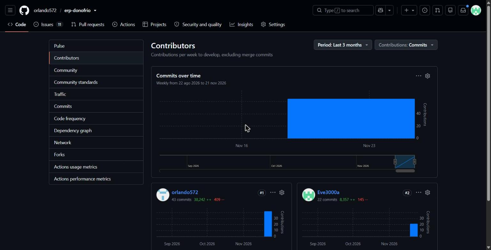

# 6.7 y 6.8 Resumen de commits y de issues

> **Estado:** borrador del Sprint 3 · **Autora:** Evelyn (PO) · **Revisa:** Orlando · **Fuente:** [02 §2.2](../plan/02_mapeo_plantilla.md), [06 §6.7 y §6.8](../plan/06_github_ci_infra.md), [04 §4.11](../plan/04_scrum_pmbok.md)
>
> Las cifras se miden con [`scripts/estadisticas_repo.py`](../../scripts/estadisticas_repo.py) (solo lectura, repetible) y están guardadas con fecha en [`S3-informe6_estadisticas_commits_issues.md`](../capturas/sprint-3/S3-informe6_estadisticas_commits_issues.md). **Fecha de corte: 23/11/2026**, con `develop` en `c00de8e`; son 54 PR fusionados.

## 6.7 Resumen de commits

### Convención

Los commits siguen **Conventional Commits en español** con la etiqueta de la historia de usuario o del sprint al final:

```
feat(facturacion): factura (01) y boleta (03) con IGV desde el pedido, en su diario [HU-15]
docs(informe): 4.7 métricas clave, KPI y acuerdos de nivel de servicio [S3]
```

El tipo (`feat`, `fix`, `docs`, `test`, `perf`, `chore`, `ci`…) dice qué cambia; el alcance, dónde; y la etiqueta `[HU-xx]` o `[Sn]`, a qué trabajo pertenece. Como `develop` se fusiona con **squash** (un commit por PR), **lo que queda en la historia es el título del PR**, y es ahí donde se exige la etiqueta.

### Estadísticas por autor

**Commits que quedaron en `develop`** (sin contar los de fusión), según GitHub Insights → Contributors:

| Autor | Commits en `develop` | Líneas agregadas | Líneas quitadas |
|---|---|---|---|
| Orlando (`orlando572`) | 43 | 38 242 | 409 |
| Evelyn (`Eve3000a`) | 22 | 8 357 | 145 |
| **Total** | **65** | 46 599 | 554 |



Hay 82 commits en total en `develop`: los 65 de arriba y 17 de fusión. Las cifras de líneas incluyen datos, pruebas, documentación y diagramas, y las cuenta GitHub; no miden esfuerzo, solo volumen.

**Commits dentro de los PR** (el trabajo antes del *squash*, con el login de GitHub):

| Autor | PR fusionados | Commits dentro de los PR | % |
|---|---|---|---|
| orlando572 | 32 | 57 | 61 % |
| Eve3000a | 22 | 36 | 39 % |
| **Total** | **54** | **93** | 100 % |

**Una sola persona con dos firmas.** Evelyn aparece con dos correos en `git` (19 commits con su correo de GitHub y 3 con un correo personal); es la misma persona y sus 22 commits se cuentan juntos.

### Tipos de commit

| Tipo | Cantidad |
|---|---|
| `docs` | 50 |
| `feat` | 24 |
| `chore` | 6 |
| `test` | 5 |
| `fix` | 3 |
| `ci` | 1 |
| `perf` | 1 |

El proyecto es mayormente **documentación y configuración**: el 54 % de los commits son `docs` (el informe, las actas y las evidencias) y el 26 %, `feat` (módulos y datos).

### Cumplimiento de la convención

| Regla | Resultado |
|---|---|
| Commits que siguen Conventional Commits | **90 de 93 (97 %)** |
| Commits que llevan la etiqueta `[HU-xx]` o `[Sn]` | 25 de 93 (27 %) |
| **Títulos de PR** (lo que queda en `develop`) con convención y etiqueta | **53 de 54 (98 %)** |

- **Los 3 commits fuera de la convención** son commits de fusión escritos a mano al resolver conflictos (`merge: integra develop (…)`, en los PR #168, #170 y #179). Usan un tipo, `merge:`, que no es de Conventional Commits.
- **El 27 % de commits con etiqueta es bajo a propósito de la regla:** la etiqueta se exige en el **título del PR**, que es el commit que sobrevive al *squash*; los commits intermedios de una rama no siempre la llevan. Con esa medida, **53 de 54 PR cumplen**.
- **El PR fuera de la regla** es el #176 (capturas de HU-11, HU-12 y HU-14 del S2): su título no lleva etiqueta.

### Qué se aprendió

- La regla de la etiqueta en el título del PR funciona y deja una historia legible: cada commit de `develop` se enlaza con una HU o un sprint.
- Falta una regla para los commits de fusión; se sugiere **no hacerlos a mano** (rebasar la rama) o usar el tipo `chore(merge)`.

## 6.8 Resumen de issues

### Qué hay

GitHub tiene **22 issues** (11 abiertos y 11 cerrados). **Ninguno es de tipo «bug»** (aún no se registró ningún defecto de software; las fallas del servicio van a la mesa de servicios de TI, no a GitHub). Las épicas agrupan las HU de un área y un dueño, con una checklist de HU dentro de cada una.

| Tipo | Total | Abiertos | Cerrados |
|---|---|---|---|
| Épica | 15 | 6 | 9 |
| Gestión | 7 | 5 | 2 |

| Fase | Total | Abiertos | Cerrados |
|---|---|---|---|
| Fase 1 (núcleo) | 17 | 6 | 11 |
| Fase 2 (módulos propios) | 5 | 5 | 0 |

| Área | Total | Abiertos | Cerrados |
|---|---|---|---|
| docs | 6 | 5 | 1 |
| infra | 6 | 0 | 6 |
| ventas | 3 | 2 | 1 |
| extras | 2 | 0 | 2 |
| gerencia | 2 | 2 | 0 |
| producción | 2 | 1 | 1 |
| logística | 1 | 1 | 0 |

### Etiquetas y milestones

Cada issue lleva tres etiquetas: **`tipo:`** (épica, gestión o bug), **`area:`** (ventas, logística, producción, gerencia, infra, extras o docs) y **`fase-`** (1 o 2). Y un **milestone** por sprint:

| Milestone | Total | Abiertos | Cerrados |
|---|---|---|---|
| Sprint 0 – Inicio | 4 | 2 | 2 |
| Sprint 1 – Fundaciones | 3 | 0 | 3 |
| Sprint 2 – Procesos estándar | 4 | 0 | 4 |
| Sprint 3 – Calidad del núcleo | 4 | 2 | 2 |
| Sprint 4 – Módulos propios | 5 | 5 | 0 |
| Cierre | 2 | 2 | 0 |

Los abiertos del Sprint 0 son el registro de riesgos (#131) y las dailies (#132), que se cierran al final del proyecto.

### Cierre de issues con los PR

Cada PR dice en su descripción a qué épica pertenece:

| Forma | PR | Cuándo se usa |
|---|---|---|
| `Parte de #n` | 35 | El PR es parte de la épica, pero no la termina |
| `Closes #n` | 5 | **El último PR de la épica**, que la cierra al fusionarse |
| Sin enlace a una épica | 14 | Documentación, capturas y actas que no son parte de una HU |

La regla es que **solo el último PR de una épica la cierra** (`Closes`), para que una épica no se cierre con trabajo a medias. Ejemplo: HU-16 cerró la épica #139 («Transacciones de demostración») con `Closes #139` porque era la única HU que quedaba.

### Prevención de defectos

- Una **plantilla de PR** con checklist (Definition of Done) y una plantilla de **bug** (`bug.yml`) para registrar defectos del software, con pasos para reproducir.
- **CI obligatorio** (`lint` y `test`): ningún PR se fusiona con el CI en rojo.
- **Revisión del otro integrante** en todos los PR.
- **Pruebas** que fallan si se rompe lo ya hecho (136 pruebas de `donofrio_base` al 23/11/2026).

### Hallazgos de gestión

- Las épicas #140 y #142 están cerradas, pero su tarjeta del Project sigue en «Backlog» ([6.3](06_01_a_06_03_equipo_sprints_y_project.md#hallazgos-de-gestión-al-23112026)).
- Quedan 14 PR sin enlace a una épica: son documentación; se aceptan porque no cierran trabajo de una HU.
