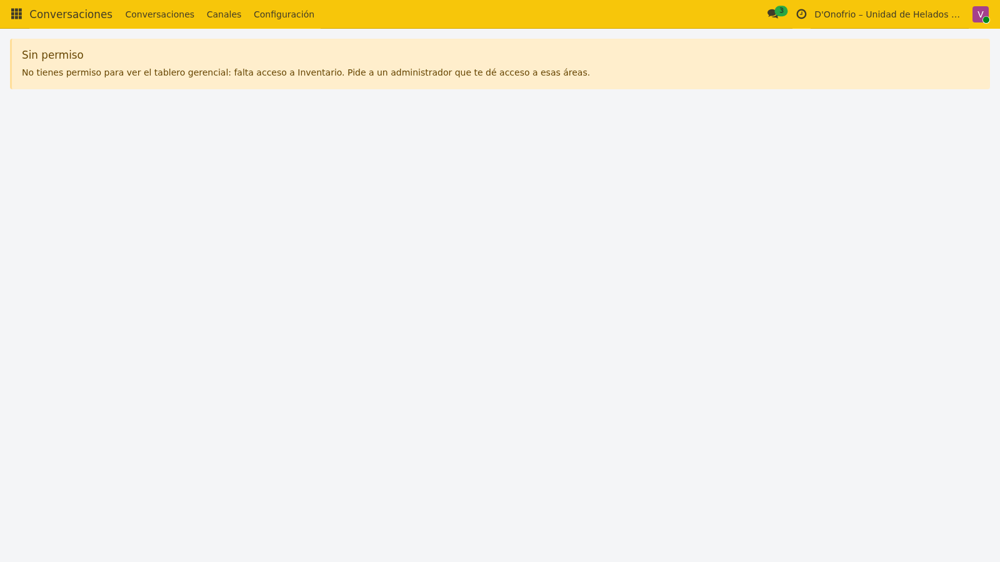

# 6.12 Pruebas de usabilidad

> **Estado:** versión final del Cierre (25/11/2026) · **Autora:** Evelyn (PO) · **Revisa:** Orlando · **Requisito:** RNF003 (interfaz en español y tareas clave en ≤ 3 pasos)

## Método

La usabilidad se evaluó con tres técnicas que el equipo aplicó sobre el sistema con los datos de demostración (HU-16):

1. **Revisión pantalla por pantalla por roles** del 25/11/2026, con los usuarios administrador, inspector de calidad, vendedor y gerente, sobre las vistas de lista y de formulario de cada módulo.
2. **Nota de accesibilidad** sobre el contraste de color de la marca y de las alertas (WCAG 2.1), calculada en 4.6.1.
3. **Evaluación heurística** de las pantallas de M1 a M4 con las 10 heurísticas de usabilidad de Nielsen (Nielsen, 1994), contrastada con las capturas de 1600 × 900 del proyecto.

## Revisión por roles del 25/11/2026

Cada rol recorrió sus pantallas con los datos de la demostración completa. La revisión encontró cuatro tipos de problemas, todos corregidos y fusionados con la HU-16 (PR #230):

| Rol | Hallazgo | Qué se corrigió |
|---|---|---|
| Administrador | Al imprimir el certificado de calidad aparecía un error 403 (sin permiso) | El administrador entra a los grupos de jefatura de calidad y de heladeros; hay pruebas de esa pertenencia |
| Administrador | Textos en inglés: el nombre del contacto y del empleado del administrador, el diario «Punto de venta», las referencias de los asientos | Se pasaron a español («Administrador», «Punto de venta», referencias en español) |
| Vendedor, inspector y gerente | Fechas fuera de la ventana de datos de demostración (3/8 al 22/11/2026): asientos, albaranes, cotizaciones y compras | Se llevaron a la ventana; las listas y los filtros por fecha muestran datos coherentes |
| Todos | Plazos de los tickets de la mesa de servicios fuera de la ventana de datos | Los tickets abiertos y los resueltos quedaron con plazo dentro de la ventana |

El vendedor, que no tiene acceso a Inventario, recibe en el tablero gerencial un aviso claro y no una pantalla en blanco (figura siguiente).

*Aviso del tablero gerencial para un usuario sin acceso a Inventario: dice qué falta y a quién pedirlo.*

## Accesibilidad

El contraste de los pares de color de la marca y de las alertas se calculó con la fórmula de WCAG 2.1 (mínimo 4.5 para texto normal; ver 4.6.1). Los pares de texto y fondo usados en las pantallas cumplen el mínimo; el amarillo de marca no se usa como color de texto (contraste 1.61) y los colores de alerta siempre van acompañados de un texto, como en el resultado «Cumple» y «No cumple» de la inspección.

## Evaluación heurística de M1 a M4

| Heurística de Nielsen | Qué se observa en las pantallas | Captura |
|---|---|---|
| 1. Visibilidad del estado del sistema | La inspección muestra su barra de estado (Pendiente, En medición, Aprobado, Rechazado) y cada punto de control su resultado; la lectura fuera de rango lleva el sello «Fuera de rango»; la liquidación muestra Borrador, Despachado y Liquidado | HU-17_inspeccion_rechazada.png, HU-19_lectura_fuera_de_rango.png, HU-20_liquidacion_confirmada_con_pedido.png |
| 2. Coincidencia con el mundo real | Se usan los términos del negocio (heladero, liquidador, lote, cámara de frío, punto de control) y los importes en soles | HU-20_liquidacion_confirmada_con_pedido.png |
| 3. Control y libertad del usuario | La liquidación despachada ofrece «Volver a borrador» y las actividades se pueden marcar como hechas, editar o cancelar | HU-21_formulario_con_imprimir_y_liquidador.png, HU-19_lectura_fuera_de_rango.png |
| 4. Consistencia y estándares | Todas las aplicaciones comparten la barra superior amarilla de la marca (HU-24) y los patrones estándar de Odoo; la pantalla de acceso lleva el logotipo y los colores de la marca | HU-24_login_marca.png, HU-24_marca_barra_superior.png |
| 5. Prevención de errores | Un punto de control sin medir no deja aprobar la inspección, rechazar exige un motivo y un lote rechazado no se despacha (5.5b) | HU-17_inspeccion_rechazada.png |
| 6. Reconocer en vez de recordar | La lista de inspecciones muestra el estado de cada una en una insignia y ofrece el filtro «Por medir»; la liquidación muestra el heladero, la lista de precios y el pedido ligado | HU-17_lista_inspecciones.png |
| 7. Flexibilidad y eficiencia | El tablero tiene un selector de almacén y la liquidación un botón «Imprimir» para el PDF; las listas se filtran y se agrupan con los controles estándar | HU-22_tablero_filtro_arequipa.png, HU-21_formulario_con_imprimir_y_liquidador.png |
| 8. Diseño estético y minimalista | El tablero reúne seis tarjetas, un gráfico de ventas por mes y una tabla por canal; en una ventana de 375 px las tarjetas pasan a una columna. Los meses de junio y julio salen sin barra porque los datos de demostración empiezan en agosto | HU-22_tablero_todos_los_almacenes.png |
| 9. Ayudar a reconocer y recuperarse de errores | El aviso «Sin permiso» dice qué acceso falta y a quién pedirlo; el error 403 del certificado del administrador se corrigió el 25/11 | HU-22_tablero_sin_permiso_vendedor.png |
| 10. Ayuda y documentación | Los campos «Comisión (%)» y «Diferencia de efectivo» llevan una ayuda emergente con la explicación; el informe y los manuales describen cada caso de uso | HU-20_liquidacion_confirmada_con_pedido.png |

Dos hallazgos de la evaluación se anotan como mejoras de bajo costo. Primero, el mensaje automático del historial de la liquidación sale en inglés («created»), por lo que se propone traducirlo con el resto de los textos del módulo. Segundo, en la lista de inspecciones las pendientes aparecen sin inspector asignado hasta que se inicia la medición, lo que es coherente con el flujo pero conviene explicar en el manual de usuario.

## Qué cubre y qué no

- La revisión por roles y la evaluación heurística las hizo el propio equipo con datos de demostración, no usuarios reales de D'Onofrio (distribuidores, heladeros, cajeros).
- Las capturas son de un solo navegador de escritorio y de una ventana de 375 × 812 (5.5e.6.1).
- El criterio de RNF003 (interfaz en español y tareas clave en tres pasos o menos) queda respaldado por estas tres técnicas y por la interfaz en español (`es_PE`, HU-03); no se afirma una medición con tiempos por tarea.
