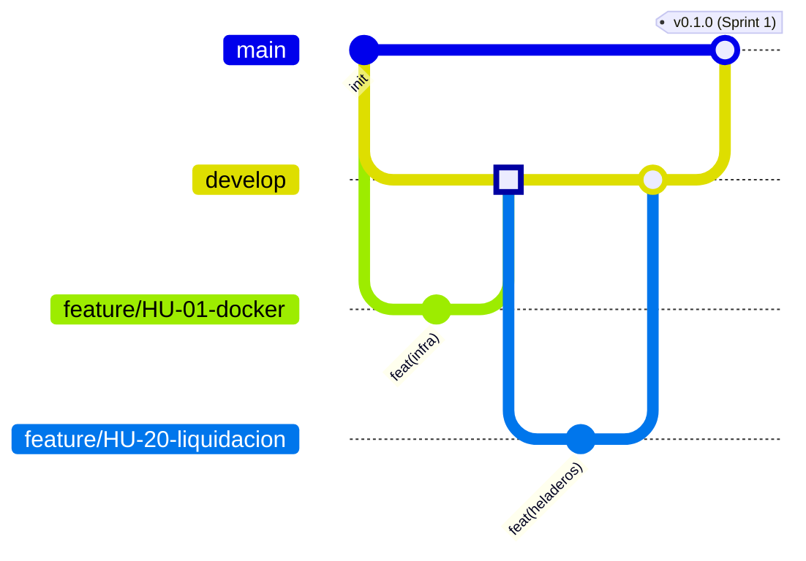

# 6. Flujo en GitHub, CI/CD e infraestructura

[← Índice](PLAN_PROYECTO.md)

## 6.1 Estructura del repositorio

El nombre propuesto es `erp-donofrio`. El repo es privado durante el desarrollo; se hace público o se agrega al docente antes de la entrega (decisión abierta).

```
erp-donofrio/
├── addons/                         # Módulos propios (LGPL-3)
│   ├── donofrio_base/              # F1: configuración + datos maestros por área + tests (O + E)
│   ├── donofrio_calidad/           # F2-M1/M3: inspecciones, certificado QWeb, cadena de frío (O)
│   ├── donofrio_heladeros/         # F2-M2: liquidación diaria + QWeb (E)
│   └── donofrio_tablero/           # F2-M4: tablero OWL + SCSS de marca (E)
│                                   # (los módulos de la F2 solo llegan a develop/main cuando cumplen su DoD)
├── docker/
│   ├── odoo/Dockerfile             # FROM odoo:19.0-<fecha>; clona OCA en commit fijo
│   ├── odoo/odoo.conf.template
│   ├── postgres/primary/           # postgresql.conf, pg_hba.conf, init-replicacion.sh
│   ├── postgres/replica/entrypoint-replica.sh
│   └── nginx/odoo.conf             # TLS, gzip, websocket, caché de assets
├── docker-compose.yml              # db + odoo; perfiles: replica, proxy, tools
├── .env.example                    # Variables (sin secretos reales)
├── scripts/
│   ├── init_db.sh                  # Crea la BD e instala los módulos donofrio_*
│   ├── cargar_transacciones.py     # odoo shell: 3-4 meses de movimientos (semilla fija)
│   ├── test.sh                     # Instala con --test-enable y filtra errores
│   ├── check_legacy.sh             # Mismos patrones que el hook (también en CI)
│   ├── backup.sh / restore.sh
│   ├── diccionario_datos.py        # information_schema + ir_model_fields → XLSX/MD
│   ├── schemaspy.sh                # ER en HTML/PNG
│   ├── burndown.py                 # gh project item-list --format json → burndown por puntos
│   └── perf/ (k6 *.js, lighthouse.sh, zap.sh)
├── docs/
│   ├── plan/                       # Este plan
│   ├── informe/                    # Borradores por sección (MD) + plantilla .docx + PDF final
│   ├── diagramas/                  # .bpmn, .puml, .drawio + PNG exportados
│   ├── capturas/sprint-N/          # Evidencias (HU-xx_*.png)
│   ├── scrum/sprint-N/             # planning, dailies, review, retro
│   ├── pm/                         # acta, interesados, comunicaciones, cierre
│   │   └── github-projects/        # definición de campos y vistas del Project (comandos gh)
│   ├── manuales/                   # Manual de instalación y de herramientas (MD → PDF)
│   └── dev/odoo19_cambios.md       # Ficha de cambios de Odoo 19 para el agente
├── .github/
│   ├── workflows/ci.yml, release.yml, cd.yml (opcional)
│   ├── ISSUE_TEMPLATE/ (historia.yml, bug.yml)
│   ├── pull_request_template.md
│   └── dependabot.yml              # Actions y Docker
├── .pre-commit-config.yaml         # ruff, pylint-odoo, check_legacy, prettier XML (opcional)
├── CLAUDE.md                       # Corto (ver 08)
├── .claude/settings.json + hooks/  # Hook anti-legacy
├── README.md
└── LICENSE
```

Los PDF de los documentos de origen (`TF_Lineamientos…`, plantilla) **no se suben al repo público**: son material del docente y quedan en `.gitignore`.

## 6.2 Ramas y merge strategy (secciones 6.5 y 6.6)



| Rama | Propósito | Reglas |
|---|---|---|
| `main` | Lo entregado y aceptado en cada Review | Protegida: solo PR desde `develop`, 1 aprobación y CI en verde; **tag por sprint de la F1** (`v0.1.0`, `v0.2.0`, **`v1.0.0` = núcleo entregable**) y **un tag por módulo de la F2** (`v1.1.0` calidad, `v1.2.0` heladeros, `v1.3.0` frío, `v1.4.0` tablero) |
| `develop` | Integración continua del sprint | Protegida: PR con 1 aprobación del **otro integrante** y CI en verde |
| `feature/HU-xx-descripcion-corta` | Una HU (o una tarea grande) | Sale de `develop` y vive como máximo unos 3 días |
| `fix/<issue>-descripcion` | Bug detectado en la Review o en pruebas | Igual que feature |
| `docs/<seccion>` | Avance del informe y diagramas | Revisión ligera (el otro integrante lee) |
| `hotfix/…` | Corrección urgente sobre `main` | Merge a `main` y a `develop` |

**Merge strategy:**
1. **Crear el PR:** `feature/*` → `develop` con la plantilla (HU, qué cambia, cómo probar, capturas, `Closes #n`).
2. **Revisión de código:** la hace el otro integrante con la checklist (DoD, sin patrones legacy, ACL, tests, textos en español). Los comentarios se resuelven en la misma rama.
3. **Fusión:**
   - `feature/*` → `develop` con **Squash and merge**, para dejar un commit por HU en un historial limpio.
   - `develop` → `main` con **Create a merge commit** (no squash), para conservar la trazabilidad de cada HU dentro de la release.
4. **Conflictos:** antes del merge se hace `git fetch && git rebase origin/develop` en la rama; el CI vuelve a correr. Como cada uno trabaja en módulos distintos, los conflictos se limitan a `donofrio_base` y `docs/`. En `donofrio_base` se separan los datos en un archivo por área para reducirlos.

## 6.3 Convenciones

**Commits** ([Conventional Commits](https://www.conventionalcommits.org/es/) en español): `tipo(alcance): descripción en imperativo [HU-xx]`.
- Tipos: `feat`, `fix`, `data`, `test`, `docs`, `ci`, `build`, `refactor`, `chore`.
- Alcances: `base`, `calidad`, `heladeros`, `tablero`, `infra`, `bd`, `informe`, `scrum`.
- Ejemplos:
  - `feat(heladeros): calcula vendido y comisión en líneas de liquidación [HU-20]`
  - `docs(informe): agrega BPMN AS-IS de liquidación [DOC-03]`
- Cada integrante hace commits **con su propia identidad de git y su cuenta de GitHub**. Las contribuciones por autor son evidencia de la sección 6.7 y de la nota individual.

**Issues:**
- Uno por HU (plantilla "Historia": como/quiero/para, criterios, puntos, RF/RNF) y uno por bug (plantilla "Bug": pasos, esperado, obtenido, captura, severidad).
- Etiquetas: `area:ventas|logistica|produccion|gerencia|extras|infra|docs`, `tipo:historia|bug|tarea`, `prioridad:alta|media|baja`.
- **Milestone** = sprint. Asignado = responsable.

**PR:**
- Título con el mismo formato que el commit.
- La plantilla incluye la checklist de la DoD.
- Revisor obligatorio: el otro integrante. Si un PR no se puede revisar dentro del mismo sprint, se anota como impedimento en la Daily.

## 6.4 CI con GitHub Actions

**`ci.yml`** se ejecuta en `pull_request` y `push` a `develop` y `main`, además de un `schedule` semanal (regresión de mantenimiento).

| Job | Qué hace | Detalle |
|---|---|---|
| `lint` | `pre-commit run --all-files` | `ruff` (lint y formato), `pylint-odoo` con `--valid-odoo-versions=19.0` (confirmar que la versión del plugin soporta 19.0), `scripts/check_legacy.sh` |
| `test` | Instala los módulos y corre los tests en Docker con Odoo 19 | `services: postgres:16`; el job corre en `container: odoo:19.0-<fecha fijada>` (o en la imagen propia construida en el job); comando: `odoo -d ci --db_host postgres --addons-path=/mnt/extra-addons,/usr/lib/python3/dist-packages/odoo/addons -i <módulos presentes en addons/> --test-enable --stop-after-init --log-level=test` (un paso previo arma la lista: en la F1 solo `donofrio_base`, y crece con cada módulo de la F2); el paso falla si el log contiene `ERROR` o `FAIL` (grep) |
| `upgrade` (opcional) | Prueba la actualización con `-u` sobre la BD del job anterior | Detecta errores de migración de datos `noupdate` |

**`release.yml`** se ejecuta al publicar un tag `v*`:
1. Construye `docker/odoo/Dockerfile` y lo publica en **GHCR** (`ghcr.io/<org>/erp-donofrio:<tag>`).
2. Genera `erp-donofrio-<tag>.zip` (`git archive`): es el entregable **"código fuente comprimido"**.
3. Crea la GitHub Release con las notas generadas a partir de los PR.

**`cd.yml`** (opcional, solo si hay VM): al publicar una release, se conecta por SSH (llave en GitHub Secrets) y ejecuta:
1. `docker compose pull`
2. `backup.sh`
3. `docker compose up -d`
4. `odoo -u donofrio_* --stop-after-init`
5. *smoke test*: `curl /web/health` y login

Si falla, hace *rollback* a la imagen del tag anterior. Si no hay VM, la sección 5.15 documenta el despliegue local o *on-premise* con el mismo procedimiento manual (`scripts/deploy.sh`).

**Secretos:**
- Contraseña maestra (`admin_passwd`), contraseña de PostgreSQL, contraseña del usuario de replicación y llave SSH → **GitHub Secrets** y `.env` (en `.gitignore`).
- Se activan *secret scanning* y Dependabot.

## 6.5 Infraestructura

### Docker Compose (diseño)

| Servicio | Imagen | Perfil | Puertos | Notas |
|---|---|---|---|---|
| `db` | `postgres:16` | (siempre) | 5432 (solo en la red interna; se expone a localhost para DBeaver) | Volumen `pgdata`; `healthcheck` con `pg_isready`; `wal_level=replica`, `max_wal_senders`, `hot_standby=on`; usuario `odoo` **sin superusuario**; `pg_stat_statements` |
| `odoo` | `build: docker/odoo` (FROM `odoo:19.0-<fecha>`) | (siempre) | 8069 (HTTP), 8072 (*websocket*/*longpolling*) | Monta `./addons` (desarrollo); volumen del *filestore*; `depends_on: db (healthy)`; en desarrollo `workers=0`; en el perfil `proxy`, `workers=2` y `proxy_mode=True`; `list_db=False`; `restart: unless-stopped` |
| `db-replica` | `postgres:16` | `replica` | 5433 (lectura) | La primera vez ejecuta `pg_basebackup -h db -U replicador -D $PGDATA -R -X stream`; queda en *hot standby* de solo lectura |
| `nginx` | `nginx:stable` | `proxy` | 443/80 | TLS autofirmado (local) o Let's Encrypt (VM); gzip; `Cache-Control` en `/web/assets`; *proxy* de `/websocket` → 8072 |
| `schemaspy` | `schemaspy/schemaspy` | `tools` | — | Genera el ER en `docs/diagramas/schemaspy/` |
| `uptime-kuma` (opcional) | `louislam/uptime-kuma` | `tools` | 3001 | Monitorea `/web/health` |

- **Versión de PostgreSQL:** Odoo 19 exige 13 o superior (`MIN_PG_VERSION = 13` en `release.py`). Se elige **16** por estabilidad y porque es una versión moderna con soporte vigente.
- **Imagen de Odoo:** se fija la etiqueta con fecha (por ejemplo `odoo:19.0-20261112`, disponible en Docker Hub al 22/11/2026) para que el CI y las PC usen exactamente la misma.
- **Recursos mínimos:** unos 4 GB de RAM libres para todos los perfiles. En PC limitadas, la réplica y las herramientas se levantan solo para tomar las evidencias.

### Replicación (sección 5.9)

- **Estrategia:** *streaming replication* física **primario → standby (maestro-esclavo)**, asíncrona, con *hot standby* de solo lectura.
- **Justificación:**
  - Es nativa de PostgreSQL y no necesita software extra.
  - Odoo escribe en un único primario.
  - La réplica sirve para lectura (reportes, DBeaver o BI) y como base de recuperación (promoción manual con `pg_ctl promote` / `SELECT pg_promote()`).
  - Multi-maestro no aplica: Odoo no lo soporta y es complejo.
  - La replicación lógica se menciona como alternativa no elegida.

**Evidencias:**
1. `SELECT client_addr, state, sync_state, replay_lag FROM pg_stat_replication;` en el primario.
2. `SELECT pg_is_in_recovery();` → `t` en la réplica.
3. Crear un producto en Odoo y consultarlo en la réplica con DBeaver.
4. Intentar `INSERT` en la réplica → error `read-only transaction`.
5. (Opcional) Promoción y reconexión.
6. Archivos de configuración y scripts como figura.

### Despliegue (sección 5.15)

- **Entornos:**
  - Desarrollo (PC de cada integrante).
  - CI (Actions).
  - "Producción" de demo: la PC de la exposición con el perfil `proxy`, o una VM opcional.
- **Enfoque:** *rolling* sobre un solo nodo, con **rollback por imagen etiquetada** y backup previo obligatorio. *Blue-green* se describe como mejora (dos stacks Compose detrás de Nginx), pero no se implementa.
- **Tabla 25 de la plantilla:**

| Herramienta | Uso |
|---|---|
| Git/GitHub | Control de versiones |
| Docker y Compose | Contenedores |
| GitHub Actions | CI/CD |
| GHCR | Registro de imágenes |
| Nginx | Proxy y TLS |
| Nube | VM opcional |
| Kubernetes | No aplica, se justifica |
| Uptime Kuma | Monitoreo |

- **URLs que se listan en el informe**, con el formato de la plantilla:
  - Repo
  - Release
  - Imagen GHCR
  - `https://<host>/odoo` (front y back)
  - `<host>:5432` (persistencia)
  - `<host>:5433` (réplica)

## 6.6 Evidencias para la sección 6.4 (y 6.5-6.10)

Se capturan al cierre de cada sprint en `docs/capturas/sprint-N/github/`, con fecha visible.

| # | Evidencia | Sección |
|---|---|---|
| 1 | Página principal del repo con el README y la estructura de carpetas | 6.4 |
| 2 | Lista de Releases y tags (`v1.0.0` núcleo + los de la F2 que se hayan alcanzado) con el zip adjunto; carpeta `docs/scrum/gates/` | 6.4 |
| 3 | Paquete GHCR publicado | 6.4 |
| 4 | Reglas de protección de `main` y `develop` | 6.4 / 6.5 |
| 5 | Listado de ramas (activas y fusionadas) + `git log --graph --oneline --all` + gitGraph de Mermaid | 6.5 |
| 6 | Un PR con revisión del otro integrante, comentarios resueltos, checks en verde y botón de *squash merge* | 6.6 |
| 7 | PR de release `develop` → `main` con *merge commit* | 6.6 |
| 8 | Historial de commits con la convención + **Insights → Contributors** (commits por autor) | 6.7 |
| 9 | Issues abiertos y cerrados con etiquetas y milestones; un issue de bug cerrado por un PR (`Closes #n`) | 6.8 |
| 10 | Pestaña Actions con ejecuciones en verde y un ejemplo en rojo corregido después (muestra que el control funciona) | 6.9 / 6.10 |
| 11 | Log del job `test` con el resumen de tests de Odoo | 6.10 |
| 12 | Insights → Pulse o Code frequency de todo el periodo (prueba de que el trabajo se repartió en el tiempo) | 6.4 / 6.7 |
